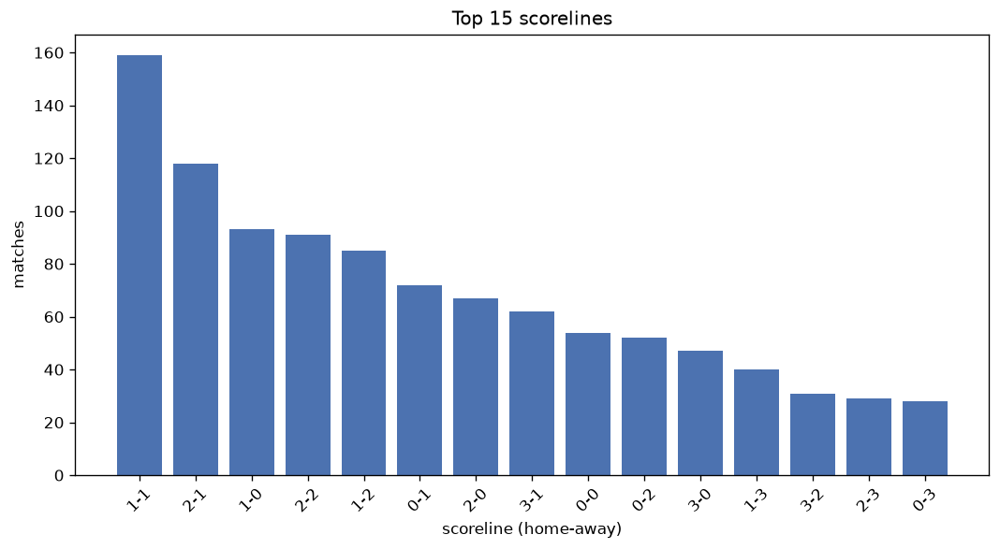
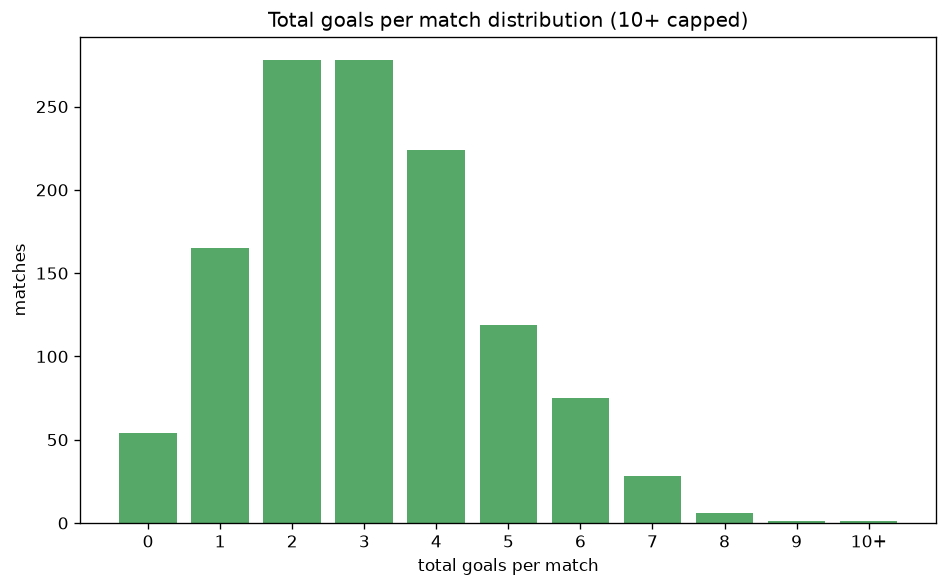

# Scoreline Analysis
- Report: `scoreline_analysis`
- Generated: 2026-10-29T02:17:53+00:00
- Script: `backend/scripts/analyze_scorelines.py` v1.0.0
- League: Super League (Switzerland)
- Scope: league `swiss1`

## 1. Scoreline frequency
- Matches analysed: **1232** across **7** seasons.
- Distinct scorelines seen: **41**.

| scoreline | count | pct |
|---|---|---|
| 1-1 | 159 | 12.9% |
| 2-1 | 118 | 9.6% |
| 1-0 | 94 | 7.6% |
| 2-2 | 91 | 7.4% |
| 1-2 | 85 | 6.9% |
| 0-1 | 72 | 5.8% |
| 2-0 | 67 | 5.4% |
| 3-1 | 62 | 5.0% |
| 0-0 | 55 | 4.5% |
| 0-2 | 52 | 4.2% |
| 3-0 | 47 | 3.8% |
| 1-3 | 40 | 3.2% |
| 3-2 | 31 | 2.5% |
| 2-3 | 30 | 2.4% |
| 0-3 | 28 | 2.3% |
| 4-0 | 24 | 1.9% |
| 4-1 | 23 | 1.9% |
| 3-3 | 22 | 1.8% |
| 1-4 | 21 | 1.7% |
| 4-2 | 19 | 1.5% |

## 2. Scoreline frequency per season

### 2020-2021
| scoreline | count | pct |
|---|---|---|
| 1-1 | 22 | 12.2% |
| 2-1 | 18 | 10.0% |
| 2-2 | 16 | 8.9% |
| 1-2 | 14 | 7.8% |
| 1-0 | 13 | 7.2% |

### 2021-2022
| scoreline | count | pct |
|---|---|---|
| 1-1 | 24 | 13.3% |
| 2-2 | 17 | 9.4% |
| 3-1 | 16 | 8.9% |
| 0-2 | 13 | 7.2% |
| 1-2 | 11 | 6.1% |

### 2022-2023
| scoreline | count | pct |
|---|---|---|
| 1-1 | 32 | 17.8% |
| 1-0 | 14 | 7.8% |
| 1-2 | 14 | 7.8% |
| 2-1 | 13 | 7.2% |
| 2-2 | 13 | 7.2% |

### 2023-2024
| scoreline | count | pct |
|---|---|---|
| 2-1 | 28 | 14.1% |
| 1-1 | 24 | 12.1% |
| 1-0 | 20 | 10.1% |
| 0-1 | 20 | 10.1% |
| 2-2 | 14 | 7.1% |

### 2024-2025
| scoreline | count | pct |
|---|---|---|
| 1-1 | 28 | 14.1% |
| 1-0 | 21 | 10.6% |
| 2-1 | 19 | 9.6% |
| 2-2 | 14 | 7.1% |
| 2-0 | 14 | 7.1% |

### 2025-2026
| scoreline | count | pct |
|---|---|---|
| 1-1 | 26 | 11.3% |
| 1-2 | 24 | 10.4% |
| 2-1 | 22 | 9.6% |
| 2-2 | 13 | 5.7% |
| 0-1 | 13 | 5.7% |

### 2026-2027
| scoreline | count | pct |
|---|---|---|
| 2-1 | 8 | 12.1% |
| 0-1 | 4 | 6.1% |
| 4-2 | 4 | 6.1% |
| 2-2 | 4 | 6.1% |
| 1-0 | 4 | 6.1% |

## 3. Total-goal histogram
_10+ groups all matches with 10 or more total goals._

| total goals | matches | pct |
|---|---|---|
| 0 | 55 | 4.5% |
| 1 | 166 | 13.5% |
| 2 | 278 | 22.6% |
| 3 | 278 | 22.6% |
| 4 | 224 | 18.2% |
| 5 | 120 | 9.7% |
| 6 | 75 | 6.1% |
| 7 | 28 | 2.3% |
| 8 | 6 | 0.5% |
| 9 | 1 | 0.1% |
| 10+ | 1 | 0.1% |

## 4. Extreme scorelines
- Matches with 7+ total goals: **36**

| season | date | scoreline | total goals |
|---|---|---|---|
| 2025-2026 | 2026-05-14 | 3-8 | 11 |
| 2022-2023 | 2022-11-12 | 2-7 | 9 |
| 2020-2021 | 2021-04-22 | 3-5 | 8 |
| 2021-2022 | 2021-10-03 | 6-2 | 8 |
| 2022-2023 | 2022-10-08 | 4-4 | 8 |
| 2025-2026 | 2025-11-30 | 4-4 | 8 |
| 2025-2026 | 2025-12-17 | 2-6 | 8 |
| 2025-2026 | 2026-04-26 | 5-3 | 8 |
| 2020-2021 | 2021-03-20 | 4-3 | 7 |
| 2020-2021 | 2021-04-10 | 3-4 | 7 |
| 2020-2021 | 2021-05-15 | 5-2 | 7 |
| 2021-2022 | 2021-07-24 | 3-4 | 7 |
| 2021-2022 | 2021-08-01 | 6-1 | 7 |
| 2021-2022 | 2021-09-22 | 1-6 | 7 |
| 2021-2022 | 2021-10-02 | 5-2 | 7 |
| 2021-2022 | 2021-12-12 | 4-3 | 7 |
| 2022-2023 | 2023-04-22 | 6-1 | 7 |
| 2022-2023 | 2023-05-14 | 6-1 | 7 |
| 2023-2024 | 2023-07-30 | 5-2 | 7 |
| 2023-2024 | 2023-08-05 | 5-2 | 7 |
| 2023-2024 | 2023-08-13 | 6-1 | 7 |
| 2023-2024 | 2023-08-27 | 2-5 | 7 |
| 2023-2024 | 2023-11-05 | 2-5 | 7 |
| 2023-2024 | 2023-11-11 | 6-1 | 7 |
| 2023-2024 | 2023-11-12 | 5-2 | 7 |
| 2024-2025 | 2024-08-04 | 3-4 | 7 |
| 2024-2025 | 2024-10-26 | 1-6 | 7 |
| 2024-2025 | 2024-12-14 | 3-4 | 7 |
| 2024-2025 | 2025-02-05 | 6-1 | 7 |
| 2025-2026 | 2026-01-17 | 2-5 | 7 |
| 2025-2026 | 2026-01-25 | 3-4 | 7 |
| 2025-2026 | 2026-02-10 | 4-3 | 7 |
| 2025-2026 | 2026-02-14 | 6-1 | 7 |
| 2026-2027 | 2026-08-30 | 3-4 | 7 |
| 2026-2027 | 2026-08-30 | 5-2 | 7 |
| 2026-2027 | 2026-09-15 | 2-5 | 7 |

## 5. Margin-of-victory distribution (decided matches)
- Decided matches: **903** (draws: **329**)
- Average winning margin: **1.88**

| margin | matches | pct |
|---|---|---|
| 1 | 439 | 48.6% |
| 2 | 251 | 27.8% |
| 3+ | 213 | 23.6% |

## 6. Margin by outcome

### Home wins
- Matches: **534** | avg margin: **1.96** | max margin: **6**
| margin | matches | pct |
|---|---|---|
| 1 | 246 | 46.1% |
| 2 | 149 | 27.9% |
| 3+ | 139 | 26.0% |
- *Full match-by-match list available in `scoreline_analysis.json`.*

### Away wins
- Matches: **369** | avg margin: **1.77** | max margin: **6**
| margin | matches | pct |
|---|---|---|
| 1 | 193 | 52.3% |
| 2 | 102 | 27.6% |
| 3+ | 74 | 20.1% |
- *Full match-by-match list available in `scoreline_analysis.json`.*

## 7. Most common exact score by outcome type
| outcome | matches | most common score | count | pct |
|---|---|---|---|---|
| home | 534 | 2-1 | 118 | 22.1% |
| draw | 329 | 1-1 | 159 | 48.3% |
| away | 369 | 1-2 | 85 | 23.0% |

---
*All statistics are computed from PostgreSQL tables (read-only). Run with `python backend/scripts/analyze_scorelines.py` to regenerate.*

## Charts

