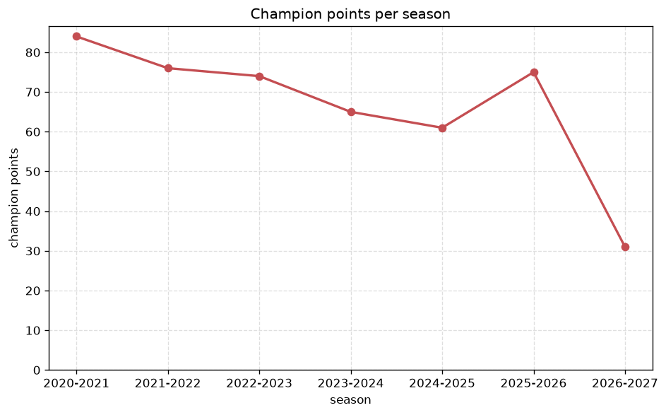
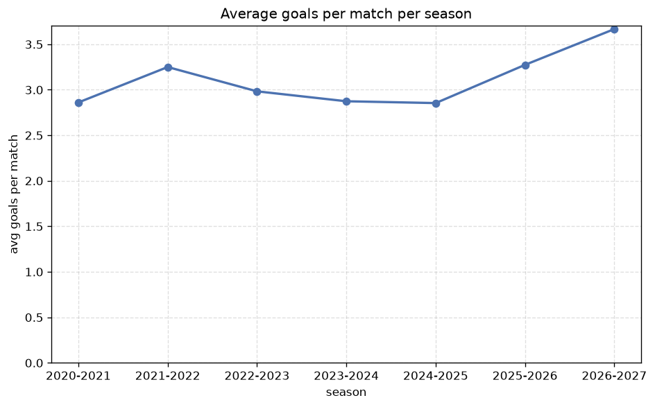

# Season Trends Analysis
- Report: `season_trends`
- Generated: 2026-10-29T02:17:51+00:00
- Script: `backend/scripts/analyze_seasons.py` v1.0.0
- League: Super League (Switzerland)
- Scope: league `swiss1`

## 1. Champions per season
| season | champion | pts | runner-up | margin |
|---|---|---|---|---|
| 2020-2021 | Young Boys | 84 | Basel | 31 pts |
| 2021-2022 | Zurich | 76 | Basel | 14 pts |
| 2022-2023 | Young Boys | 74 | Servette | 16 pts |
| 2023-2024 | Young Boys | 65 | Lugano | 6 pts |
| 2024-2025 | Basel | 61 | Servette | 6 pts |
| 2025-2026 | Thun | 75 | St. Gallen | 5 pts |
| 2026-2027 | Lugano | 31 | Young Boys | 6 pts |

## 2. Title-race tightness
- Tight races (margin <= 3 pts): **0** of 7 seasons
- Tightest race: **2025-2026** - Thun beat St. Gallen by **5** pts

| season | margin | tight |
|---|---|---|
| 2020-2021 | 31 pts |  |
| 2021-2022 | 14 pts |  |
| 2022-2023 | 16 pts |  |
| 2023-2024 | 6 pts |  |
| 2024-2025 | 6 pts |  |
| 2025-2026 | 5 pts |  |
| 2026-2027 | 6 pts |  |

## 3. Points thresholds
_Position-specific points per season. Key: 1 = champion, 2 = runner-up, 4 = CL line, 6 = Europa, 9 = last safe, 12 = bottom._

| season | pos 1 | pos 2 | pos 4 | pos 6 | pos 9 | pos 12 |
|---|---|---|---|---|---|---|
| 2020-2021 | 84 | 53 | 49 | 46 | 38 | - |
| 2021-2022 | 76 | 62 | 54 | 44 | 40 | - |
| 2022-2023 | 74 | 58 | 50 | 45 | 32 | - |
| 2023-2024 | 65 | 59 | 50 | 48 | 40 | 23 |
| 2024-2025 | 61 | 55 | 51 | 47 | 36 | 30 |
| 2025-2026 | 75 | 70 | 63 | 55 | 42 | 23 |
| 2026-2027 | 31 | 25 | 17 | 16 | 10 | 6 |

## 4. Relegation battle
| season | safe pos | safe pts | drop pos | drop pts | gap |
|---|---|---|---|---|---|
| 2020-2021 | 9 | 38 | 10 | 36 | 2 pts |
| 2021-2022 | 9 | 40 | 10 | 22 | 18 pts |
| 2022-2023 | 9 | 32 | 10 | 31 | 1 pts |
| 2023-2024 | 9 | 40 | 10 | 40 | 0 pts |
| 2024-2025 | 9 | 36 | 10 | 33 | 3 pts |
| 2025-2026 | 9 | 42 | 10 | 38 | 4 pts |
| 2026-2027 | 9 | 10 | 10 | 9 | 1 pts |

## 5. League-level trends
| season | matches | total goals | avg goals | home win | draw | away win | goalless | avg pts/team |
|---|---|---|---|---|---|---|---|---|
| 2020-2021 | 180 | 515 | 2.861 | 40.6% | 28.3% | 31.1% | 6.7% | 48.9 |
| 2021-2022 | 180 | 585 | 3.25 | 41.7% | 28.3% | 30.0% | 2.2% | 48.9 |
| 2022-2023 | 180 | 537 | 2.983 | 39.4% | 32.2% | 28.3% | 5.6% | 48.2 |
| 2023-2024 | 198 | 569 | 2.874 | 50.0% | 24.7% | 25.3% | 4.0% | 45.42 |
| 2024-2025 | 198 | 565 | 2.854 | 47.0% | 26.3% | 26.8% | 4.5% | 45.17 |
| 2025-2026 | 230 | 753 | 3.274 | 40.4% | 24.8% | 34.8% | 4.3% | 48.46 |
| 2026-2027 | 66 | 242 | 3.667 | 45.5% | 16.7% | 37.9% | 3.0% | 15.58 |

## 6. View divergence
- Largest divergence: **2025-2026** (goals view, avg abs position diff = 4.769)

_Avg absolute position difference between classic view and alternative view per season._

| season | classic vs luck | classic vs goals |
|---|---|---|
| 2020-2021 | 3.400 | 3.400 |
| 2021-2022 | 1.800 | 3.000 |
| 2022-2023 | 2.200 | 3.400 |
| 2023-2024 | 2.333 | 3.500 |
| 2024-2025 | 3.500 | 2.500 |
| 2025-2026 | 1.846 | 4.769 |
| 2026-2027 | 1.167 | 3.333 |

---
*All statistics are computed from PostgreSQL tables (read-only). Run with `python backend/scripts/analyze_seasons.py` to regenerate.*

## Charts

