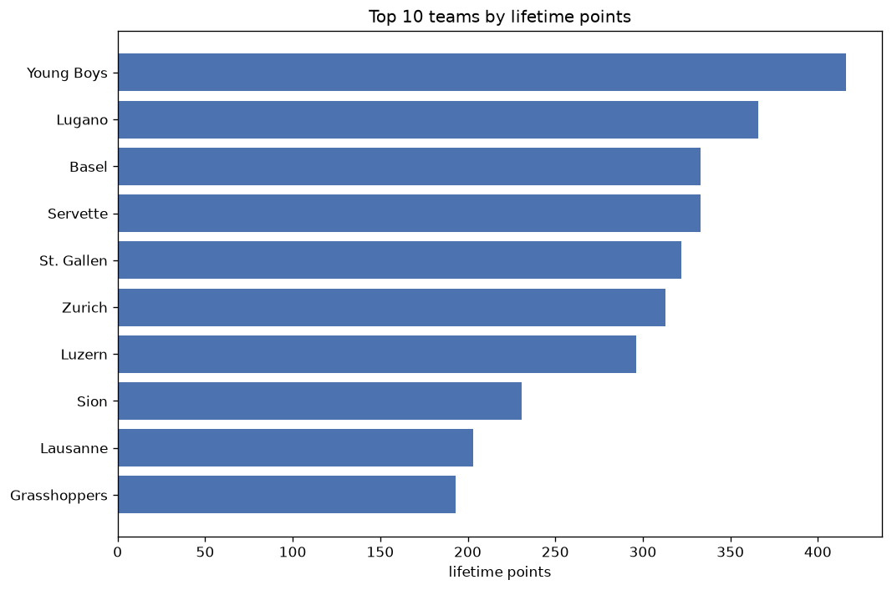
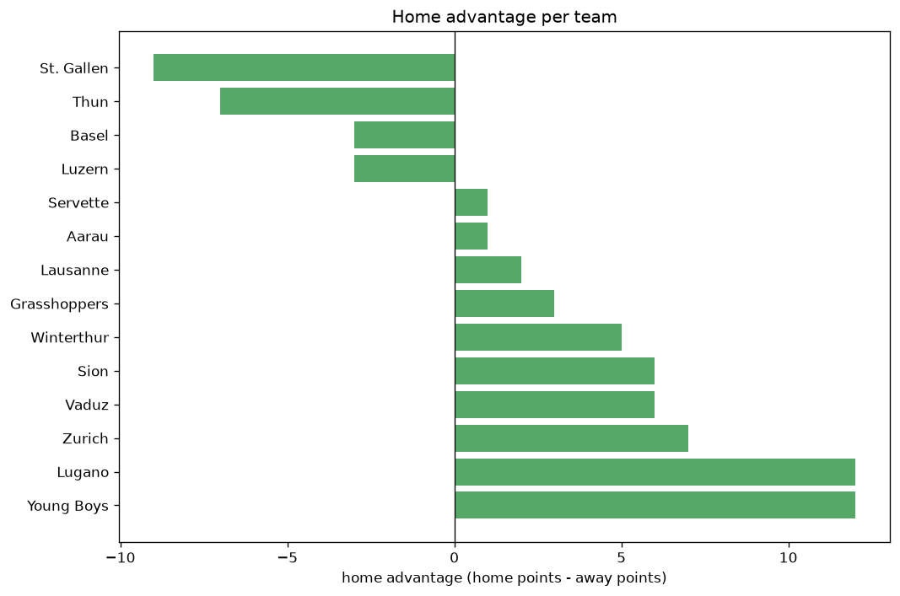

# Team Analysis
- Report: `teams_analysis`
- Generated: 2026-10-30T04:14:17+00:00
- Script: `backend/scripts/analyze_teams.py` v1.0.0
- League: Super League (Switzerland)
- Scope: league `swiss1`

- Teams: **16** | Seasons: **7** | Matches: **1232**

## 1. Team standings (lifetime)
| team | seasons | played | W | D | L | pts | GF | GA | GD | avg pts/season | best pos | worst pos | titles |
|---|---|---|---|---|---|---|---|---|---|---|---|---|---|
| Young Boys | 7 | 223 | 118 | 62 | 43 | 416 | 467 | 270 | 197 | 59.43 | 1 | 6 | 3 |
| Lugano | 7 | 223 | 104 | 54 | 65 | 366 | 351 | 285 | 66 | 52.29 | 1 | 5 | 1 |
| Basel | 7 | 223 | 90 | 63 | 70 | 333 | 366 | 305 | 61 | 47.57 | 1 | 9 | 1 |
| Servette | 7 | 223 | 89 | 66 | 68 | 333 | 340 | 328 | 12 | 47.57 | 2 | 8 | 0 |
| St. Gallen | 7 | 223 | 87 | 61 | 75 | 322 | 367 | 318 | 49 | 46.0 | 2 | 7 | 0 |
| Zurich | 7 | 223 | 85 | 58 | 80 | 313 | 329 | 336 | -7 | 44.71 | 1 | 10 | 1 |
| Luzern | 7 | 223 | 77 | 65 | 81 | 296 | 366 | 362 | 4 | 42.29 | 4 | 9 | 0 |
| Sion | 6 | 190 | 58 | 57 | 75 | 231 | 263 | 306 | -43 | 38.5 | 3 | 10 | 0 |
| Lausanne | 6 | 187 | 51 | 50 | 86 | 203 | 244 | 307 | -63 | 33.83 | 6 | 12 | 0 |
| Grasshoppers | 6 | 189 | 47 | 52 | 90 | 193 | 243 | 314 | -71 | 32.17 | 7 | 11 | 0 |
| Winterthur | 4 | 140 | 34 | 32 | 74 | 134 | 163 | 283 | -120 | 33.5 | 5 | 12 | 0 |
| Thun | 2 | 49 | 27 | 4 | 18 | 85 | 99 | 82 | 17 | 42.5 | 1 | 9 | 1 |
| Yverdon | 2 | 66 | 19 | 16 | 31 | 73 | 76 | 121 | -45 | 36.5 | 10 | 11 | 0 |
| Vaduz | 2 | 47 | 12 | 9 | 26 | 45 | 58 | 81 | -23 | 22.5 | 10 | 10 | 0 |
| Lausanne Ouchy | 1 | 33 | 5 | 8 | 20 | 23 | 33 | 66 | -33 | 23.0 | 12 | 12 | 0 |
| Aarau | 1 | 2 | 0 | 1 | 1 | 1 | 1 | 2 | -1 | 1.0 | 13 | 13 | 0 |

## 2. Home vs away split
| team | home P | H-W | H-D | H-L | H-pts | away P | A-W | A-D | A-L | A-pts | adv |
|---|---|---|---|---|---|---|---|---|---|---|---|
| Young Boys | 112 | 76 | 25 | 11 | 253 | 111 | 42 | 37 | 32 | 163 | 90 |
| St. Gallen | 111 | 53 | 31 | 27 | 190 | 112 | 34 | 30 | 48 | 132 | 58 |
| Lausanne | 93 | 35 | 21 | 37 | 126 | 94 | 16 | 29 | 49 | 77 | 49 |
| Lugano | 112 | 61 | 23 | 28 | 206 | 111 | 43 | 31 | 37 | 160 | 46 |
| Servette | 112 | 49 | 38 | 25 | 185 | 111 | 40 | 28 | 43 | 148 | 37 |
| Yverdon | 33 | 16 | 7 | 10 | 55 | 33 | 3 | 9 | 21 | 18 | 37 |
| Luzern | 111 | 44 | 33 | 34 | 165 | 112 | 33 | 32 | 47 | 131 | 34 |
| Winterthur | 70 | 23 | 15 | 32 | 84 | 70 | 11 | 17 | 42 | 50 | 34 |
| Grasshoppers | 94 | 29 | 26 | 39 | 113 | 95 | 18 | 26 | 51 | 80 | 33 |
| Basel | 112 | 49 | 35 | 28 | 182 | 111 | 41 | 28 | 42 | 151 | 31 |
| Zurich | 112 | 47 | 30 | 35 | 171 | 111 | 38 | 28 | 45 | 142 | 29 |
| Sion | 95 | 31 | 31 | 33 | 124 | 95 | 27 | 26 | 42 | 107 | 17 |
| Vaduz | 23 | 7 | 4 | 12 | 25 | 24 | 5 | 5 | 14 | 20 | 5 |
| Lausanne Ouchy | 17 | 2 | 6 | 9 | 12 | 16 | 3 | 2 | 11 | 11 | 1 |
| Aarau | 1 | 0 | 1 | 0 | 1 | 1 | 0 | 0 | 1 | 0 | 1 |
| Thun | 24 | 12 | 3 | 9 | 39 | 25 | 15 | 1 | 9 | 46 | -7 |

## 3. Top performers
### Best points per game (PPG)
| rank | team | PPG |
|---|---|---|
| 1 | Young Boys | 1.86 |
| 2 | Thun | 1.74 |
| 3 | Lugano | 1.64 |
| 4 | Basel | 1.49 |
| 5 | Servette | 1.49 |

### Most goals scored
| rank | team | goals |
|---|---|---|
| 1 | Young Boys | 467 |
| 2 | St. Gallen | 367 |
| 3 | Basel | 366 |
| 4 | Luzern | 366 |
| 5 | Lugano | 351 |

### Best goal difference
| rank | team | GD |
|---|---|---|
| 1 | Young Boys | 197 |
| 2 | Lugano | 66 |
| 3 | Basel | 61 |
| 4 | St. Gallen | 49 |
| 5 | Thun | 17 |

### Best defence (goals against per match, standings)
| rank | team | GA/match |
|---|---|---|
| 1 | Aarau | 0.000 |
| 2 | Young Boys | 1.211 |
| 3 | Lugano | 1.278 |
| 4 | Basel | 1.368 |
| 5 | St. Gallen | 1.426 |

## 4. Team consistency
- Teams present in all **7** seasons: **7**

Basel, Lugano, Luzern, Servette, St. Gallen, Young Boys, Zurich

## 5. Head-to-head dominance
- Distinct fixtures: **100** (showing the 15 most frequent)

| fixture | meetings | home wins | draws | away wins | home pct | draw pct | away pct |
|---|---|---|---|---|---|---|---|
| Young Boys vs St. Gallen | 23 | 14 | 4 | 5 | 60.9% | 17.4% | 21.7% |
| Young Boys vs Lugano | 23 | 13 | 6 | 4 | 56.5% | 26.1% | 17.4% |
| Young Boys vs Basel | 23 | 12 | 9 | 2 | 52.2% | 39.1% | 8.7% |
| Basel vs Lugano | 23 | 10 | 6 | 7 | 43.5% | 26.1% | 30.4% |
| Basel vs St. Gallen | 23 | 10 | 8 | 5 | 43.5% | 34.8% | 21.7% |
| Luzern vs Zurich | 23 | 10 | 6 | 7 | 43.5% | 26.1% | 30.4% |
| Servette vs Zurich | 23 | 10 | 5 | 8 | 43.5% | 21.7% | 34.8% |
| Servette vs Luzern | 23 | 9 | 8 | 6 | 39.1% | 34.8% | 26.1% |
| Lugano vs St. Gallen | 23 | 8 | 7 | 8 | 34.8% | 30.4% | 34.8% |
| Basel vs Servette | 22 | 11 | 7 | 4 | 50.0% | 31.8% | 18.2% |
| Lugano vs Zurich | 22 | 11 | 2 | 9 | 50.0% | 9.1% | 40.9% |
| Young Boys vs Servette | 22 | 11 | 5 | 6 | 50.0% | 22.7% | 27.3% |
| Young Boys vs Zurich | 22 | 11 | 6 | 5 | 50.0% | 27.3% | 22.7% |
| Lugano vs Luzern | 22 | 9 | 4 | 9 | 40.9% | 18.2% | 40.9% |
| Luzern vs St. Gallen | 22 | 9 | 11 | 2 | 40.9% | 50.0% | 9.1% |

## 6. Position per season (classic view)
_Cells show final position; '-' when the team was absent from that season._

| team | 2020-2021 | 2021-2022 | 2022-2023 | 2023-2024 | 2024-2025 | 2025-2026 | 2026-2027 |
|---|---|---|---|---|---|---|---|
| Young Boys | 1 | 3 | 1 | 1 | 3 | 6 | 2 |
| Lugano | 4 | 4 | 3 | 2 | 5 | 3 | 1 |
| Basel | 2 | 2 | 5 | 9 | 1 | 5 | 7 |
| Servette | 3 | 6 | 2 | 3 | 2 | 8 | 5 |
| St. Gallen | 7 | 5 | 6 | 4 | 7 | 2 | 6 |
| Zurich | 8 | 1 | 8 | 6 | 8 | 10 | 4 |
| Luzern | 5 | 9 | 4 | 7 | 4 | 7 | 8 |
| Sion | 9 | 7 | 10 | - | 9 | 4 | 3 |
| Lausanne | 6 | 10 | - | 8 | 6 | 9 | 12 |
| Grasshoppers | - | 8 | 7 | 11 | 10 | 11 | 11 |
| Winterthur | - | - | 9 | 5 | 12 | 12 | - |
| Thun | - | - | - | - | - | 1 | 9 |
| Yverdon | - | - | - | 10 | 11 | - | - |
| Vaduz | 10 | - | - | - | - | - | 10 |
| Lausanne Ouchy | - | - | - | 12 | - | - | - |
| Aarau | - | - | - | - | - | 13 | - |

---
*All statistics are computed from PostgreSQL tables (read-only). Run with `python backend/scripts/analyze_teams.py` to regenerate.*

## Charts

