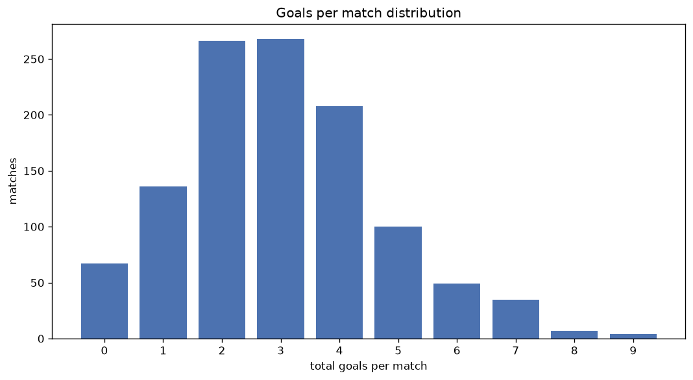
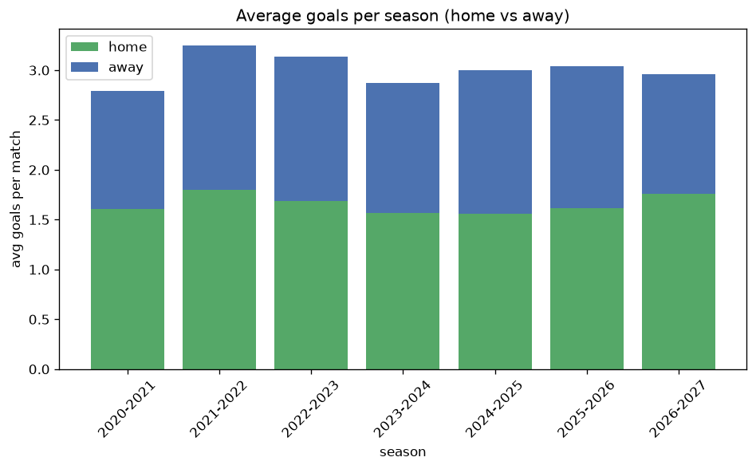

# Goal Analysis
- Report: `goals_analysis`
- Generated: 2026-10-26T01:51:06+00:00
- Script: `backend/scripts/analyze_goals.py` v1.0.0
- League: Challenge League (Switzerland)
- Scope: league `swiss2`

## 1. Goals per match distribution
| goals | matches | pct |
|---|---|---|
| 0 | 67 | 5.9% |
| 1 | 136 | 11.9% |
| 2 | 266 | 23.3% |
| 3 | 268 | 23.5% |
| 4 | 208 | 18.2% |
| 5 | 100 | 8.8% |
| 6 | 49 | 4.3% |
| 7 | 35 | 3.1% |
| 8 | 7 | 0.6% |
| 9 | 4 | 0.4% |

## 2. Goals per match per season
| season | matches | total goals | avg home | avg away | avg total |
|---|---|---|---|---|---|
| 2020-2021 | 180 | 503 | 1.611 | 1.183 | 2.794 |
| 2021-2022 | 180 | 585 | 1.8 | 1.45 | 3.25 |
| 2022-2023 | 180 | 564 | 1.689 | 1.444 | 3.133 |
| 2023-2024 | 180 | 517 | 1.567 | 1.306 | 2.872 |
| 2024-2025 | 180 | 540 | 1.561 | 1.439 | 3.0 |
| 2025-2026 | 186 | 566 | 1.613 | 1.43 | 3.043 |
| 2026-2027 | 54 | 160 | 1.759 | 1.204 | 2.963 |

## 3. Home vs away goal share
- Home goals: **1876** (54.6%)
- Away goals: **1559** (45.4%)
- Home/away ratio: **1.203**

| season | home goals | away goals | total | home pct | away pct |
|---|---|---|---|---|---|
| 2020-2021 | 290 | 213 | 503 | 57.7% | 42.3% |
| 2021-2022 | 324 | 261 | 585 | 55.4% | 44.6% |
| 2022-2023 | 304 | 260 | 564 | 53.9% | 46.1% |
| 2023-2024 | 282 | 235 | 517 | 54.5% | 45.5% |
| 2024-2025 | 281 | 259 | 540 | 52.0% | 48.0% |
| 2025-2026 | 300 | 266 | 566 | 53.0% | 47.0% |
| 2026-2027 | 95 | 65 | 160 | 59.4% | 40.6% |

## 4. BTTS (Both Teams To Score)
- Overall: **664** of `1140` (58.2%)

| season | matches | BTTS | pct |
|---|---|---|---|
| 2020-2021 | 180 | 102 | 56.7% |
| 2021-2022 | 180 | 107 | 59.4% |
| 2022-2023 | 180 | 111 | 61.7% |
| 2023-2024 | 180 | 96 | 53.3% |
| 2024-2025 | 180 | 112 | 62.2% |
| 2025-2026 | 186 | 107 | 57.5% |
| 2026-2027 | 54 | 29 | 53.7% |

## 5. Clean sheets
- Home clean sheets: **310** (27.2%)
- Away clean sheets: **233** (20.4%)
- Total clean sheets recorded: **543**
- Matches with at least one clean sheet: **476** (41.8%)
- Both teams kept clean sheets (0-0): **67**

| season | matches | home CS | away CS | total CS | matches w/ CS |
|---|---|---|---|---|---|
| 2020-2021 | 180 | 52 | 36 | 88 | 78 (43.3%) |
| 2021-2022 | 180 | 49 | 35 | 84 | 73 (40.6%) |
| 2022-2023 | 180 | 47 | 31 | 78 | 69 (38.3%) |
| 2023-2024 | 180 | 53 | 42 | 95 | 84 (46.7%) |
| 2024-2025 | 180 | 40 | 39 | 79 | 68 (37.8%) |
| 2025-2026 | 186 | 53 | 38 | 91 | 79 (42.5%) |
| 2026-2027 | 54 | 16 | 12 | 28 | 25 (46.3%) |

## 6. Scoring intensity
- First-half goals: **1508** (43.9%)
- Second-half goals: **1924** (56.1%)
- Avg first-half goals per match: **1.324**
- Avg second-half goals per match: **1.689**
- Second-half-only scoring (HT 0-0, FT goals >= 1): **227** (19.9%)
- *1 match(es) excluded (no HT score recorded).*

| season | matches | 1st half | 2nd half | 1st half pct | 2nd half pct |
|---|---|---|---|---|---|
| 2020-2021 | 180 | 193 | 310 | 38.4% | 61.6% |
| 2021-2022 | 180 | 272 | 313 | 46.5% | 53.5% |
| 2022-2023 | 180 | 246 | 318 | 43.6% | 56.4% |
| 2023-2024 | 180 | 207 | 310 | 40.0% | 60.0% |
| 2024-2025 | 180 | 246 | 291 | 45.8% | 54.2% |
| 2025-2026 | 186 | 269 | 297 | 47.5% | 52.5% |
| 2026-2027 | 54 | 75 | 85 | 46.9% | 53.1% |

## 7. First-goal timing
- Matches with first-goal time recorded: `1072` of `1140` (94.0%)
- Goalless matches: `68`
- Min `1` | Max `97` | Mean `27.89` | Median (p50) `21.0`

| bucket | count | % of matches | % of scoring matches |
|---|---|---|---|
| 1-15 | 424 | 37.2% | 39.6% |
| 16-30 | 245 | 21.5% | 22.9% |
| 31-45 | 166 | 14.6% | 15.5% |
| 46-60 | 131 | 11.5% | 12.2% |
| 61-75 | 64 | 5.6% | 6.0% |
| 76-90 | 31 | 2.7% | 2.9% |
| 91-120 | 11 | 1.0% | 1.0% |

---
*All statistics are computed from PostgreSQL tables (read-only). Run with `python backend/scripts/analyze_goals.py` to regenerate.*

## Charts

