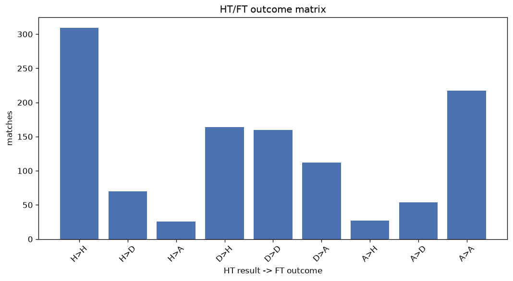
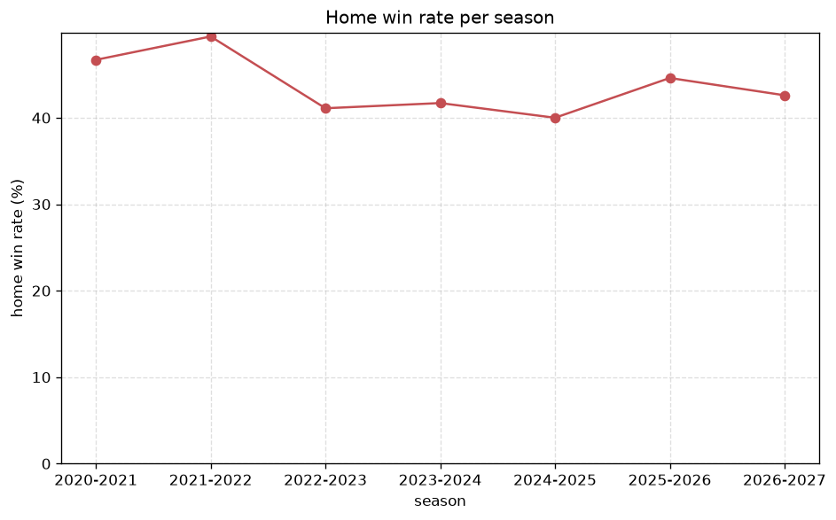

# Match Analysis
- Report: `matches_analysis`
- Generated: 2026-10-30T04:14:29+00:00
- Script: `backend/scripts/analyze_matches.py` v1.0.0
- League: Challenge League (Switzerland)
- Scope: league `swiss2`

## 1. Overall summary
| metric | value |
|---|---|
| Matches | 1141 |
| Home wins | 501 (43.9%) |
| Draws | 284 (24.9%) |
| Away wins | 356 (31.2%) |
| Total goals | 3442 |
| Average goals per match | 3.017 |
| Goalless matches | 67 (5.9%) |

## 2. Per-season breakdown
| season | matches | home wins | draws | away wins | total goals | avg goals | goalless |
|---|---|---|---|---|---|---|---|
| 2020-2021 | 180 | 84 (46.7%) | 45 (25.0%) | 51 (28.3%) | 503 | 2.794 | 10 (5.6%) |
| 2021-2022 | 180 | 89 (49.4%) | 37 (20.6%) | 54 (30.0%) | 585 | 3.25 | 11 (6.1%) |
| 2022-2023 | 180 | 74 (41.1%) | 49 (27.2%) | 57 (31.7%) | 564 | 3.133 | 9 (5.0%) |
| 2023-2024 | 180 | 75 (41.7%) | 51 (28.3%) | 54 (30.0%) | 517 | 2.872 | 11 (6.1%) |
| 2024-2025 | 180 | 72 (40.0%) | 47 (26.1%) | 61 (33.9%) | 540 | 3.0 | 11 (6.1%) |
| 2025-2026 | 186 | 83 (44.6%) | 40 (21.5%) | 63 (33.9%) | 566 | 3.043 | 12 (6.5%) |
| 2026-2027 | 55 | 24 (43.6%) | 15 (27.3%) | 16 (29.1%) | 167 | 3.036 | 3 (5.5%) |

## 3. HT/FT outcome matrix
| HT result \ FT result | Home | Draw | Away | total |
|---|---|---|---|---|
| HT home lead | 310 (76.4%) | 70 (17.2%) | 26 (6.4%) | 406 |
| HT draw | 164 (37.6%) | 160 (36.7%) | 112 (25.7%) | 436 |
| HT away lead | 27 (9.1%) | 54 (18.1%) | 217 (72.8%) | 298 |
- *1 match(es) excluded (no HT score recorded).*

## 4. Comeback matches
- Home comebacks (trailing at HT, won at FT): **27** (2.4%)
- Away comebacks (trailing at HT, won at FT): **26** (2.3%)

### Home comebacks
| season | home | away | HT | FT |
|---|---|---|---|---|
| 2020-2021 | Wil | Thun | 0-1 | 3-1 |
| 2020-2021 | Grasshoppers | Aarau | 0-1 | 2-1 |
| 2020-2021 | Xamax | Chiasso | 0-1 | 2-1 |
| 2020-2021 | Schaffhausen | Aarau | 0-1 | 3-2 |
| 2021-2022 | Xamax | Aarau | 0-2 | 4-2 |
| 2021-2022 | Thun | Xamax | 1-2 | 3-2 |
| 2021-2022 | Xamax | Schaffhausen | 0-1 | 2-1 |
| 2021-2022 | Vaduz | Kriens | 0-1 | 3-2 |
| 2021-2022 | Winterthur | Lausanne Ouchy | 0-1 | 2-1 |
| 2022-2023 | Bellinzona | Xamax | 0-1 | 3-1 |
| 2022-2023 | Vaduz | Bellinzona | 0-1 | 2-1 |
| 2023-2024 | Vaduz | Stade Nyonnais | 0-1 | 2-1 |
| 2023-2024 | Aarau | Vaduz | 1-2 | 3-2 |
| 2023-2024 | Sion | Schaffhausen | 0-1 | 2-1 |
| 2023-2024 | Thun | Wil | 0-1 | 2-1 |
| 2023-2024 | Bellinzona | Aarau | 1-2 | 5-2 |
| 2024-2025 | Stade Nyonnais | Bellinzona | 0-1 | 2-1 |
| 2024-2025 | Vaduz | Wil | 0-1 | 3-2 |
| 2024-2025 | Xamax | Stade Nyonnais | 0-1 | 3-2 |
| 2024-2025 | Etoile | Etoile-Carouge | 0-1 | 3-1 |
| 2024-2025 | Stade Nyonnais | Wil | 0-1 | 3-1 |
| 2024-2025 | Aarau | Bellinzona | 0-1 | 2-1 |
| 2024-2025 | Wil | Schaffhausen | 0-1 | 3-1 |
| 2025-2026 | Yverdon | Lausanne Ouchy | 1-2 | 3-2 |
| 2025-2026 | Xamax | Wil | 0-1 | 3-1 |
| 2025-2026 | Aarau | Rapperswil-Jona | 1-2 | 5-3 |
| 2026-2027 | Aarau | Rapperswil-Jona | 0-1 | 3-2 |

### Away comebacks
| season | home | away | HT | FT |
|---|---|---|---|---|
| 2020-2021 | Aarau | Wil | 1-0 | 1-3 |
| 2020-2021 | Aarau | Schaffhausen | 1-0 | 1-2 |
| 2020-2021 | Winterthur | Grasshoppers | 2-1 | 2-3 |
| 2020-2021 | Grasshoppers | Lausanne Ouchy | 1-0 | 1-2 |
| 2021-2022 | Wil | Vaduz | 1-0 | 2-3 |
| 2021-2022 | Wil | Aarau | 3-2 | 3-4 |
| 2021-2022 | Lausanne Ouchy | Xamax | 1-0 | 1-3 |
| 2021-2022 | Lausanne Ouchy | Schaffhausen | 1-0 | 1-2 |
| 2022-2023 | Schaffhausen | Yverdon | 1-0 | 1-2 |
| 2022-2023 | Bellinzona | Yverdon | 1-0 | 1-2 |
| 2022-2023 | Schaffhausen | Yverdon | 3-1 | 3-4 |
| 2022-2023 | Wil | Lausanne Ouchy | 1-0 | 1-2 |
| 2022-2023 | Thun | Schaffhausen | 1-0 | 2-3 |
| 2023-2024 | Sion | Thun | 2-0 | 2-3 |
| 2023-2024 | Vaduz | Sion | 1-0 | 1-2 |
| 2023-2024 | Baden | Stade Nyonnais | 1-0 | 2-3 |
| 2023-2024 | Bellinzona | Xamax | 1-0 | 1-2 |
| 2024-2025 | Aarau | Xamax | 1-0 | 1-3 |
| 2024-2025 | Schaffhausen | Xamax | 1-0 | 1-2 |
| 2024-2025 | Xamax | Thun | 1-0 | 2-3 |
| 2024-2025 | Stade Nyonnais | Aarau | 1-0 | 1-2 |
| 2024-2025 | Lausanne Ouchy | Aarau | 2-0 | 2-4 |
| 2024-2025 | Etoile | Etoile-Carouge | 1-0 | 1-2 |
| 2025-2026 | Wil | Yverdon | 2-0 | 2-4 |
| 2025-2026 | Rapperswil-Jona | Xamax | 2-0 | 2-3 |
| 2026-2027 | Aarau | Etoile-Carouge | 1-0 | 1-2 |

## 5. HT lead conversion
| HT state | matches | converted to win | held as draw | collapsed to loss |
|---|---|---|---|---|
| Home lead | 406 | 310 (76.4%) | 70 (17.2%) | 26 (6.4%) |
| Away lead | 298 | 217 (72.8%) | 54 (18.1%) | 27 (9.1%) |

### Matches level at half-time
| FT result | count | pct |
|---|---|---|
| Home win | 164 | 37.6% |
| Draw | 160 | 36.7% |
| Away win | 112 | 25.7% |
- *1 match(es) excluded (no HT score recorded).*

## 6. First-goal timing
- Matches with a first-goal time recorded: `1073` of `1141` (94.0%)

Outcome distribution by first-goal timing bucket:
| bucket | matches | % of matches | home | draw | away |
|---|---|---|---|---|---|
| 1-15 | 425 | 37.2% | 209 (49.2%) | 76 (17.9%) | 140 (32.9%) |
| 16-30 | 245 | 21.5% | 112 (45.7%) | 51 (20.8%) | 82 (33.5%) |
| 31-45 | 166 | 14.5% | 66 (39.8%) | 40 (24.1%) | 60 (36.1%) |
| 46-60 | 131 | 11.5% | 63 (48.1%) | 33 (25.2%) | 35 (26.7%) |
| 61-75 | 64 | 5.6% | 27 (42.2%) | 13 (20.3%) | 24 (37.5%) |
| 76-90 | 31 | 2.7% | 16 (51.6%) | 4 (12.9%) | 11 (35.5%) |
| 91-120 | 11 | 1.0% | 8 (72.7%) | 0 (0.0%) | 3 (27.3%) |

## 7. Goalless matches
- Overall: **67** of `1141` (5.9%)

| season | matches | goalless | pct |
|---|---|---|---|
| 2020-2021 | 180 | 10 | 5.6% |
| 2021-2022 | 180 | 11 | 6.1% |
| 2022-2023 | 180 | 9 | 5.0% |
| 2023-2024 | 180 | 11 | 6.1% |
| 2024-2025 | 180 | 11 | 6.1% |
| 2025-2026 | 186 | 12 | 6.5% |
| 2026-2027 | 55 | 3 | 5.5% |

---
*All statistics are computed from PostgreSQL tables (read-only). Run with `python backend/scripts/analyze_matches.py` to regenerate.*

## Charts

