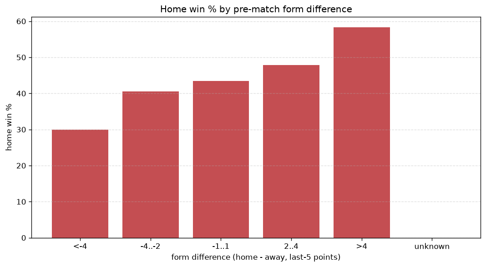
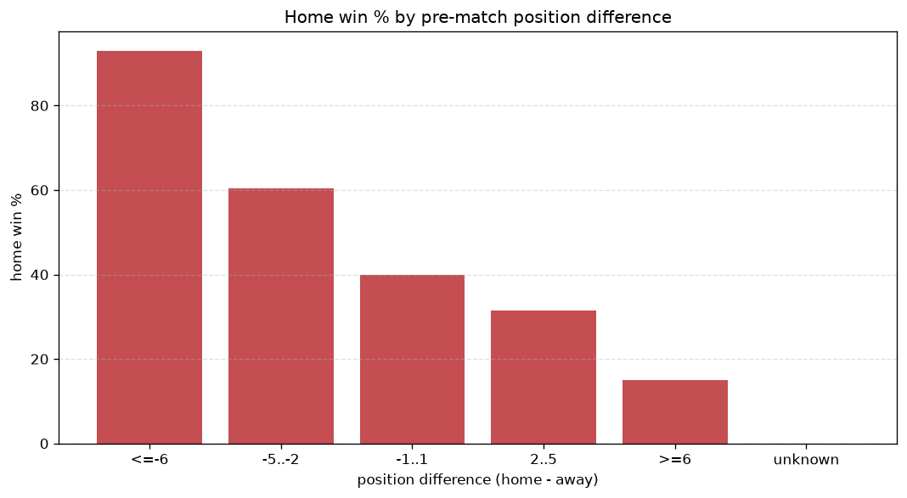

# Relationships Analysis
- Report: `relationships`
- Generated: 2026-10-29T02:18:13+00:00
- Script: `backend/scripts/analyze_relationships.py` v1.0.0
- League: Challenge League (Switzerland)
- Scope: league `swiss2`

- Matches analysed: **1086** (23 leakage-safe pre-match features).

## 1. Correlation matrix
_Pearson correlation of each pre-match feature with observed goals; sorted by |corr(total goals)|._

| feature | corr(home) | corr(away) | corr(total) |
|---|---|---|---|
| home_points_before_match | 0.112 | -0.011 | 0.079 |
| home_team_home_conceded_avg | -0.122 | 0.037 | -0.068 |
| away_points_before_match | -0.037 | 0.124 | 0.059 |
| away_team_away_conceded_avg | 0.021 | -0.095 | -0.051 |
| away_team_away_win_rate | -0.001 | 0.069 | 0.048 |
| home_team_home_win_rate | 0.107 | -0.049 | 0.048 |
| home_position_before_match | -0.138 | 0.083 | -0.048 |
| away_position_before_match | 0.082 | -0.150 | -0.042 |
| home_team_goals_conceded_last_5 | -0.059 | 0.015 | -0.035 |
| home_team_home_goals_avg | 0.099 | -0.061 | 0.033 |
| rest_days_difference | -0.018 | -0.025 | -0.031 |
| points_difference | 0.201 | -0.181 | 0.027 |
| home_rest_days | -0.028 | -0.004 | -0.025 |
| away_team_away_goals_avg | -0.043 | 0.074 | 0.019 |
| away_team_goals_conceded_last_5 | 0.057 | -0.045 | 0.012 |
| away_team_wins_last_5 | -0.067 | 0.089 | 0.011 |
| away_team_goals_scored_last_5 | -0.050 | 0.070 | 0.011 |
| away_rest_days | -0.020 | 0.012 | -0.007 |
| home_team_wins_last_5 | 0.075 | -0.089 | -0.005 |
| position_difference | -0.155 | 0.165 | -0.003 |
| away_team_points_last_5 | -0.077 | 0.088 | 0.003 |
| home_team_goals_scored_last_5 | 0.056 | -0.063 | -0.001 |
| home_team_points_last_5 | 0.082 | -0.089 | 0.000 |

## 2. Form vs outcome
_Home win/draw/away % per bucket of `home_team_points_last_5 - away_team_points_last_5`._

| bucket | matches | home | draw | away | home % | draw % | away % |
|---|---|---|---|---|---|---|---|
| <-4 | 170 | 51 | 48 | 71 | 30.0% | 28.2% | 41.8% |
| -4..-2 | 217 | 88 | 52 | 77 | 40.6% | 24.0% | 35.5% |
| -1..1 | 322 | 140 | 78 | 104 | 43.5% | 24.2% | 32.3% |
| 2..4 | 209 | 100 | 51 | 58 | 47.8% | 24.4% | 27.8% |
| >4 | 168 | 98 | 40 | 30 | 58.3% | 23.8% | 17.9% |
| unknown | 0 | 0 | 0 | 0 | - | - | - |

## 3. Position vs outcome
_Home win/draw/away % per bucket of `position_difference` (home position - away position; negative favours the home team)._

| bucket | matches | home | draw | away | home % | draw % | away % |
|---|---|---|---|---|---|---|---|
| <=-6 | 105 | 72 | 21 | 12 | 68.6% | 20.0% | 11.4% |
| -5..-2 | 319 | 163 | 73 | 83 | 51.1% | 22.9% | 26.0% |
| -1..1 | 241 | 91 | 71 | 79 | 37.8% | 29.5% | 32.8% |
| 2..5 | 310 | 121 | 68 | 121 | 39.0% | 21.9% | 39.0% |
| >=6 | 111 | 30 | 36 | 45 | 27.0% | 32.4% | 40.5% |
| unknown | 0 | 0 | 0 | 0 | - | - | - |

## 4. Rest advantage
_Home win/draw/away % per bucket of `rest_days_difference` (home rest - away rest). Matches with unknown rest are bucketed separately._

| bucket | matches | home | draw | away | home % | draw % | away % |
|---|---|---|---|---|---|---|---|
| <-1 | 140 | 57 | 44 | 39 | 40.7% | 31.4% | 27.9% |
| -1..0 | 174 | 78 | 43 | 53 | 44.8% | 24.7% | 30.5% |
| 0 | 393 | 170 | 91 | 132 | 43.3% | 23.2% | 33.6% |
| 1..2 | 265 | 120 | 61 | 84 | 45.3% | 23.0% | 31.7% |
| >2 | 79 | 38 | 21 | 20 | 48.1% | 26.6% | 25.3% |
| unknown | 35 | 14 | 9 | 12 | 40.0% | 25.7% | 34.3% |
- *35 match(es) had unknown rest difference (missing rest data on at least one side).*

## 5. Home team quality
_Home win rate by `home_team_home_win_rate` tier (split at 0.5)._

- `< 0.5` tier: **38.6%** home win (241/624)
- `>= 0.5` tier: **51.1%** home win (236/462)
- Home-win gap (>= split minus < split): **+12.5 pp**

| tier | label | matches | home | draw | away | home % |
|---|---|---|---|---|---|---|
| low | < 0.5 | 624 | 241 | 169 | 214 | 38.6% |
| high | >= 0.5 | 462 | 236 | 100 | 126 | 51.1% |

## 6. Feature averages by result
_Mean feature value per outcome; `range` is home-minus-away spread of the group means._

| feature | home mean | draw mean | away mean | range |
|---|---|---|---|---|
| points_difference | 3.203 | -1.045 | -4.100 | 7.303 |
| away_points_before_match | 21.719 | 23.851 | 26.638 | 4.919 |
| home_points_before_match | 24.922 | 22.807 | 22.538 | 2.384 |
| position_difference | -0.969 | 0.379 | 1.106 | 2.074 |
| away_position_before_match | 6.201 | 5.606 | 5.059 | 1.142 |
| home_position_before_match | 5.233 | 5.985 | 6.165 | 0.932 |
| home_team_points_last_5 | 6.610 | 6.342 | 5.694 | 0.916 |
| away_team_points_last_5 | 5.891 | 6.517 | 6.776 | 0.885 |
| away_team_goals_scored_last_5 | 6.495 | 6.896 | 7.256 | 0.761 |
| home_team_goals_scored_last_5 | 6.969 | 6.803 | 6.362 | 0.607 |
| home_team_goals_conceded_last_5 | 6.583 | 6.602 | 7.171 | 0.588 |
| home_rest_days | 8.479 | 9.031 | 8.671 | 0.551 |
| away_rest_days | 8.226 | 8.762 | 8.397 | 0.537 |
| away_team_goals_conceded_last_5 | 6.954 | 6.595 | 6.718 | 0.359 |
| away_team_wins_last_5 | 1.572 | 1.822 | 1.885 | 0.313 |
| home_team_wins_last_5 | 1.807 | 1.721 | 1.524 | 0.284 |
| home_team_home_conceded_avg | 1.199 | 1.301 | 1.370 | 0.171 |
| home_team_home_goals_avg | 1.612 | 1.509 | 1.466 | 0.146 |
| away_team_away_goals_avg | 1.225 | 1.278 | 1.371 | 0.146 |
| away_team_away_conceded_avg | 1.575 | 1.537 | 1.485 | 0.090 |
| rest_days_difference | 0.240 | 0.269 | 0.302 | 0.062 |
| home_team_home_win_rate | 0.452 | 0.393 | 0.398 | 0.059 |
| away_team_away_win_rate | 0.280 | 0.292 | 0.310 | 0.030 |

---
*All features are leakage-safe pre-match values built by `ml.features.build_features.build_rows` from strictly prior matches. Run with `python backend/scripts/analyze_relationships.py` to regenerate.*

## Charts

