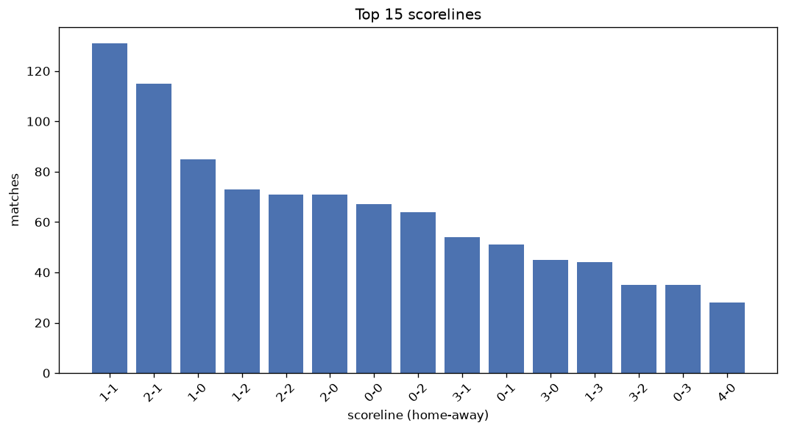
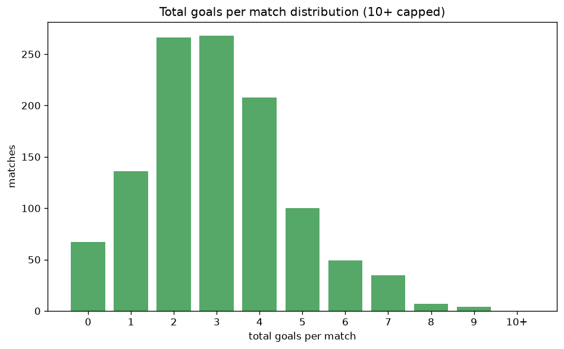

# Scoreline Analysis
- Report: `scoreline_analysis`
- Generated: 2026-10-26T01:51:11+00:00
- Script: `backend/scripts/analyze_scorelines.py` v1.0.0
- League: Challenge League (Switzerland)
- Scope: league `swiss2`

## 1. Scoreline frequency
- Matches analysed: **1140** across **7** seasons.
- Distinct scorelines seen: **40**.

| scoreline | count | pct |
|---|---|---|
| 1-1 | 131 | 11.5% |
| 2-1 | 115 | 10.1% |
| 1-0 | 85 | 7.5% |
| 1-2 | 73 | 6.4% |
| 2-2 | 71 | 6.2% |
| 2-0 | 71 | 6.2% |
| 0-0 | 67 | 5.9% |
| 0-2 | 64 | 5.6% |
| 3-1 | 54 | 4.7% |
| 0-1 | 51 | 4.5% |
| 3-0 | 45 | 3.9% |
| 1-3 | 44 | 3.9% |
| 3-2 | 35 | 3.1% |
| 0-3 | 35 | 3.1% |
| 4-0 | 28 | 2.5% |
| 2-3 | 28 | 2.5% |
| 4-1 | 16 | 1.4% |
| 5-2 | 14 | 1.2% |
| 2-4 | 14 | 1.2% |
| 3-3 | 14 | 1.2% |

## 2. Scoreline frequency per season

### 2020-2021
| scoreline | count | pct |
|---|---|---|
| 1-1 | 25 | 13.9% |
| 2-1 | 16 | 8.9% |
| 1-0 | 15 | 8.3% |
| 3-1 | 13 | 7.2% |
| 1-2 | 12 | 6.7% |

### 2021-2022
| scoreline | count | pct |
|---|---|---|
| 2-1 | 23 | 12.8% |
| 2-0 | 15 | 8.3% |
| 1-1 | 14 | 7.8% |
| 0-0 | 11 | 6.1% |
| 2-2 | 10 | 5.6% |

### 2022-2023
| scoreline | count | pct |
|---|---|---|
| 1-1 | 22 | 12.2% |
| 2-1 | 16 | 8.9% |
| 2-0 | 14 | 7.8% |
| 1-0 | 13 | 7.2% |
| 2-2 | 13 | 7.2% |

### 2023-2024
| scoreline | count | pct |
|---|---|---|
| 1-1 | 29 | 16.1% |
| 1-0 | 17 | 9.4% |
| 1-2 | 12 | 6.7% |
| 2-1 | 11 | 6.1% |
| 0-0 | 11 | 6.1% |

### 2024-2025
| scoreline | count | pct |
|---|---|---|
| 2-1 | 21 | 11.7% |
| 1-1 | 20 | 11.1% |
| 2-2 | 15 | 8.3% |
| 1-0 | 13 | 7.2% |
| 3-1 | 12 | 6.7% |

### 2025-2026
| scoreline | count | pct |
|---|---|---|
| 2-1 | 22 | 11.8% |
| 1-0 | 18 | 9.7% |
| 1-1 | 14 | 7.5% |
| 1-3 | 13 | 7.0% |
| 1-2 | 13 | 7.0% |

### 2026-2027
| scoreline | count | pct |
|---|---|---|
| 1-1 | 7 | 13.0% |
| 2-1 | 6 | 11.1% |
| 2-2 | 5 | 9.3% |
| 1-2 | 5 | 9.3% |
| 0-2 | 5 | 9.3% |

## 3. Total-goal histogram
_10+ groups all matches with 10 or more total goals._

| total goals | matches | pct |
|---|---|---|
| 0 | 67 | 5.9% |
| 1 | 136 | 11.9% |
| 2 | 266 | 23.3% |
| 3 | 268 | 23.5% |
| 4 | 208 | 18.2% |
| 5 | 100 | 8.8% |
| 6 | 49 | 4.3% |
| 7 | 35 | 3.1% |
| 8 | 7 | 0.6% |
| 9 | 4 | 0.4% |
| 10+ | 0 | 0.0% |

## 4. Extreme scorelines
- Matches with 7+ total goals: **46**

| season | date | scoreline | total goals |
|---|---|---|---|
| 2023-2024 | 2024-05-17 | 6-3 | 9 |
| 2025-2026 | 2025-08-22 | 4-5 | 9 |
| 2025-2026 | 2026-04-04 | 4-5 | 9 |
| 2026-2027 | 2026-07-24 | 4-5 | 9 |
| 2021-2022 | 2021-12-11 | 3-5 | 8 |
| 2021-2022 | 2022-01-30 | 4-4 | 8 |
| 2023-2024 | 2024-02-04 | 5-3 | 8 |
| 2024-2025 | 2024-11-08 | 6-2 | 8 |
| 2024-2025 | 2025-03-31 | 6-2 | 8 |
| 2025-2026 | 2026-02-27 | 5-3 | 8 |
| 2025-2026 | 2026-05-03 | 3-5 | 8 |
| 2020-2021 | 2020-09-19 | 5-2 | 7 |
| 2020-2021 | 2020-09-25 | 5-2 | 7 |
| 2020-2021 | 2020-10-20 | 5-2 | 7 |
| 2020-2021 | 2021-04-20 | 7-0 | 7 |
| 2021-2022 | 2021-08-21 | 5-2 | 7 |
| 2021-2022 | 2021-08-29 | 4-3 | 7 |
| 2021-2022 | 2021-10-23 | 6-1 | 7 |
| 2021-2022 | 2021-11-26 | 2-5 | 7 |
| 2021-2022 | 2022-02-05 | 2-5 | 7 |
| 2021-2022 | 2022-03-04 | 3-4 | 7 |
| 2021-2022 | 2022-04-01 | 3-4 | 7 |
| 2021-2022 | 2022-04-22 | 5-2 | 7 |
| 2021-2022 | 2022-05-06 | 5-2 | 7 |
| 2021-2022 | 2022-05-10 | 2-5 | 7 |
| 2021-2022 | 2022-05-21 | 5-2 | 7 |
| 2022-2023 | 2022-10-28 | 4-3 | 7 |
| 2022-2023 | 2022-11-13 | 6-1 | 7 |
| 2022-2023 | 2023-02-12 | 3-4 | 7 |
| 2022-2023 | 2023-04-08 | 3-4 | 7 |
| 2022-2023 | 2023-04-14 | 3-4 | 7 |
| 2022-2023 | 2023-04-16 | 1-6 | 7 |
| 2022-2023 | 2023-04-22 | 5-2 | 7 |
| 2022-2023 | 2023-05-27 | 1-6 | 7 |
| 2023-2024 | 2023-11-03 | 5-2 | 7 |
| 2023-2024 | 2024-02-10 | 5-2 | 7 |
| 2023-2024 | 2024-03-29 | 5-2 | 7 |
| 2023-2024 | 2024-05-20 | 4-3 | 7 |
| 2024-2025 | 2024-09-20 | 2-5 | 7 |
| 2024-2025 | 2024-11-01 | 1-6 | 7 |
| 2024-2025 | 2025-04-05 | 7-0 | 7 |
| 2024-2025 | 2025-04-21 | 7-0 | 7 |
| 2025-2026 | 2025-10-31 | 3-4 | 7 |
| 2025-2026 | 2026-01-30 | 5-2 | 7 |
| 2025-2026 | 2026-04-03 | 5-2 | 7 |
| 2025-2026 | 2026-04-07 | 5-2 | 7 |

## 5. Margin-of-victory distribution (decided matches)
- Decided matches: **856** (draws: **284**)
- Average winning margin: **1.89**

| margin | matches | pct |
|---|---|---|
| 1 | 399 | 46.6% |
| 2 | 258 | 30.1% |
| 3+ | 199 | 23.2% |

## 6. Margin by outcome

### Home wins
- Matches: **500** | avg margin: **1.94** | max margin: **7**
| margin | matches | pct |
|---|---|---|
| 1 | 238 | 47.6% |
| 2 | 134 | 26.8% |
| 3+ | 128 | 25.6% |
- *Full match-by-match list available in `scoreline_analysis.json`.*

### Away wins
- Matches: **356** | avg margin: **1.83** | max margin: **5**
| margin | matches | pct |
|---|---|---|
| 1 | 161 | 45.2% |
| 2 | 124 | 34.8% |
| 3+ | 71 | 19.9% |
- *Full match-by-match list available in `scoreline_analysis.json`.*

## 7. Most common exact score by outcome type
| outcome | matches | most common score | count | pct |
|---|---|---|---|---|
| home | 500 | 2-1 | 115 | 23.0% |
| draw | 284 | 1-1 | 131 | 46.1% |
| away | 356 | 1-2 | 73 | 20.5% |

---
*All statistics are computed from PostgreSQL tables (read-only). Run with `python backend/scripts/analyze_scorelines.py` to regenerate.*

## Charts

