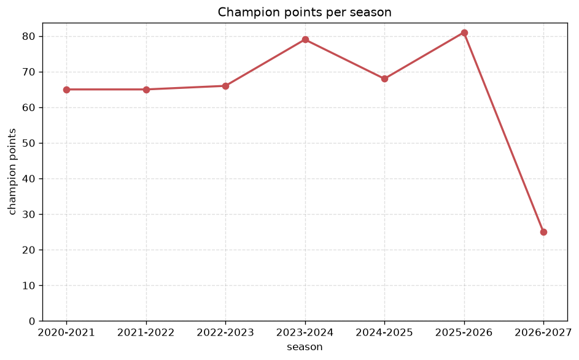
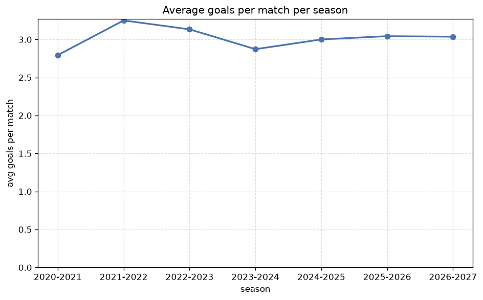

# Season Trends Analysis
- Report: `season_trends`
- Generated: 2026-10-29T02:18:09+00:00
- Script: `backend/scripts/analyze_seasons.py` v1.0.0
- League: Challenge League (Switzerland)
- Scope: league `swiss2`

## 1. Champions per season
| season | champion | pts | runner-up | margin |
|---|---|---|---|---|
| 2020-2021 | Grasshoppers | 65 | Thun | 1 pts |
| 2021-2022 | Winterthur | 65 | Schaffhausen | 0 pts |
| 2022-2023 | Yverdon | 66 | Lausanne | 5 pts |
| 2023-2024 | Sion | 79 | Thun | 3 pts |
| 2024-2025 | Thun | 68 | Aarau | 10 pts |
| 2025-2026 | Vaduz | 81 | Aarau | 1 pts |
| 2026-2027 | Lausanne Ouchy | 25 | Yverdon | 3 pts |

## 2. Title-race tightness
- Tight races (margin <= 3 pts): **5** of 7 seasons
- Tightest race: **2021-2022** - Winterthur beat Schaffhausen by **0** pts

| season | margin | tight |
|---|---|---|
| 2020-2021 | 1 pts | yes |
| 2021-2022 | 0 pts | yes |
| 2022-2023 | 5 pts |  |
| 2023-2024 | 3 pts | yes |
| 2024-2025 | 10 pts |  |
| 2025-2026 | 1 pts | yes |
| 2026-2027 | 3 pts | yes |

## 3. Points thresholds
_Position-specific points per season. Key: 1 = champion, 2 = runner-up, 4 = CL line, 6 = Europa, 7 = last safe, 10 = bottom._

| season | pos 1 | pos 2 | pos 4 | pos 6 | pos 7 | pos 10 |
|---|---|---|---|---|---|---|
| 2020-2021 | 65 | 64 | 58 | 43 | 39 | 36 |
| 2021-2022 | 65 | 65 | 60 | 50 | 44 | 13 |
| 2022-2023 | 66 | 61 | 57 | 49 | 44 | 24 |
| 2023-2024 | 79 | 76 | 49 | 43 | 43 | 26 |
| 2024-2025 | 68 | 58 | 51 | 43 | 41 | 34 |
| 2025-2026 | 81 | 80 | 50 | 48 | 44 | 23 |
| 2026-2027 | 25 | 22 | 16 | 12 | 12 | 5 |

## 4. Relegation battle
| season | safe pos | safe pts | drop pos | drop pts | gap |
|---|---|---|---|---|---|
| 2020-2021 | 7 | 39 | 8 | 38 | 1 pts |
| 2021-2022 | 7 | 44 | 8 | 44 | 0 pts |
| 2022-2023 | 7 | 44 | 8 | 37 | 7 pts |
| 2023-2024 | 7 | 43 | 8 | 42 | 1 pts |
| 2024-2025 | 7 | 41 | 8 | 36 | 5 pts |
| 2025-2026 | 7 | 44 | 8 | 40 | 4 pts |
| 2026-2027 | 7 | 12 | 8 | 11 | 1 pts |

## 5. League-level trends
| season | matches | total goals | avg goals | home win | draw | away win | goalless | avg pts/team |
|---|---|---|---|---|---|---|---|---|
| 2020-2021 | 180 | 503 | 2.794 | 46.7% | 25.0% | 28.3% | 5.6% | 49.5 |
| 2021-2022 | 180 | 585 | 3.25 | 49.4% | 20.6% | 30.0% | 6.1% | 50.3 |
| 2022-2023 | 180 | 564 | 3.133 | 41.1% | 27.2% | 31.7% | 5.0% | 49.1 |
| 2023-2024 | 180 | 517 | 2.872 | 41.7% | 28.3% | 30.0% | 6.1% | 48.9 |
| 2024-2025 | 180 | 540 | 3.0 | 40.0% | 26.1% | 33.9% | 6.1% | 44.82 |
| 2025-2026 | 186 | 566 | 3.043 | 44.6% | 21.5% | 33.9% | 6.5% | 47.09 |
| 2026-2027 | 55 | 167 | 3.036 | 43.6% | 27.3% | 29.1% | 5.5% | 15.0 |

## 6. View divergence
- Largest divergence: **2026-2027** (goals view, avg abs position diff = 4.600)

_Avg absolute position difference between classic view and alternative view per season._

| season | classic vs luck | classic vs goals |
|---|---|---|
| 2020-2021 | 1.400 | 1.800 |
| 2021-2022 | 1.400 | 2.800 |
| 2022-2023 | 1.600 | 2.000 |
| 2023-2024 | 2.800 | 2.800 |
| 2024-2025 | 2.000 | 4.000 |
| 2025-2026 | 1.455 | 2.000 |
| 2026-2027 | 0.800 | 4.600 |

---
*All statistics are computed from PostgreSQL tables (read-only). Run with `python backend/scripts/analyze_seasons.py` to regenerate.*

## Charts

