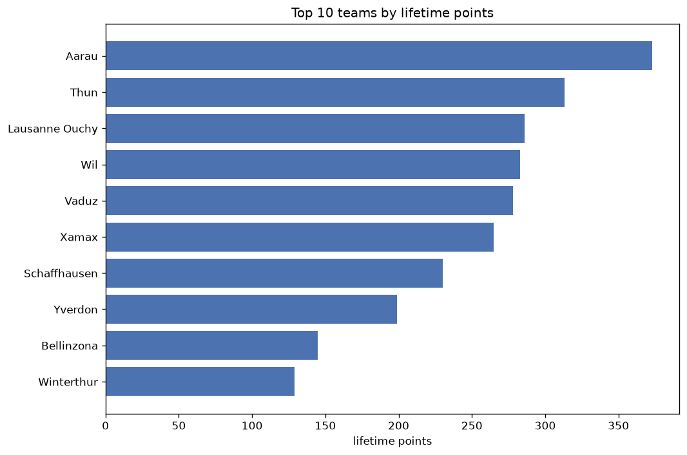
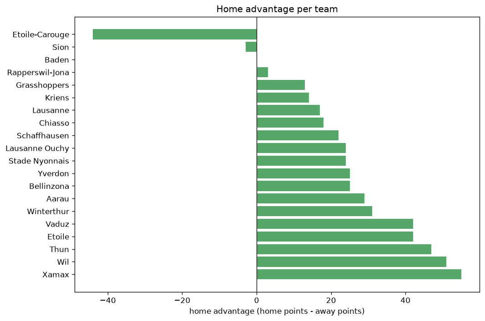

# Team Analysis
- Report: `teams_analysis`
- Generated: 2026-10-27T02:33:26+00:00
- Script: `backend/scripts/analyze_teams.py` v1.0.0
- League: Challenge League (Switzerland)
- Scope: league `swiss2`

- Teams: **20** | Seasons: **7** | Matches: **1141**

## 1. Team standings (lifetime)
| team | seasons | played | W | D | L | pts | GF | GA | GD | avg pts/season | best pos | worst pos | titles |
|---|---|---|---|---|---|---|---|---|---|---|---|---|---|
| Aarau | 7 | 225 | 107 | 52 | 66 | 373 | 399 | 331 | 68 | 53.29 | 2 | 6 | 0 |
| Thun | 5 | 178 | 91 | 40 | 47 | 313 | 322 | 235 | 87 | 62.6 | 1 | 6 | 1 |
| Lausanne Ouchy | 6 | 189 | 78 | 52 | 59 | 286 | 303 | 237 | 66 | 47.67 | 1 | 7 | 1 |
| Wil | 7 | 225 | 74 | 61 | 90 | 283 | 336 | 366 | -30 | 40.43 | 3 | 9 | 0 |
| Vaduz | 5 | 178 | 76 | 50 | 52 | 278 | 310 | 255 | 55 | 55.6 | 1 | 8 | 1 |
| Xamax | 7 | 225 | 70 | 55 | 100 | 265 | 314 | 355 | -41 | 37.86 | 4 | 10 | 0 |
| Schaffhausen | 5 | 178 | 61 | 47 | 70 | 230 | 257 | 277 | -20 | 46.0 | 2 | 11 | 0 |
| Yverdon | 4 | 119 | 57 | 28 | 34 | 199 | 204 | 164 | 40 | 49.75 | 1 | 8 | 1 |
| Bellinzona | 4 | 142 | 38 | 31 | 73 | 145 | 161 | 248 | -87 | 36.25 | 6 | 10 | 0 |
| Winterthur | 3 | 83 | 35 | 24 | 24 | 129 | 149 | 108 | 41 | 43.0 | 1 | 6 | 1 |
| Stade Nyonnais | 4 | 117 | 27 | 31 | 59 | 112 | 128 | 210 | -82 | 28.0 | 7 | 10 | 0 |
| Etoile-Carouge | 3 | 89 | 24 | 24 | 41 | 96 | 110 | 135 | -25 | 32.0 | 6 | 8 | 0 |
| Sion | 1 | 36 | 23 | 10 | 3 | 79 | 72 | 23 | 49 | 79.0 | 1 | 1 | 1 |
| Kriens | 3 | 83 | 16 | 18 | 49 | 66 | 84 | 158 | -74 | 22.0 | 5 | 10 | 0 |
| Grasshoppers | 1 | 36 | 19 | 8 | 9 | 65 | 60 | 43 | 17 | 65.0 | 1 | 1 | 1 |
| Lausanne | 1 | 36 | 17 | 10 | 9 | 61 | 58 | 43 | 15 | 61.0 | 2 | 2 | 0 |
| Rapperswil-Jona | 2 | 47 | 17 | 4 | 26 | 55 | 69 | 83 | -14 | 27.5 | 7 | 8 | 0 |
| Etoile | 2 | 24 | 12 | 6 | 6 | 42 | 40 | 29 | 11 | 21.0 | 10 | 11 | 0 |
| Chiasso | 1 | 36 | 9 | 9 | 18 | 36 | 35 | 60 | -25 | 36.0 | 10 | 10 | 0 |
| Baden | 1 | 36 | 6 | 8 | 22 | 26 | 31 | 82 | -51 | 26.0 | 10 | 10 | 0 |

## 2. Home vs away split
| team | home P | H-W | H-D | H-L | H-pts | away P | A-W | A-D | A-L | A-pts | adv |
|---|---|---|---|---|---|---|---|---|---|---|---|
| Xamax | 113 | 43 | 31 | 39 | 160 | 112 | 27 | 24 | 61 | 105 | 55 |
| Wil | 113 | 45 | 32 | 36 | 167 | 112 | 29 | 29 | 54 | 116 | 51 |
| Thun | 90 | 54 | 18 | 18 | 180 | 88 | 37 | 22 | 29 | 133 | 47 |
| Vaduz | 90 | 46 | 22 | 22 | 160 | 88 | 30 | 28 | 30 | 118 | 42 |
| Etoile | 24 | 12 | 6 | 6 | 42 | 0 | 0 | 0 | 0 | 0 | 42 |
| Winterthur | 42 | 23 | 11 | 8 | 80 | 41 | 12 | 13 | 16 | 49 | 31 |
| Aarau | 114 | 59 | 24 | 31 | 201 | 111 | 48 | 28 | 35 | 172 | 29 |
| Yverdon | 60 | 32 | 16 | 12 | 112 | 59 | 25 | 12 | 22 | 87 | 25 |
| Bellinzona | 72 | 24 | 13 | 35 | 85 | 70 | 14 | 18 | 38 | 60 | 25 |
| Lausanne Ouchy | 95 | 43 | 26 | 26 | 155 | 94 | 35 | 26 | 33 | 131 | 24 |
| Stade Nyonnais | 59 | 18 | 14 | 27 | 68 | 58 | 9 | 17 | 32 | 44 | 24 |
| Schaffhausen | 90 | 33 | 27 | 30 | 126 | 88 | 28 | 20 | 40 | 104 | 22 |
| Chiasso | 18 | 7 | 6 | 5 | 27 | 18 | 2 | 3 | 13 | 9 | 18 |
| Lausanne | 18 | 11 | 6 | 1 | 39 | 18 | 6 | 4 | 8 | 22 | 17 |
| Kriens | 42 | 10 | 10 | 22 | 40 | 41 | 6 | 8 | 27 | 26 | 14 |
| Grasshoppers | 18 | 12 | 3 | 3 | 39 | 18 | 7 | 5 | 6 | 26 | 13 |
| Rapperswil-Jona | 23 | 9 | 2 | 12 | 29 | 24 | 8 | 2 | 14 | 26 | 3 |
| Baden | 18 | 3 | 4 | 11 | 13 | 18 | 3 | 4 | 11 | 13 | 0 |
| Sion | 18 | 11 | 5 | 2 | 38 | 18 | 12 | 5 | 1 | 41 | -3 |
| Etoile-Carouge | 24 | 6 | 8 | 10 | 26 | 65 | 18 | 16 | 31 | 70 | -44 |

## 3. Top performers
### Best points per game (PPG)
| rank | team | PPG |
|---|---|---|
| 1 | Sion | 2.19 |
| 2 | Grasshoppers | 1.81 |
| 3 | Thun | 1.76 |
| 4 | Etoile | 1.75 |
| 5 | Lausanne | 1.69 |

### Most goals scored
| rank | team | goals |
|---|---|---|
| 1 | Aarau | 399 |
| 2 | Wil | 336 |
| 3 | Thun | 322 |
| 4 | Xamax | 314 |
| 5 | Vaduz | 310 |

### Best goal difference
| rank | team | GD |
|---|---|---|
| 1 | Thun | 87 |
| 2 | Aarau | 68 |
| 3 | Lausanne Ouchy | 66 |
| 4 | Vaduz | 55 |
| 5 | Sion | 49 |

### Best defence (goals against per match, standings)
| rank | team | GA/match |
|---|---|---|
| 1 | Sion | 0.639 |
| 2 | Grasshoppers | 1.194 |
| 3 | Lausanne | 1.194 |
| 4 | Etoile | 1.208 |
| 5 | Lausanne Ouchy | 1.254 |

## 4. Team consistency
- Teams present in all **7** seasons: **3**

Aarau, Wil, Xamax

## 5. Head-to-head dominance
- Distinct fixtures: **131** (showing the 15 most frequent)

| fixture | meetings | home wins | draws | away wins | home pct | draw pct | away pct |
|---|---|---|---|---|---|---|---|
| Wil vs Xamax | 25 | 15 | 6 | 4 | 60.0% | 24.0% | 16.0% |
| Aarau vs Xamax | 25 | 12 | 4 | 9 | 48.0% | 16.0% | 36.0% |
| Aarau vs Wil | 25 | 8 | 10 | 7 | 32.0% | 40.0% | 28.0% |
| Etoile-Carouge vs Etoile | 24 | 12 | 6 | 6 | 50.0% | 25.0% | 25.0% |
| Lausanne Ouchy vs Xamax | 22 | 9 | 7 | 6 | 40.9% | 31.8% | 27.3% |
| Lausanne Ouchy vs Wil | 21 | 9 | 7 | 5 | 42.9% | 33.3% | 23.8% |
| Lausanne Ouchy vs Aarau | 21 | 7 | 7 | 7 | 33.3% | 33.3% | 33.3% |
| Thun vs Aarau | 20 | 12 | 3 | 5 | 60.0% | 15.0% | 25.0% |
| Schaffhausen vs Xamax | 20 | 11 | 5 | 4 | 55.0% | 25.0% | 20.0% |
| Thun vs Schaffhausen | 20 | 11 | 4 | 5 | 55.0% | 20.0% | 25.0% |
| Schaffhausen vs Wil | 20 | 10 | 4 | 6 | 50.0% | 20.0% | 30.0% |
| Vaduz vs Wil | 20 | 10 | 5 | 5 | 50.0% | 25.0% | 25.0% |
| Thun vs Xamax | 20 | 9 | 4 | 7 | 45.0% | 20.0% | 35.0% |
| Vaduz vs Aarau | 20 | 8 | 4 | 8 | 40.0% | 20.0% | 40.0% |
| Aarau vs Schaffhausen | 20 | 7 | 5 | 8 | 35.0% | 25.0% | 40.0% |

## 6. Position per season (classic view)
_Cells show final position; '-' when the team was absent from that season._

| team | 2020-2021 | 2021-2022 | 2022-2023 | 2023-2024 | 2024-2025 | 2025-2026 | 2026-2027 |
|---|---|---|---|---|---|---|---|
| Aarau | 5 | 3 | 4 | 6 | 2 | 2 | 6 |
| Thun | 2 | 5 | 6 | 2 | 1 | - | - |
| Lausanne Ouchy | 3 | 7 | 3 | - | 5 | 4 | 1 |
| Wil | 7 | 9 | 5 | 5 | 3 | 8 | 9 |
| Vaduz | - | 4 | 8 | 3 | 4 | 1 | - |
| Xamax | 9 | 6 | 10 | 4 | 7 | 5 | 4 |
| Schaffhausen | 4 | 2 | 7 | 9 | 11 | - | - |
| Yverdon | - | 8 | 1 | - | - | 3 | 2 |
| Bellinzona | - | - | 9 | 8 | 6 | 10 | - |
| Winterthur | 6 | 1 | - | - | - | - | 3 |
| Stade Nyonnais | - | - | - | 7 | 9 | 9 | 10 |
| Etoile-Carouge | - | - | - | - | 8 | 6 | 7 |
| Sion | - | - | - | 1 | - | - | - |
| Kriens | 8 | 10 | - | - | - | - | 5 |
| Grasshoppers | 1 | - | - | - | - | - | - |
| Lausanne | - | - | 2 | - | - | - | - |
| Rapperswil-Jona | - | - | - | - | - | 7 | 8 |
| Etoile | - | - | - | - | 10 | 11 | - |
| Chiasso | 10 | - | - | - | - | - | - |
| Baden | - | - | - | 10 | - | - | - |

---
*All statistics are computed from PostgreSQL tables (read-only). Run with `python backend/scripts/analyze_teams.py` to regenerate.*

## Charts

