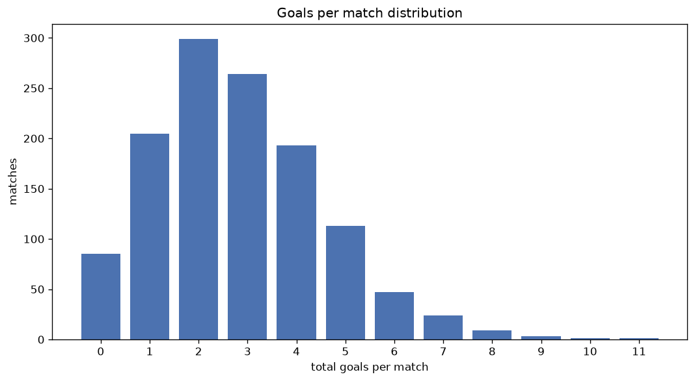
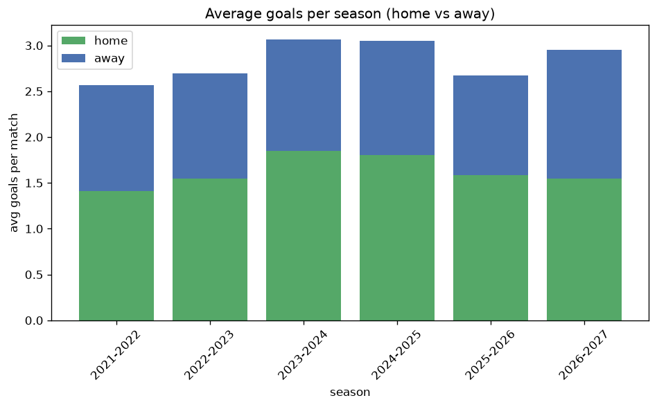

# Goal Analysis
- Report: `goals_analysis`
- Generated: 2026-10-26T01:51:23+00:00
- Script: `backend/scripts/analyze_goals.py` v1.0.0
- League: Thai League 1 (Thailand)
- Scope: league `thai1`

## 1. Goals per match distribution
| goals | matches | pct |
|---|---|---|
| 0 | 85 | 6.8% |
| 1 | 205 | 16.5% |
| 2 | 299 | 24.0% |
| 3 | 264 | 21.2% |
| 4 | 193 | 15.5% |
| 5 | 113 | 9.1% |
| 6 | 47 | 3.8% |
| 7 | 24 | 1.9% |
| 8 | 9 | 0.7% |
| 9 | 3 | 0.2% |
| 10 | 1 | 0.1% |
| 11 | 1 | 0.1% |

## 2. Goals per match per season
| season | matches | total goals | avg home | avg away | avg total |
|---|---|---|---|---|---|
| 2021-2022 | 240 | 615 | 1.413 | 1.15 | 2.562 |
| 2022-2023 | 240 | 647 | 1.55 | 1.146 | 2.696 |
| 2023-2024 | 240 | 736 | 1.85 | 1.217 | 3.067 |
| 2024-2025 | 240 | 732 | 1.8 | 1.25 | 3.05 |
| 2025-2026 | 240 | 642 | 1.583 | 1.092 | 2.675 |
| 2026-2027 | 44 | 130 | 1.545 | 1.409 | 2.955 |

## 3. Home vs away goal share
- Home goals: **2035** (58.1%)
- Away goals: **1467** (41.9%)
- Home/away ratio: **1.387**

| season | home goals | away goals | total | home pct | away pct |
|---|---|---|---|---|---|
| 2021-2022 | 339 | 276 | 615 | 55.1% | 44.9% |
| 2022-2023 | 372 | 275 | 647 | 57.5% | 42.5% |
| 2023-2024 | 444 | 292 | 736 | 60.3% | 39.7% |
| 2024-2025 | 432 | 300 | 732 | 59.0% | 41.0% |
| 2025-2026 | 380 | 262 | 642 | 59.2% | 40.8% |
| 2026-2027 | 68 | 62 | 130 | 52.3% | 47.7% |

## 4. BTTS (Both Teams To Score)
- Overall: **707** of `1244` (56.8%)

| season | matches | BTTS | pct |
|---|---|---|---|
| 2021-2022 | 240 | 131 | 54.6% |
| 2022-2023 | 240 | 131 | 54.6% |
| 2023-2024 | 240 | 146 | 60.8% |
| 2024-2025 | 240 | 137 | 57.1% |
| 2025-2026 | 240 | 133 | 55.4% |
| 2026-2027 | 44 | 29 | 65.9% |

## 5. Clean sheets
- Home clean sheets: **388** (31.2%)
- Away clean sheets: **234** (18.8%)
- Total clean sheets recorded: **622**
- Matches with at least one clean sheet: **537** (43.2%)
- Both teams kept clean sheets (0-0): **85**

| season | matches | home CS | away CS | total CS | matches w/ CS |
|---|---|---|---|---|---|
| 2021-2022 | 240 | 75 | 53 | 128 | 109 (45.4%) |
| 2022-2023 | 240 | 78 | 46 | 124 | 109 (45.4%) |
| 2023-2024 | 240 | 70 | 41 | 111 | 94 (39.2%) |
| 2024-2025 | 240 | 80 | 39 | 119 | 103 (42.9%) |
| 2025-2026 | 240 | 78 | 46 | 124 | 107 (44.6%) |
| 2026-2027 | 44 | 7 | 9 | 16 | 15 (34.1%) |

## 6. Scoring intensity
- First-half goals: **1500** (42.8%)
- Second-half goals: **2002** (57.2%)
- Avg first-half goals per match: **1.206**
- Avg second-half goals per match: **1.609**
- Second-half-only scoring (HT 0-0, FT goals >= 1): **274** (22.0%)

| season | matches | 1st half | 2nd half | 1st half pct | 2nd half pct |
|---|---|---|---|---|---|
| 2021-2022 | 240 | 243 | 372 | 39.5% | 60.5% |
| 2022-2023 | 240 | 291 | 356 | 45.0% | 55.0% |
| 2023-2024 | 240 | 315 | 421 | 42.8% | 57.2% |
| 2024-2025 | 240 | 325 | 407 | 44.4% | 55.6% |
| 2025-2026 | 240 | 264 | 378 | 41.1% | 58.9% |
| 2026-2027 | 44 | 62 | 68 | 47.7% | 52.3% |

## 7. First-goal timing
- Matches with first-goal time recorded: `1159` of `1244` (93.2%)
- Goalless matches: `85`
- Min `1` | Max `107` | Mean `31.34` | Median (p50) `26`

| bucket | count | % of matches | % of scoring matches |
|---|---|---|---|
| 1-15 | 379 | 30.5% | 32.7% |
| 16-30 | 271 | 21.8% | 23.4% |
| 31-45 | 198 | 15.9% | 17.1% |
| 46-60 | 159 | 12.8% | 13.7% |
| 61-75 | 84 | 6.8% | 7.2% |
| 76-90 | 51 | 4.1% | 4.4% |
| 91-120 | 17 | 1.4% | 1.5% |

---
*All statistics are computed from PostgreSQL tables (read-only). Run with `python backend/scripts/analyze_goals.py` to regenerate.*

## Charts

