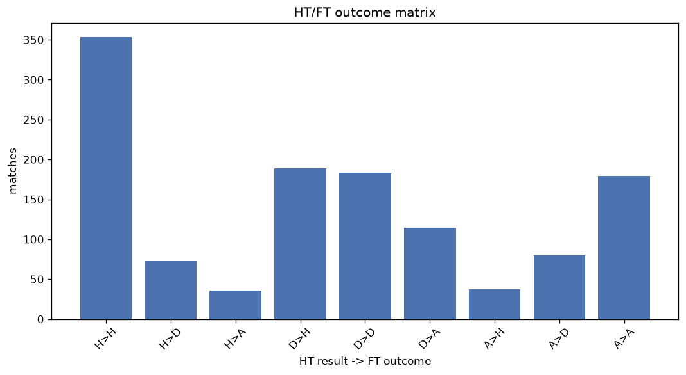
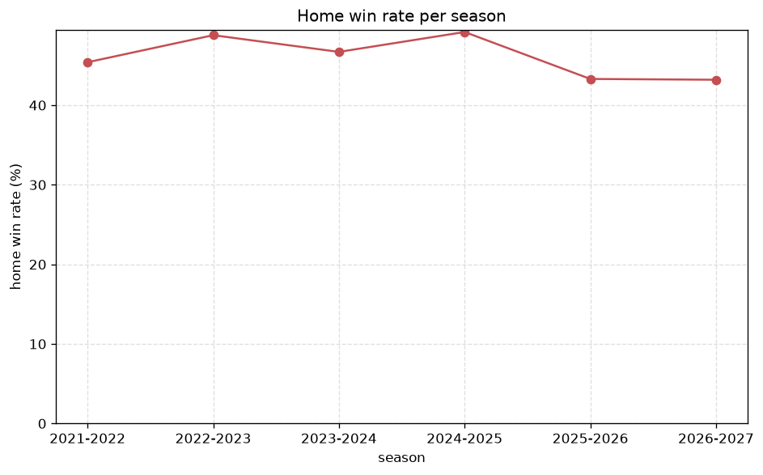

# Match Analysis
- Report: `matches_analysis`
- Generated: 2026-10-29T02:18:21+00:00
- Script: `backend/scripts/analyze_matches.py` v1.0.0
- League: Thai League 1 (Thailand)
- Scope: league `thai1`

## 1. Overall summary
| metric | value |
|---|---|
| Matches | 1248 |
| Home wins | 580 (46.5%) |
| Draws | 337 (27.0%) |
| Away wins | 331 (26.5%) |
| Total goals | 3514 |
| Average goals per match | 2.816 |
| Goalless matches | 86 (6.9%) |

## 2. Per-season breakdown
| season | matches | home wins | draws | away wins | total goals | avg goals | goalless |
|---|---|---|---|---|---|---|---|
| 2021-2022 | 240 | 109 (45.4%) | 64 (26.7%) | 67 (27.9%) | 615 | 2.562 | 19 (7.9%) |
| 2022-2023 | 240 | 117 (48.8%) | 63 (26.2%) | 60 (25.0%) | 647 | 2.696 | 15 (6.2%) |
| 2023-2024 | 240 | 112 (46.7%) | 66 (27.5%) | 62 (25.8%) | 736 | 3.067 | 17 (7.1%) |
| 2024-2025 | 240 | 118 (49.2%) | 61 (25.4%) | 61 (25.4%) | 732 | 3.05 | 16 (6.7%) |
| 2025-2026 | 240 | 104 (43.3%) | 75 (31.2%) | 61 (25.4%) | 642 | 2.675 | 17 (7.1%) |
| 2026-2027 | 48 | 20 (41.7%) | 8 (16.7%) | 20 (41.7%) | 142 | 2.958 | 2 (4.2%) |

## 3. HT/FT outcome matrix
| HT result \ FT result | Home | Draw | Away | total |
|---|---|---|---|---|
| HT home lead | 353 (76.4%) | 73 (15.8%) | 36 (7.8%) | 462 |
| HT draw | 190 (38.9%) | 184 (37.6%) | 115 (23.5%) | 489 |
| HT away lead | 37 (12.5%) | 80 (26.9%) | 180 (60.6%) | 297 |

## 4. Comeback matches
- Home comebacks (trailing at HT, won at FT): **37** (3.0%)
- Away comebacks (trailing at HT, won at FT): **36** (2.9%)

### Home comebacks
| season | home | away | HT | FT |
|---|---|---|---|---|
| 2021-2022 | Chiangrai Utd | Nakhon Ratchasima FC | 1-2 | 3-2 |
| 2021-2022 | Nakhon Ratchasima FC | Suphanburi | 0-1 | 2-1 |
| 2021-2022 | Muang Thong Utd | Khonkaen Utd. | 0-1 | 3-1 |
| 2021-2022 | Nong Bua Pitchaya | Suphanburi | 0-1 | 2-1 |
| 2021-2022 | Nong Bua Pitchaya | Pathum United | 0-1 | 3-1 |
| 2021-2022 | Ratchaburi | Suphanburi | 0-1 | 2-1 |
| 2022-2023 | Chiangrai Utd | Prachuap | 1-2 | 3-2 |
| 2022-2023 | Port MTI FC | Nong Bua Pitchaya | 0-1 | 2-1 |
| 2022-2023 | Bangkok Utd | Buriram | 1-2 | 4-3 |
| 2022-2023 | Pathum United | Nakhon Ratchasima FC | 0-1 | 5-2 |
| 2023-2024 | Police Tero | Chonburi | 0-1 | 3-2 |
| 2023-2024 | Nakhon Pathom | Uthai Thani | 0-1 | 2-1 |
| 2023-2024 | Trat FC | Nakhon Pathom | 1-2 | 4-3 |
| 2023-2024 | Bangkok Utd | Chiangrai Utd | 0-1 | 2-1 |
| 2023-2024 | Uthai Thani | Muang Thong Utd | 0-1 | 4-2 |
| 2023-2024 | Bangkok Utd | Ratchaburi | 0-1 | 3-1 |
| 2023-2024 | Port MTI FC | Muang Thong Utd | 0-2 | 4-3 |
| 2023-2024 | Sukhothai | Chiangrai Utd | 0-1 | 2-1 |
| 2023-2024 | Buriram | Bangkok Utd | 1-2 | 3-2 |
| 2023-2024 | Muang Thong Utd | Uthai Thani | 0-2 | 5-2 |
| 2023-2024 | Sukhothai | Nakhon Pathom | 0-1 | 3-1 |
| 2024-2025 | Muang Thong Utd | Sukhothai | 0-1 | 4-2 |
| 2024-2025 | Nong Bua Pitchaya | Uthai Thani | 1-2 | 3-2 |
| 2024-2025 | Prachuap | Ratchaburi | 0-2 | 3-2 |
| 2024-2025 | Muang Thong Utd | Chiangrai Utd | 0-1 | 2-1 |
| 2024-2025 | Port MTI FC | Nakhon Ratchasima FC | 0-2 | 4-2 |
| 2024-2025 | Rayong FC | Sukhothai | 0-1 | 2-1 |
| 2024-2025 | Ratchaburi | Prachuap | 0-2 | 3-2 |
| 2024-2025 | Khonkaen Utd. | Muang Thong Utd | 0-1 | 2-1 |
| 2025-2026 | Pathum United | Lamphun Warrior | 0-1 | 2-1 |
| 2025-2026 | Buriram | Nakhon Ratchasima FC | 0-1 | 2-1 |
| 2025-2026 | Ayutthaya Utd | Bangkok Utd | 0-1 | 3-1 |
| 2025-2026 | Prachuap | Chiangrai Utd | 0-2 | 3-2 |
| 2025-2026 | Chonburi | Port MTI FC | 1-2 | 3-2 |
| 2025-2026 | Uthai Thani | Kanchanaburi | 0-1 | 2-1 |
| 2025-2026 | Sukhothai | Rayong FC | 0-1 | 2-1 |
| 2025-2026 | Muang Thong Utd | Chiangrai Utd | 0-1 | 2-1 |

### Away comebacks
| season | home | away | HT | FT |
|---|---|---|---|---|
| 2021-2022 | Chiangmai Utd | Bangkok Utd | 1-0 | 1-2 |
| 2021-2022 | Chonburi | Chiangrai Utd | 2-1 | 2-3 |
| 2021-2022 | Port MTI FC | Chonburi | 1-0 | 1-2 |
| 2021-2022 | Buriram | Prachuap | 1-0 | 1-2 |
| 2021-2022 | Prachuap | Nong Bua Pitchaya | 1-0 | 2-3 |
| 2022-2023 | Lampang | Lamphun Warrior | 1-0 | 1-2 |
| 2022-2023 | Chiangrai Utd | Bangkok Utd | 1-0 | 1-2 |
| 2022-2023 | Port MTI FC | Muang Thong Utd | 2-0 | 2-3 |
| 2022-2023 | Chiangrai Utd | Port MTI FC | 2-0 | 2-3 |
| 2022-2023 | Buriram | Port MTI FC | 1-0 | 2-3 |
| 2023-2024 | Lamphun Warrior | Sukhothai | 1-0 | 1-2 |
| 2023-2024 | Port MTI FC | Pathum United | 2-0 | 2-3 |
| 2023-2024 | Police Tero | Sukhothai | 1-0 | 2-3 |
| 2023-2024 | Ratchaburi | Bangkok Utd | 1-0 | 1-2 |
| 2023-2024 | Nakhon Pathom | Bangkok Utd | 1-0 | 1-2 |
| 2023-2024 | Chiangrai Utd | Muang Thong Utd | 1-0 | 2-3 |
| 2024-2025 | Rayong FC | Port MTI FC | 1-0 | 1-3 |
| 2024-2025 | Ratchaburi | Nakhon Pathom | 1-0 | 2-3 |
| 2024-2025 | Nong Bua Pitchaya | Bangkok Utd | 1-0 | 2-3 |
| 2024-2025 | Nakhon Ratchasima FC | Port MTI FC | 2-1 | 2-3 |
| 2024-2025 | Prachuap | Buriram | 1-0 | 1-2 |
| 2024-2025 | Lamphun Warrior | Buriram | 1-0 | 1-2 |
| 2024-2025 | Nakhon Ratchasima FC | Chiangrai Utd | 1-0 | 1-4 |
| 2024-2025 | Nakhon Pathom | Rayong FC | 1-0 | 1-2 |
| 2024-2025 | Nong Bua Pitchaya | Port MTI FC | 1-0 | 1-2 |
| 2024-2025 | Prachuap | Bangkok Utd | 2-0 | 2-4 |
| 2025-2026 | Lamphun Warrior | Buriram | 2-1 | 2-3 |
| 2025-2026 | Kanchanaburi | Ayutthaya Utd | 1-0 | 1-2 |
| 2025-2026 | Bangkok Utd | Uthai Thani | 1-0 | 1-2 |
| 2025-2026 | Chonburi | Pathum United | 1-0 | 1-2 |
| 2025-2026 | Ratchaburi | Chiangrai Utd | 1-0 | 1-2 |
| 2025-2026 | Sukhothai | Ratchaburi | 1-0 | 1-2 |
| 2025-2026 | Kanchanaburi | Buriram | 1-0 | 1-3 |
| 2025-2026 | Ayutthaya Utd | Prachuap | 1-0 | 1-3 |
| 2026-2027 | Chonburi | Prachuap | 1-0 | 1-2 |
| 2026-2027 | Ratchaburi | Chonburi | 1-0 | 1-2 |

## 5. HT lead conversion
| HT state | matches | converted to win | held as draw | collapsed to loss |
|---|---|---|---|---|
| Home lead | 462 | 353 (76.4%) | 73 (15.8%) | 36 (7.8%) |
| Away lead | 297 | 180 (60.6%) | 80 (26.9%) | 37 (12.5%) |

### Matches level at half-time
| FT result | count | pct |
|---|---|---|
| Home win | 190 | 38.9% |
| Draw | 184 | 37.6% |
| Away win | 115 | 23.5% |

## 6. First-goal timing
- Matches with a first-goal time recorded: `1162` of `1248` (93.1%)

Outcome distribution by first-goal timing bucket:
| bucket | matches | % of matches | home | draw | away |
|---|---|---|---|---|---|
| 1-15 | 379 | 30.4% | 203 (53.6%) | 74 (19.5%) | 102 (26.9%) |
| 16-30 | 273 | 21.9% | 129 (47.3%) | 65 (23.8%) | 79 (28.9%) |
| 31-45 | 199 | 15.9% | 96 (48.2%) | 48 (24.1%) | 55 (27.6%) |
| 46-60 | 159 | 12.7% | 73 (45.9%) | 37 (23.3%) | 49 (30.8%) |
| 61-75 | 84 | 6.7% | 47 (56.0%) | 13 (15.5%) | 24 (28.6%) |
| 76-90 | 51 | 4.1% | 24 (47.1%) | 14 (27.5%) | 13 (25.5%) |
| 91-120 | 17 | 1.4% | 8 (47.1%) | 0 (0.0%) | 9 (52.9%) |

## 7. Goalless matches
- Overall: **86** of `1248` (6.9%)

| season | matches | goalless | pct |
|---|---|---|---|
| 2021-2022 | 240 | 19 | 7.9% |
| 2022-2023 | 240 | 15 | 6.2% |
| 2023-2024 | 240 | 17 | 7.1% |
| 2024-2025 | 240 | 16 | 6.7% |
| 2025-2026 | 240 | 17 | 7.1% |
| 2026-2027 | 48 | 2 | 4.2% |

---
*All statistics are computed from PostgreSQL tables (read-only). Run with `python backend/scripts/analyze_matches.py` to regenerate.*

## Charts

