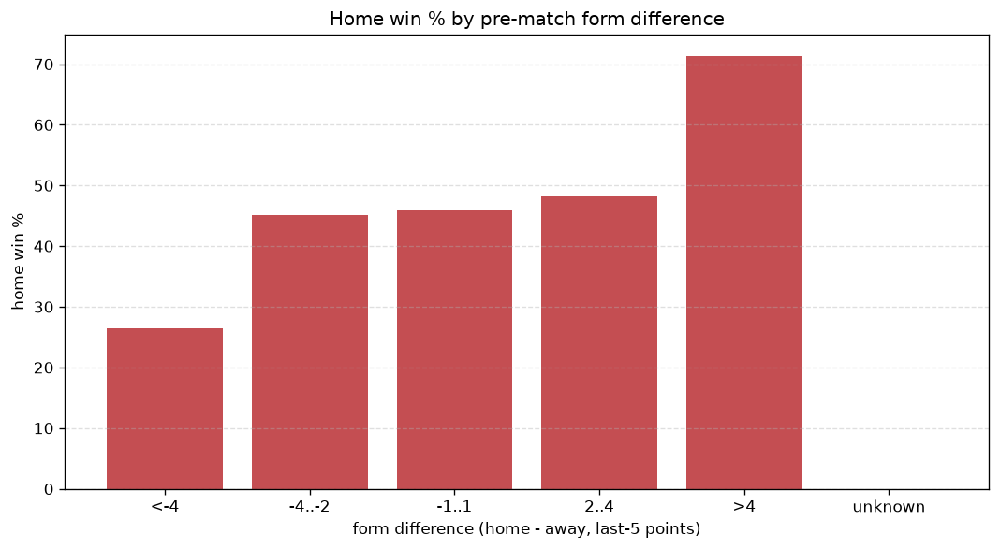
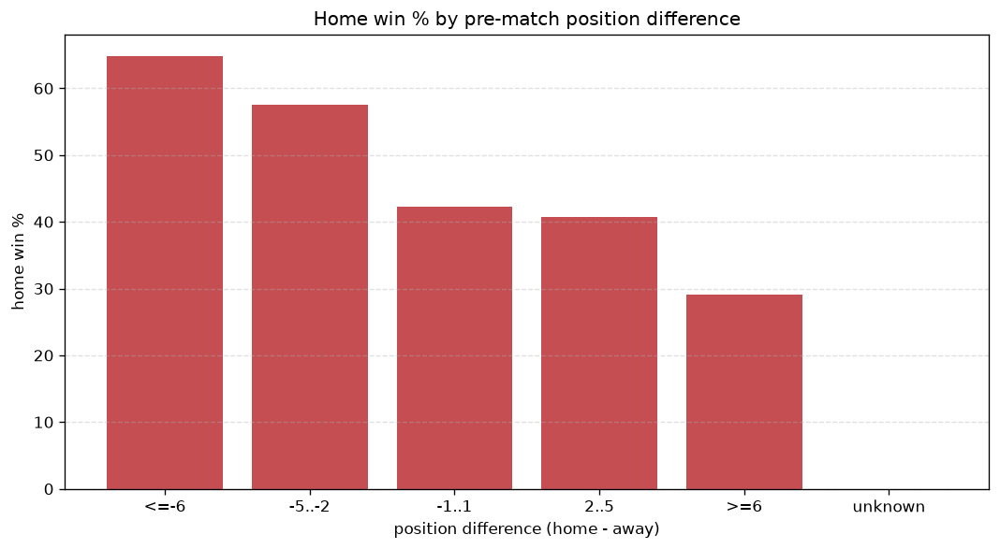

# Relationships Analysis
- Report: `relationships`
- Generated: 2026-10-29T02:18:30+00:00
- Script: `backend/scripts/analyze_relationships.py` v1.0.0
- League: Thai League 1 (Thailand)
- Scope: league `thai1`

- Matches analysed: **1200** (23 leakage-safe pre-match features).

## 1. Correlation matrix
_Pearson correlation of each pre-match feature with observed goals; sorted by |corr(total goals)|._

| feature | corr(home) | corr(away) | corr(total) |
|---|---|---|---|
| home_points_before_match | 0.205 | -0.068 | 0.119 |
| position_difference | -0.309 | 0.212 | -0.108 |
| points_difference | 0.310 | -0.214 | 0.108 |
| home_position_before_match | -0.224 | 0.117 | -0.102 |
| home_team_goals_scored_last_5 | 0.203 | -0.109 | 0.090 |
| home_team_home_goals_avg | 0.202 | -0.112 | 0.088 |
| home_team_home_win_rate | 0.169 | -0.083 | 0.080 |
| home_team_home_conceded_avg | -0.121 | 0.045 | -0.067 |
| home_team_points_last_5 | 0.173 | -0.120 | 0.060 |
| home_team_wins_last_5 | 0.164 | -0.111 | 0.058 |
| away_position_before_match | 0.211 | -0.182 | 0.050 |
| away_team_away_conceded_avg | 0.102 | -0.064 | 0.040 |
| away_points_before_match | -0.042 | 0.102 | 0.033 |
| rest_days_difference | 0.045 | -0.005 | 0.032 |
| away_team_goals_scored_last_5 | -0.066 | 0.130 | 0.031 |
| away_team_goals_conceded_last_5 | 0.100 | -0.085 | 0.024 |
| home_team_goals_conceded_last_5 | -0.084 | 0.066 | -0.023 |
| home_rest_days | -0.020 | 0.061 | 0.023 |
| away_team_away_goals_avg | -0.131 | 0.141 | -0.013 |
| away_team_wins_last_5 | -0.108 | 0.113 | -0.013 |
| away_team_away_win_rate | -0.124 | 0.143 | -0.006 |
| away_rest_days | -0.048 | 0.066 | 0.004 |
| away_team_points_last_5 | -0.094 | 0.110 | -0.003 |

## 2. Form vs outcome
_Home win/draw/away % per bucket of `home_team_points_last_5 - away_team_points_last_5`._

| bucket | matches | home | draw | away | home % | draw % | away % |
|---|---|---|---|---|---|---|---|
| <-4 | 193 | 51 | 66 | 76 | 26.4% | 34.2% | 39.4% |
| -4..-2 | 246 | 111 | 64 | 71 | 45.1% | 26.0% | 28.9% |
| -1..1 | 366 | 168 | 110 | 88 | 45.9% | 30.1% | 24.0% |
| 2..4 | 224 | 108 | 58 | 58 | 48.2% | 25.9% | 25.9% |
| >4 | 171 | 122 | 31 | 18 | 71.3% | 18.1% | 10.5% |
| unknown | 0 | 0 | 0 | 0 | - | - | - |

## 3. Position vs outcome
_Home win/draw/away % per bucket of `position_difference` (home position - away position; negative favours the home team)._

| bucket | matches | home | draw | away | home % | draw % | away % |
|---|---|---|---|---|---|---|---|
| <=-6 | 244 | 158 | 55 | 31 | 64.8% | 22.5% | 12.7% |
| -5..-2 | 247 | 142 | 59 | 46 | 57.5% | 23.9% | 18.6% |
| -1..1 | 173 | 73 | 58 | 42 | 42.2% | 33.5% | 24.3% |
| 2..5 | 268 | 109 | 80 | 79 | 40.7% | 29.9% | 29.5% |
| >=6 | 268 | 78 | 77 | 113 | 29.1% | 28.7% | 42.2% |
| unknown | 0 | 0 | 0 | 0 | - | - | - |

## 4. Rest advantage
_Home win/draw/away % per bucket of `rest_days_difference` (home rest - away rest). Matches with unknown rest are bucketed separately._

| bucket | matches | home | draw | away | home % | draw % | away % |
|---|---|---|---|---|---|---|---|
| <-1 | 127 | 57 | 36 | 34 | 44.9% | 28.3% | 26.8% |
| -1..0 | 269 | 119 | 70 | 80 | 44.2% | 26.0% | 29.7% |
| 0 | 357 | 169 | 104 | 84 | 47.3% | 29.1% | 23.5% |
| 1..2 | 319 | 157 | 82 | 80 | 49.2% | 25.7% | 25.1% |
| >2 | 87 | 44 | 23 | 20 | 50.6% | 26.4% | 23.0% |
| unknown | 41 | 14 | 14 | 13 | 34.1% | 34.1% | 31.7% |
- *41 match(es) had unknown rest difference (missing rest data on at least one side).*

## 5. Home team quality
_Home win rate by `home_team_home_win_rate` tier (split at 0.5)._

- `< 0.5` tier: **40.9%** home win (266/651)
- `>= 0.5` tier: **53.6%** home win (294/549)
- Home-win gap (>= split minus < split): **+12.7 pp**

| tier | label | matches | home | draw | away | home % |
|---|---|---|---|---|---|---|
| low | < 0.5 | 651 | 266 | 193 | 192 | 40.9% |
| high | >= 0.5 | 549 | 294 | 136 | 119 | 53.6% |

## 6. Feature averages by result
_Mean feature value per outcome; `range` is home-minus-away spread of the group means._

| feature | home mean | draw mean | away mean | range |
|---|---|---|---|---|
| points_difference | 2.934 | -1.471 | -4.974 | 7.908 |
| position_difference | -1.668 | 0.881 | 2.945 | 4.613 |
| home_points_before_match | 21.643 | 17.860 | 17.534 | 4.109 |
| away_points_before_match | 18.709 | 19.331 | 22.508 | 3.799 |
| away_position_before_match | 9.659 | 8.426 | 6.884 | 2.775 |
| home_position_before_match | 7.991 | 9.307 | 9.830 | 1.839 |
| home_team_goals_scored_last_5 | 6.766 | 5.556 | 5.441 | 1.326 |
| away_team_goals_scored_last_5 | 5.843 | 6.185 | 7.138 | 1.295 |
| home_team_points_last_5 | 6.661 | 5.523 | 5.421 | 1.239 |
| away_team_points_last_5 | 5.734 | 6.310 | 6.958 | 1.224 |
| away_rest_days | 8.639 | 9.260 | 9.862 | 1.223 |
| away_team_goals_conceded_last_5 | 6.639 | 5.833 | 5.614 | 1.025 |
| home_rest_days | 8.878 | 9.232 | 9.699 | 0.821 |
| home_team_goals_conceded_last_5 | 5.900 | 6.419 | 6.585 | 0.685 |
| away_team_wins_last_5 | 1.471 | 1.696 | 1.923 | 0.451 |
| rest_days_difference | 0.247 | -0.029 | -0.151 | 0.398 |
| home_team_wins_last_5 | 1.784 | 1.432 | 1.399 | 0.385 |
| home_team_home_goals_avg | 1.594 | 1.421 | 1.274 | 0.320 |
| away_team_away_goals_avg | 1.021 | 1.070 | 1.327 | 0.306 |
| away_team_away_conceded_avg | 1.554 | 1.432 | 1.337 | 0.216 |
| away_team_away_win_rate | 0.212 | 0.240 | 0.333 | 0.121 |
| home_team_home_conceded_avg | 1.043 | 1.157 | 1.150 | 0.114 |
| home_team_home_win_rate | 0.454 | 0.394 | 0.369 | 0.086 |

---
*All features are leakage-safe pre-match values built by `ml.features.build_features.build_rows` from strictly prior matches. Run with `python backend/scripts/analyze_relationships.py` to regenerate.*

## Charts

