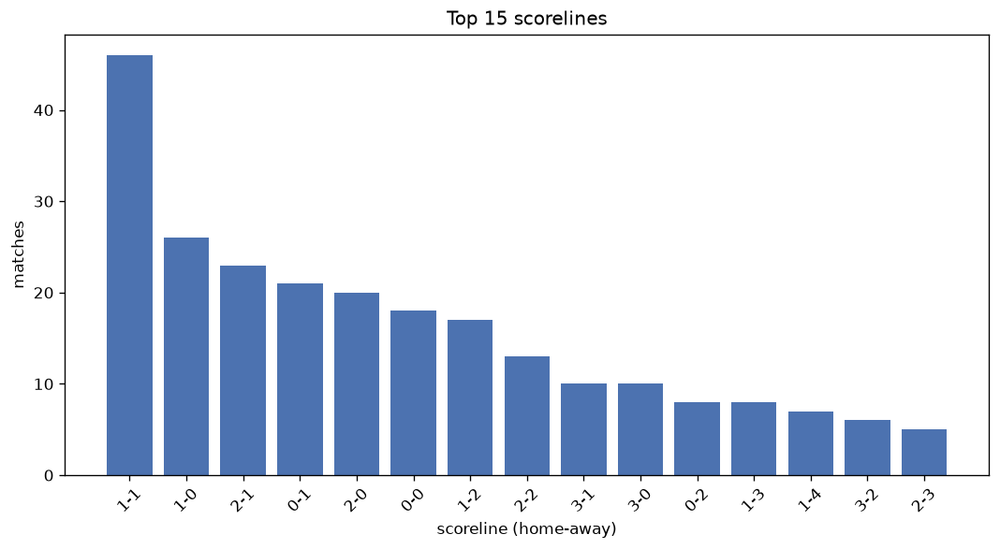
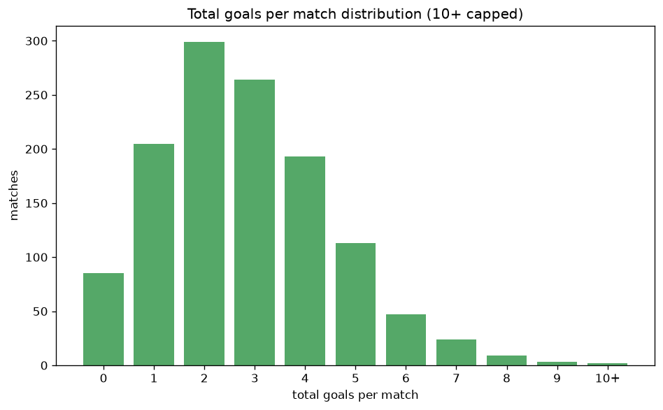

# Scoreline Analysis
- Report: `scoreline_analysis`
- Generated: 2026-10-30T04:14:45+00:00
- Script: `backend/scripts/analyze_scorelines.py` v1.0.0
- League: Thai League 1 (Thailand)
- Scope: league `thai1`

## 1. Scoreline frequency
- Matches analysed: **1248** across **6** seasons.
- Distinct scorelines seen: **44**.

| scoreline | count | pct |
|---|---|---|
| 1-1 | 168 | 13.5% |
| 1-0 | 129 | 10.3% |
| 2-1 | 116 | 9.3% |
| 2-0 | 89 | 7.1% |
| 1-2 | 88 | 7.1% |
| 0-0 | 86 | 6.9% |
| 0-1 | 76 | 6.1% |
| 2-2 | 72 | 5.8% |
| 3-1 | 59 | 4.7% |
| 3-0 | 43 | 3.4% |
| 0-2 | 42 | 3.4% |
| 3-2 | 35 | 2.8% |
| 1-3 | 35 | 2.8% |
| 2-3 | 28 | 2.2% |
| 4-0 | 20 | 1.6% |
| 4-1 | 20 | 1.6% |
| 0-3 | 18 | 1.4% |
| 1-4 | 17 | 1.4% |
| 4-2 | 14 | 1.1% |
| 5-0 | 10 | 0.8% |

## 2. Scoreline frequency per season

### 2021-2022
| scoreline | count | pct |
|---|---|---|
| 2-1 | 29 | 12.1% |
| 1-1 | 28 | 11.7% |
| 1-0 | 27 | 11.2% |
| 2-0 | 22 | 9.2% |
| 1-2 | 22 | 9.2% |

### 2022-2023
| scoreline | count | pct |
|---|---|---|
| 1-1 | 36 | 15.0% |
| 1-0 | 33 | 13.8% |
| 2-1 | 21 | 8.8% |
| 2-0 | 16 | 6.7% |
| 3-1 | 16 | 6.7% |

### 2023-2024
| scoreline | count | pct |
|---|---|---|
| 2-2 | 24 | 10.0% |
| 1-1 | 24 | 10.0% |
| 2-1 | 20 | 8.3% |
| 1-2 | 19 | 7.9% |
| 0-0 | 17 | 7.1% |

### 2024-2025
| scoreline | count | pct |
|---|---|---|
| 1-1 | 31 | 12.9% |
| 1-0 | 26 | 10.8% |
| 2-1 | 21 | 8.8% |
| 0-0 | 16 | 6.7% |
| 2-0 | 15 | 6.2% |

### 2025-2026
| scoreline | count | pct |
|---|---|---|
| 1-1 | 43 | 17.9% |
| 1-0 | 22 | 9.2% |
| 2-1 | 20 | 8.3% |
| 2-0 | 20 | 8.3% |
| 0-1 | 18 | 7.5% |

### 2026-2027
| scoreline | count | pct |
|---|---|---|
| 1-2 | 7 | 14.6% |
| 1-1 | 6 | 12.5% |
| 2-1 | 5 | 10.4% |
| 1-0 | 4 | 8.3% |
| 0-1 | 4 | 8.3% |

## 3. Total-goal histogram
_10+ groups all matches with 10 or more total goals._

| total goals | matches | pct |
|---|---|---|
| 0 | 86 | 6.9% |
| 1 | 205 | 16.4% |
| 2 | 299 | 24.0% |
| 3 | 265 | 21.2% |
| 4 | 194 | 15.5% |
| 5 | 114 | 9.1% |
| 6 | 47 | 3.8% |
| 7 | 24 | 1.9% |
| 8 | 9 | 0.7% |
| 9 | 3 | 0.2% |
| 10+ | 2 | 0.2% |

## 4. Extreme scorelines
- Matches with 7+ total goals: **38**

| season | date | scoreline | total goals |
|---|---|---|---|
| 2024-2025 | 2025-04-06 | 4-7 | 11 |
| 2023-2024 | 2024-05-26 | 8-2 | 10 |
| 2021-2022 | 2022-04-06 | 7-2 | 9 |
| 2024-2025 | 2025-01-19 | 9-0 | 9 |
| 2025-2026 | 2026-01-18 | 8-1 | 9 |
| 2022-2023 | 2023-01-22 | 5-3 | 8 |
| 2022-2023 | 2023-02-12 | 4-4 | 8 |
| 2023-2024 | 2024-02-24 | 6-2 | 8 |
| 2023-2024 | 2024-03-09 | 7-1 | 8 |
| 2024-2025 | 2024-10-25 | 5-3 | 8 |
| 2024-2025 | 2025-01-15 | 8-0 | 8 |
| 2024-2025 | 2025-04-27 | 4-4 | 8 |
| 2025-2026 | 2025-10-04 | 8-0 | 8 |
| 2025-2026 | 2025-12-06 | 4-4 | 8 |
| 2021-2022 | 2021-09-25 | 0-7 | 7 |
| 2021-2022 | 2022-04-09 | 5-2 | 7 |
| 2021-2022 | 2022-05-01 | 5-2 | 7 |
| 2022-2023 | 2022-08-19 | 6-1 | 7 |
| 2022-2023 | 2022-08-26 | 5-2 | 7 |
| 2022-2023 | 2023-04-04 | 4-3 | 7 |
| 2022-2023 | 2023-04-08 | 5-2 | 7 |
| 2022-2023 | 2023-05-06 | 4-3 | 7 |
| 2023-2024 | 2023-09-16 | 5-2 | 7 |
| 2023-2024 | 2023-09-16 | 6-1 | 7 |
| 2023-2024 | 2023-09-24 | 4-3 | 7 |
| 2023-2024 | 2023-09-30 | 6-1 | 7 |
| 2023-2024 | 2023-10-07 | 4-3 | 7 |
| 2023-2024 | 2024-02-14 | 4-3 | 7 |
| 2023-2024 | 2024-02-18 | 3-4 | 7 |
| 2023-2024 | 2024-04-03 | 5-2 | 7 |
| 2024-2025 | 2024-11-03 | 6-1 | 7 |
| 2024-2025 | 2024-11-08 | 5-2 | 7 |
| 2024-2025 | 2025-04-30 | 7-0 | 7 |
| 2024-2025 | 2025-04-30 | 1-6 | 7 |
| 2025-2026 | 2025-10-26 | 4-3 | 7 |
| 2025-2026 | 2025-11-29 | 7-0 | 7 |
| 2025-2026 | 2026-01-18 | 5-2 | 7 |
| 2025-2026 | 2026-05-03 | 6-1 | 7 |

## 5. Margin-of-victory distribution (decided matches)
- Decided matches: **911** (draws: **337**)
- Average winning margin: **1.84**

| margin | matches | pct |
|---|---|---|
| 1 | 479 | 52.6% |
| 2 | 246 | 27.0% |
| 3+ | 186 | 20.4% |

## 6. Margin by outcome

### Home wins
- Matches: **580** | avg margin: **1.93** | max margin: **9**
| margin | matches | pct |
|---|---|---|
| 1 | 286 | 49.3% |
| 2 | 164 | 28.3% |
| 3+ | 130 | 22.4% |
- *Full match-by-match list available in `scoreline_analysis.json`.*

### Away wins
- Matches: **331** | avg margin: **1.67** | max margin: **7**
| margin | matches | pct |
|---|---|---|
| 1 | 193 | 58.3% |
| 2 | 82 | 24.8% |
| 3+ | 56 | 16.9% |
- *Full match-by-match list available in `scoreline_analysis.json`.*

## 7. Most common exact score by outcome type
| outcome | matches | most common score | count | pct |
|---|---|---|---|---|
| home | 580 | 1-0 | 129 | 22.2% |
| draw | 337 | 1-1 | 168 | 49.9% |
| away | 331 | 1-2 | 88 | 26.6% |

---
*All statistics are computed from PostgreSQL tables (read-only). Run with `python backend/scripts/analyze_scorelines.py` to regenerate.*

## Charts

