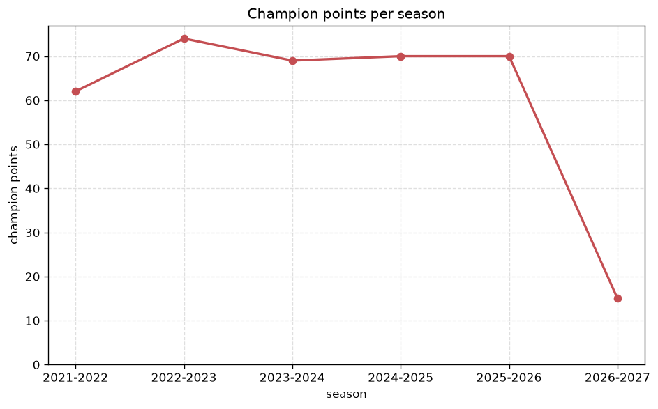
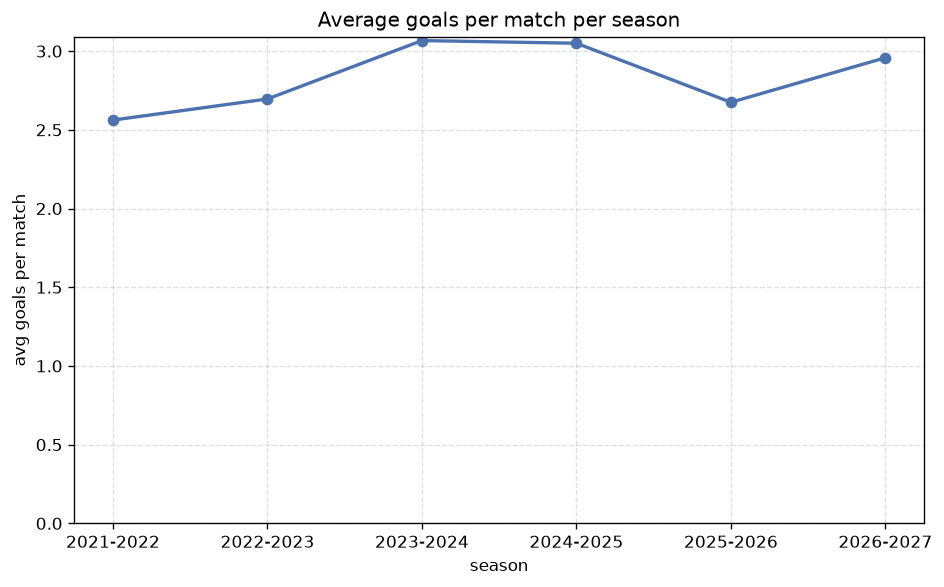

# Season Trends Analysis
- Report: `season_trends`
- Generated: 2026-10-27T02:33:46+00:00
- Script: `backend/scripts/analyze_seasons.py` v1.0.0
- League: Thai League 1 (Thailand)
- Scope: league `thai1`

## 1. Champions per season
| season | champion | pts | runner-up | margin |
|---|---|---|---|---|
| 2021-2022 | Buriram | 62 | Pathum United | 2 pts |
| 2022-2023 | Buriram | 74 | Bangkok Utd | 12 pts |
| 2023-2024 | Buriram | 69 | Bangkok Utd | 8 pts |
| 2024-2025 | Buriram | 70 | Bangkok Utd | 1 pts |
| 2025-2026 | Buriram | 70 | Port MTI FC | 10 pts |
| 2026-2027 | Port MTI FC | 15 | Prachuap | 2 pts |

## 2. Title-race tightness
- Tight races (margin <= 3 pts): **3** of 6 seasons
- Tightest race: **2024-2025** - Buriram beat Bangkok Utd by **1** pts

| season | margin | tight |
|---|---|---|
| 2021-2022 | 2 pts | yes |
| 2022-2023 | 12 pts |  |
| 2023-2024 | 8 pts |  |
| 2024-2025 | 1 pts | yes |
| 2025-2026 | 10 pts |  |
| 2026-2027 | 2 pts | yes |

## 3. Points thresholds
_Position-specific points per season. Key: 1 = champion, 2 = runner-up, 4 = CL line, 6 = Europa, 13 = last safe, 16 = bottom._

| season | pos 1 | pos 2 | pos 4 | pos 6 | pos 13 | pos 16 |
|---|---|---|---|---|---|---|
| 2021-2022 | 62 | 60 | 49 | 47 | 31 | 19 |
| 2022-2023 | 74 | 62 | 50 | 43 | 33 | 19 |
| 2023-2024 | 69 | 61 | 54 | 39 | 32 | 26 |
| 2024-2025 | 70 | 69 | 52 | 45 | 32 | 18 |
| 2025-2026 | 70 | 60 | 52 | 45 | 28 | 23 |
| 2026-2027 | 15 | 13 | 10 | 10 | 4 | 1 |

## 4. Relegation battle
| season | safe pos | safe pts | drop pos | drop pts | gap |
|---|---|---|---|---|---|
| 2021-2022 | 13 | 31 | 14 | 30 | 1 pts |
| 2022-2023 | 13 | 33 | 14 | 29 | 4 pts |
| 2023-2024 | 13 | 32 | 14 | 30 | 2 pts |
| 2024-2025 | 13 | 32 | 14 | 27 | 5 pts |
| 2025-2026 | 13 | 28 | 14 | 26 | 2 pts |
| 2026-2027 | 13 | 4 | 14 | 4 | 0 pts |

## 5. League-level trends
| season | matches | total goals | avg goals | home win | draw | away win | goalless | avg pts/team |
|---|---|---|---|---|---|---|---|---|
| 2021-2022 | 240 | 615 | 2.562 | 45.4% | 26.7% | 27.9% | 7.9% | 41.0 |
| 2022-2023 | 240 | 647 | 2.696 | 48.8% | 26.2% | 25.0% | 6.2% | 41.06 |
| 2023-2024 | 240 | 736 | 3.067 | 46.7% | 27.5% | 25.8% | 7.1% | 40.88 |
| 2024-2025 | 240 | 732 | 3.05 | 49.2% | 25.4% | 25.4% | 6.7% | 41.19 |
| 2025-2026 | 240 | 642 | 2.675 | 43.3% | 31.2% | 25.4% | 7.1% | 40.31 |
| 2026-2027 | 48 | 142 | 2.958 | 41.7% | 16.7% | 41.7% | 4.2% | 8.5 |

## 6. View divergence
- Largest divergence: **2024-2025** (goals view, avg abs position diff = 5.500)

_Avg absolute position difference between classic view and alternative view per season._

| season | classic vs luck | classic vs goals |
|---|---|---|
| 2021-2022 | 3.500 | 5.125 |
| 2022-2023 | 3.250 | 3.250 |
| 2023-2024 | 3.625 | 5.000 |
| 2024-2025 | 3.500 | 5.500 |
| 2025-2026 | 2.125 | 4.625 |
| 2026-2027 | 3.375 | 4.875 |

---
*All statistics are computed from PostgreSQL tables (read-only). Run with `python backend/scripts/analyze_seasons.py` to regenerate.*

## Charts

