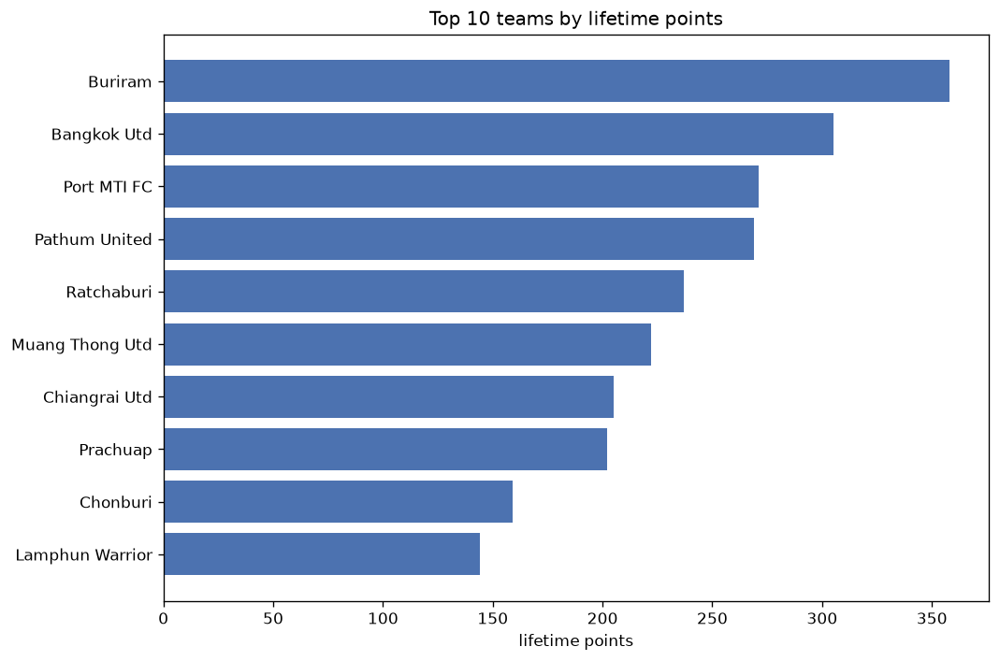
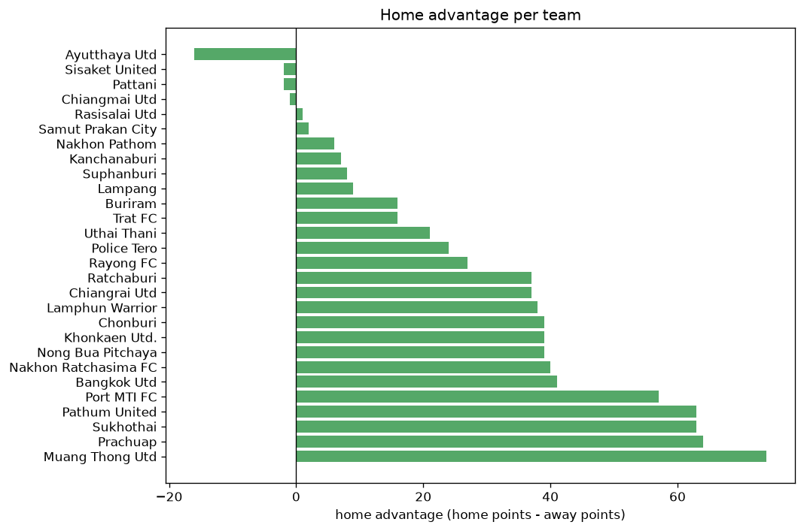

# Team Analysis
- Report: `teams_analysis`
- Generated: 2026-10-27T02:33:44+00:00
- Script: `backend/scripts/analyze_teams.py` v1.0.0
- League: Thai League 1 (Thailand)
- Scope: league `thai1`

- Teams: **28** | Seasons: **6** | Matches: **1248**

## 1. Team standings (lifetime)
| team | seasons | played | W | D | L | pts | GF | GA | GD | avg pts/season | best pos | worst pos | titles |
|---|---|---|---|---|---|---|---|---|---|---|---|---|---|
| Buriram | 6 | 156 | 110 | 28 | 18 | 358 | 372 | 131 | 241 | 59.67 | 1 | 3 | 5 |
| Bangkok Utd | 6 | 156 | 88 | 41 | 27 | 305 | 280 | 144 | 136 | 50.83 | 2 | 7 | 0 |
| Port MTI FC | 6 | 156 | 77 | 40 | 39 | 271 | 290 | 181 | 109 | 45.17 | 1 | 8 | 1 |
| Pathum United | 6 | 156 | 75 | 44 | 37 | 269 | 254 | 174 | 80 | 44.83 | 2 | 9 | 0 |
| Ratchaburi | 6 | 156 | 66 | 39 | 51 | 237 | 235 | 183 | 52 | 39.5 | 3 | 12 | 0 |
| Muang Thong Utd | 5 | 150 | 62 | 36 | 52 | 222 | 239 | 208 | 31 | 44.4 | 4 | 14 | 0 |
| Chiangrai Utd | 6 | 156 | 54 | 43 | 59 | 205 | 181 | 208 | -27 | 34.17 | 5 | 13 | 0 |
| Prachuap | 6 | 156 | 52 | 46 | 58 | 202 | 203 | 214 | -11 | 33.67 | 2 | 13 | 0 |
| Chonburi | 5 | 126 | 43 | 30 | 53 | 159 | 173 | 181 | -8 | 31.8 | 6 | 15 | 0 |
| Lamphun Warrior | 5 | 126 | 33 | 45 | 48 | 144 | 151 | 179 | -28 | 28.8 | 7 | 12 | 0 |
| Sukhothai | 5 | 126 | 35 | 34 | 57 | 139 | 141 | 212 | -71 | 27.8 | 10 | 13 | 0 |
| Khonkaen Utd. | 4 | 120 | 29 | 36 | 55 | 123 | 119 | 211 | -92 | 30.75 | 8 | 16 | 0 |
| Nakhon Ratchasima FC | 4 | 120 | 30 | 32 | 58 | 122 | 120 | 201 | -81 | 30.5 | 11 | 15 | 0 |
| Uthai Thani | 4 | 96 | 28 | 29 | 39 | 113 | 128 | 143 | -15 | 28.25 | 5 | 11 | 0 |
| Police Tero | 3 | 90 | 26 | 30 | 34 | 108 | 112 | 149 | -37 | 36.0 | 7 | 15 | 0 |
| Nong Bua Pitchaya | 3 | 90 | 24 | 23 | 43 | 95 | 106 | 144 | -38 | 31.67 | 5 | 15 | 0 |
| Rayong FC | 3 | 66 | 19 | 20 | 27 | 77 | 94 | 119 | -25 | 25.67 | 9 | 12 | 0 |
| Nakhon Pathom | 2 | 60 | 13 | 17 | 30 | 56 | 67 | 112 | -45 | 28.0 | 12 | 15 | 0 |
| Ayutthaya Utd | 2 | 36 | 11 | 9 | 16 | 42 | 43 | 57 | -14 | 21.0 | 6 | 10 | 0 |
| Suphanburi | 1 | 30 | 8 | 6 | 16 | 30 | 35 | 49 | -14 | 30.0 | 14 | 14 | 0 |
| Samut Prakan City | 1 | 30 | 6 | 10 | 14 | 28 | 29 | 42 | -13 | 28.0 | 15 | 15 | 0 |
| Trat FC | 1 | 30 | 6 | 8 | 16 | 26 | 40 | 64 | -24 | 26.0 | 16 | 16 | 0 |
| Kanchanaburi | 1 | 30 | 4 | 11 | 15 | 23 | 29 | 54 | -25 | 23.0 | 16 | 16 | 0 |
| Chiangmai Utd | 1 | 30 | 4 | 7 | 19 | 19 | 28 | 56 | -28 | 19.0 | 16 | 16 | 0 |
| Lampang | 1 | 30 | 4 | 7 | 19 | 19 | 24 | 60 | -36 | 19.0 | 16 | 16 | 0 |
| Sisaket United | 1 | 6 | 3 | 1 | 2 | 10 | 8 | 8 | 0 | 10.0 | 8 | 8 | 0 |
| Pattani | 1 | 6 | 1 | 1 | 4 | 4 | 5 | 11 | -6 | 4.0 | 14 | 14 | 0 |
| Rasisalai Utd | 1 | 6 | 0 | 1 | 5 | 1 | 8 | 19 | -11 | 1.0 | 16 | 16 | 0 |

## 2. Home vs away split
| team | home P | H-W | H-D | H-L | H-pts | away P | A-W | A-D | A-L | A-pts | adv |
|---|---|---|---|---|---|---|---|---|---|---|---|
| Muang Thong Utd | 75 | 44 | 16 | 15 | 148 | 75 | 18 | 20 | 37 | 74 | 74 |
| Prachuap | 78 | 37 | 22 | 19 | 133 | 78 | 15 | 24 | 39 | 69 | 64 |
| Pathum United | 78 | 51 | 13 | 14 | 166 | 78 | 24 | 31 | 23 | 103 | 63 |
| Sukhothai | 63 | 29 | 14 | 20 | 101 | 63 | 6 | 20 | 37 | 38 | 63 |
| Port MTI FC | 78 | 49 | 17 | 12 | 164 | 78 | 28 | 23 | 27 | 107 | 57 |
| Bangkok Utd | 78 | 51 | 20 | 7 | 173 | 78 | 37 | 21 | 20 | 132 | 41 |
| Nakhon Ratchasima FC | 60 | 21 | 18 | 21 | 81 | 60 | 9 | 14 | 37 | 41 | 40 |
| Chonburi | 63 | 28 | 15 | 20 | 99 | 63 | 15 | 15 | 33 | 60 | 39 |
| Khonkaen Utd. | 60 | 19 | 24 | 17 | 81 | 60 | 10 | 12 | 38 | 42 | 39 |
| Nong Bua Pitchaya | 45 | 18 | 13 | 14 | 67 | 45 | 6 | 10 | 29 | 28 | 39 |
| Lamphun Warrior | 63 | 23 | 22 | 18 | 91 | 63 | 10 | 23 | 30 | 53 | 38 |
| Ratchaburi | 77 | 39 | 20 | 18 | 137 | 79 | 27 | 19 | 33 | 100 | 37 |
| Chiangrai Utd | 78 | 34 | 19 | 25 | 121 | 78 | 20 | 24 | 34 | 84 | 37 |
| Rayong FC | 33 | 13 | 13 | 7 | 52 | 33 | 6 | 7 | 20 | 25 | 27 |
| Police Tero | 45 | 16 | 18 | 11 | 66 | 45 | 10 | 12 | 23 | 42 | 24 |
| Uthai Thani | 49 | 16 | 19 | 14 | 67 | 47 | 12 | 10 | 25 | 46 | 21 |
| Buriram | 78 | 58 | 13 | 7 | 187 | 78 | 52 | 15 | 11 | 171 | 16 |
| Trat FC | 15 | 5 | 6 | 4 | 21 | 15 | 1 | 2 | 12 | 5 | 16 |
| Lampang | 15 | 4 | 2 | 9 | 14 | 15 | 0 | 5 | 10 | 5 | 9 |
| Suphanburi | 15 | 5 | 4 | 6 | 19 | 15 | 3 | 2 | 10 | 11 | 8 |
| Kanchanaburi | 15 | 3 | 6 | 6 | 15 | 15 | 1 | 5 | 9 | 8 | 7 |
| Nakhon Pathom | 30 | 8 | 7 | 15 | 31 | 30 | 5 | 10 | 15 | 25 | 6 |
| Samut Prakan City | 15 | 3 | 6 | 6 | 15 | 15 | 3 | 4 | 8 | 13 | 2 |
| Rasisalai Utd | 3 | 0 | 1 | 2 | 1 | 3 | 0 | 0 | 3 | 0 | 1 |
| Chiangmai Utd | 15 | 2 | 3 | 10 | 9 | 15 | 2 | 4 | 9 | 10 | -1 |
| Sisaket United | 3 | 1 | 1 | 1 | 4 | 3 | 2 | 0 | 1 | 6 | -2 |
| Pattani | 3 | 0 | 1 | 2 | 1 | 3 | 1 | 0 | 2 | 3 | -2 |
| Ayutthaya Utd | 18 | 3 | 4 | 11 | 13 | 18 | 8 | 5 | 5 | 29 | -16 |

## 3. Top performers
### Best points per game (PPG)
| rank | team | PPG |
|---|---|---|
| 1 | Buriram | 2.29 |
| 2 | Bangkok Utd | 1.96 |
| 3 | Port MTI FC | 1.74 |
| 4 | Pathum United | 1.72 |
| 5 | Sisaket United | 1.67 |

### Most goals scored
| rank | team | goals |
|---|---|---|
| 1 | Buriram | 372 |
| 2 | Port MTI FC | 290 |
| 3 | Bangkok Utd | 280 |
| 4 | Pathum United | 254 |
| 5 | Muang Thong Utd | 239 |

### Best goal difference
| rank | team | GD |
|---|---|---|
| 1 | Buriram | 241 |
| 2 | Bangkok Utd | 136 |
| 3 | Port MTI FC | 109 |
| 4 | Pathum United | 80 |
| 5 | Ratchaburi | 52 |

### Best defence (goals against per match, standings)
| rank | team | GA/match |
|---|---|---|
| 1 | Buriram | 0.840 |
| 2 | Bangkok Utd | 0.923 |
| 3 | Pathum United | 1.115 |
| 4 | Port MTI FC | 1.160 |
| 5 | Ratchaburi | 1.173 |

## 4. Team consistency
- Teams present in all **6** seasons: **7**

Bangkok Utd, Buriram, Chiangrai Utd, Pathum United, Port MTI FC, Prachuap, Ratchaburi

## 5. Head-to-head dominance
- Distinct fixtures: **271** (showing the 15 most frequent)

| fixture | meetings | home wins | draws | away wins | home pct | draw pct | away pct |
|---|---|---|---|---|---|---|---|
| Chiangrai Utd vs Prachuap | 11 | 7 | 2 | 2 | 63.6% | 18.2% | 18.2% |
| Pathum United vs Bangkok Utd | 11 | 7 | 2 | 2 | 63.6% | 18.2% | 18.2% |
| Pathum United vs Chiangrai Utd | 11 | 6 | 2 | 3 | 54.5% | 18.2% | 27.3% |
| Bangkok Utd vs Prachuap | 11 | 5 | 4 | 2 | 45.5% | 36.4% | 18.2% |
| Buriram vs Chiangrai Utd | 11 | 4 | 3 | 4 | 36.4% | 27.3% | 36.4% |
| Chiangrai Utd vs Ratchaburi | 11 | 4 | 3 | 4 | 36.4% | 27.3% | 36.4% |
| Bangkok Utd vs Ratchaburi | 11 | 2 | 2 | 7 | 18.2% | 18.2% | 63.6% |
| Bangkok Utd vs Port MTI FC | 11 | 1 | 7 | 3 | 9.1% | 63.6% | 27.3% |
| Buriram vs Bangkok Utd | 10 | 7 | 0 | 3 | 70.0% | 0.0% | 30.0% |
| Pathum United vs Muang Thong Utd | 10 | 7 | 3 | 0 | 70.0% | 30.0% | 0.0% |
| Ratchaburi vs Prachuap | 10 | 7 | 2 | 1 | 70.0% | 20.0% | 10.0% |
| Bangkok Utd vs Muang Thong Utd | 10 | 6 | 3 | 1 | 60.0% | 30.0% | 10.0% |
| Muang Thong Utd vs Ratchaburi | 10 | 6 | 1 | 3 | 60.0% | 10.0% | 30.0% |
| Pathum United vs Port MTI FC | 10 | 6 | 1 | 3 | 60.0% | 10.0% | 30.0% |
| Port MTI FC vs Ratchaburi | 10 | 6 | 4 | 0 | 60.0% | 40.0% | 0.0% |

## 6. Position per season (classic view)
_Cells show final position; '-' when the team was absent from that season._

| team | 2021-2022 | 2022-2023 | 2023-2024 | 2024-2025 | 2025-2026 | 2026-2027 |
|---|---|---|---|---|---|---|
| Buriram | 1 | 1 | 1 | 1 | 1 | 3 |
| Bangkok Utd | 3 | 2 | 2 | 2 | 5 | 7 |
| Port MTI FC | 8 | 3 | 3 | 5 | 2 | 1 |
| Pathum United | 2 | 8 | 4 | 3 | 4 | 9 |
| Ratchaburi | 12 | 9 | 6 | 4 | 3 | 4 |
| Muang Thong Utd | 4 | 4 | 5 | 6 | 14 | - |
| Chiangrai Utd | 6 | 5 | 10 | 11 | 7 | 13 |
| Prachuap | 13 | 11 | 11 | 7 | 6 | 2 |
| Chonburi | 7 | 6 | 14 | - | 8 | 15 |
| Lamphun Warrior | - | 10 | 7 | 9 | 12 | 12 |
| Sukhothai | - | 12 | 13 | 10 | 13 | 10 |
| Khonkaen Utd. | 10 | 13 | 8 | 16 | - | - |
| Nakhon Ratchasima FC | 11 | 14 | - | 13 | 15 | - |
| Uthai Thani | - | - | 9 | 8 | 11 | 5 |
| Police Tero | 9 | 7 | 15 | - | - | - |
| Nong Bua Pitchaya | 5 | 15 | - | 14 | - | - |
| Rayong FC | - | - | - | 12 | 9 | 11 |
| Nakhon Pathom | - | - | 12 | 15 | - | - |
| Ayutthaya Utd | - | - | - | - | 10 | 6 |
| Suphanburi | 14 | - | - | - | - | - |
| Samut Prakan City | 15 | - | - | - | - | - |
| Trat FC | - | - | 16 | - | - | - |
| Kanchanaburi | - | - | - | - | 16 | - |
| Chiangmai Utd | 16 | - | - | - | - | - |
| Lampang | - | 16 | - | - | - | - |
| Sisaket United | - | - | - | - | - | 8 |
| Pattani | - | - | - | - | - | 14 |
| Rasisalai Utd | - | - | - | - | - | 16 |

---
*All statistics are computed from PostgreSQL tables (read-only). Run with `python backend/scripts/analyze_teams.py` to regenerate.*

## Charts

