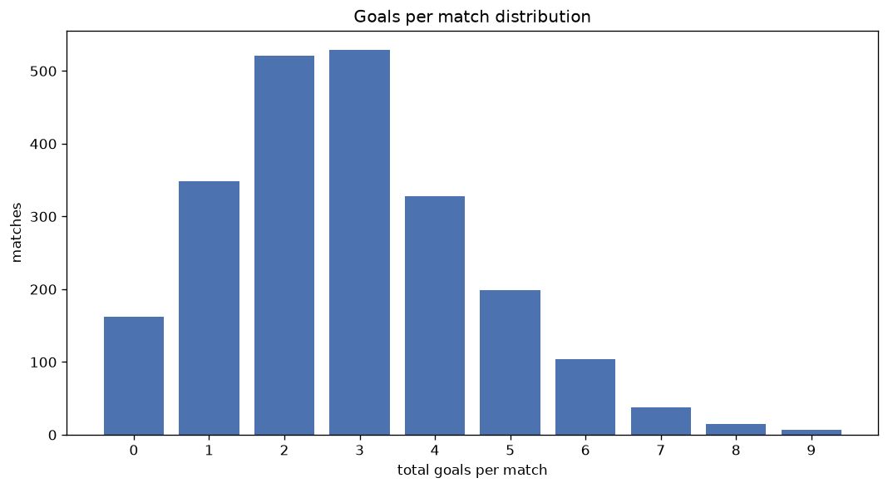
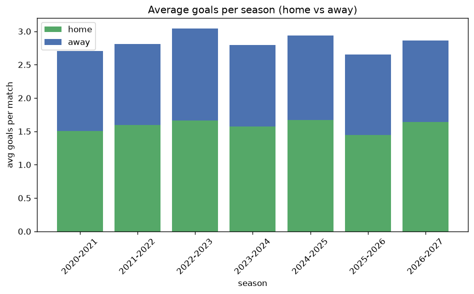

# Goal Analysis
- Report: `goals_analysis`
- Generated: 2026-10-30T04:14:54+00:00
- Script: `backend/scripts/analyze_goals.py` v1.0.0
- League: Super Lig (Turkey)
- Scope: league `turkey1`

## 1. Goals per match distribution
| goals | matches | pct |
|---|---|---|
| 0 | 162 | 7.2% |
| 1 | 348 | 15.5% |
| 2 | 521 | 23.1% |
| 3 | 529 | 23.5% |
| 4 | 328 | 14.6% |
| 5 | 199 | 8.8% |
| 6 | 104 | 4.6% |
| 7 | 38 | 1.7% |
| 8 | 15 | 0.7% |
| 9 | 7 | 0.3% |

## 2. Goals per match per season
| season | matches | total goals | avg home | avg away | avg total |
|---|---|---|---|---|---|
| 2020-2021 | 420 | 1136 | 1.505 | 1.2 | 2.705 |
| 2021-2022 | 380 | 1067 | 1.595 | 1.213 | 2.808 |
| 2022-2023 | 342 | 1041 | 1.664 | 1.38 | 3.044 |
| 2023-2024 | 380 | 1062 | 1.576 | 1.218 | 2.795 |
| 2024-2025 | 342 | 1004 | 1.667 | 1.269 | 2.936 |
| 2025-2026 | 306 | 812 | 1.444 | 1.209 | 2.654 |
| 2026-2027 | 81 | 235 | 1.667 | 1.235 | 2.901 |

## 3. Home vs away goal share
- Home goals: **3553** (55.9%)
- Away goals: **2804** (44.1%)
- Home/away ratio: **1.267**

| season | home goals | away goals | total | home pct | away pct |
|---|---|---|---|---|---|
| 2020-2021 | 632 | 504 | 1136 | 55.6% | 44.4% |
| 2021-2022 | 606 | 461 | 1067 | 56.8% | 43.2% |
| 2022-2023 | 569 | 472 | 1041 | 54.7% | 45.3% |
| 2023-2024 | 599 | 463 | 1062 | 56.4% | 43.6% |
| 2024-2025 | 570 | 434 | 1004 | 56.8% | 43.2% |
| 2025-2026 | 442 | 370 | 812 | 54.4% | 45.6% |
| 2026-2027 | 135 | 100 | 235 | 57.4% | 42.6% |

## 4. BTTS (Both Teams To Score)
- Overall: **1244** of `2251` (55.3%)

| season | matches | BTTS | pct |
|---|---|---|---|
| 2020-2021 | 420 | 238 | 56.7% |
| 2021-2022 | 380 | 219 | 57.6% |
| 2022-2023 | 342 | 181 | 52.9% |
| 2023-2024 | 380 | 209 | 55.0% |
| 2024-2025 | 342 | 193 | 56.4% |
| 2025-2026 | 306 | 167 | 54.6% |
| 2026-2027 | 81 | 37 | 45.7% |

## 5. Clean sheets
- Home clean sheets: **678** (30.1%)
- Away clean sheets: **491** (21.8%)
- Total clean sheets recorded: **1169**
- Matches with at least one clean sheet: **1007** (44.7%)
- Both teams kept clean sheets (0-0): **162**

| season | matches | home CS | away CS | total CS | matches w/ CS |
|---|---|---|---|---|---|
| 2020-2021 | 420 | 123 | 97 | 220 | 182 (43.3%) |
| 2021-2022 | 380 | 111 | 73 | 184 | 161 (42.4%) |
| 2022-2023 | 342 | 101 | 76 | 177 | 161 (47.1%) |
| 2023-2024 | 380 | 116 | 83 | 199 | 171 (45.0%) |
| 2024-2025 | 342 | 101 | 73 | 174 | 149 (43.6%) |
| 2025-2026 | 306 | 97 | 70 | 167 | 139 (45.4%) |
| 2026-2027 | 81 | 29 | 19 | 48 | 44 (54.3%) |

## 6. Scoring intensity
- First-half goals: **2769** (44.2%)
- Second-half goals: **3495** (55.8%)
- Avg first-half goals per match: **1.247**
- Avg second-half goals per match: **1.574**
- Second-half-only scoring (HT 0-0, FT goals >= 1): **458** (20.3%)
- *31 match(es) excluded (no HT score recorded).*

| season | matches | 1st half | 2nd half | 1st half pct | 2nd half pct |
|---|---|---|---|---|---|
| 2020-2021 | 420 | 486 | 650 | 42.8% | 57.2% |
| 2021-2022 | 380 | 490 | 577 | 45.9% | 54.1% |
| 2022-2023 | 342 | 430 | 524 | 45.1% | 54.9% |
| 2023-2024 | 380 | 458 | 601 | 43.2% | 56.8% |
| 2024-2025 | 342 | 449 | 552 | 44.9% | 55.1% |
| 2025-2026 | 306 | 350 | 462 | 43.1% | 56.9% |
| 2026-2027 | 81 | 106 | 129 | 45.1% | 54.9% |

## 7. First-goal timing
- Matches with first-goal time recorded: `2058` of `2251` (91.4%)
- Goalless matches: `193`
- Min `1` | Max `103` | Mean `31.07` | Median (p50) `26.0`

| bucket | count | % of matches | % of scoring matches |
|---|---|---|---|
| 1-15 | 653 | 29.0% | 31.7% |
| 16-30 | 525 | 23.3% | 25.5% |
| 31-45 | 344 | 15.3% | 16.7% |
| 46-60 | 278 | 12.4% | 13.5% |
| 61-75 | 148 | 6.6% | 7.2% |
| 76-90 | 85 | 3.8% | 4.1% |
| 91-120 | 25 | 1.1% | 1.2% |

---
*All statistics are computed from PostgreSQL tables (read-only). Run with `python backend/scripts/analyze_goals.py` to regenerate.*

## Charts

