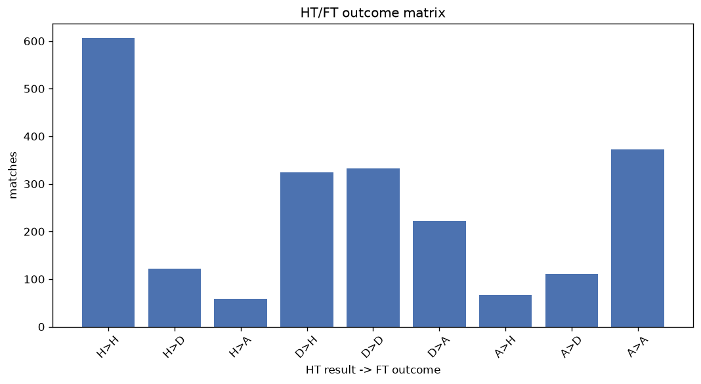
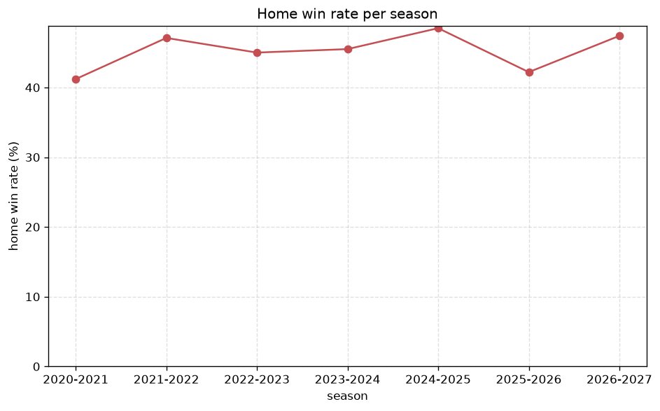

# Match Analysis
- Report: `matches_analysis`
- Generated: 2026-10-27T02:34:00+00:00
- Script: `backend/scripts/analyze_matches.py` v1.0.0
- League: Super Lig (Turkey)
- Scope: league `turkey1`

## 1. Overall summary
| metric | value |
|---|---|
| Matches | 2248 |
| Home wins | 1011 (45.0%) |
| Draws | 565 (25.1%) |
| Away wins | 672 (29.9%) |
| Total goals | 6345 |
| Average goals per match | 2.823 |
| Goalless matches | 162 (7.2%) |

## 2. Per-season breakdown
| season | matches | home wins | draws | away wins | total goals | avg goals | goalless |
|---|---|---|---|---|---|---|---|
| 2020-2021 | 420 | 173 (41.2%) | 118 (28.1%) | 129 (30.7%) | 1136 | 2.705 | 38 (9.0%) |
| 2021-2022 | 380 | 179 (47.1%) | 91 (23.9%) | 110 (28.9%) | 1067 | 2.808 | 23 (6.1%) |
| 2022-2023 | 342 | 154 (45.0%) | 73 (21.3%) | 115 (33.6%) | 1041 | 3.044 | 16 (4.7%) |
| 2023-2024 | 380 | 173 (45.5%) | 100 (26.3%) | 107 (28.2%) | 1062 | 2.795 | 28 (7.4%) |
| 2024-2025 | 342 | 166 (48.5%) | 80 (23.4%) | 96 (28.1%) | 1004 | 2.936 | 25 (7.3%) |
| 2025-2026 | 306 | 129 (42.2%) | 89 (29.1%) | 88 (28.8%) | 812 | 2.654 | 28 (9.2%) |
| 2026-2027 | 78 | 37 (47.4%) | 14 (17.9%) | 27 (34.6%) | 223 | 2.859 | 4 (5.1%) |

## 3. HT/FT outcome matrix
| HT result \ FT result | Home | Draw | Away | total |
|---|---|---|---|---|
| HT home lead | 606 (77.0%) | 122 (15.5%) | 59 (7.5%) | 787 |
| HT draw | 324 (36.9%) | 332 (37.8%) | 223 (25.4%) | 879 |
| HT away lead | 67 (12.2%) | 111 (20.1%) | 373 (67.7%) | 551 |
- *31 match(es) excluded (no HT score recorded).*

## 4. Comeback matches
- Home comebacks (trailing at HT, won at FT): **67** (3.0%)
- Away comebacks (trailing at HT, won at FT): **59** (2.6%)

### Home comebacks
| season | home | away | HT | FT |
|---|---|---|---|---|
| 2020-2021 | Rizespor | Ankaragucu | 2-3 | 5-3 |
| 2020-2021 | Fenerbahce | Trabzonspor | 0-1 | 3-1 |
| 2020-2021 | Basaksehir | Genclerbirligi | 0-1 | 2-1 |
| 2020-2021 | Konyaspor | Kasimpasa | 0-1 | 2-1 |
| 2020-2021 | Ankaragucu | Konyaspor | 1-2 | 4-3 |
| 2020-2021 | Trabzonspor | Rizespor | 0-1 | 2-1 |
| 2020-2021 | Yeni Malatyaspor | Rizespor | 0-1 | 4-1 |
| 2020-2021 | Besiktas | Goztepe | 0-1 | 2-1 |
| 2020-2021 | Alanyaspor | Ankaragucu | 1-2 | 4-3 |
| 2020-2021 | Gaziantep | Genclerbirligi | 0-1 | 2-1 |
| 2020-2021 | Antalyaspor | Erzurumspor | 0-1 | 3-1 |
| 2020-2021 | Alanyaspor | Denizlispor | 0-1 | 3-2 |
| 2020-2021 | Basaksehir | Ankaragucu | 0-1 | 2-1 |
| 2020-2021 | Genclerbirligi | Goztepe | 1-2 | 5-3 |
| 2020-2021 | Galatasaray | Yeni Malatyaspor | 0-1 | 3-1 |
| 2021-2022 | Konyaspor | Basaksehir | 0-1 | 2-1 |
| 2021-2022 | Goztepe | Basaksehir | 0-1 | 2-1 |
| 2021-2022 | Altay | Goztepe | 0-1 | 2-1 |
| 2021-2022 | Hatayspor | Kayserispor | 0-1 | 2-1 |
| 2021-2022 | Galatasaray | Goztepe | 0-1 | 2-1 |
| 2021-2022 | Kayserispor | Karagumruk | 0-1 | 2-1 |
| 2021-2022 | Giresunspor | Karagumruk | 0-1 | 3-1 |
| 2021-2022 | Hatayspor | Galatasaray | 1-2 | 4-2 |
| 2021-2022 | Sivasspor | Yeni Malatyaspor | 0-1 | 2-1 |
| 2021-2022 | Basaksehir | Konyaspor | 0-1 | 2-1 |
| 2021-2022 | Trabzonspor | Kayserispor | 0-2 | 3-2 |
| 2021-2022 | Fenerbahce | Konyaspor | 0-1 | 2-1 |
| 2021-2022 | Alanyaspor | Yeni Malatyaspor | 0-1 | 2-1 |
| 2022-2023 | Gaziantep | Antalyaspor | 1-2 | 5-2 |
| 2022-2023 | Hatayspor | Besiktas | 0-1 | 2-1 |
| 2022-2023 | Hatayspor | Trabzonspor | 0-1 | 2-1 |
| 2022-2023 | Galatasaray | Umraniyespor | 1-2 | 3-2 |
| 2022-2023 | Konyaspor | Galatasaray | 0-1 | 2-1 |
| 2022-2023 | Ankaragucu | Giresunspor | 0-1 | 3-1 |
| 2023-2024 | Hatayspor | Trabzonspor | 0-1 | 3-2 |
| 2023-2024 | Samsunspor | Hatayspor | 0-1 | 2-1 |
| 2023-2024 | Antalyaspor | Besiktas | 0-1 | 3-2 |
| 2023-2024 | Samsunspor | Istanbulspor AS | 0-1 | 2-1 |
| 2023-2024 | Fenerbahce | Karagumruk | 0-1 | 2-1 |
| 2023-2024 | Galatasaray | Gaziantep | 0-1 | 2-1 |
| 2023-2024 | Kayserispor | Ankaragucu | 0-2 | 3-2 |
| 2023-2024 | Fenerbahce | Pendikspor | 0-1 | 4-1 |
| 2023-2024 | Antalyaspor | Hatayspor | 0-1 | 2-1 |
| 2023-2024 | Trabzonspor | Gaziantep | 0-2 | 4-2 |
| 2023-2024 | Pendikspor | Rizespor | 0-1 | 2-1 |
| 2023-2024 | Trabzonspor | Ankaragucu | 0-1 | 4-2 |
| 2024-2025 | Basaksehir | Alanyaspor | 1-2 | 4-2 |
| 2024-2025 | Eyupspor | Bodrumspor | 0-1 | 4-1 |
| 2024-2025 | Antalyaspor | Hatayspor | 0-2 | 3-2 |
| 2024-2025 | Basaksehir | Antalyaspor | 1-2 | 5-2 |
| 2024-2025 | Samsunspor | Goztepe | 1-2 | 4-3 |
| 2024-2025 | Sivasspor | Rizespor | 0-1 | 2-1 |
| 2024-2025 | Fenerbahce | Goztepe | 0-1 | 3-2 |
| 2024-2025 | Kasimpasa | Hatayspor | 2-3 | 5-4 |
| 2024-2025 | Fenerbahce | Rizespor | 1-2 | 3-2 |
| 2024-2025 | Besiktas | Trabzonspor | 0-1 | 2-1 |
| 2024-2025 | Alanyaspor | Adana Demirspor | 0-2 | 3-2 |
| 2024-2025 | Sivasspor | Goztepe | 0-1 | 3-1 |
| 2024-2025 | Fenerbahce | Trabzonspor | 0-1 | 4-1 |
| 2024-2025 | Konyaspor | Adana Demirspor | 0-1 | 3-1 |
| 2024-2025 | Fenerbahce | Konyaspor | 0-1 | 2-1 |
| 2025-2026 | Samsunspor | Karagumruk | 0-1 | 3-2 |
| 2025-2026 | Galatasaray | Genclerbirligi | 0-1 | 3-2 |
| 2025-2026 | Fenerbahce | Samsunspor | 1-2 | 3-2 |
| 2025-2026 | Rizespor | Gaziantep | 0-1 | 2-1 |
| 2025-2026 | Galatasaray | Antalyaspor | 0-1 | 4-2 |
| 2025-2026 | Karagumruk | Alanyaspor | 0-1 | 2-1 |

### Away comebacks
| season | home | away | HT | FT |
|---|---|---|---|---|
| 2020-2021 | Trabzonspor | Kasimpasa | 3-2 | 3-4 |
| 2020-2021 | Kayserispor | Konyaspor | 1-0 | 1-2 |
| 2020-2021 | Yeni Malatyaspor | Konyaspor | 2-0 | 2-3 |
| 2020-2021 | Genclerbirligi | Sivasspor | 2-0 | 2-3 |
| 2020-2021 | Erzurumspor | Basaksehir | 1-0 | 1-2 |
| 2020-2021 | Alanyaspor | Erzurumspor | 2-1 | 2-3 |
| 2020-2021 | Kayserispor | Fenerbahce | 1-0 | 1-2 |
| 2021-2022 | Yeni Malatyaspor | Karagumruk | 3-2 | 3-4 |
| 2021-2022 | Antalyaspor | Besiktas | 2-0 | 2-3 |
| 2021-2022 | Rizespor | Galatasaray | 2-1 | 2-3 |
| 2021-2022 | Kasimpasa | Sivasspor | 1-0 | 1-3 |
| 2021-2022 | Altay | Trabzonspor | 1-0 | 1-2 |
| 2021-2022 | Galatasaray | Trabzonspor | 1-0 | 1-2 |
| 2021-2022 | Kayserispor | Konyaspor | 2-1 | 2-3 |
| 2021-2022 | Konyaspor | Karagumruk | 1-0 | 1-2 |
| 2021-2022 | Kayserispor | Besiktas | 1-0 | 2-3 |
| 2022-2023 | Kayserispor | Trabzonspor | 1-0 | 1-2 |
| 2022-2023 | Karagumruk | Istanbulspor AS | 1-0 | 1-2 |
| 2022-2023 | Fenerbahce | Giresunspor | 1-0 | 1-2 |
| 2022-2023 | Antalyaspor | Fenerbahce | 1-0 | 1-2 |
| 2022-2023 | Konyaspor | Besiktas | 1-0 | 1-2 |
| 2022-2023 | Kasimpasa | Basaksehir | 1-0 | 1-3 |
| 2022-2023 | Istanbulspor AS | Kayserispor | 2-1 | 2-4 |
| 2022-2023 | Alanyaspor | Fenerbahce | 1-0 | 1-3 |
| 2022-2023 | Fenerbahce | Besiktas | 1-0 | 2-4 |
| 2022-2023 | Karagumruk | Fenerbahce | 1-0 | 1-2 |
| 2022-2023 | Basaksehir | Fenerbahce | 1-0 | 1-2 |
| 2022-2023 | Antalyaspor | Besiktas | 1-0 | 1-3 |
| 2022-2023 | Karagumruk | Adana Demirspor | 1-0 | 2-3 |
| 2023-2024 | Konyaspor | Rizespor | 1-0 | 1-2 |
| 2023-2024 | Istanbulspor AS | Antalyaspor | 1-0 | 1-2 |
| 2023-2024 | Konyaspor | Basaksehir | 2-0 | 2-3 |
| 2023-2024 | Trabzonspor | Kasimpasa | 1-0 | 2-3 |
| 2023-2024 | Rizespor | Fenerbahce | 1-0 | 1-3 |
| 2023-2024 | Istanbulspor AS | Kasimpasa | 1-0 | 1-2 |
| 2023-2024 | Karagumruk | Fenerbahce | 1-0 | 1-2 |
| 2024-2025 | Adana Demirspor | Samsunspor | 1-0 | 1-3 |
| 2024-2025 | Adana Demirspor | Sivasspor | 2-1 | 2-4 |
| 2024-2025 | Kasimpasa | Samsunspor | 1-0 | 1-4 |
| 2024-2025 | Alanyaspor | Antalyaspor | 1-0 | 1-2 |
| 2024-2025 | Besiktas | Kasimpasa | 1-0 | 1-3 |
| 2024-2025 | Eyupspor | Rizespor | 1-0 | 1-2 |
| 2024-2025 | Hatayspor | Adana Demirspor | 1-0 | 1-3 |
| 2024-2025 | Samsunspor | Rizespor | 2-0 | 2-3 |
| 2024-2025 | Alanyaspor | Galatasaray | 1-0 | 1-2 |
| 2024-2025 | Besiktas | Gaziantep | 1-0 | 1-2 |
| 2024-2025 | Hatayspor | Konyaspor | 2-1 | 2-3 |
| 2024-2025 | Gaziantep | Fenerbahce | 1-0 | 1-3 |
| 2024-2025 | Basaksehir | Adana Demirspor | 2-1 | 2-3 |
| 2025-2026 | Alanyaspor | Kasimpasa | 1-0 | 1-2 |
| 2025-2026 | Rizespor | Fenerbahce | 2-0 | 2-5 |
| 2025-2026 | Basaksehir | Trabzonspor | 2-1 | 3-4 |
| 2025-2026 | Antalyaspor | Goztepe | 1-0 | 1-2 |
| 2025-2026 | Alanyaspor | Fenerbahce | 2-1 | 2-3 |
| 2025-2026 | Alanyaspor | Eyupspor | 1-0 | 1-3 |
| 2025-2026 | Eyupspor | Samsunspor | 1-0 | 1-2 |
| 2026-2027 | Konyaspor | Kocaelispor | 1-0 | 1-2 |
| 2026-2027 | Genclerbirligi | Kasimpasa | 1-0 | 1-2 |
| 2026-2027 | Samsunspor | Amedspor | 1-0 | 1-2 |

## 5. HT lead conversion
| HT state | matches | converted to win | held as draw | collapsed to loss |
|---|---|---|---|---|
| Home lead | 787 | 606 (77.0%) | 122 (15.5%) | 59 (7.5%) |
| Away lead | 551 | 373 (67.7%) | 111 (20.1%) | 67 (12.2%) |

### Matches level at half-time
| FT result | count | pct |
|---|---|---|
| Home win | 324 | 36.9% |
| Draw | 332 | 37.8% |
| Away win | 223 | 25.4% |
- *31 match(es) excluded (no HT score recorded).*

## 6. First-goal timing
- Matches with a first-goal time recorded: `2055` of `2248` (91.4%)

Outcome distribution by first-goal timing bucket:
| bucket | matches | % of matches | home | draw | away |
|---|---|---|---|---|---|
| 1-15 | 652 | 29.0% | 335 (51.4%) | 113 (17.3%) | 204 (31.3%) |
| 16-30 | 524 | 23.3% | 245 (46.8%) | 114 (21.8%) | 165 (31.5%) |
| 31-45 | 344 | 15.3% | 170 (49.4%) | 68 (19.8%) | 106 (30.8%) |
| 46-60 | 278 | 12.4% | 130 (46.8%) | 59 (21.2%) | 89 (32.0%) |
| 61-75 | 148 | 6.6% | 65 (43.9%) | 33 (22.3%) | 50 (33.8%) |
| 76-90 | 84 | 3.7% | 36 (42.9%) | 13 (15.5%) | 35 (41.7%) |
| 91-120 | 25 | 1.1% | 16 (64.0%) | 3 (12.0%) | 6 (24.0%) |

## 7. Goalless matches
- Overall: **162** of `2248` (7.2%)

| season | matches | goalless | pct |
|---|---|---|---|
| 2020-2021 | 420 | 38 | 9.0% |
| 2021-2022 | 380 | 23 | 6.1% |
| 2022-2023 | 342 | 16 | 4.7% |
| 2023-2024 | 380 | 28 | 7.4% |
| 2024-2025 | 342 | 25 | 7.3% |
| 2025-2026 | 306 | 28 | 9.2% |
| 2026-2027 | 78 | 4 | 5.1% |

---
*All statistics are computed from PostgreSQL tables (read-only). Run with `python backend/scripts/analyze_matches.py` to regenerate.*

## Charts

