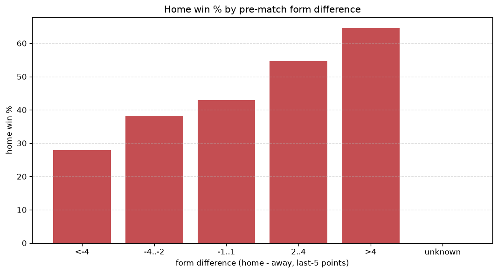
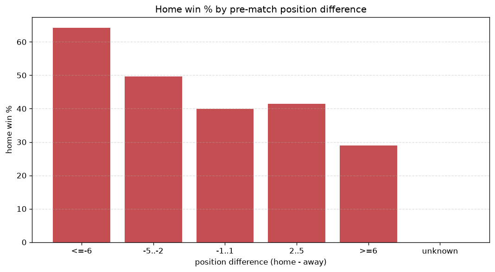

# Relationships Analysis
- Report: `relationships`
- Generated: 2026-10-26T01:51:52+00:00
- Script: `backend/scripts/analyze_relationships.py` v1.0.0
- League: Super Lig (Turkey)
- Scope: league `turkey1`

- Matches analysed: **2170** (23 leakage-safe pre-match features).

## 1. Correlation matrix
_Pearson correlation of each pre-match feature with observed goals; sorted by |corr(total goals)|._

| feature | corr(home) | corr(away) | corr(total) |
|---|---|---|---|
| home_points_before_match | 0.177 | -0.031 | 0.112 |
| home_team_home_goals_avg | 0.183 | -0.058 | 0.098 |
| home_team_goals_scored_last_5 | 0.167 | -0.048 | 0.094 |
| home_team_home_win_rate | 0.191 | -0.078 | 0.091 |
| home_team_points_last_5 | 0.177 | -0.064 | 0.090 |
| home_team_wins_last_5 | 0.166 | -0.056 | 0.087 |
| home_position_before_match | -0.198 | 0.103 | -0.079 |
| away_team_goals_scored_last_5 | -0.069 | 0.182 | 0.072 |
| away_points_before_match | -0.048 | 0.152 | 0.068 |
| away_team_points_last_5 | -0.088 | 0.182 | 0.058 |
| points_difference | 0.286 | -0.234 | 0.056 |
| away_team_wins_last_5 | -0.099 | 0.182 | 0.050 |
| away_team_away_goals_avg | -0.060 | 0.138 | 0.049 |
| away_team_away_win_rate | -0.084 | 0.154 | 0.042 |
| position_difference | -0.252 | 0.222 | -0.039 |
| away_team_goals_conceded_last_5 | 0.114 | -0.087 | 0.027 |
| away_position_before_match | 0.154 | -0.207 | -0.025 |
| away_team_away_conceded_avg | 0.119 | -0.102 | 0.020 |
| home_rest_days | -0.031 | 0.009 | -0.018 |
| rest_days_difference | -0.023 | 0.010 | -0.011 |
| away_rest_days | -0.017 | 0.002 | -0.011 |
| home_team_goals_conceded_last_5 | -0.080 | 0.077 | -0.007 |
| home_team_home_conceded_avg | -0.075 | 0.079 | -0.003 |

## 2. Form vs outcome
_Home win/draw/away % per bucket of `home_team_points_last_5 - away_team_points_last_5`._

| bucket | matches | home | draw | away | home % | draw % | away % |
|---|---|---|---|---|---|---|---|
| <-4 | 365 | 102 | 86 | 177 | 27.9% | 23.6% | 48.5% |
| -4..-2 | 484 | 185 | 136 | 163 | 38.2% | 28.1% | 33.7% |
| -1..1 | 567 | 243 | 161 | 163 | 42.9% | 28.4% | 28.7% |
| 2..4 | 435 | 238 | 100 | 97 | 54.7% | 23.0% | 22.3% |
| >4 | 319 | 206 | 68 | 45 | 64.6% | 21.3% | 14.1% |
| unknown | 0 | 0 | 0 | 0 | - | - | - |

## 3. Position vs outcome
_Home win/draw/away % per bucket of `position_difference` (home position - away position; negative favours the home team)._

| bucket | matches | home | draw | away | home % | draw % | away % |
|---|---|---|---|---|---|---|---|
| <=-6 | 528 | 339 | 109 | 80 | 64.2% | 20.6% | 15.2% |
| -5..-2 | 378 | 188 | 106 | 84 | 49.7% | 28.0% | 22.2% |
| -1..1 | 293 | 117 | 84 | 92 | 39.9% | 28.7% | 31.4% |
| 2..5 | 391 | 162 | 112 | 117 | 41.4% | 28.6% | 29.9% |
| >=6 | 580 | 168 | 140 | 272 | 29.0% | 24.1% | 46.9% |
| unknown | 0 | 0 | 0 | 0 | - | - | - |

## 4. Rest advantage
_Home win/draw/away % per bucket of `rest_days_difference` (home rest - away rest). Matches with unknown rest are bucketed separately._

| bucket | matches | home | draw | away | home % | draw % | away % |
|---|---|---|---|---|---|---|---|
| <-1 | 275 | 136 | 74 | 65 | 49.5% | 26.9% | 23.6% |
| -1..0 | 407 | 192 | 93 | 122 | 47.2% | 22.9% | 30.0% |
| 0 | 734 | 324 | 199 | 211 | 44.1% | 27.1% | 28.7% |
| 1..2 | 591 | 257 | 138 | 196 | 43.5% | 23.4% | 33.2% |
| >2 | 101 | 41 | 31 | 29 | 40.6% | 30.7% | 28.7% |
| unknown | 62 | 24 | 16 | 22 | 38.7% | 25.8% | 35.5% |
- *62 match(es) had unknown rest difference (missing rest data on at least one side).*

## 5. Home team quality
_Home win rate by `home_team_home_win_rate` tier (split at 0.5)._

- `< 0.5` tier: **39.4%** home win (497/1263)
- `>= 0.5` tier: **52.6%** home win (477/907)
- Home-win gap (>= split minus < split): **+13.2 pp**

| tier | label | matches | home | draw | away | home % |
|---|---|---|---|---|---|---|
| low | < 0.5 | 1263 | 497 | 333 | 433 | 39.4% |
| high | >= 0.5 | 907 | 477 | 218 | 212 | 52.6% |

## 6. Feature averages by result
_Mean feature value per outcome; `range` is home-minus-away spread of the group means._

| feature | home mean | draw mean | away mean | range |
|---|---|---|---|---|
| points_difference | 4.190 | -0.405 | -6.532 | 10.722 |
| away_points_before_match | 22.765 | 23.842 | 28.816 | 6.051 |
| position_difference | -2.158 | 0.475 | 3.509 | 5.667 |
| home_points_before_match | 26.955 | 23.437 | 22.284 | 4.671 |
| away_position_before_match | 11.738 | 10.387 | 8.577 | 3.161 |
| home_position_before_match | 9.580 | 10.862 | 12.085 | 2.505 |
| away_team_points_last_5 | 5.828 | 6.368 | 7.307 | 1.479 |
| away_team_goals_scored_last_5 | 6.009 | 6.292 | 7.330 | 1.321 |
| home_team_points_last_5 | 6.801 | 5.984 | 5.485 | 1.316 |
| home_team_goals_scored_last_5 | 6.873 | 6.076 | 5.766 | 1.107 |
| away_team_goals_conceded_last_5 | 6.757 | 6.105 | 5.867 | 0.890 |
| home_team_goals_conceded_last_5 | 6.205 | 6.379 | 6.986 | 0.781 |
| away_team_wins_last_5 | 1.528 | 1.724 | 2.068 | 0.540 |
| home_team_wins_last_5 | 1.866 | 1.599 | 1.448 | 0.417 |
| home_team_home_goals_avg | 1.524 | 1.370 | 1.264 | 0.260 |
| away_team_away_conceded_avg | 1.512 | 1.376 | 1.278 | 0.234 |
| away_team_away_goals_avg | 1.063 | 1.119 | 1.277 | 0.214 |
| rest_days_difference | -0.109 | -0.043 | 0.098 | 0.207 |
| home_rest_days | 7.647 | 7.819 | 7.828 | 0.181 |
| away_rest_days | 7.757 | 7.866 | 7.728 | 0.138 |
| home_team_home_conceded_avg | 1.094 | 1.125 | 1.230 | 0.136 |
| home_team_home_win_rate | 0.453 | 0.398 | 0.351 | 0.101 |
| away_team_away_win_rate | 0.246 | 0.272 | 0.346 | 0.100 |

---
*All features are leakage-safe pre-match values built by `ml.features.build_features.build_rows` from strictly prior matches. Run with `python backend/scripts/analyze_relationships.py` to regenerate.*

## Charts

