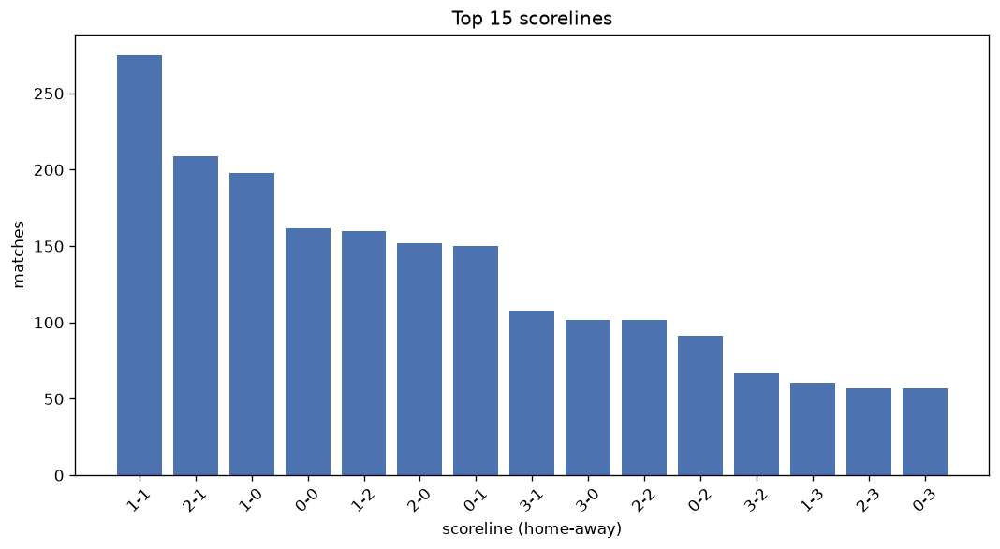
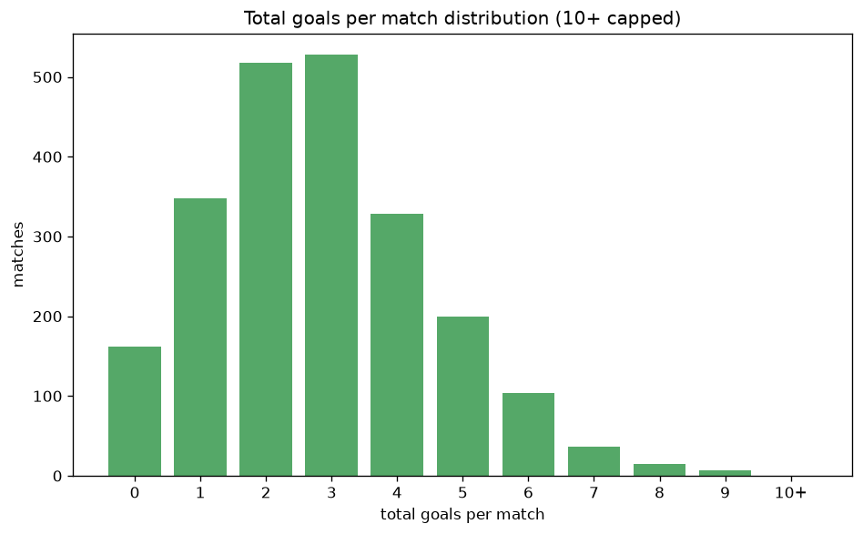

# Scoreline Analysis
- Report: `scoreline_analysis`
- Generated: 2026-10-26T01:51:50+00:00
- Script: `backend/scripts/analyze_scorelines.py` v1.0.0
- League: Super Lig (Turkey)
- Scope: league `turkey1`

## 1. Scoreline frequency
- Matches analysed: **2246** across **7** seasons.
- Distinct scorelines seen: **47**.

| scoreline | count | pct |
|---|---|---|
| 1-1 | 275 | 12.2% |
| 2-1 | 209 | 9.3% |
| 1-0 | 198 | 8.8% |
| 0-0 | 162 | 7.2% |
| 1-2 | 160 | 7.1% |
| 2-0 | 152 | 6.8% |
| 0-1 | 150 | 6.7% |
| 3-1 | 108 | 4.8% |
| 3-0 | 102 | 4.5% |
| 2-2 | 102 | 4.5% |
| 0-2 | 91 | 4.1% |
| 3-2 | 67 | 3.0% |
| 1-3 | 60 | 2.7% |
| 2-3 | 57 | 2.5% |
| 0-3 | 57 | 2.5% |
| 4-1 | 41 | 1.8% |
| 4-0 | 35 | 1.6% |
| 3-3 | 25 | 1.1% |
| 0-4 | 23 | 1.0% |
| 4-2 | 23 | 1.0% |

## 2. Scoreline frequency per season

### 2020-2021
| scoreline | count | pct |
|---|---|---|
| 1-1 | 60 | 14.3% |
| 0-0 | 38 | 9.0% |
| 1-0 | 37 | 8.8% |
| 1-2 | 35 | 8.3% |
| 0-1 | 35 | 8.3% |

### 2021-2022
| scoreline | count | pct |
|---|---|---|
| 1-1 | 49 | 12.9% |
| 2-1 | 45 | 11.8% |
| 2-0 | 31 | 8.2% |
| 1-0 | 30 | 7.9% |
| 1-2 | 27 | 7.1% |

### 2022-2023
| scoreline | count | pct |
|---|---|---|
| 1-0 | 32 | 9.4% |
| 1-1 | 30 | 8.8% |
| 1-2 | 30 | 8.8% |
| 2-1 | 24 | 7.0% |
| 3-0 | 22 | 6.4% |

### 2023-2024
| scoreline | count | pct |
|---|---|---|
| 1-1 | 52 | 13.7% |
| 2-1 | 38 | 10.0% |
| 2-0 | 33 | 8.7% |
| 1-0 | 31 | 8.2% |
| 0-0 | 28 | 7.4% |

### 2024-2025
| scoreline | count | pct |
|---|---|---|
| 1-1 | 37 | 10.8% |
| 2-1 | 34 | 9.9% |
| 1-0 | 30 | 8.8% |
| 0-0 | 25 | 7.3% |
| 0-1 | 25 | 7.3% |

### 2025-2026
| scoreline | count | pct |
|---|---|---|
| 1-1 | 43 | 14.1% |
| 1-0 | 30 | 9.8% |
| 2-1 | 29 | 9.5% |
| 0-0 | 28 | 9.2% |
| 1-2 | 23 | 7.5% |

### 2026-2027
| scoreline | count | pct |
|---|---|---|
| 1-0 | 8 | 10.5% |
| 1-2 | 8 | 10.5% |
| 0-1 | 7 | 9.2% |
| 2-1 | 7 | 9.2% |
| 2-2 | 5 | 6.6% |

## 3. Total-goal histogram
_10+ groups all matches with 10 or more total goals._

| total goals | matches | pct |
|---|---|---|
| 0 | 162 | 7.2% |
| 1 | 348 | 15.5% |
| 2 | 518 | 23.1% |
| 3 | 528 | 23.5% |
| 4 | 328 | 14.6% |
| 5 | 199 | 8.9% |
| 6 | 104 | 4.6% |
| 7 | 37 | 1.6% |
| 8 | 15 | 0.7% |
| 9 | 7 | 0.3% |
| 10+ | 0 | 0.0% |

## 4. Extreme scorelines
- Matches with 7+ total goals: **59**

| season | date | scoreline | total goals |
|---|---|---|---|
| 2020-2021 | 2021-04-28 | 6-3 | 9 |
| 2020-2021 | 2021-05-11 | 4-5 | 9 |
| 2021-2022 | 2021-10-18 | 6-3 | 9 |
| 2022-2023 | 2022-10-09 | 5-4 | 9 |
| 2024-2025 | 2025-01-25 | 5-4 | 9 |
| 2024-2025 | 2025-01-27 | 5-4 | 9 |
| 2024-2025 | 2025-05-18 | 6-3 | 9 |
| 2020-2021 | 2020-10-17 | 5-3 | 8 |
| 2020-2021 | 2021-03-20 | 3-5 | 8 |
| 2020-2021 | 2021-04-20 | 5-3 | 8 |
| 2020-2021 | 2021-05-11 | 5-3 | 8 |
| 2021-2022 | 2021-12-12 | 2-6 | 8 |
| 2021-2022 | 2022-02-18 | 4-4 | 8 |
| 2021-2022 | 2022-05-01 | 1-7 | 8 |
| 2022-2023 | 2023-04-23 | 5-3 | 8 |
| 2023-2024 | 2024-01-10 | 7-1 | 8 |
| 2023-2024 | 2024-03-08 | 6-2 | 8 |
| 2023-2024 | 2024-05-26 | 2-6 | 8 |
| 2024-2025 | 2024-11-23 | 2-6 | 8 |
| 2024-2025 | 2025-02-02 | 3-5 | 8 |
| 2026-2027 | 2026-08-31 | 6-2 | 8 |
| 2026-2027 | 2026-09-20 | 8-0 | 8 |
| 2020-2021 | 2020-10-30 | 3-4 | 7 |
| 2020-2021 | 2020-11-29 | 3-4 | 7 |
| 2020-2021 | 2020-12-12 | 4-3 | 7 |
| 2020-2021 | 2021-01-05 | 4-3 | 7 |
| 2020-2021 | 2021-01-20 | 6-1 | 7 |
| 2020-2021 | 2021-01-25 | 4-3 | 7 |
| 2020-2021 | 2021-03-19 | 3-4 | 7 |
| 2020-2021 | 2021-05-01 | 7-0 | 7 |
| 2021-2022 | 2021-09-17 | 3-4 | 7 |
| 2021-2022 | 2022-02-04 | 4-3 | 7 |
| 2021-2022 | 2022-02-27 | 5-2 | 7 |
| 2021-2022 | 2022-03-13 | 2-5 | 7 |
| 2021-2022 | 2022-05-22 | 7-0 | 7 |
| 2022-2023 | 2022-08-20 | 5-2 | 7 |
| 2022-2023 | 2022-08-26 | 5-2 | 7 |
| 2022-2023 | 2022-10-30 | 5-2 | 7 |
| 2022-2023 | 2022-10-30 | 2-5 | 7 |
| 2022-2023 | 2022-11-12 | 0-7 | 7 |
| 2022-2023 | 2023-03-04 | 4-3 | 7 |
| 2022-2023 | 2023-04-01 | 3-4 | 7 |
| 2022-2023 | 2023-06-03 | 2-5 | 7 |
| 2023-2024 | 2023-11-11 | 3-4 | 7 |
| 2023-2024 | 2023-12-20 | 3-4 | 7 |
| 2023-2024 | 2024-03-17 | 3-4 | 7 |
| 2023-2024 | 2024-05-05 | 6-1 | 7 |
| 2023-2024 | 2024-05-12 | 1-6 | 7 |
| 2024-2025 | 2024-09-01 | 5-2 | 7 |
| 2024-2025 | 2024-09-28 | 4-3 | 7 |
| 2024-2025 | 2024-12-16 | 4-3 | 7 |
| 2024-2025 | 2025-01-25 | 5-2 | 7 |
| 2024-2025 | 2025-04-27 | 4-3 | 7 |
| 2024-2025 | 2025-05-31 | 5-2 | 7 |
| 2025-2026 | 2025-09-27 | 3-4 | 7 |
| 2025-2026 | 2025-10-03 | 2-5 | 7 |
| 2025-2026 | 2025-11-23 | 2-5 | 7 |
| 2025-2026 | 2025-11-24 | 3-4 | 7 |
| 2025-2026 | 2025-12-22 | 4-3 | 7 |

## 5. Margin-of-victory distribution (decided matches)
- Decided matches: **1681** (draws: **565**)
- Average winning margin: **1.81**

| margin | matches | pct |
|---|---|---|
| 1 | 864 | 51.4% |
| 2 | 456 | 27.1% |
| 3+ | 361 | 21.5% |

## 6. Margin by outcome

### Home wins
- Matches: **1009** | avg margin: **1.88** | max margin: **8**
| margin | matches | pct |
|---|---|---|
| 1 | 486 | 48.2% |
| 2 | 287 | 28.4% |
| 3+ | 236 | 23.4% |
- *Full match-by-match list available in `scoreline_analysis.json`.*

### Away wins
- Matches: **672** | avg margin: **1.72** | max margin: **7**
| margin | matches | pct |
|---|---|---|
| 1 | 378 | 56.2% |
| 2 | 169 | 25.1% |
| 3+ | 125 | 18.6% |
- *Full match-by-match list available in `scoreline_analysis.json`.*

## 7. Most common exact score by outcome type
| outcome | matches | most common score | count | pct |
|---|---|---|---|---|
| home | 1009 | 2-1 | 209 | 20.7% |
| draw | 565 | 1-1 | 275 | 48.7% |
| away | 672 | 1-2 | 160 | 23.8% |

---
*All statistics are computed from PostgreSQL tables (read-only). Run with `python backend/scripts/analyze_scorelines.py` to regenerate.*

## Charts

