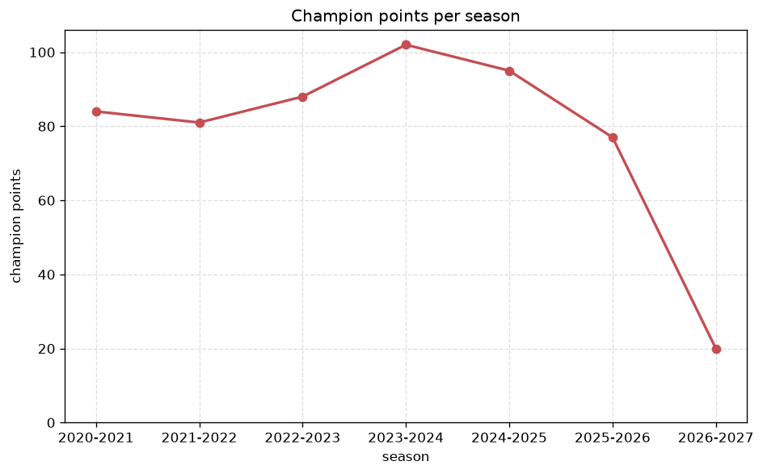
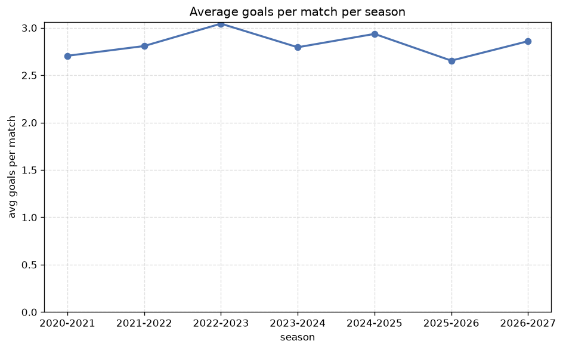

# Season Trends Analysis
- Report: `season_trends`
- Generated: 2026-10-27T02:34:06+00:00
- Script: `backend/scripts/analyze_seasons.py` v1.0.0
- League: Super Lig (Turkey)
- Scope: league `turkey1`

## 1. Champions per season
| season | champion | pts | runner-up | margin |
|---|---|---|---|---|
| 2020-2021 | Besiktas | 84 | Galatasaray | 0 pts |
| 2021-2022 | Trabzonspor | 81 | Fenerbahce | 8 pts |
| 2022-2023 | Galatasaray | 88 | Fenerbahce | 8 pts |
| 2023-2024 | Galatasaray | 102 | Fenerbahce | 3 pts |
| 2024-2025 | Galatasaray | 95 | Fenerbahce | 11 pts |
| 2025-2026 | Galatasaray | 77 | Fenerbahce | 3 pts |
| 2026-2027 | Amedspor | 20 | Galatasaray | 1 pts |

## 2. Title-race tightness
- Tight races (margin <= 3 pts): **4** of 7 seasons
- Tightest race: **2020-2021** - Besiktas beat Galatasaray by **0** pts

| season | margin | tight |
|---|---|---|
| 2020-2021 | 0 pts | yes |
| 2021-2022 | 8 pts |  |
| 2022-2023 | 8 pts |  |
| 2023-2024 | 3 pts | yes |
| 2024-2025 | 11 pts |  |
| 2025-2026 | 3 pts | yes |
| 2026-2027 | 1 pts | yes |

## 3. Points thresholds
_Position-specific points per season. Key: 1 = champion, 2 = runner-up, 4 = CL line, 6 = Europa, 15 = last safe, 18 = bottom._

| season | pos 1 | pos 2 | pos 4 | pos 6 | pos 15 | pos 18 |
|---|---|---|---|---|---|---|
| 2020-2021 | 84 | 84 | 71 | 61 | 45 | 40 |
| 2021-2022 | 81 | 73 | 65 | 59 | 46 | 34 |
| 2022-2023 | 88 | 80 | 69 | 57 | 41 | 25 |
| 2023-2024 | 102 | 99 | 61 | 56 | 41 | 40 |
| 2024-2025 | 95 | 84 | 62 | 53 | 44 | 26 |
| 2025-2026 | 77 | 74 | 60 | 55 | 33 | 30 |
| 2026-2027 | 20 | 19 | 16 | 15 | 8 | 3 |

## 4. Relegation battle
| season | safe pos | safe pts | drop pos | drop pts | gap |
|---|---|---|---|---|---|
| 2020-2021 | 15 | 45 | 16 | 44 | 1 pts |
| 2021-2022 | 15 | 46 | 16 | 45 | 1 pts |
| 2022-2023 | 15 | 41 | 16 | 40 | 1 pts |
| 2023-2024 | 15 | 41 | 16 | 41 | 0 pts |
| 2024-2025 | 15 | 44 | 16 | 37 | 7 pts |
| 2025-2026 | 15 | 33 | 16 | 32 | 1 pts |
| 2026-2027 | 15 | 8 | 16 | 8 | 0 pts |

## 5. League-level trends
| season | matches | total goals | avg goals | home win | draw | away win | goalless | avg pts/team |
|---|---|---|---|---|---|---|---|---|
| 2020-2021 | 420 | 1136 | 2.705 | 41.2% | 28.1% | 30.7% | 9.0% | 54.38 |
| 2021-2022 | 380 | 1067 | 2.808 | 47.1% | 23.9% | 28.9% | 6.1% | 52.45 |
| 2022-2023 | 342 | 1041 | 3.044 | 45.0% | 21.3% | 33.6% | 4.7% | 50.16 |
| 2023-2024 | 380 | 1062 | 2.795 | 45.5% | 26.3% | 28.2% | 7.4% | 52.0 |
| 2024-2025 | 342 | 1004 | 2.936 | 48.5% | 23.4% | 28.1% | 7.3% | 49.79 |
| 2025-2026 | 306 | 812 | 2.654 | 42.2% | 29.1% | 28.8% | 9.2% | 46.06 |
| 2026-2027 | 78 | 223 | 2.859 | 47.4% | 17.9% | 34.6% | 5.1% | 12.22 |

## 6. View divergence
- Largest divergence: **2021-2022** (goals view, avg abs position diff = 6.300)

_Avg absolute position difference between classic view and alternative view per season._

| season | classic vs luck | classic vs goals |
|---|---|---|
| 2020-2021 | 2.857 | 6.286 |
| 2021-2022 | 2.900 | 6.300 |
| 2022-2023 | 3.158 | 5.158 |
| 2023-2024 | 2.500 | 4.900 |
| 2024-2025 | 3.263 | 5.579 |
| 2025-2026 | 3.667 | 3.556 |
| 2026-2027 | 2.556 | 5.111 |

---
*All statistics are computed from PostgreSQL tables (read-only). Run with `python backend/scripts/analyze_seasons.py` to regenerate.*

## Charts

