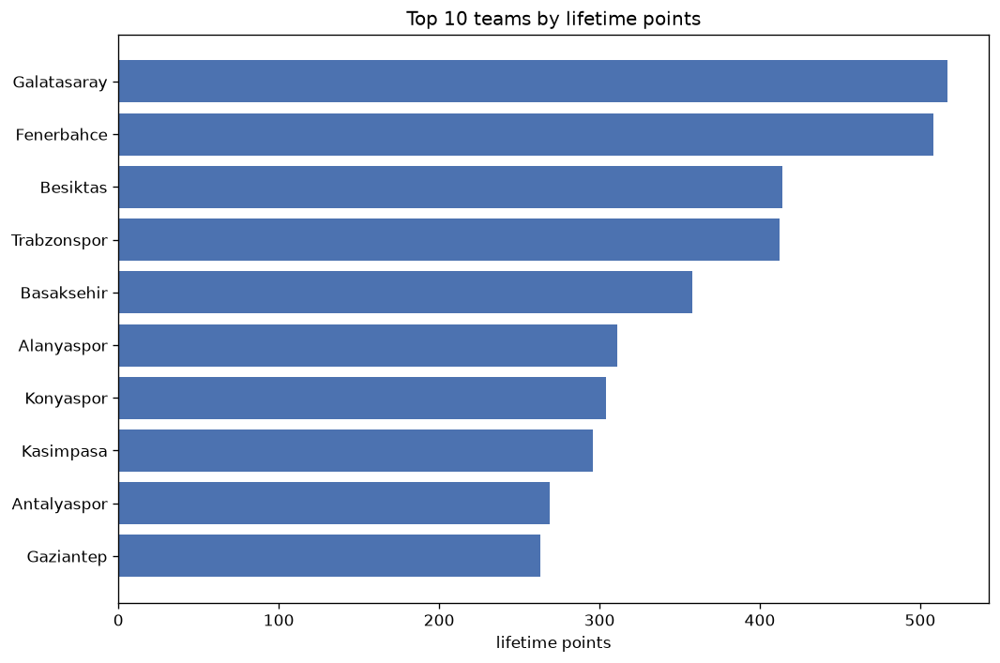
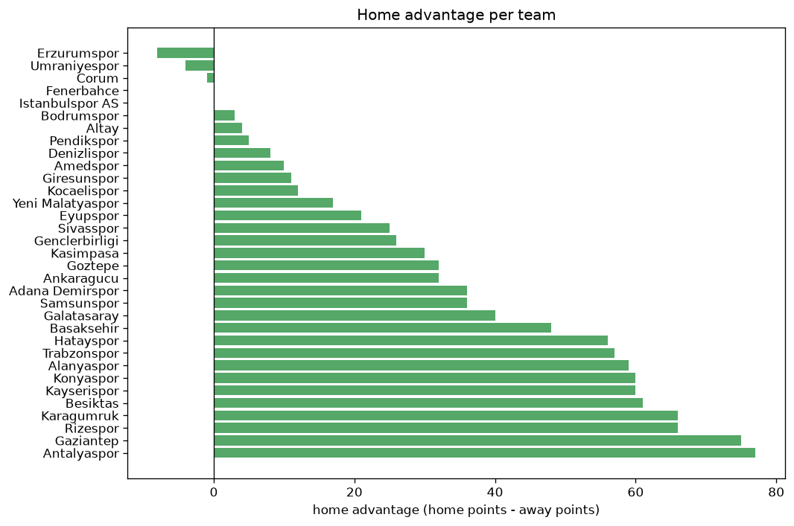

# Team Analysis
- Report: `teams_analysis`
- Generated: 2026-10-30T04:14:56+00:00
- Script: `backend/scripts/analyze_teams.py` v1.0.0
- League: Super Lig (Turkey)
- Scope: league `turkey1`

- Teams: **33** | Seasons: **7** | Matches: **2251**

## 1. Team standings (lifetime)
| team | seasons | played | W | D | L | pts | GF | GA | GD | avg pts/season | best pos | worst pos | titles |
|---|---|---|---|---|---|---|---|---|---|---|---|---|---|
| Galatasaray | 7 | 231 | 162 | 34 | 35 | 520 | 493 | 215 | 278 | 74.29 | 1 | 13 | 5 |
| Fenerbahce | 7 | 231 | 154 | 46 | 31 | 508 | 521 | 236 | 285 | 72.57 | 2 | 5 | 0 |
| Besiktas | 7 | 231 | 120 | 57 | 54 | 417 | 411 | 261 | 150 | 59.57 | 1 | 6 | 1 |
| Trabzonspor | 7 | 231 | 119 | 58 | 54 | 415 | 393 | 269 | 124 | 59.29 | 1 | 7 | 1 |
| Basaksehir | 7 | 231 | 102 | 52 | 77 | 358 | 340 | 276 | 64 | 51.14 | 4 | 12 | 0 |
| Alanyaspor | 7 | 231 | 81 | 68 | 82 | 311 | 325 | 325 | 0 | 44.43 | 5 | 14 | 0 |
| Konyaspor | 7 | 231 | 78 | 70 | 83 | 304 | 298 | 296 | 2 | 43.43 | 3 | 16 | 0 |
| Kasimpasa | 7 | 231 | 78 | 62 | 91 | 296 | 329 | 361 | -32 | 42.29 | 6 | 14 | 0 |
| Antalyaspor | 6 | 222 | 68 | 65 | 89 | 269 | 255 | 323 | -68 | 44.83 | 7 | 16 | 0 |
| Gaziantep | 7 | 231 | 68 | 59 | 104 | 263 | 285 | 359 | -74 | 37.57 | 9 | 18 | 0 |
| Kayserispor | 6 | 222 | 64 | 66 | 92 | 258 | 260 | 350 | -90 | 43.0 | 9 | 18 | 0 |
| Sivasspor | 5 | 188 | 64 | 57 | 67 | 249 | 243 | 261 | -18 | 49.8 | 5 | 17 | 0 |
| Karagumruk | 5 | 186 | 63 | 49 | 74 | 238 | 266 | 273 | -7 | 47.6 | 7 | 17 | 0 |
| Rizespor | 6 | 195 | 64 | 42 | 89 | 234 | 254 | 323 | -69 | 39.0 | 8 | 17 | 0 |
| Hatayspor | 5 | 188 | 53 | 45 | 90 | 204 | 229 | 322 | -93 | 40.8 | 6 | 19 | 0 |
| Goztepe | 5 | 157 | 50 | 46 | 61 | 196 | 219 | 234 | -15 | 39.2 | 6 | 19 | 0 |
| Adana Demirspor | 4 | 148 | 48 | 38 | 62 | 182 | 224 | 245 | -21 | 45.5 | 4 | 19 | 0 |
| Samsunspor | 4 | 117 | 44 | 30 | 43 | 162 | 151 | 159 | -8 | 40.5 | 3 | 17 | 0 |
| Ankaragucu | 3 | 114 | 30 | 30 | 54 | 120 | 135 | 170 | -35 | 40.0 | 11 | 19 | 0 |
| Eyupspor | 3 | 79 | 24 | 17 | 38 | 89 | 87 | 118 | -31 | 29.67 | 6 | 18 | 0 |
| Giresunspor | 2 | 74 | 22 | 19 | 33 | 85 | 83 | 107 | -24 | 42.5 | 16 | 16 | 0 |
| Genclerbirligi | 3 | 83 | 21 | 17 | 45 | 80 | 87 | 141 | -54 | 26.67 | 14 | 20 | 0 |
| Yeni Malatyaspor | 2 | 78 | 15 | 20 | 43 | 65 | 76 | 124 | -48 | 32.5 | 15 | 20 | 0 |
| Istanbulspor AS | 2 | 74 | 16 | 12 | 46 | 60 | 74 | 143 | -69 | 30.0 | 15 | 20 | 0 |
| Erzurumspor | 2 | 49 | 14 | 12 | 23 | 54 | 52 | 80 | -28 | 27.0 | 8 | 18 | 0 |
| Kocaelispor | 2 | 43 | 14 | 10 | 19 | 52 | 37 | 47 | -10 | 26.0 | 7 | 11 | 0 |
| Bodrumspor | 1 | 36 | 9 | 10 | 17 | 37 | 26 | 43 | -17 | 37.0 | 16 | 16 | 0 |
| Pendikspor | 1 | 38 | 9 | 10 | 19 | 37 | 42 | 73 | -31 | 37.0 | 19 | 19 | 0 |
| Altay | 1 | 38 | 9 | 7 | 22 | 34 | 39 | 57 | -18 | 34.0 | 18 | 18 | 0 |
| Umraniyespor | 1 | 36 | 7 | 9 | 20 | 30 | 47 | 64 | -17 | 30.0 | 17 | 17 | 0 |
| Denizlispor | 1 | 40 | 6 | 10 | 24 | 28 | 38 | 77 | -39 | 28.0 | 21 | 21 | 0 |
| Amedspor | 1 | 9 | 6 | 2 | 1 | 20 | 20 | 10 | 10 | 20.0 | 2 | 2 | 0 |
| Corum | 1 | 9 | 4 | 1 | 4 | 13 | 18 | 15 | 3 | 13.0 | 9 | 9 | 0 |

## 2. Home vs away split
| team | home P | H-W | H-D | H-L | H-pts | away P | A-W | A-D | A-L | A-pts | adv |
|---|---|---|---|---|---|---|---|---|---|---|---|
| Antalyaspor | 111 | 47 | 32 | 32 | 173 | 111 | 21 | 33 | 57 | 96 | 77 |
| Gaziantep | 116 | 45 | 34 | 37 | 169 | 115 | 23 | 25 | 67 | 94 | 75 |
| Karagumruk | 93 | 43 | 23 | 27 | 152 | 93 | 20 | 26 | 47 | 86 | 66 |
| Rizespor | 97 | 43 | 21 | 33 | 150 | 98 | 21 | 21 | 56 | 84 | 66 |
| Besiktas | 116 | 72 | 23 | 21 | 239 | 115 | 48 | 34 | 33 | 178 | 61 |
| Konyaspor | 116 | 48 | 38 | 30 | 182 | 115 | 30 | 32 | 53 | 122 | 60 |
| Kayserispor | 111 | 43 | 30 | 38 | 159 | 111 | 21 | 36 | 54 | 99 | 60 |
| Alanyaspor | 115 | 51 | 32 | 32 | 185 | 116 | 30 | 36 | 50 | 126 | 59 |
| Trabzonspor | 115 | 70 | 26 | 19 | 236 | 116 | 49 | 32 | 35 | 179 | 57 |
| Hatayspor | 94 | 35 | 25 | 34 | 130 | 94 | 18 | 20 | 56 | 74 | 56 |
| Basaksehir | 116 | 59 | 26 | 31 | 203 | 115 | 43 | 26 | 46 | 155 | 48 |
| Galatasaray | 116 | 87 | 19 | 10 | 280 | 115 | 75 | 15 | 25 | 240 | 40 |
| Adana Demirspor | 74 | 31 | 16 | 27 | 109 | 74 | 17 | 22 | 35 | 73 | 36 |
| Samsunspor | 59 | 28 | 15 | 16 | 99 | 58 | 16 | 15 | 27 | 63 | 36 |
| Goztepe | 78 | 31 | 21 | 26 | 114 | 79 | 19 | 25 | 35 | 82 | 32 |
| Ankaragucu | 57 | 20 | 16 | 21 | 76 | 57 | 10 | 14 | 33 | 44 | 32 |
| Kasimpasa | 115 | 44 | 31 | 40 | 163 | 116 | 34 | 31 | 51 | 133 | 30 |
| Genclerbirligi | 42 | 14 | 11 | 17 | 53 | 41 | 7 | 6 | 28 | 27 | 26 |
| Sivasspor | 94 | 33 | 38 | 23 | 137 | 94 | 31 | 19 | 44 | 112 | 25 |
| Eyupspor | 40 | 16 | 7 | 17 | 55 | 39 | 8 | 10 | 21 | 34 | 21 |
| Yeni Malatyaspor | 39 | 10 | 11 | 18 | 41 | 39 | 5 | 9 | 25 | 24 | 17 |
| Kocaelispor | 21 | 9 | 5 | 7 | 32 | 22 | 5 | 5 | 12 | 20 | 12 |
| Giresunspor | 37 | 13 | 9 | 15 | 48 | 37 | 9 | 10 | 18 | 37 | 11 |
| Amedspor | 5 | 5 | 0 | 0 | 15 | 4 | 1 | 2 | 1 | 5 | 10 |
| Denizlispor | 20 | 4 | 6 | 10 | 18 | 20 | 2 | 4 | 14 | 10 | 8 |
| Pendikspor | 19 | 6 | 3 | 10 | 21 | 19 | 3 | 7 | 9 | 16 | 5 |
| Altay | 19 | 5 | 4 | 10 | 19 | 19 | 4 | 3 | 12 | 15 | 4 |
| Bodrumspor | 18 | 5 | 5 | 8 | 20 | 18 | 4 | 5 | 9 | 17 | 3 |
| Fenerbahce | 115 | 78 | 20 | 17 | 254 | 116 | 76 | 26 | 14 | 254 | 0 |
| Istanbulspor AS | 37 | 8 | 6 | 23 | 30 | 37 | 8 | 6 | 23 | 30 | 0 |
| Corum | 4 | 2 | 0 | 2 | 6 | 5 | 2 | 1 | 2 | 7 | -1 |
| Umraniyespor | 18 | 3 | 4 | 11 | 13 | 18 | 4 | 5 | 9 | 17 | -4 |
| Erzurumspor | 24 | 5 | 8 | 11 | 23 | 25 | 9 | 4 | 12 | 31 | -8 |

## 3. Top performers
### Best points per game (PPG)
| rank | team | PPG |
|---|---|---|
| 1 | Galatasaray | 2.25 |
| 2 | Amedspor | 2.22 |
| 3 | Fenerbahce | 2.20 |
| 4 | Besiktas | 1.80 |
| 5 | Trabzonspor | 1.80 |

### Most goals scored
| rank | team | goals |
|---|---|---|
| 1 | Fenerbahce | 521 |
| 2 | Galatasaray | 493 |
| 3 | Besiktas | 411 |
| 4 | Trabzonspor | 393 |
| 5 | Basaksehir | 340 |

### Best goal difference
| rank | team | GD |
|---|---|---|
| 1 | Fenerbahce | 285 |
| 2 | Galatasaray | 278 |
| 3 | Besiktas | 150 |
| 4 | Trabzonspor | 124 |
| 5 | Basaksehir | 64 |

### Best defence (goals against per match, standings)
| rank | team | GA/match |
|---|---|---|
| 1 | Galatasaray | 0.931 |
| 2 | Fenerbahce | 1.022 |
| 3 | Kocaelispor | 1.093 |
| 4 | Amedspor | 1.111 |
| 5 | Besiktas | 1.130 |

## 4. Team consistency
- Teams present in all **7** seasons: **9**

Alanyaspor, Basaksehir, Besiktas, Fenerbahce, Galatasaray, Gaziantep, Kasimpasa, Konyaspor, Trabzonspor

## 5. Head-to-head dominance
- Distinct fixtures: **415** (showing the 15 most frequent)

| fixture | meetings | home wins | draws | away wins | home pct | draw pct | away pct |
|---|---|---|---|---|---|---|---|
| Gaziantep vs Basaksehir | 13 | 9 | 1 | 3 | 69.2% | 7.7% | 23.1% |
| Trabzonspor vs Konyaspor | 13 | 9 | 3 | 1 | 69.2% | 23.1% | 7.7% |
| Fenerbahce vs Gaziantep | 13 | 8 | 1 | 4 | 61.5% | 7.7% | 30.8% |
| Fenerbahce vs Konyaspor | 13 | 8 | 1 | 4 | 61.5% | 7.7% | 30.8% |
| Besiktas vs Alanyaspor | 13 | 7 | 5 | 1 | 53.8% | 38.5% | 7.7% |
| Galatasaray vs Kasimpasa | 13 | 7 | 3 | 3 | 53.8% | 23.1% | 23.1% |
| Konyaspor vs Basaksehir | 13 | 7 | 3 | 3 | 53.8% | 23.1% | 23.1% |
| Alanyaspor vs Gaziantep | 13 | 6 | 3 | 4 | 46.2% | 23.1% | 30.8% |
| Besiktas vs Basaksehir | 13 | 5 | 3 | 5 | 38.5% | 23.1% | 38.5% |
| Galatasaray vs Basaksehir | 13 | 5 | 2 | 6 | 38.5% | 15.4% | 46.2% |
| Galatasaray vs Trabzonspor | 13 | 5 | 4 | 4 | 38.5% | 30.8% | 30.8% |
| Trabzonspor vs Basaksehir | 13 | 5 | 3 | 5 | 38.5% | 23.1% | 38.5% |
| Basaksehir vs Kasimpasa | 13 | 4 | 3 | 6 | 30.8% | 23.1% | 46.2% |
| Besiktas vs Trabzonspor | 13 | 4 | 5 | 4 | 30.8% | 38.5% | 30.8% |
| Fenerbahce vs Alanyaspor | 13 | 4 | 3 | 6 | 30.8% | 23.1% | 46.2% |

## 6. Position per season (classic view)
_Cells show final position; '-' when the team was absent from that season._

| team | 2020-2021 | 2021-2022 | 2022-2023 | 2023-2024 | 2024-2025 | 2025-2026 | 2026-2027 |
|---|---|---|---|---|---|---|---|
| Galatasaray | 2 | 13 | 1 | 1 | 1 | 1 | 1 |
| Fenerbahce | 3 | 2 | 2 | 2 | 2 | 2 | 5 |
| Besiktas | 1 | 6 | 3 | 5 | 4 | 4 | 4 |
| Trabzonspor | 4 | 1 | 6 | 3 | 7 | 3 | 3 |
| Basaksehir | 12 | 4 | 5 | 4 | 5 | 5 | 12 |
| Alanyaspor | 7 | 5 | 14 | 8 | 13 | 10 | 11 |
| Konyaspor | 11 | 3 | 8 | 16 | 11 | 9 | 14 |
| Kasimpasa | 14 | 11 | 10 | 6 | 10 | 13 | 6 |
| Antalyaspor | 16 | 7 | 13 | 10 | 15 | 16 | - |
| Gaziantep | 9 | 15 | 18 | 13 | 12 | 12 | 15 |
| Kayserispor | 17 | 14 | 9 | 11 | 14 | 18 | - |
| Sivasspor | 5 | 10 | 12 | 7 | 17 | - | - |
| Karagumruk | 8 | 8 | 7 | 17 | - | 17 | - |
| Rizespor | 13 | 17 | - | 9 | 9 | 8 | 13 |
| Hatayspor | 6 | 12 | 19 | 15 | 18 | - | - |
| Goztepe | 10 | 19 | - | - | 8 | 6 | 10 |
| Adana Demirspor | - | 9 | 4 | 12 | 19 | - | - |
| Samsunspor | - | - | - | 14 | 3 | 7 | 17 |
| Ankaragucu | 19 | - | 11 | 18 | - | - | - |
| Eyupspor | - | - | - | - | 6 | 15 | 18 |
| Giresunspor | - | 16 | 16 | - | - | - | - |
| Genclerbirligi | 20 | - | - | - | - | 14 | 16 |
| Yeni Malatyaspor | 15 | 20 | - | - | - | - | - |
| Istanbulspor AS | - | - | 15 | 20 | - | - | - |
| Erzurumspor | 18 | - | - | - | - | - | 8 |
| Kocaelispor | - | - | - | - | - | 11 | 7 |
| Bodrumspor | - | - | - | - | 16 | - | - |
| Pendikspor | - | - | - | 19 | - | - | - |
| Altay | - | 18 | - | - | - | - | - |
| Umraniyespor | - | - | 17 | - | - | - | - |
| Denizlispor | 21 | - | - | - | - | - | - |
| Amedspor | - | - | - | - | - | - | 2 |
| Corum | - | - | - | - | - | - | 9 |

---
*All statistics are computed from PostgreSQL tables (read-only). Run with `python backend/scripts/analyze_teams.py` to regenerate.*

## Charts

