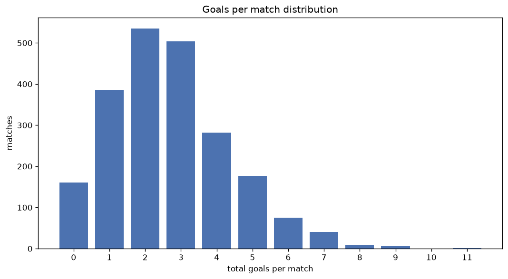
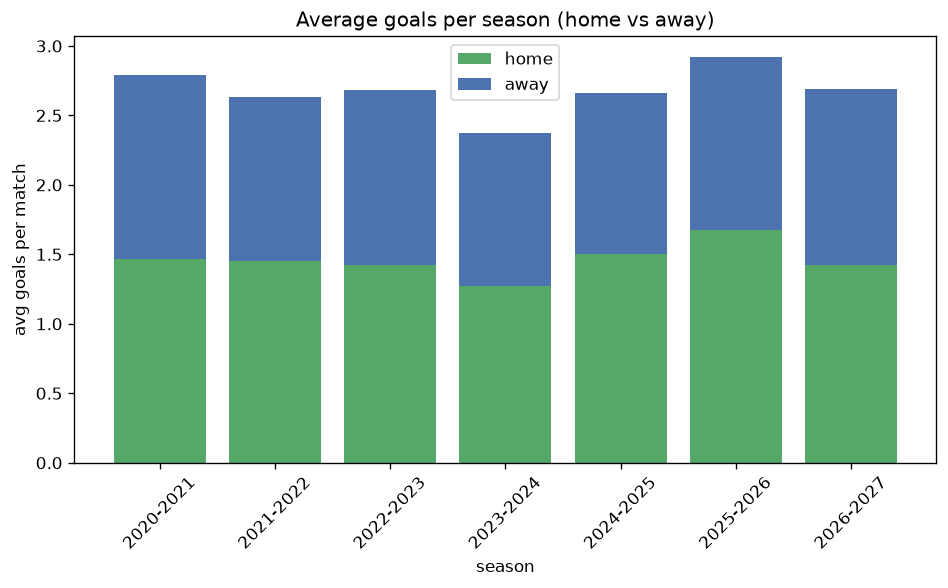

# Goal Analysis
- Report: `goals_analysis`
- Generated: 2026-10-26T01:52:06+00:00
- Script: `backend/scripts/analyze_goals.py` v1.0.0
- League: 1. Lig (Turkey)
- Scope: league `turkey2`

## 1. Goals per match distribution
| goals | matches | pct |
|---|---|---|
| 0 | 161 | 7.4% |
| 1 | 386 | 17.7% |
| 2 | 535 | 24.6% |
| 3 | 504 | 23.2% |
| 4 | 282 | 13.0% |
| 5 | 177 | 8.1% |
| 6 | 75 | 3.4% |
| 7 | 40 | 1.8% |
| 8 | 8 | 0.4% |
| 9 | 6 | 0.3% |
| 10 | 0 | 0.0% |
| 11 | 1 | 0.0% |

## 2. Goals per match per season
| season | matches | total goals | avg home | avg away | avg total |
|---|---|---|---|---|---|
| 2020-2021 | 306 | 854 | 1.467 | 1.324 | 2.791 |
| 2021-2022 | 342 | 901 | 1.453 | 1.181 | 2.635 |
| 2022-2023 | 341 | 915 | 1.422 | 1.261 | 2.683 |
| 2023-2024 | 306 | 725 | 1.275 | 1.095 | 2.369 |
| 2024-2025 | 380 | 1011 | 1.505 | 1.155 | 2.661 |
| 2025-2026 | 385 | 1125 | 1.673 | 1.249 | 2.922 |
| 2026-2027 | 115 | 309 | 1.426 | 1.261 | 2.687 |

## 3. Home vs away goal share
- Home goals: **3201** (54.8%)
- Away goals: **2639** (45.2%)
- Home/away ratio: **1.213**

| season | home goals | away goals | total | home pct | away pct |
|---|---|---|---|---|---|
| 2020-2021 | 449 | 405 | 854 | 52.6% | 47.4% |
| 2021-2022 | 497 | 404 | 901 | 55.2% | 44.8% |
| 2022-2023 | 485 | 430 | 915 | 53.0% | 47.0% |
| 2023-2024 | 390 | 335 | 725 | 53.8% | 46.2% |
| 2024-2025 | 572 | 439 | 1011 | 56.6% | 43.4% |
| 2025-2026 | 644 | 481 | 1125 | 57.2% | 42.8% |
| 2026-2027 | 164 | 145 | 309 | 53.1% | 46.9% |

## 4. BTTS (Both Teams To Score)
- Overall: **1062** of `2175` (48.8%)

| season | matches | BTTS | pct |
|---|---|---|---|
| 2020-2021 | 306 | 153 | 50.0% |
| 2021-2022 | 342 | 183 | 53.5% |
| 2022-2023 | 341 | 172 | 50.4% |
| 2023-2024 | 306 | 133 | 43.5% |
| 2024-2025 | 380 | 168 | 44.2% |
| 2025-2026 | 385 | 193 | 50.1% |
| 2026-2027 | 115 | 60 | 52.2% |

## 5. Clean sheets
- Home clean sheets: **702** (32.3%)
- Away clean sheets: **572** (26.3%)
- Total clean sheets recorded: **1274**
- Matches with at least one clean sheet: **1113** (51.2%)
- Both teams kept clean sheets (0-0): **161**

| season | matches | home CS | away CS | total CS | matches w/ CS |
|---|---|---|---|---|---|
| 2020-2021 | 306 | 89 | 86 | 175 | 153 (50.0%) |
| 2021-2022 | 342 | 107 | 76 | 183 | 159 (46.5%) |
| 2022-2023 | 341 | 96 | 97 | 193 | 169 (49.6%) |
| 2023-2024 | 306 | 103 | 98 | 201 | 173 (56.5%) |
| 2024-2025 | 380 | 142 | 98 | 240 | 212 (55.8%) |
| 2025-2026 | 385 | 135 | 85 | 220 | 192 (49.9%) |
| 2026-2027 | 115 | 30 | 32 | 62 | 55 (47.8%) |

## 6. Scoring intensity
- First-half goals: **2553** (44.4%)
- Second-half goals: **3193** (55.6%)
- Avg first-half goals per match: **1.191**
- Avg second-half goals per match: **1.49**
- Second-half-only scoring (HT 0-0, FT goals >= 1): **499** (22.9%)
- *32 match(es) excluded (no HT score recorded).*

| season | matches | 1st half | 2nd half | 1st half pct | 2nd half pct |
|---|---|---|---|---|---|
| 2020-2021 | 306 | 368 | 483 | 43.2% | 56.8% |
| 2021-2022 | 342 | 395 | 506 | 43.8% | 56.2% |
| 2022-2023 | 341 | 368 | 463 | 44.3% | 55.7% |
| 2023-2024 | 306 | 314 | 411 | 43.3% | 56.7% |
| 2024-2025 | 380 | 476 | 532 | 47.2% | 52.8% |
| 2025-2026 | 385 | 491 | 631 | 43.8% | 56.2% |
| 2026-2027 | 115 | 141 | 167 | 45.8% | 54.2% |

## 7. First-goal timing
- Matches with first-goal time recorded: `1982` of `2175` (91.1%)
- Goalless matches: `193`
- Min `1` | Max `98` | Mean `31.96` | Median (p50) `27.0`

| bucket | count | % of matches | % of scoring matches |
|---|---|---|---|
| 1-15 | 609 | 28.0% | 30.7% |
| 16-30 | 479 | 22.0% | 24.2% |
| 31-45 | 331 | 15.2% | 16.7% |
| 46-60 | 299 | 13.7% | 15.1% |
| 61-75 | 147 | 6.8% | 7.4% |
| 76-90 | 94 | 4.3% | 4.7% |
| 91-120 | 23 | 1.1% | 1.2% |

---
*All statistics are computed from PostgreSQL tables (read-only). Run with `python backend/scripts/analyze_goals.py` to regenerate.*

## Charts

