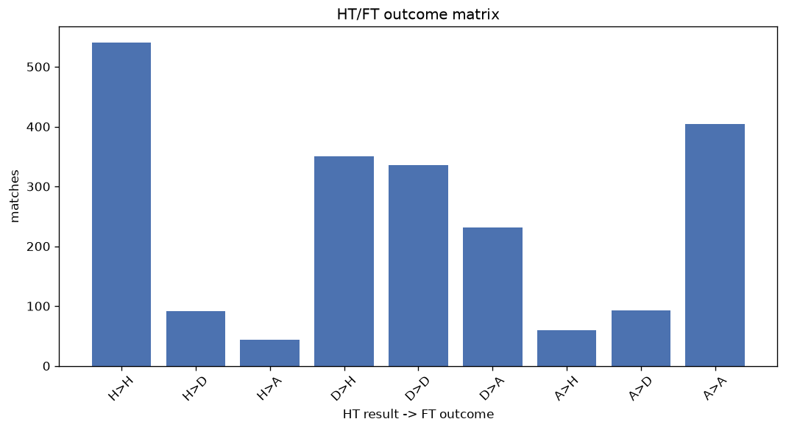
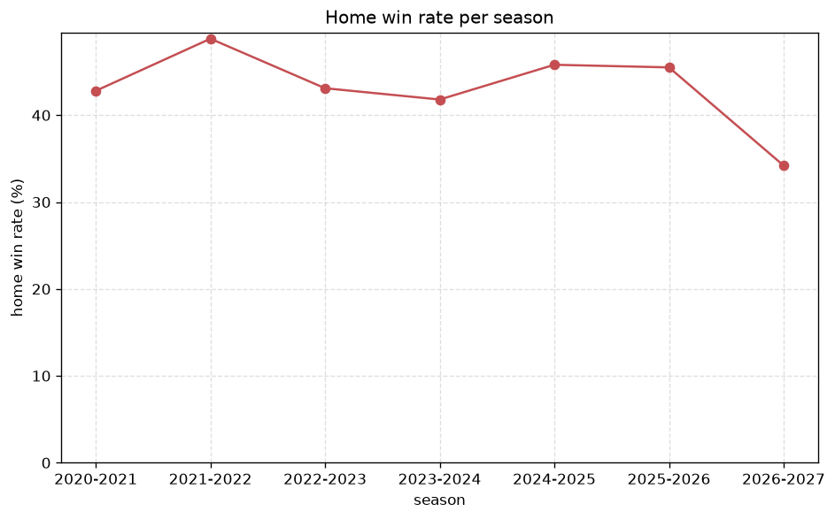

# Match Analysis
- Report: `matches_analysis`
- Generated: 2026-10-29T02:18:58+00:00
- Script: `backend/scripts/analyze_matches.py` v1.0.0
- League: 1. Lig (Turkey)
- Scope: league `turkey2`

## 1. Overall summary
| metric | value |
|---|---|
| Matches | 2180 |
| Home wins | 963 (44.2%) |
| Draws | 520 (23.9%) |
| Away wins | 697 (32.0%) |
| Total goals | 5861 |
| Average goals per match | 2.689 |
| Goalless matches | 161 (7.4%) |

## 2. Per-season breakdown
| season | matches | home wins | draws | away wins | total goals | avg goals | goalless |
|---|---|---|---|---|---|---|---|
| 2020-2021 | 306 | 131 (42.8%) | 65 (21.2%) | 110 (35.9%) | 854 | 2.791 | 22 (7.2%) |
| 2021-2022 | 342 | 167 (48.8%) | 77 (22.5%) | 98 (28.7%) | 901 | 2.635 | 24 (7.0%) |
| 2022-2023 | 341 | 147 (43.1%) | 79 (23.2%) | 115 (33.7%) | 915 | 2.683 | 24 (7.0%) |
| 2023-2024 | 306 | 128 (41.8%) | 77 (25.2%) | 101 (33.0%) | 725 | 2.369 | 28 (9.2%) |
| 2024-2025 | 380 | 174 (45.8%) | 91 (23.9%) | 115 (30.3%) | 1011 | 2.661 | 28 (7.4%) |
| 2025-2026 | 385 | 175 (45.5%) | 95 (24.7%) | 115 (29.9%) | 1125 | 2.922 | 28 (7.3%) |
| 2026-2027 | 120 | 41 (34.2%) | 36 (30.0%) | 43 (35.8%) | 330 | 2.75 | 7 (5.8%) |

## 3. HT/FT outcome matrix
| HT result \ FT result | Home | Draw | Away | total |
|---|---|---|---|---|
| HT home lead | 540 (80.0%) | 91 (13.5%) | 44 (6.5%) | 675 |
| HT draw | 350 (38.2%) | 336 (36.6%) | 231 (25.2%) | 917 |
| HT away lead | 59 (10.6%) | 93 (16.7%) | 404 (72.7%) | 556 |
- *32 match(es) excluded (no HT score recorded).*

## 4. Comeback matches
- Home comebacks (trailing at HT, won at FT): **59** (2.7%)
- Away comebacks (trailing at HT, won at FT): **44** (2.0%)

### Home comebacks
| season | home | away | HT | FT |
|---|---|---|---|---|
| 2020-2021 | Giresunspor | Boluspor | 0-1 | 2-1 |
| 2020-2021 | Bursaspor | Akhisarspor | 1-2 | 3-2 |
| 2020-2021 | Tuzlaspor | Adanaspor AS | 0-1 | 3-2 |
| 2020-2021 | Bandirmaspor | Tuzlaspor | 1-2 | 3-2 |
| 2020-2021 | Istanbulspor AS | Tuzlaspor | 0-1 | 2-1 |
| 2020-2021 | Tuzlaspor | Eskisehirspor | 1-2 | 5-2 |
| 2020-2021 | Bursaspor | Bandirmaspor | 0-1 | 2-1 |
| 2020-2021 | Umraniyespor | Ankaraspor | 1-2 | 4-3 |
| 2021-2022 | Altinordu | Denizlispor | 0-1 | 2-1 |
| 2021-2022 | Eyupspor | Manisa FK | 1-2 | 3-2 |
| 2021-2022 | Denizlispor | Balikesirspor | 0-1 | 2-1 |
| 2021-2022 | Denizlispor | Keciorengucu | 0-1 | 2-1 |
| 2021-2022 | Keciorengucu | Umraniyespor | 1-2 | 3-2 |
| 2021-2022 | Altinordu | Kocaelispor | 1-2 | 3-2 |
| 2021-2022 | Manisa FK | Genclerbirligi | 0-1 | 3-1 |
| 2021-2022 | Ankaragucu | Bursaspor | 0-1 | 2-1 |
| 2021-2022 | Bursaspor | Balikesirspor | 0-1 | 2-1 |
| 2021-2022 | Kocaelispor | Bandirmaspor | 0-1 | 2-1 |
| 2021-2022 | Denizlispor | Istanbulspor AS | 2-3 | 4-3 |
| 2021-2022 | Denizlispor | Genclerbirligi | 0-1 | 2-1 |
| 2021-2022 | Altinordu | Balikesirspor | 0-1 | 2-1 |
| 2022-2023 | Sakaryaspor | Denizlispor | 0-1 | 2-1 |
| 2022-2023 | Sakaryaspor | Adanaspor AS | 1-2 | 3-2 |
| 2022-2023 | Keciorengucu | Eyupspor | 0-1 | 2-1 |
| 2022-2023 | Altinordu | Genclerbirligi | 0-1 | 2-1 |
| 2022-2023 | Pendikspor | Altinordu | 0-1 | 2-1 |
| 2022-2023 | Manisa FK | Bodrumspor | 0-1 | 2-1 |
| 2022-2023 | Altinordu | Tuzlaspor | 0-1 | 2-1 |
| 2022-2023 | Boluspor | Keciorengucu | 0-1 | 3-1 |
| 2022-2023 | Pendikspor | Keciorengucu | 0-1 | 2-1 |
| 2022-2023 | Manisa FK | Genclerbirligi | 0-1 | 2-1 |
| 2022-2023 | Pendikspor | Bandirmaspor | 0-1 | 2-1 |
| 2022-2023 | Genclerbirligi | Sakaryaspor | 0-1 | 2-1 |
| 2023-2024 | Tuzlaspor | Adanaspor AS | 0-1 | 2-1 |
| 2023-2024 | Bodrumspor | Bandirmaspor | 0-1 | 2-1 |
| 2023-2024 | Boluspor | Bodrumspor | 0-1 | 2-1 |
| 2023-2024 | Eyupspor | Manisa FK | 0-1 | 2-1 |
| 2023-2024 | Altay | Keciorengucu | 0-1 | 2-1 |
| 2023-2024 | Adanaspor AS | Tuzlaspor | 0-1 | 2-1 |
| 2023-2024 | Kocaelispor | Goztepe | 0-1 | 3-2 |
| 2023-2024 | Erzurumspor | Giresunspor | 0-1 | 2-1 |
| 2023-2024 | Boluspor | Altay | 0-1 | 3-1 |
| 2024-2025 | Kocaelispor | Genclerbirligi | 0-1 | 2-1 |
| 2024-2025 | Genclerbirligi | Istanbulspor AS | 0-1 | 2-1 |
| 2024-2025 | Adanaspor AS | Yeni Malatyaspor | 0-1 | 3-1 |
| 2024-2025 | Bandirmaspor | Sanliurfaspor | 1-2 | 3-2 |
| 2024-2025 | Erokspor | Igdir FK | 0-1 | 3-1 |
| 2024-2025 | Corum | Keciorengucu | 1-2 | 3-2 |
| 2024-2025 | Corum | Sanliurfaspor | 0-1 | 2-1 |
| 2025-2026 | Amedspor | Erokspor | 0-1 | 2-1 |
| 2025-2026 | Manisa FK | Vanspor FK | 0-1 | 2-1 |
| 2025-2026 | Istanbulspor AS | Sivasspor | 0-1 | 2-1 |
| 2025-2026 | Manisa FK | Bandirmaspor | 0-1 | 3-2 |
| 2025-2026 | Vanspor FK | Bodrumspor | 0-1 | 3-1 |
| 2025-2026 | Istanbulspor AS | Sariyer | 0-1 | 3-1 |
| 2025-2026 | Serik Spor | Hatayspor | 0-1 | 4-2 |
| 2025-2026 | Sivasspor | Igdir FK | 0-1 | 2-1 |
| 2025-2026 | Boluspor | Serik Spor | 0-1 | 3-1 |
| 2026-2027 | Batman Petrolspor | Sivasspor | 0-1 | 2-1 |

### Away comebacks
| season | home | away | HT | FT |
|---|---|---|---|---|
| 2020-2021 | Bursaspor | Adana Demirspor | 1-0 | 1-3 |
| 2020-2021 | Umraniyespor | Keciorengucu | 1-0 | 1-2 |
| 2020-2021 | Boluspor | Tuzlaspor | 1-0 | 1-2 |
| 2020-2021 | Menemenspor | Altay | 1-0 | 1-2 |
| 2020-2021 | Bursaspor | Altinordu | 1-0 | 1-2 |
| 2020-2021 | Altay | Altinordu | 1-0 | 1-3 |
| 2020-2021 | Akhisarspor | Keciorengucu | 1-0 | 1-2 |
| 2021-2022 | Denizlispor | Samsunspor | 1-0 | 2-3 |
| 2021-2022 | Adanaspor AS | Bandirmaspor | 1-0 | 1-5 |
| 2021-2022 | Kocaelispor | Genclerbirligi | 1-0 | 1-2 |
| 2021-2022 | Bandirmaspor | Denizlispor | 3-0 | 3-4 |
| 2021-2022 | Altinordu | Keciorengucu | 1-0 | 2-3 |
| 2021-2022 | Balikesirspor | Kocaelispor | 1-0 | 1-2 |
| 2022-2023 | Genclerbirligi | Pendikspor | 1-0 | 1-2 |
| 2022-2023 | Tuzlaspor | Samsunspor | 1-0 | 1-2 |
| 2022-2023 | Bodrumspor | Tuzlaspor | 1-0 | 1-2 |
| 2022-2023 | Denizlispor | Boluspor | 1-0 | 1-2 |
| 2022-2023 | Boluspor | Samsunspor | 1-0 | 1-5 |
| 2022-2023 | Boluspor | Bodrumspor | 1-0 | 1-4 |
| 2022-2023 | Bandirmaspor | Erzurumspor | 1-0 | 2-4 |
| 2023-2024 | Adanaspor AS | Sanliurfaspor | 1-0 | 1-2 |
| 2023-2024 | Altay | Sakaryaspor | 1-0 | 1-2 |
| 2023-2024 | Corum | Keciorengucu | 2-0 | 2-3 |
| 2023-2024 | Keciorengucu | Bandirmaspor | 1-0 | 1-3 |
| 2023-2024 | Bandirmaspor | Adanaspor AS | 2-0 | 2-3 |
| 2023-2024 | Giresunspor | Sakaryaspor | 2-1 | 2-3 |
| 2024-2025 | Igdir FK | Erokspor | 1-0 | 1-2 |
| 2024-2025 | Kocaelispor | Manisa FK | 1-0 | 1-2 |
| 2024-2025 | Keciorengucu | Corum | 2-1 | 2-3 |
| 2024-2025 | Umraniyespor | Keciorengucu | 1-0 | 1-2 |
| 2024-2025 | Boluspor | Kocaelispor | 1-0 | 1-3 |
| 2024-2025 | Sakaryaspor | Karagumruk | 1-0 | 1-3 |
| 2024-2025 | Erzurumspor | Pendikspor | 2-1 | 2-4 |
| 2025-2026 | Hatayspor | Keciorengucu | 1-0 | 1-3 |
| 2025-2026 | Boluspor | Vanspor FK | 2-1 | 2-3 |
| 2025-2026 | Manisa FK | Erokspor | 2-1 | 3-4 |
| 2025-2026 | Sariyer | Istanbulspor AS | 1-0 | 1-2 |
| 2025-2026 | Keciorengucu | Erzurumspor | 1-0 | 1-2 |
| 2025-2026 | Serik Spor | Corum | 2-1 | 2-3 |
| 2025-2026 | Sakaryaspor | Erokspor | 1-0 | 1-2 |
| 2026-2027 | Antalyaspor | Sariyer | 1-0 | 1-2 |
| 2026-2027 | Kayserispor | Bursaspor | 1-0 | 1-2 |
| 2026-2027 | Umraniyespor | Antalyaspor | 1-0 | 1-2 |
| 2026-2027 | Batman Petrolspor | Bursaspor | 1-0 | 1-2 |

## 5. HT lead conversion
| HT state | matches | converted to win | held as draw | collapsed to loss |
|---|---|---|---|---|
| Home lead | 675 | 540 (80.0%) | 91 (13.5%) | 44 (6.5%) |
| Away lead | 556 | 404 (72.7%) | 93 (16.7%) | 59 (10.6%) |

### Matches level at half-time
| FT result | count | pct |
|---|---|---|
| Home win | 350 | 38.2% |
| Draw | 336 | 36.6% |
| Away win | 231 | 25.2% |
- *32 match(es) excluded (no HT score recorded).*

## 6. First-goal timing
- Matches with a first-goal time recorded: `1987` of `2180` (91.1%)

Outcome distribution by first-goal timing bucket:
| bucket | matches | % of matches | home | draw | away |
|---|---|---|---|---|---|
| 1-15 | 610 | 28.0% | 297 (48.7%) | 107 (17.5%) | 206 (33.8%) |
| 16-30 | 481 | 22.1% | 225 (46.8%) | 89 (18.5%) | 167 (34.7%) |
| 31-45 | 332 | 15.2% | 147 (44.3%) | 67 (20.2%) | 118 (35.5%) |
| 46-60 | 300 | 13.8% | 154 (51.3%) | 55 (18.3%) | 91 (30.3%) |
| 61-75 | 147 | 6.7% | 69 (46.9%) | 30 (20.4%) | 48 (32.7%) |
| 76-90 | 94 | 4.3% | 45 (47.9%) | 11 (11.7%) | 38 (40.4%) |
| 91-120 | 23 | 1.1% | 12 (52.2%) | 0 (0.0%) | 11 (47.8%) |

## 7. Goalless matches
- Overall: **161** of `2180` (7.4%)

| season | matches | goalless | pct |
|---|---|---|---|
| 2020-2021 | 306 | 22 | 7.2% |
| 2021-2022 | 342 | 24 | 7.0% |
| 2022-2023 | 341 | 24 | 7.0% |
| 2023-2024 | 306 | 28 | 9.2% |
| 2024-2025 | 380 | 28 | 7.4% |
| 2025-2026 | 385 | 28 | 7.3% |
| 2026-2027 | 120 | 7 | 5.8% |

---
*All statistics are computed from PostgreSQL tables (read-only). Run with `python backend/scripts/analyze_matches.py` to regenerate.*

## Charts

