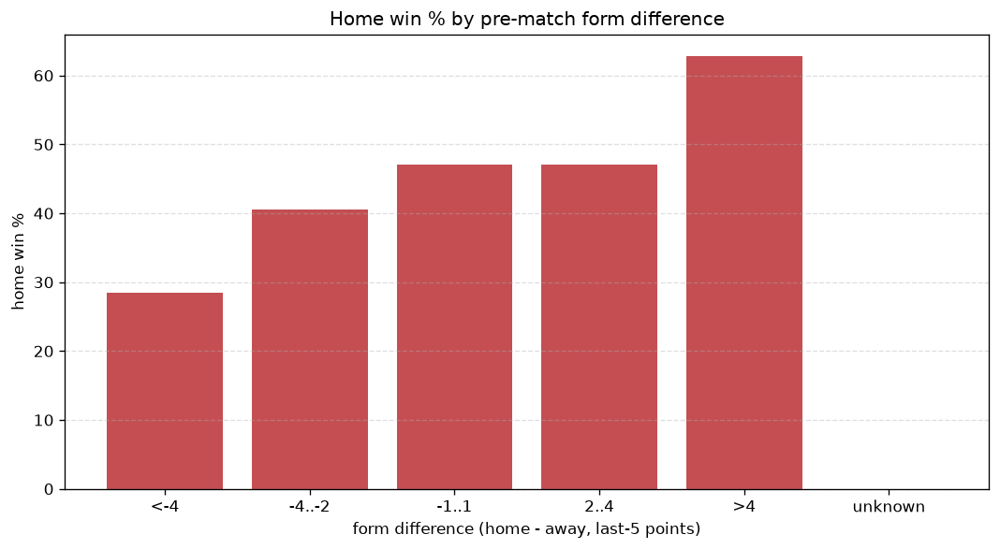
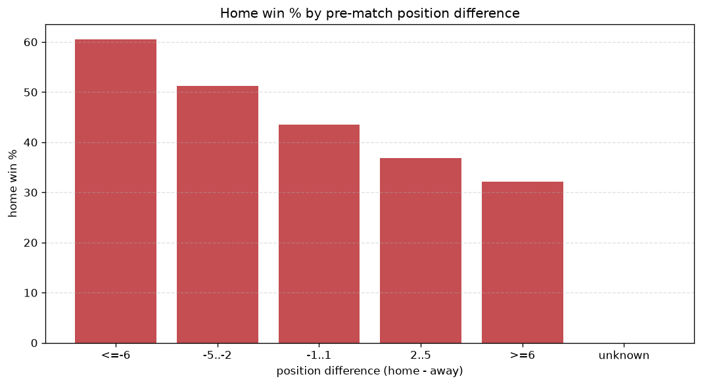

# Relationships Analysis
- Report: `relationships`
- Generated: 2026-10-27T02:34:30+00:00
- Script: `backend/scripts/analyze_relationships.py` v1.0.0
- League: 1. Lig (Turkey)
- Scope: league `turkey2`

- Matches analysed: **2060** (23 leakage-safe pre-match features).

## 1. Correlation matrix
_Pearson correlation of each pre-match feature with observed goals; sorted by |corr(total goals)|._

| feature | corr(home) | corr(away) | corr(total) |
|---|---|---|---|
| home_team_goals_conceded_last_5 | -0.107 | 0.311 | 0.141 |
| away_team_goals_conceded_last_5 | 0.270 | -0.108 | 0.136 |
| away_team_away_conceded_avg | 0.242 | -0.097 | 0.123 |
| home_team_home_conceded_avg | -0.091 | 0.267 | 0.121 |
| away_position_before_match | 0.222 | -0.148 | 0.069 |
| home_position_before_match | -0.132 | 0.236 | 0.067 |
| away_team_points_last_5 | -0.152 | 0.099 | -0.049 |
| away_team_wins_last_5 | -0.139 | 0.092 | -0.043 |
| away_team_away_win_rate | -0.140 | 0.096 | -0.042 |
| home_team_points_last_5 | 0.139 | -0.199 | -0.034 |
| home_team_goals_scored_last_5 | 0.140 | -0.110 | 0.032 |
| home_rest_days | -0.029 | -0.008 | -0.029 |
| home_team_wins_last_5 | 0.118 | -0.168 | -0.028 |
| away_rest_days | -0.012 | -0.020 | -0.024 |
| home_team_home_win_rate | 0.115 | -0.152 | -0.019 |
| away_team_goals_scored_last_5 | -0.101 | 0.084 | -0.019 |
| points_difference | 0.334 | -0.340 | 0.019 |
| home_points_before_match | 0.129 | -0.121 | 0.014 |
| home_team_home_goals_avg | 0.112 | -0.142 | -0.014 |
| away_team_away_goals_avg | -0.089 | 0.081 | -0.012 |
| rest_days_difference | -0.030 | 0.020 | -0.010 |
| position_difference | -0.256 | 0.278 | -0.002 |
| away_points_before_match | -0.123 | 0.135 | 0.000 |

## 2. Form vs outcome
_Home win/draw/away % per bucket of `home_team_points_last_5 - away_team_points_last_5`._

| bucket | matches | home | draw | away | home % | draw % | away % |
|---|---|---|---|---|---|---|---|
| <-4 | 345 | 98 | 75 | 172 | 28.4% | 21.7% | 49.9% |
| -4..-2 | 439 | 178 | 100 | 161 | 40.5% | 22.8% | 36.7% |
| -1..1 | 555 | 261 | 137 | 157 | 47.0% | 24.7% | 28.3% |
| 2..4 | 433 | 204 | 118 | 111 | 47.1% | 27.3% | 25.6% |
| >4 | 288 | 181 | 54 | 53 | 62.8% | 18.8% | 18.4% |
| unknown | 0 | 0 | 0 | 0 | - | - | - |

## 3. Position vs outcome
_Home win/draw/away % per bucket of `position_difference` (home position - away position; negative favours the home team)._

| bucket | matches | home | draw | away | home % | draw % | away % |
|---|---|---|---|---|---|---|---|
| <=-6 | 494 | 299 | 111 | 84 | 60.5% | 22.5% | 17.0% |
| -5..-2 | 369 | 189 | 89 | 91 | 51.2% | 24.1% | 24.7% |
| -1..1 | 283 | 123 | 71 | 89 | 43.5% | 25.1% | 31.4% |
| 2..5 | 378 | 139 | 101 | 138 | 36.8% | 26.7% | 36.5% |
| >=6 | 536 | 172 | 112 | 252 | 32.1% | 20.9% | 47.0% |
| unknown | 0 | 0 | 0 | 0 | - | - | - |

## 4. Rest advantage
_Home win/draw/away % per bucket of `rest_days_difference` (home rest - away rest). Matches with unknown rest are bucketed separately._

| bucket | matches | home | draw | away | home % | draw % | away % |
|---|---|---|---|---|---|---|---|
| <-1 | 195 | 90 | 48 | 57 | 46.2% | 24.6% | 29.2% |
| -1..0 | 461 | 206 | 98 | 157 | 44.7% | 21.3% | 34.1% |
| 0 | 709 | 335 | 159 | 215 | 47.2% | 22.4% | 30.3% |
| 1..2 | 558 | 243 | 146 | 169 | 43.5% | 26.2% | 30.3% |
| >2 | 79 | 27 | 17 | 35 | 34.2% | 21.5% | 44.3% |
| unknown | 58 | 21 | 16 | 21 | 36.2% | 27.6% | 36.2% |
- *58 match(es) had unknown rest difference (missing rest data on at least one side).*

## 5. Home team quality
_Home win rate by `home_team_home_win_rate` tier (split at 0.5)._

- `< 0.5` tier: **40.4%** home win (467/1155)
- `>= 0.5` tier: **50.3%** home win (455/905)
- Home-win gap (>= split minus < split): **+9.9 pp**

| tier | label | matches | home | draw | away | home % |
|---|---|---|---|---|---|---|
| low | < 0.5 | 1155 | 467 | 257 | 431 | 40.4% |
| high | >= 0.5 | 905 | 455 | 227 | 223 | 50.3% |

## 6. Feature averages by result
_Mean feature value per outcome; `range` is home-minus-away spread of the group means._

| feature | home mean | draw mean | away mean | range |
|---|---|---|---|---|
| points_difference | 3.969 | -0.752 | -5.898 | 9.866 |
| away_points_before_match | 22.245 | 24.587 | 27.327 | 5.082 |
| position_difference | -1.813 | 0.122 | 3.014 | 4.827 |
| home_points_before_match | 26.214 | 23.835 | 21.430 | 4.784 |
| away_position_before_match | 11.349 | 9.814 | 8.914 | 2.435 |
| home_position_before_match | 9.536 | 9.936 | 11.928 | 2.392 |
| home_team_goals_conceded_last_5 | 5.504 | 5.550 | 7.460 | 1.956 |
| away_team_goals_conceded_last_5 | 6.782 | 5.347 | 5.387 | 1.435 |
| home_team_points_last_5 | 6.744 | 6.467 | 5.364 | 1.380 |
| away_team_points_last_5 | 5.933 | 6.651 | 6.960 | 1.027 |
| home_team_goals_scored_last_5 | 6.342 | 6.062 | 5.480 | 0.862 |
| away_team_goals_scored_last_5 | 5.848 | 6.120 | 6.615 | 0.767 |
| home_team_wins_last_5 | 1.839 | 1.795 | 1.471 | 0.369 |
| away_team_wins_last_5 | 1.626 | 1.824 | 1.957 | 0.331 |
| away_team_away_conceded_avg | 1.477 | 1.235 | 1.220 | 0.256 |
| home_team_home_conceded_avg | 1.024 | 1.021 | 1.272 | 0.251 |
| home_team_home_goals_avg | 1.406 | 1.373 | 1.202 | 0.204 |
| rest_days_difference | -0.053 | 0.053 | 0.093 | 0.146 |
| away_rest_days | 7.705 | 7.575 | 7.567 | 0.138 |
| away_team_away_goals_avg | 1.053 | 1.108 | 1.156 | 0.103 |
| home_team_home_win_rate | 0.439 | 0.425 | 0.361 | 0.077 |
| away_team_away_win_rate | 0.259 | 0.307 | 0.315 | 0.056 |
| home_rest_days | 7.654 | 7.628 | 7.656 | 0.028 |

---
*All features are leakage-safe pre-match values built by `ml.features.build_features.build_rows` from strictly prior matches. Run with `python backend/scripts/analyze_relationships.py` to regenerate.*

## Charts

