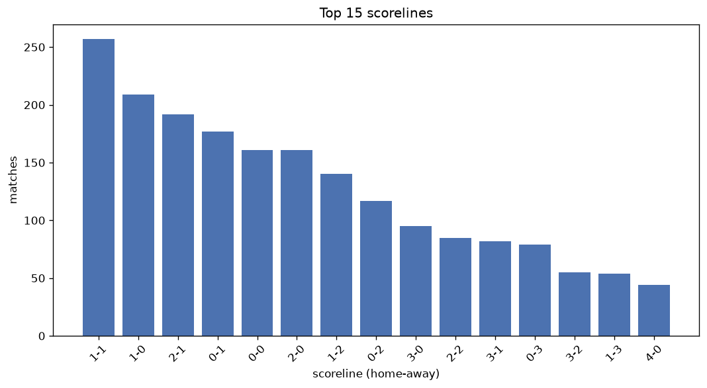
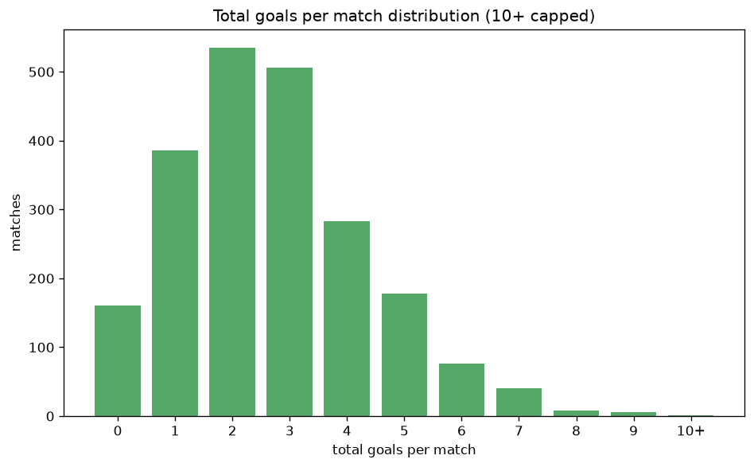

# Scoreline Analysis
- Report: `scoreline_analysis`
- Generated: 2026-10-29T02:19:05+00:00
- Script: `backend/scripts/analyze_scorelines.py` v1.0.0
- League: 1. Lig (Turkey)
- Scope: league `turkey2`

## 1. Scoreline frequency
- Matches analysed: **2180** across **7** seasons.
- Distinct scorelines seen: **46**.

| scoreline | count | pct |
|---|---|---|
| 1-1 | 257 | 11.8% |
| 1-0 | 209 | 9.6% |
| 2-1 | 192 | 8.8% |
| 0-1 | 177 | 8.1% |
| 0-0 | 161 | 7.4% |
| 2-0 | 161 | 7.4% |
| 1-2 | 140 | 6.4% |
| 0-2 | 117 | 5.4% |
| 3-0 | 95 | 4.4% |
| 2-2 | 85 | 3.9% |
| 3-1 | 82 | 3.8% |
| 0-3 | 79 | 3.6% |
| 3-2 | 55 | 2.5% |
| 1-3 | 54 | 2.5% |
| 4-0 | 44 | 2.0% |
| 4-1 | 37 | 1.7% |
| 2-3 | 29 | 1.3% |
| 5-0 | 23 | 1.1% |
| 1-4 | 22 | 1.0% |
| 4-2 | 20 | 0.9% |

## 2. Scoreline frequency per season

### 2020-2021
| scoreline | count | pct |
|---|---|---|
| 1-1 | 28 | 9.2% |
| 0-1 | 27 | 8.8% |
| 2-1 | 26 | 8.5% |
| 1-0 | 26 | 8.5% |
| 1-2 | 25 | 8.2% |

### 2021-2022
| scoreline | count | pct |
|---|---|---|
| 2-1 | 45 | 13.2% |
| 1-0 | 41 | 12.0% |
| 1-1 | 37 | 10.8% |
| 2-0 | 30 | 8.8% |
| 0-0 | 24 | 7.0% |

### 2022-2023
| scoreline | count | pct |
|---|---|---|
| 1-1 | 38 | 11.1% |
| 2-1 | 35 | 10.3% |
| 0-1 | 34 | 10.0% |
| 1-0 | 29 | 8.5% |
| 0-0 | 24 | 7.0% |

### 2023-2024
| scoreline | count | pct |
|---|---|---|
| 1-1 | 44 | 14.4% |
| 0-1 | 32 | 10.5% |
| 0-0 | 28 | 9.2% |
| 2-0 | 28 | 9.2% |
| 2-1 | 27 | 8.8% |

### 2024-2025
| scoreline | count | pct |
|---|---|---|
| 1-0 | 47 | 12.4% |
| 1-1 | 39 | 10.3% |
| 0-1 | 33 | 8.7% |
| 0-0 | 28 | 7.4% |
| 2-1 | 27 | 7.1% |

### 2025-2026
| scoreline | count | pct |
|---|---|---|
| 1-1 | 52 | 13.5% |
| 1-0 | 34 | 8.8% |
| 2-0 | 31 | 8.1% |
| 0-0 | 28 | 7.3% |
| 2-1 | 25 | 6.5% |

### 2026-2027
| scoreline | count | pct |
|---|---|---|
| 1-1 | 19 | 15.8% |
| 1-2 | 14 | 11.7% |
| 0-2 | 10 | 8.3% |
| 2-2 | 10 | 8.3% |
| 0-1 | 10 | 8.3% |

## 3. Total-goal histogram
_10+ groups all matches with 10 or more total goals._

| total goals | matches | pct |
|---|---|---|
| 0 | 161 | 7.4% |
| 1 | 386 | 17.7% |
| 2 | 535 | 24.5% |
| 3 | 506 | 23.2% |
| 4 | 283 | 13.0% |
| 5 | 178 | 8.2% |
| 6 | 76 | 3.5% |
| 7 | 40 | 1.8% |
| 8 | 8 | 0.4% |
| 9 | 6 | 0.3% |
| 10+ | 1 | 0.0% |

## 4. Extreme scorelines
- Matches with 7+ total goals: **55**

| season | date | scoreline | total goals |
|---|---|---|---|
| 2024-2025 | 2025-05-04 | 10-1 | 11 |
| 2020-2021 | 2021-04-04 | 6-3 | 9 |
| 2024-2025 | 2025-04-27 | 0-9 | 9 |
| 2025-2026 | 2025-08-31 | 1-8 | 9 |
| 2025-2026 | 2025-11-09 | 2-7 | 9 |
| 2025-2026 | 2026-03-07 | 8-1 | 9 |
| 2025-2026 | 2026-05-01 | 8-1 | 9 |
| 2020-2021 | 2021-01-03 | 5-3 | 8 |
| 2020-2021 | 2021-02-20 | 6-2 | 8 |
| 2020-2021 | 2021-04-09 | 5-3 | 8 |
| 2021-2022 | 2021-09-11 | 6-2 | 8 |
| 2021-2022 | 2021-10-17 | 6-2 | 8 |
| 2022-2023 | 2023-04-23 | 5-3 | 8 |
| 2023-2024 | 2023-11-11 | 1-7 | 8 |
| 2024-2025 | 2025-04-14 | 7-1 | 8 |
| 2020-2021 | 2020-09-28 | 2-5 | 7 |
| 2020-2021 | 2020-10-17 | 5-2 | 7 |
| 2020-2021 | 2020-10-21 | 4-3 | 7 |
| 2020-2021 | 2021-01-30 | 5-2 | 7 |
| 2020-2021 | 2021-02-24 | 6-1 | 7 |
| 2020-2021 | 2021-04-13 | 5-2 | 7 |
| 2020-2021 | 2021-04-19 | 4-3 | 7 |
| 2020-2021 | 2021-05-09 | 4-3 | 7 |
| 2021-2022 | 2021-08-14 | 3-4 | 7 |
| 2021-2022 | 2021-12-18 | 3-4 | 7 |
| 2021-2022 | 2022-01-08 | 3-4 | 7 |
| 2021-2022 | 2022-04-19 | 4-3 | 7 |
| 2022-2023 | 2022-11-06 | 4-3 | 7 |
| 2022-2023 | 2022-12-25 | 2-5 | 7 |
| 2022-2023 | 2023-03-28 | 5-2 | 7 |
| 2023-2024 | 2024-03-16 | 4-3 | 7 |
| 2024-2025 | 2024-08-18 | 6-1 | 7 |
| 2024-2025 | 2024-08-25 | 3-4 | 7 |
| 2024-2025 | 2024-09-22 | 5-2 | 7 |
| 2024-2025 | 2024-11-09 | 6-1 | 7 |
| 2024-2025 | 2025-02-01 | 7-0 | 7 |
| 2024-2025 | 2025-02-08 | 0-7 | 7 |
| 2024-2025 | 2025-04-27 | 3-4 | 7 |
| 2024-2025 | 2025-04-27 | 5-2 | 7 |
| 2024-2025 | 2025-05-10 | 0-7 | 7 |
| 2025-2026 | 2025-09-20 | 3-4 | 7 |
| 2025-2026 | 2025-12-06 | 3-4 | 7 |
| 2025-2026 | 2025-12-12 | 1-6 | 7 |
| 2025-2026 | 2026-02-01 | 7-0 | 7 |
| 2025-2026 | 2026-02-14 | 7-0 | 7 |
| 2025-2026 | 2026-02-14 | 4-3 | 7 |
| 2025-2026 | 2026-03-08 | 3-4 | 7 |
| 2025-2026 | 2026-03-10 | 3-4 | 7 |
| 2025-2026 | 2026-03-21 | 7-0 | 7 |
| 2025-2026 | 2026-04-05 | 6-1 | 7 |
| 2025-2026 | 2026-04-08 | 1-6 | 7 |
| 2025-2026 | 2026-04-12 | 1-6 | 7 |
| 2026-2027 | 2026-08-08 | 4-3 | 7 |
| 2026-2027 | 2026-09-06 | 4-3 | 7 |
| 2026-2027 | 2026-10-19 | 3-4 | 7 |

## 5. Margin-of-victory distribution (decided matches)
- Decided matches: **1660** (draws: **520**)
- Average winning margin: **1.89**

| margin | matches | pct |
|---|---|---|
| 1 | 821 | 49.5% |
| 2 | 452 | 27.2% |
| 3+ | 387 | 23.3% |

## 6. Margin by outcome

### Home wins
- Matches: **963** | avg margin: **1.92** | max margin: **9**
| margin | matches | pct |
|---|---|---|
| 1 | 465 | 48.3% |
| 2 | 266 | 27.6% |
| 3+ | 232 | 24.1% |
- *Full match-by-match list available in `scoreline_analysis.json`.*

### Away wins
- Matches: **697** | avg margin: **1.85** | max margin: **9**
| margin | matches | pct |
|---|---|---|
| 1 | 356 | 51.1% |
| 2 | 186 | 26.7% |
| 3+ | 155 | 22.2% |
- *Full match-by-match list available in `scoreline_analysis.json`.*

## 7. Most common exact score by outcome type
| outcome | matches | most common score | count | pct |
|---|---|---|---|---|
| home | 963 | 1-0 | 209 | 21.7% |
| draw | 520 | 1-1 | 257 | 49.4% |
| away | 697 | 0-1 | 177 | 25.4% |

---
*All statistics are computed from PostgreSQL tables (read-only). Run with `python backend/scripts/analyze_scorelines.py` to regenerate.*

## Charts

