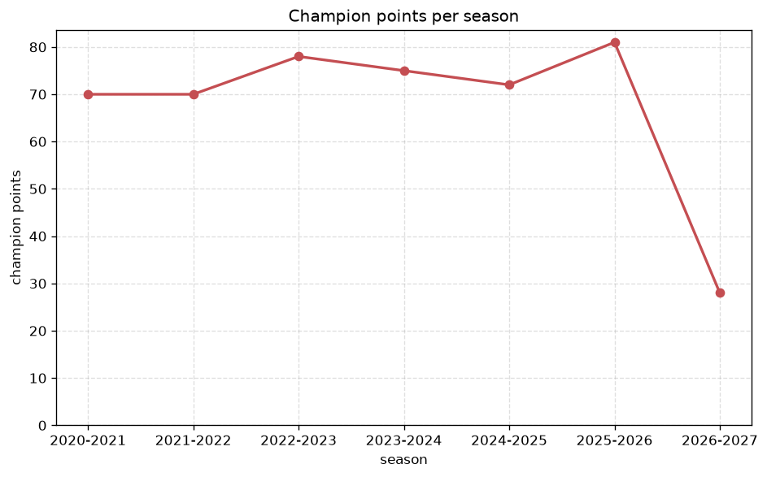
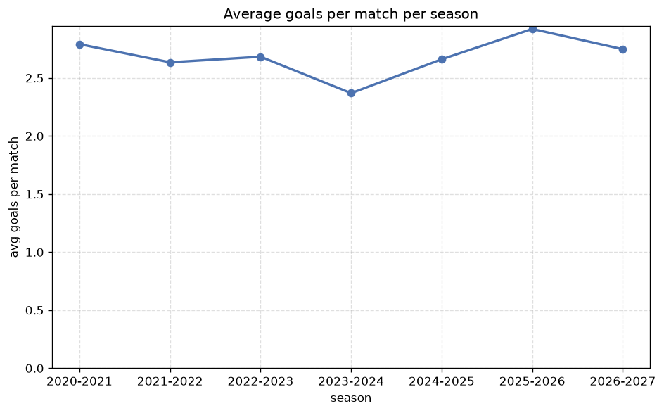

# Season Trends Analysis
- Report: `season_trends`
- Generated: 2026-10-27T02:34:26+00:00
- Script: `backend/scripts/analyze_seasons.py` v1.0.0
- League: 1. Lig (Turkey)
- Scope: league `turkey2`

## 1. Champions per season
| season | champion | pts | runner-up | margin |
|---|---|---|---|---|
| 2020-2021 | Adana Demirspor | 70 | Giresunspor | 0 pts |
| 2021-2022 | Umraniyespor | 70 | Ankaragucu | 0 pts |
| 2022-2023 | Samsunspor | 78 | Rizespor | 10 pts |
| 2023-2024 | Eyupspor | 75 | Goztepe | 5 pts |
| 2024-2025 | Kocaelispor | 72 | Genclerbirligi | 4 pts |
| 2025-2026 | Erzurumspor | 81 | Corum | 4 pts |
| 2026-2027 | Bursaspor | 28 | Kayserispor | 1 pts |

## 2. Title-race tightness
- Tight races (margin <= 3 pts): **3** of 7 seasons
- Tightest race: **2020-2021** - Adana Demirspor beat Giresunspor by **0** pts

| season | margin | tight |
|---|---|---|
| 2020-2021 | 0 pts | yes |
| 2021-2022 | 0 pts | yes |
| 2022-2023 | 10 pts |  |
| 2023-2024 | 5 pts |  |
| 2024-2025 | 4 pts |  |
| 2025-2026 | 4 pts |  |
| 2026-2027 | 1 pts | yes |

## 3. Points thresholds
_Position-specific points per season. Key: 1 = champion, 2 = runner-up, 4 = CL line, 6 = Europa, 17 = last safe, 20 = bottom._

| season | pos 1 | pos 2 | pos 4 | pos 6 | pos 17 | pos 20 |
|---|---|---|---|---|---|---|
| 2020-2021 | 70 | 70 | 64 | 60 | 26 | - |
| 2021-2022 | 70 | 70 | 60 | 57 | 44 | - |
| 2022-2023 | 78 | 68 | 62 | 62 | 26 | - |
| 2023-2024 | 75 | 70 | 57 | 55 | 19 | - |
| 2024-2025 | 72 | 68 | 64 | 64 | 48 | 0 |
| 2025-2026 | 81 | 77 | 74 | 63 | 39 | 6 |
| 2026-2027 | 28 | 27 | 23 | 18 | 11 | 4 |

## 4. Relegation battle
| season | safe pos | safe pts | drop pos | drop pts | gap |
|---|---|---|---|---|---|
| 2020-2021 | 17 | 26 | 18 | 11 | 15 pts |
| 2021-2022 | 17 | 44 | 18 | 38 | 6 pts |
| 2022-2023 | 17 | 26 | 18 | 25 | 1 pts |
| 2023-2024 | 17 | 19 | 18 | 10 | 9 pts |
| 2024-2025 | 17 | 48 | 18 | 40 | 8 pts |
| 2025-2026 | 17 | 39 | 18 | 34 | 5 pts |
| 2026-2027 | 17 | 11 | 18 | 10 | 1 pts |

## 5. League-level trends
| season | matches | total goals | avg goals | home win | draw | away win | goalless | avg pts/team |
|---|---|---|---|---|---|---|---|---|
| 2020-2021 | 306 | 854 | 2.791 | 42.8% | 21.2% | 35.9% | 7.2% | 47.39 |
| 2021-2022 | 342 | 901 | 2.635 | 48.8% | 22.5% | 28.7% | 7.0% | 49.95 |
| 2022-2023 | 341 | 915 | 2.683 | 43.1% | 23.2% | 33.7% | 7.0% | 49.68 |
| 2023-2024 | 306 | 725 | 2.369 | 41.8% | 25.2% | 33.0% | 9.2% | 46.72 |
| 2024-2025 | 380 | 1011 | 2.661 | 45.8% | 23.9% | 30.3% | 7.4% | 52.45 |
| 2025-2026 | 385 | 1125 | 2.922 | 45.5% | 24.7% | 29.9% | 7.3% | 52.85 |
| 2026-2027 | 119 | 327 | 2.748 | 33.6% | 30.3% | 36.1% | 5.9% | 16.05 |

## 6. View divergence
- Largest divergence: **2024-2025** (goals view, avg abs position diff = 8.000)

_Avg absolute position difference between classic view and alternative view per season._

| season | classic vs luck | classic vs goals |
|---|---|---|
| 2020-2021 | 1.889 | 7.111 |
| 2021-2022 | 4.000 | 6.105 |
| 2022-2023 | 2.737 | 7.263 |
| 2023-2024 | 3.222 | 5.333 |
| 2024-2025 | 2.600 | 8.000 |
| 2025-2026 | 4.300 | 7.300 |
| 2026-2027 | 2.000 | 6.500 |

---
*All statistics are computed from PostgreSQL tables (read-only). Run with `python backend/scripts/analyze_seasons.py` to regenerate.*

## Charts

