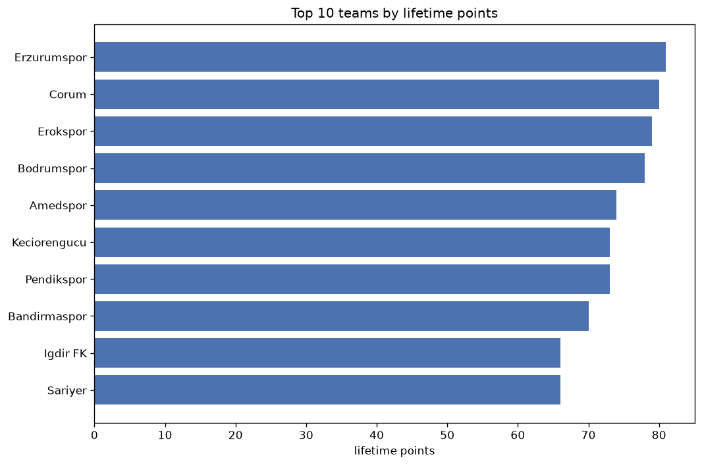
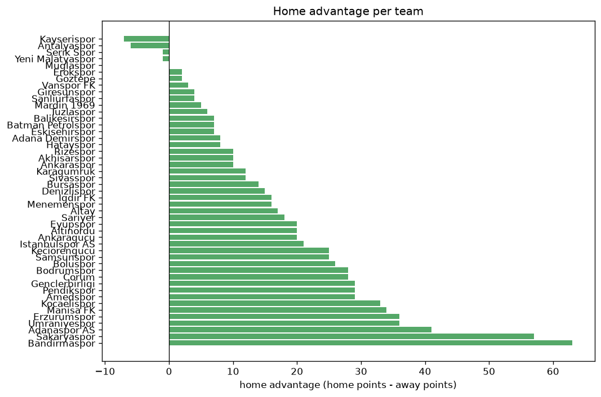

# Team Analysis
- Report: `teams_analysis`
- Generated: 2026-10-29T02:19:02+00:00
- Script: `backend/scripts/analyze_teams.py` v1.0.0
- League: 1. Lig (Turkey)
- Scope: league `turkey2`

- Teams: **47** | Seasons: **7** | Matches: **2180**

## 1. Team standings (lifetime)
| team | seasons | played | W | D | L | pts | GF | GA | GD | avg pts/season | best pos | worst pos | titles |
|---|---|---|---|---|---|---|---|---|---|---|---|---|---|
| Bandirmaspor | 7 | 228 | 95 | 62 | 71 | 347 | 324 | 264 | 60 | 49.57 | 3 | 12 | 0 |
| Keciorengucu | 7 | 229 | 91 | 60 | 78 | 333 | 343 | 277 | 66 | 47.57 | 6 | 13 | 0 |
| Boluspor | 7 | 228 | 87 | 49 | 92 | 310 | 288 | 288 | 0 | 44.29 | 7 | 20 | 0 |
| Erzurumspor | 5 | 182 | 81 | 49 | 52 | 292 | 263 | 184 | 79 | 58.4 | 1 | 13 | 1 |
| Umraniyespor | 6 | 192 | 77 | 45 | 70 | 276 | 258 | 231 | 27 | 46.0 | 1 | 16 | 1 |
| Manisa FK | 6 | 194 | 70 | 48 | 76 | 258 | 264 | 261 | 3 | 43.0 | 9 | 18 | 0 |
| Istanbulspor AS | 5 | 158 | 70 | 35 | 53 | 245 | 252 | 198 | 54 | 49.0 | 4 | 19 | 0 |
| Sakaryaspor | 4 | 146 | 58 | 33 | 55 | 207 | 202 | 208 | -6 | 51.75 | 3 | 18 | 0 |
| Bodrumspor | 4 | 123 | 57 | 35 | 31 | 206 | 187 | 108 | 79 | 51.5 | 4 | 9 | 0 |
| Genclerbirligi | 4 | 144 | 56 | 37 | 51 | 205 | 186 | 176 | 10 | 51.25 | 2 | 14 | 0 |
| Samsunspor | 3 | 106 | 56 | 31 | 19 | 199 | 182 | 102 | 80 | 66.33 | 1 | 7 | 1 |
| Eyupspor | 3 | 106 | 57 | 23 | 26 | 194 | 173 | 105 | 68 | 64.67 | 1 | 6 | 1 |
| Corum | 3 | 114 | 54 | 28 | 32 | 190 | 172 | 121 | 51 | 63.33 | 2 | 10 | 0 |
| Pendikspor | 4 | 125 | 50 | 39 | 36 | 189 | 182 | 145 | 37 | 47.25 | 3 | 17 | 0 |
| Adanaspor AS | 5 | 178 | 45 | 38 | 95 | 173 | 176 | 295 | -119 | 34.6 | 14 | 19 | 0 |
| Tuzlaspor | 4 | 140 | 47 | 31 | 62 | 172 | 168 | 196 | -28 | 43.0 | 9 | 16 | 0 |
| Kocaelispor | 3 | 108 | 49 | 24 | 35 | 171 | 156 | 131 | 25 | 57.0 | 1 | 16 | 1 |
| Altinordu | 3 | 106 | 40 | 20 | 46 | 140 | 144 | 164 | -20 | 46.67 | 6 | 16 | 0 |
| Erokspor | 3 | 89 | 36 | 30 | 23 | 138 | 146 | 103 | 43 | 46.0 | 3 | 15 | 0 |
| Igdir FK | 3 | 88 | 37 | 23 | 28 | 134 | 126 | 96 | 30 | 44.67 | 3 | 13 | 0 |
| Amedspor | 2 | 76 | 35 | 26 | 15 | 131 | 124 | 77 | 47 | 65.5 | 4 | 9 | 0 |
| Goztepe | 2 | 69 | 38 | 16 | 15 | 130 | 105 | 48 | 57 | 65.0 | 2 | 7 | 0 |
| Altay | 3 | 103 | 36 | 17 | 50 | 125 | 127 | 160 | -33 | 41.67 | 5 | 17 | 0 |
| Ankaragucu | 2 | 74 | 35 | 13 | 26 | 118 | 105 | 79 | 26 | 59.0 | 2 | 15 | 0 |
| Bursaspor | 3 | 82 | 35 | 13 | 34 | 118 | 125 | 121 | 4 | 39.33 | 1 | 17 | 1 |
| Karagumruk | 2 | 50 | 23 | 13 | 14 | 82 | 71 | 51 | 20 | 41.0 | 3 | 10 | 0 |
| Giresunspor | 2 | 68 | 23 | 11 | 34 | 80 | 70 | 96 | -26 | 40.0 | 2 | 18 | 0 |
| Sanliurfaspor | 2 | 72 | 20 | 18 | 34 | 78 | 77 | 92 | -15 | 39.0 | 15 | 18 | 0 |
| Adana Demirspor | 2 | 72 | 22 | 10 | 40 | 76 | 86 | 196 | -110 | 38.0 | 1 | 20 | 1 |
| Denizlispor | 2 | 72 | 21 | 12 | 39 | 75 | 81 | 117 | -36 | 37.5 | 11 | 17 | 0 |
| Menemenspor | 2 | 70 | 15 | 27 | 28 | 72 | 80 | 119 | -39 | 36.0 | 15 | 18 | 0 |
| Rizespor | 1 | 36 | 18 | 14 | 4 | 68 | 64 | 35 | 29 | 68.0 | 2 | 2 | 0 |
| Sariyer | 2 | 50 | 19 | 11 | 20 | 68 | 58 | 61 | -3 | 34.0 | 11 | 12 | 0 |
| Sivasspor | 2 | 50 | 16 | 18 | 16 | 66 | 62 | 61 | 1 | 33.0 | 10 | 14 | 0 |
| Vanspor FK | 2 | 50 | 16 | 13 | 21 | 61 | 65 | 69 | -4 | 30.5 | 14 | 16 | 0 |
| Balikesirspor | 2 | 70 | 12 | 11 | 47 | 47 | 61 | 130 | -69 | 23.5 | 13 | 19 | 0 |
| Serik Spor | 1 | 38 | 11 | 6 | 21 | 39 | 44 | 75 | -31 | 39.0 | 17 | 17 | 0 |
| Akhisarspor | 1 | 34 | 8 | 6 | 20 | 30 | 36 | 59 | -23 | 30.0 | 16 | 16 | 0 |
| Kayserispor | 1 | 12 | 8 | 3 | 1 | 27 | 26 | 9 | 17 | 27.0 | 2 | 2 | 0 |
| Ankaraspor | 1 | 34 | 6 | 8 | 20 | 26 | 33 | 61 | -28 | 26.0 | 17 | 17 | 0 |
| Batman Petrolspor | 1 | 12 | 7 | 2 | 3 | 23 | 25 | 21 | 4 | 23.0 | 4 | 4 | 0 |
| Mardin 1969 | 1 | 12 | 6 | 3 | 3 | 21 | 16 | 11 | 5 | 21.0 | 5 | 5 | 0 |
| Yeni Malatyaspor | 2 | 74 | 4 | 7 | 63 | 19 | 36 | 234 | -198 | 9.5 | 19 | 20 | 0 |
| Muglaspor | 1 | 12 | 4 | 6 | 2 | 18 | 18 | 14 | 4 | 18.0 | 7 | 7 | 0 |
| Antalyaspor | 1 | 12 | 6 | 0 | 6 | 18 | 18 | 19 | -1 | 18.0 | 8 | 8 | 0 |
| Hatayspor | 1 | 38 | 2 | 8 | 28 | 14 | 33 | 102 | -69 | 14.0 | 19 | 19 | 0 |
| Eskisehirspor | 1 | 34 | 1 | 8 | 25 | 11 | 23 | 91 | -68 | 11.0 | 18 | 18 | 0 |

## 2. Home vs away split
| team | home P | H-W | H-D | H-L | H-pts | away P | A-W | A-D | A-L | A-pts | adv |
|---|---|---|---|---|---|---|---|---|---|---|---|
| Bandirmaspor | 115 | 59 | 28 | 28 | 205 | 113 | 36 | 34 | 43 | 142 | 63 |
| Sakaryaspor | 73 | 39 | 15 | 19 | 132 | 73 | 19 | 18 | 36 | 75 | 57 |
| Adanaspor AS | 89 | 28 | 23 | 38 | 107 | 89 | 17 | 15 | 57 | 66 | 41 |
| Erzurumspor | 91 | 47 | 23 | 21 | 164 | 91 | 34 | 26 | 31 | 128 | 36 |
| Umraniyespor | 97 | 43 | 27 | 27 | 156 | 95 | 34 | 18 | 43 | 120 | 36 |
| Manisa FK | 97 | 39 | 29 | 29 | 146 | 97 | 31 | 19 | 47 | 112 | 34 |
| Kocaelispor | 54 | 31 | 9 | 14 | 102 | 54 | 18 | 15 | 21 | 69 | 33 |
| Genclerbirligi | 72 | 34 | 15 | 23 | 117 | 72 | 22 | 22 | 28 | 88 | 29 |
| Pendikspor | 62 | 30 | 19 | 13 | 109 | 63 | 20 | 20 | 23 | 80 | 29 |
| Amedspor | 38 | 23 | 11 | 4 | 80 | 38 | 12 | 15 | 11 | 51 | 29 |
| Bodrumspor | 62 | 33 | 18 | 11 | 117 | 61 | 24 | 17 | 20 | 89 | 28 |
| Corum | 57 | 31 | 16 | 10 | 109 | 57 | 23 | 12 | 22 | 81 | 28 |
| Boluspor | 114 | 49 | 21 | 44 | 168 | 114 | 38 | 28 | 48 | 142 | 26 |
| Keciorengucu | 114 | 50 | 29 | 35 | 179 | 115 | 41 | 31 | 43 | 154 | 25 |
| Samsunspor | 53 | 33 | 13 | 7 | 112 | 53 | 23 | 18 | 12 | 87 | 25 |
| Istanbulspor AS | 78 | 37 | 22 | 19 | 133 | 80 | 33 | 13 | 34 | 112 | 21 |
| Eyupspor | 53 | 33 | 8 | 12 | 107 | 53 | 24 | 15 | 14 | 87 | 20 |
| Altinordu | 53 | 24 | 8 | 21 | 80 | 53 | 16 | 12 | 25 | 60 | 20 |
| Ankaragucu | 37 | 21 | 6 | 10 | 69 | 37 | 14 | 7 | 16 | 49 | 20 |
| Sariyer | 26 | 13 | 4 | 9 | 43 | 24 | 6 | 7 | 11 | 25 | 18 |
| Altay | 52 | 21 | 8 | 23 | 71 | 51 | 15 | 9 | 27 | 54 | 17 |
| Igdir FK | 44 | 21 | 12 | 11 | 75 | 44 | 16 | 11 | 17 | 59 | 16 |
| Menemenspor | 35 | 10 | 14 | 11 | 44 | 35 | 5 | 13 | 17 | 28 | 16 |
| Denizlispor | 36 | 13 | 6 | 17 | 45 | 36 | 8 | 6 | 22 | 30 | 15 |
| Bursaspor | 40 | 20 | 6 | 14 | 66 | 42 | 15 | 7 | 20 | 52 | 14 |
| Karagumruk | 25 | 13 | 8 | 4 | 47 | 25 | 10 | 5 | 10 | 35 | 12 |
| Sivasspor | 25 | 9 | 12 | 4 | 39 | 25 | 7 | 6 | 12 | 27 | 12 |
| Rizespor | 18 | 11 | 6 | 1 | 39 | 18 | 7 | 8 | 3 | 29 | 10 |
| Akhisarspor | 17 | 5 | 5 | 7 | 20 | 17 | 3 | 1 | 13 | 10 | 10 |
| Ankaraspor | 17 | 4 | 6 | 7 | 18 | 17 | 2 | 2 | 13 | 8 | 10 |
| Adana Demirspor | 36 | 12 | 6 | 18 | 42 | 36 | 10 | 4 | 22 | 34 | 8 |
| Hatayspor | 19 | 2 | 5 | 12 | 11 | 19 | 0 | 3 | 16 | 3 | 8 |
| Balikesirspor | 35 | 7 | 6 | 22 | 27 | 35 | 5 | 5 | 25 | 20 | 7 |
| Batman Petrolspor | 6 | 5 | 0 | 1 | 15 | 6 | 2 | 2 | 2 | 8 | 7 |
| Eskisehirspor | 17 | 1 | 6 | 10 | 9 | 17 | 0 | 2 | 15 | 2 | 7 |
| Tuzlaspor | 70 | 24 | 17 | 29 | 89 | 70 | 23 | 14 | 33 | 83 | 6 |
| Mardin 1969 | 6 | 4 | 1 | 1 | 13 | 6 | 2 | 2 | 2 | 8 | 5 |
| Giresunspor | 34 | 12 | 6 | 16 | 42 | 34 | 11 | 5 | 18 | 38 | 4 |
| Sanliurfaspor | 36 | 11 | 8 | 17 | 41 | 36 | 9 | 10 | 17 | 37 | 4 |
| Vanspor FK | 25 | 9 | 5 | 11 | 32 | 25 | 7 | 8 | 10 | 29 | 3 |
| Erokspor | 44 | 18 | 16 | 10 | 70 | 45 | 18 | 14 | 13 | 68 | 2 |
| Goztepe | 34 | 19 | 9 | 6 | 66 | 35 | 19 | 7 | 9 | 64 | 2 |
| Muglaspor | 6 | 2 | 3 | 1 | 9 | 6 | 2 | 3 | 1 | 9 | 0 |
| Serik Spor | 19 | 6 | 1 | 12 | 19 | 19 | 5 | 5 | 9 | 20 | -1 |
| Yeni Malatyaspor | 37 | 2 | 3 | 32 | 9 | 37 | 2 | 4 | 31 | 10 | -1 |
| Antalyaspor | 7 | 2 | 0 | 5 | 6 | 5 | 4 | 0 | 1 | 12 | -6 |
| Kayserispor | 5 | 3 | 1 | 1 | 10 | 7 | 5 | 2 | 0 | 17 | -7 |

## 3. Top performers
### Best points per game (PPG)
| rank | team | PPG |
|---|---|---|
| 1 | Kayserispor | 2.25 |
| 2 | Batman Petrolspor | 1.92 |
| 3 | Rizespor | 1.89 |
| 4 | Goztepe | 1.88 |
| 5 | Samsunspor | 1.88 |

### Most goals scored
| rank | team | goals |
|---|---|---|
| 1 | Keciorengucu | 343 |
| 2 | Bandirmaspor | 324 |
| 3 | Boluspor | 288 |
| 4 | Manisa FK | 264 |
| 5 | Erzurumspor | 263 |

### Best goal difference
| rank | team | GD |
|---|---|---|
| 1 | Samsunspor | 80 |
| 2 | Erzurumspor | 79 |
| 3 | Bodrumspor | 79 |
| 4 | Eyupspor | 68 |
| 5 | Keciorengucu | 66 |

### Best defence (goals against per match, standings)
| rank | team | GA/match |
|---|---|---|
| 1 | Goztepe | 0.696 |
| 2 | Kayserispor | 0.750 |
| 3 | Bodrumspor | 0.869 |
| 4 | Mardin 1969 | 0.917 |
| 5 | Samsunspor | 0.962 |

## 4. Team consistency
- Teams present in all **7** seasons: **3**

Bandirmaspor, Boluspor, Keciorengucu

## 5. Head-to-head dominance
- Distinct fixtures: **652** (showing the 15 most frequent)

| fixture | meetings | home wins | draws | away wins | home pct | draw pct | away pct |
|---|---|---|---|---|---|---|---|
| Bandirmaspor vs Boluspor | 13 | 6 | 5 | 2 | 46.2% | 38.5% | 15.4% |
| Keciorengucu vs Bandirmaspor | 13 | 5 | 4 | 4 | 38.5% | 30.8% | 30.8% |
| Keciorengucu vs Boluspor | 13 | 4 | 5 | 4 | 30.8% | 38.5% | 30.8% |
| Umraniyespor vs Bandirmaspor | 11 | 7 | 1 | 3 | 63.6% | 9.1% | 27.3% |
| Boluspor vs Manisa FK | 11 | 6 | 1 | 4 | 54.5% | 9.1% | 36.4% |
| Umraniyespor vs Keciorengucu | 11 | 5 | 1 | 5 | 45.5% | 9.1% | 45.5% |
| Umraniyespor vs Boluspor | 11 | 4 | 0 | 7 | 36.4% | 0.0% | 63.6% |
| Erzurumspor vs Boluspor | 10 | 8 | 1 | 1 | 80.0% | 10.0% | 10.0% |
| Bandirmaspor vs Adanaspor AS | 10 | 5 | 1 | 4 | 50.0% | 10.0% | 40.0% |
| Keciorengucu vs Adanaspor AS | 10 | 5 | 2 | 3 | 50.0% | 20.0% | 30.0% |
| Erzurumspor vs Bandirmaspor | 10 | 4 | 3 | 3 | 40.0% | 30.0% | 30.0% |
| Erzurumspor vs Manisa FK | 10 | 4 | 2 | 4 | 40.0% | 20.0% | 40.0% |
| Keciorengucu vs Manisa FK | 10 | 3 | 5 | 2 | 30.0% | 50.0% | 20.0% |
| Bandirmaspor vs Manisa FK | 10 | 2 | 3 | 5 | 20.0% | 30.0% | 50.0% |
| Boluspor vs Adanaspor AS | 10 | 2 | 2 | 6 | 20.0% | 20.0% | 60.0% |

## 6. Position per season (classic view)
_Cells show final position; '-' when the team was absent from that season._

| team | 2020-2021 | 2021-2022 | 2022-2023 | 2023-2024 | 2024-2025 | 2025-2026 | 2026-2027 |
|---|---|---|---|---|---|---|---|
| Bandirmaspor | 11 | 3 | 10 | 9 | 6 | 8 | 12 |
| Keciorengucu | 7 | 12 | 8 | 13 | 13 | 7 | 6 |
| Boluspor | 12 | 8 | 11 | 7 | 7 | 15 | 20 |
| Erzurumspor | - | 5 | 13 | 10 | 5 | 1 | - |
| Umraniyespor | 8 | 1 | - | 11 | 11 | 16 | 13 |
| Manisa FK | - | 10 | 9 | 12 | 16 | 9 | 18 |
| Istanbulspor AS | 4 | 4 | - | - | 4 | 11 | 19 |
| Sakaryaspor | - | - | 5 | 3 | 14 | 18 | - |
| Bodrumspor | - | - | 4 | 4 | - | 5 | 9 |
| Genclerbirligi | - | 13 | 14 | 8 | 2 | - | - |
| Samsunspor | 3 | 7 | 1 | - | - | - | - |
| Eyupspor | - | 6 | 6 | 1 | - | - | - |
| Corum | - | - | - | 5 | 10 | 2 | - |
| Pendikspor | - | - | 3 | - | 17 | 6 | 17 |
| Adanaspor AS | 14 | 14 | 18 | 14 | 19 | - | - |
| Tuzlaspor | 9 | 9 | 15 | 16 | - | - | - |
| Kocaelispor | - | 16 | - | 6 | 1 | - | - |
| Altinordu | 6 | 15 | 16 | - | - | - | - |
| Erokspor | - | - | - | - | 12 | 3 | 15 |
| Igdir FK | - | - | - | - | 8 | 13 | 3 |
| Amedspor | - | - | - | - | 9 | 4 | - |
| Goztepe | - | - | 7 | 2 | - | - | - |
| Altay | 5 | - | 12 | 17 | - | - | - |
| Ankaragucu | - | 2 | - | - | 15 | - | - |
| Bursaspor | 10 | 17 | - | - | - | - | 1 |
| Karagumruk | - | - | - | - | 3 | - | 10 |
| Giresunspor | 2 | - | - | 18 | - | - | - |
| Sanliurfaspor | - | - | - | 15 | 18 | - | - |
| Adana Demirspor | 1 | - | - | - | - | 20 | - |
| Denizlispor | - | 11 | 17 | - | - | - | - |
| Menemenspor | 15 | 18 | - | - | - | - | - |
| Rizespor | - | - | 2 | - | - | - | - |
| Sariyer | - | - | - | - | - | 12 | 11 |
| Sivasspor | - | - | - | - | - | 10 | 14 |
| Vanspor FK | - | - | - | - | - | 14 | 16 |
| Balikesirspor | 13 | 19 | - | - | - | - | - |
| Serik Spor | - | - | - | - | - | 17 | - |
| Akhisarspor | 16 | - | - | - | - | - | - |
| Kayserispor | - | - | - | - | - | - | 2 |
| Ankaraspor | 17 | - | - | - | - | - | - |
| Batman Petrolspor | - | - | - | - | - | - | 4 |
| Mardin 1969 | - | - | - | - | - | - | 5 |
| Yeni Malatyaspor | - | - | 19 | - | 20 | - | - |
| Muglaspor | - | - | - | - | - | - | 7 |
| Antalyaspor | - | - | - | - | - | - | 8 |
| Hatayspor | - | - | - | - | - | 19 | - |
| Eskisehirspor | 18 | - | - | - | - | - | - |

---
*All statistics are computed from PostgreSQL tables (read-only). Run with `python backend/scripts/analyze_teams.py` to regenerate.*

## Charts

