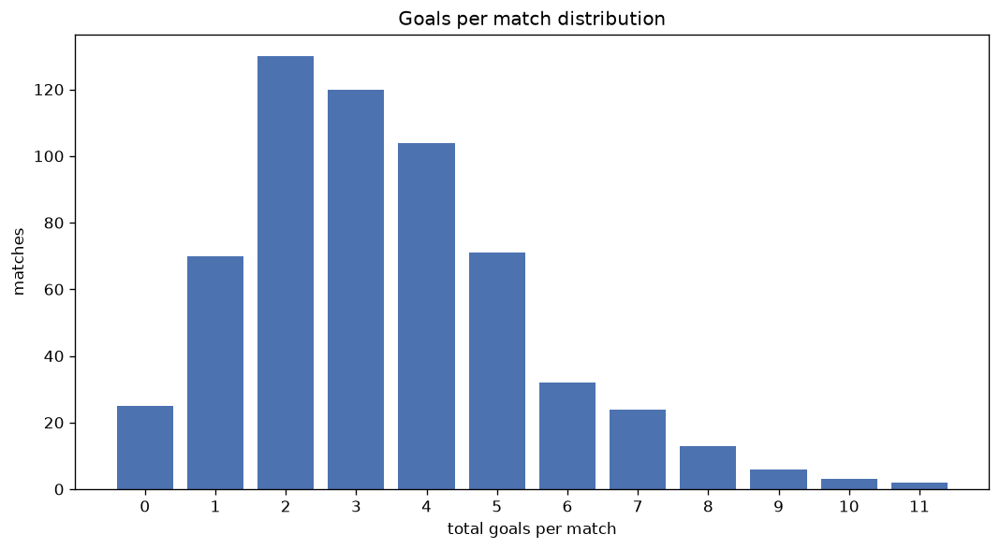
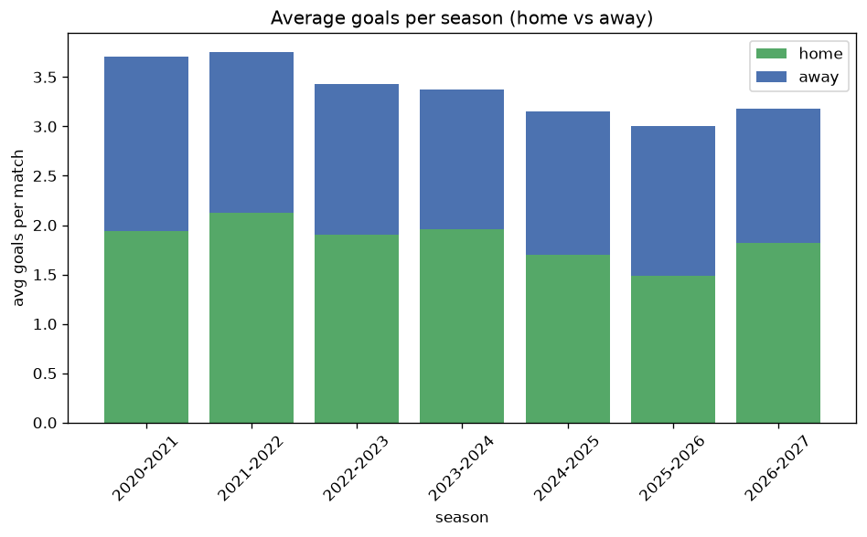

# Goal Analysis
- Report: `goals_analysis`
- Generated: 2026-10-26T01:52:27+00:00
- Script: `backend/scripts/analyze_goals.py` v1.0.0
- League: Super League Women (Belgium)
- Scope: league `wbelgium1`

## 1. Goals per match distribution
| goals | matches | pct |
|---|---|---|
| 0 | 25 | 4.2% |
| 1 | 70 | 11.7% |
| 2 | 130 | 21.7% |
| 3 | 120 | 20.0% |
| 4 | 104 | 17.3% |
| 5 | 71 | 11.8% |
| 6 | 32 | 5.3% |
| 7 | 24 | 4.0% |
| 8 | 13 | 2.2% |
| 9 | 6 | 1.0% |
| 10 | 3 | 0.5% |
| 11 | 2 | 0.3% |

## 2. Goals per match per season
| season | matches | total goals | avg home | avg away | avg total |
|---|---|---|---|---|---|
| 2020-2021 | 90 | 334 | 1.944 | 1.767 | 3.711 |
| 2021-2022 | 90 | 338 | 2.122 | 1.633 | 3.756 |
| 2022-2023 | 110 | 377 | 1.9 | 1.527 | 3.427 |
| 2023-2024 | 90 | 304 | 1.956 | 1.422 | 3.378 |
| 2024-2025 | 84 | 265 | 1.702 | 1.452 | 3.155 |
| 2025-2026 | 108 | 324 | 1.491 | 1.509 | 3.0 |
| 2026-2027 | 28 | 89 | 1.821 | 1.357 | 3.179 |

## 3. Home vs away goal share
- Home goals: **1106** (54.5%)
- Away goals: **925** (45.5%)
- Home/away ratio: **1.196**

| season | home goals | away goals | total | home pct | away pct |
|---|---|---|---|---|---|
| 2020-2021 | 175 | 159 | 334 | 52.4% | 47.6% |
| 2021-2022 | 191 | 147 | 338 | 56.5% | 43.5% |
| 2022-2023 | 209 | 168 | 377 | 55.4% | 44.6% |
| 2023-2024 | 176 | 128 | 304 | 57.9% | 42.1% |
| 2024-2025 | 143 | 122 | 265 | 54.0% | 46.0% |
| 2025-2026 | 161 | 163 | 324 | 49.7% | 50.3% |
| 2026-2027 | 51 | 38 | 89 | 57.3% | 42.7% |

## 4. BTTS (Both Teams To Score)
- Overall: **271** of `600` (45.2%)

| season | matches | BTTS | pct |
|---|---|---|---|
| 2020-2021 | 90 | 38 | 42.2% |
| 2021-2022 | 90 | 44 | 48.9% |
| 2022-2023 | 110 | 40 | 36.4% |
| 2023-2024 | 90 | 38 | 42.2% |
| 2024-2025 | 84 | 35 | 41.7% |
| 2025-2026 | 108 | 63 | 58.3% |
| 2026-2027 | 28 | 13 | 46.4% |

## 5. Clean sheets
- Home clean sheets: **185** (30.8%)
- Away clean sheets: **169** (28.2%)
- Total clean sheets recorded: **354**
- Matches with at least one clean sheet: **329** (54.8%)
- Both teams kept clean sheets (0-0): **25**

| season | matches | home CS | away CS | total CS | matches w/ CS |
|---|---|---|---|---|---|
| 2020-2021 | 90 | 31 | 25 | 56 | 52 (57.8%) |
| 2021-2022 | 90 | 20 | 27 | 47 | 46 (51.1%) |
| 2022-2023 | 110 | 40 | 36 | 76 | 70 (63.6%) |
| 2023-2024 | 90 | 27 | 29 | 56 | 52 (57.8%) |
| 2024-2025 | 84 | 28 | 23 | 51 | 49 (58.3%) |
| 2025-2026 | 108 | 28 | 23 | 51 | 45 (41.7%) |
| 2026-2027 | 28 | 11 | 6 | 17 | 15 (53.6%) |

## 6. Scoring intensity
- First-half goals: **922** (45.6%)
- Second-half goals: **1099** (54.4%)
- Avg first-half goals per match: **1.542**
- Avg second-half goals per match: **1.838**
- Second-half-only scoring (HT 0-0, FT goals >= 1): **110** (18.3%)
- *2 match(es) excluded (no HT score recorded).*

| season | matches | 1st half | 2nd half | 1st half pct | 2nd half pct |
|---|---|---|---|---|---|
| 2020-2021 | 90 | 146 | 178 | 45.1% | 54.9% |
| 2021-2022 | 90 | 160 | 178 | 47.3% | 52.7% |
| 2022-2023 | 110 | 171 | 206 | 45.4% | 54.6% |
| 2023-2024 | 90 | 143 | 161 | 47.0% | 53.0% |
| 2024-2025 | 84 | 116 | 149 | 43.8% | 56.2% |
| 2025-2026 | 108 | 149 | 175 | 46.0% | 54.0% |
| 2026-2027 | 28 | 37 | 52 | 41.6% | 58.4% |

## 7. First-goal timing
- Matches with first-goal time recorded: `575` of `600` (95.8%)
- Goalless matches: `25`
- Min `1` | Max `96` | Mean `27.09` | Median (p50) `20`

| bucket | count | % of matches | % of scoring matches |
|---|---|---|---|
| 1-15 | 237 | 39.5% | 41.2% |
| 16-30 | 133 | 22.2% | 23.1% |
| 31-45 | 94 | 15.7% | 16.3% |
| 46-60 | 55 | 9.2% | 9.6% |
| 61-75 | 31 | 5.2% | 5.4% |
| 76-90 | 21 | 3.5% | 3.7% |
| 91-120 | 4 | 0.7% | 0.7% |

---
*All statistics are computed from PostgreSQL tables (read-only). Run with `python backend/scripts/analyze_goals.py` to regenerate.*

## Charts

