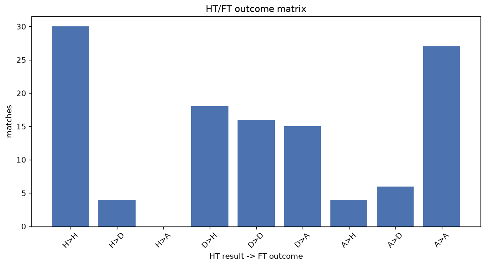
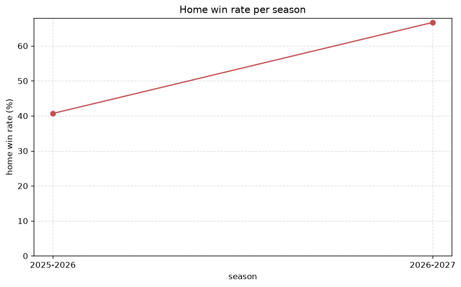

# Match Analysis
- Report: `matches_analysis`
- Generated: 2026-10-27T02:34:39+00:00
- Script: `backend/scripts/analyze_matches.py` v1.0.0
- League: Super League Women (Belgium)
- Scope: league `wbelgium1`

## 1. Overall summary
| metric | value |
|---|---|
| Matches | 600 |
| Home wins | 276 (46.0%) |
| Draws | 85 (14.2%) |
| Away wins | 239 (39.8%) |
| Total goals | 2031 |
| Average goals per match | 3.385 |
| Goalless matches | 25 (4.2%) |

## 2. Per-season breakdown
| season | matches | home wins | draws | away wins | total goals | avg goals | goalless |
|---|---|---|---|---|---|---|---|
| 2020-2021 | 90 | 39 (43.3%) | 11 (12.2%) | 40 (44.4%) | 334 | 3.711 | 4 (4.4%) |
| 2021-2022 | 90 | 44 (48.9%) | 7 (7.8%) | 39 (43.3%) | 338 | 3.756 | 1 (1.1%) |
| 2022-2023 | 110 | 51 (46.4%) | 15 (13.6%) | 44 (40.0%) | 377 | 3.427 | 6 (5.5%) |
| 2023-2024 | 90 | 44 (48.9%) | 11 (12.2%) | 35 (38.9%) | 304 | 3.378 | 4 (4.4%) |
| 2024-2025 | 84 | 40 (47.6%) | 11 (13.1%) | 33 (39.3%) | 265 | 3.155 | 2 (2.4%) |
| 2025-2026 | 108 | 44 (40.7%) | 25 (23.1%) | 39 (36.1%) | 324 | 3.0 | 6 (5.6%) |
| 2026-2027 | 28 | 14 (50.0%) | 5 (17.9%) | 9 (32.1%) | 89 | 3.179 | 2 (7.1%) |

## 3. HT/FT outcome matrix
| HT result \ FT result | Home | Draw | Away | total |
|---|---|---|---|---|
| HT home lead | 194 (89.0%) | 17 (7.8%) | 7 (3.2%) | 218 |
| HT draw | 72 (37.7%) | 54 (28.3%) | 65 (34.0%) | 191 |
| HT away lead | 10 (5.3%) | 14 (7.4%) | 165 (87.3%) | 189 |
- *2 match(es) excluded (no HT score recorded).*

## 4. Comeback matches
- Home comebacks (trailing at HT, won at FT): **10** (1.7%)
- Away comebacks (trailing at HT, won at FT): **7** (1.2%)

### Home comebacks
| season | home | away | HT | FT |
|---|---|---|---|---|
| 2020-2021 | St. Liege W | Club Brugge W | 0-1 | 2-1 |
| 2021-2022 | St. Liege W | Gent W | 1-2 | 3-2 |
| 2021-2022 | Leuven W | RSC Anderlecht W | 0-1 | 3-2 |
| 2022-2023 | RSC Anderlecht W | Femina Woluwe W | 1-2 | 5-3 |
| 2022-2023 | RSC Anderlecht W | Club Brugge W | 1-2 | 5-3 |
| 2024-2025 | St. Liege W | Waregem W | 0-1 | 2-1 |
| 2025-2026 | Westerlo W | Gent W | 0-1 | 2-1 |
| 2025-2026 | RSC Anderlecht W | Club Brugge W | 0-1 | 2-1 |
| 2025-2026 | Club Brugge W | St. Liege W | 0-1 | 4-2 |
| 2025-2026 | Leuven W | St. Liege W | 0-1 | 2-1 |

### Away comebacks
| season | home | away | HT | FT |
|---|---|---|---|---|
| 2020-2021 | Club Brugge W | RSC Anderlecht W | 1-0 | 2-3 |
| 2021-2022 | Genk W | RSC Anderlecht W | 1-0 | 1-2 |
| 2021-2022 | Aalst W | Charleroi W | 1-0 | 2-3 |
| 2021-2022 | Charleroi W | St. Liege W | 2-0 | 2-3 |
| 2022-2023 | Genk W | Charleroi W | 1-0 | 1-2 |
| 2023-2024 | Genk W | RSC Anderlecht W | 2-1 | 3-4 |
| 2026-2027 | Waregem W | St. Liege W | 3-0 | 3-4 |

## 5. HT lead conversion
| HT state | matches | converted to win | held as draw | collapsed to loss |
|---|---|---|---|---|
| Home lead | 218 | 194 (89.0%) | 17 (7.8%) | 7 (3.2%) |
| Away lead | 189 | 165 (87.3%) | 14 (7.4%) | 10 (5.3%) |

### Matches level at half-time
| FT result | count | pct |
|---|---|---|
| Home win | 72 | 37.7% |
| Draw | 54 | 28.3% |
| Away win | 65 | 34.0% |
- *2 match(es) excluded (no HT score recorded).*

## 6. First-goal timing
- Matches with a first-goal time recorded: `575` of `600` (95.8%)

Outcome distribution by first-goal timing bucket:
| bucket | matches | % of matches | home | draw | away |
|---|---|---|---|---|---|
| 1-15 | 237 | 39.5% | 123 (51.9%) | 20 (8.4%) | 94 (39.7%) |
| 16-30 | 133 | 22.2% | 59 (44.4%) | 18 (13.5%) | 56 (42.1%) |
| 31-45 | 94 | 15.7% | 45 (47.9%) | 7 (7.4%) | 42 (44.7%) |
| 46-60 | 55 | 9.2% | 24 (43.6%) | 5 (9.1%) | 26 (47.3%) |
| 61-75 | 31 | 5.2% | 14 (45.2%) | 8 (25.8%) | 9 (29.0%) |
| 76-90 | 21 | 3.5% | 9 (42.9%) | 2 (9.5%) | 10 (47.6%) |
| 91-120 | 4 | 0.7% | 2 (50.0%) | 0 (0.0%) | 2 (50.0%) |

## 7. Goalless matches
- Overall: **25** of `600` (4.2%)

| season | matches | goalless | pct |
|---|---|---|---|
| 2020-2021 | 90 | 4 | 4.4% |
| 2021-2022 | 90 | 1 | 1.1% |
| 2022-2023 | 110 | 6 | 5.5% |
| 2023-2024 | 90 | 4 | 4.4% |
| 2024-2025 | 84 | 2 | 2.4% |
| 2025-2026 | 108 | 6 | 5.6% |
| 2026-2027 | 28 | 2 | 7.1% |

---
*All statistics are computed from PostgreSQL tables (read-only). Run with `python backend/scripts/analyze_matches.py` to regenerate.*

## Charts

