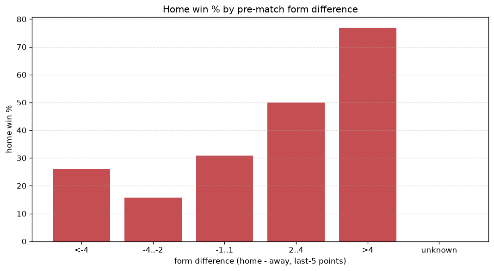
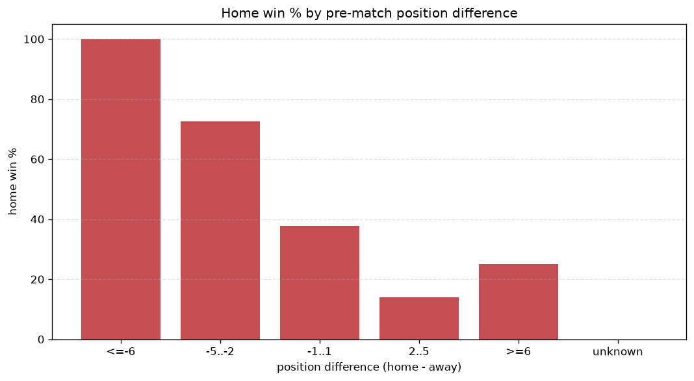

# Relationships Analysis
- Report: `relationships`
- Generated: 2026-10-30T04:15:32+00:00
- Script: `backend/scripts/analyze_relationships.py` v1.0.0
- League: Super League Women (Belgium)
- Scope: league `wbelgium1`

- Matches analysed: **572** (23 leakage-safe pre-match features).

## 1. Correlation matrix
_Pearson correlation of each pre-match feature with observed goals; sorted by |corr(total goals)|._

| feature | corr(home) | corr(away) | corr(total) |
|---|---|---|---|
| away_points_before_match | -0.262 | 0.141 | -0.136 |
| away_position_before_match | 0.396 | -0.306 | 0.132 |
| position_difference | -0.539 | 0.477 | -0.132 |
| points_difference | 0.474 | -0.406 | 0.126 |
| home_team_goals_scored_last_5 | 0.343 | -0.257 | 0.120 |
| away_team_away_conceded_avg | 0.298 | -0.208 | 0.117 |
| home_team_wins_last_5 | 0.326 | -0.265 | 0.098 |
| home_team_points_last_5 | 0.323 | -0.264 | 0.096 |
| away_team_away_win_rate | -0.276 | 0.213 | -0.092 |
| away_team_goals_conceded_last_5 | 0.298 | -0.248 | 0.085 |
| home_team_home_goals_avg | 0.314 | -0.274 | 0.080 |
| home_team_goals_conceded_last_5 | -0.270 | 0.225 | -0.076 |
| home_team_home_conceded_avg | -0.266 | 0.228 | -0.070 |
| home_team_home_win_rate | 0.310 | -0.290 | 0.064 |
| away_team_points_last_5 | -0.286 | 0.265 | -0.061 |
| away_team_wins_last_5 | -0.280 | 0.268 | -0.052 |
| away_rest_days | 0.056 | -0.008 | 0.047 |
| home_position_before_match | -0.329 | 0.337 | -0.044 |
| home_rest_days | 0.040 | -0.003 | 0.036 |
| rest_days_difference | -0.029 | 0.009 | -0.021 |
| away_team_goals_scored_last_5 | -0.259 | 0.288 | -0.016 |
| away_team_away_goals_avg | -0.236 | 0.262 | -0.016 |
| home_points_before_match | 0.204 | -0.256 | -0.010 |

## 2. Form vs outcome
_Home win/draw/away % per bucket of `home_team_points_last_5 - away_team_points_last_5`._

| bucket | matches | home | draw | away | home % | draw % | away % |
|---|---|---|---|---|---|---|---|
| <-4 | 119 | 18 | 14 | 87 | 15.1% | 11.8% | 73.1% |
| -4..-2 | 91 | 23 | 21 | 47 | 25.3% | 23.1% | 51.6% |
| -1..1 | 141 | 55 | 22 | 64 | 39.0% | 15.6% | 45.4% |
| 2..4 | 102 | 65 | 16 | 21 | 63.7% | 15.7% | 20.6% |
| >4 | 119 | 101 | 7 | 11 | 84.9% | 5.9% | 9.2% |
| unknown | 0 | 0 | 0 | 0 | - | - | - |

## 3. Position vs outcome
_Home win/draw/away % per bucket of `position_difference` (home position - away position; negative favours the home team)._

| bucket | matches | home | draw | away | home % | draw % | away % |
|---|---|---|---|---|---|---|---|
| <=-6 | 42 | 38 | 1 | 3 | 90.5% | 2.4% | 7.1% |
| -5..-2 | 169 | 127 | 22 | 20 | 75.1% | 13.0% | 11.8% |
| -1..1 | 160 | 65 | 28 | 67 | 40.6% | 17.5% | 41.9% |
| 2..5 | 159 | 28 | 28 | 103 | 17.6% | 17.6% | 64.8% |
| >=6 | 42 | 4 | 1 | 37 | 9.5% | 2.4% | 88.1% |
| unknown | 0 | 0 | 0 | 0 | - | - | - |

## 4. Rest advantage
_Home win/draw/away % per bucket of `rest_days_difference` (home rest - away rest). Matches with unknown rest are bucketed separately._

| bucket | matches | home | draw | away | home % | draw % | away % |
|---|---|---|---|---|---|---|---|
| <-1 | 44 | 22 | 6 | 16 | 50.0% | 13.6% | 36.4% |
| -1..0 | 120 | 61 | 12 | 47 | 50.8% | 10.0% | 39.2% |
| 0 | 228 | 104 | 44 | 80 | 45.6% | 19.3% | 35.1% |
| 1..2 | 113 | 48 | 10 | 55 | 42.5% | 8.8% | 48.7% |
| >2 | 37 | 16 | 4 | 17 | 43.2% | 10.8% | 45.9% |
| unknown | 30 | 11 | 4 | 15 | 36.7% | 13.3% | 50.0% |
- *30 match(es) had unknown rest difference (missing rest data on at least one side).*

## 5. Home team quality
_Home win rate by `home_team_home_win_rate` tier (split at 0.5)._

- `< 0.5` tier: **34.0%** home win (111/326)
- `>= 0.5` tier: **61.4%** home win (151/246)
- Home-win gap (>= split minus < split): **+27.4 pp**

| tier | label | matches | home | draw | away | home % |
|---|---|---|---|---|---|---|
| low | < 0.5 | 326 | 111 | 49 | 166 | 34.0% |
| high | >= 0.5 | 246 | 151 | 31 | 64 | 61.4% |

## 6. Feature averages by result
_Mean feature value per outcome; `range` is home-minus-away spread of the group means._

| feature | home mean | draw mean | away mean | range |
|---|---|---|---|---|
| points_difference | 6.821 | -1.462 | -6.700 | 13.521 |
| home_points_before_match | 17.397 | 15.238 | 10.057 | 7.340 |
| away_points_before_match | 10.576 | 16.700 | 16.757 | 6.180 |
| position_difference | -2.195 | 0.250 | 2.287 | 4.482 |
| home_team_goals_scored_last_5 | 9.321 | 6.425 | 5.465 | 3.855 |
| away_team_goals_scored_last_5 | 5.668 | 7.388 | 9.326 | 3.658 |
| away_team_goals_conceded_last_5 | 9.065 | 6.963 | 5.617 | 3.447 |
| home_team_goals_conceded_last_5 | 5.844 | 7.350 | 9.004 | 3.161 |
| home_team_points_last_5 | 7.683 | 5.375 | 4.548 | 3.135 |
| away_team_points_last_5 | 4.702 | 6.350 | 7.626 | 2.924 |
| away_position_before_match | 6.382 | 4.975 | 4.117 | 2.264 |
| home_position_before_match | 4.187 | 5.225 | 6.404 | 2.217 |
| away_rest_days | 11.579 | 10.408 | 10.372 | 1.207 |
| home_team_wins_last_5 | 2.374 | 1.587 | 1.335 | 1.039 |
| home_team_home_goals_avg | 2.164 | 1.697 | 1.142 | 1.022 |
| away_team_wins_last_5 | 1.378 | 1.938 | 2.352 | 0.974 |
| home_rest_days | 11.349 | 10.519 | 10.484 | 0.865 |
| away_team_away_conceded_avg | 1.964 | 1.728 | 1.247 | 0.717 |
| home_team_home_conceded_avg | 1.128 | 1.447 | 1.817 | 0.688 |
| away_team_away_goals_avg | 1.163 | 1.581 | 1.836 | 0.672 |
| rest_days_difference | -0.227 | 0.158 | 0.112 | 0.385 |
| home_team_home_win_rate | 0.531 | 0.407 | 0.272 | 0.259 |
| away_team_away_win_rate | 0.302 | 0.398 | 0.467 | 0.165 |

---
*All features are leakage-safe pre-match values built by `ml.features.build_features.build_rows` from strictly prior matches. Run with `python backend/scripts/analyze_relationships.py` to regenerate.*

## Charts

