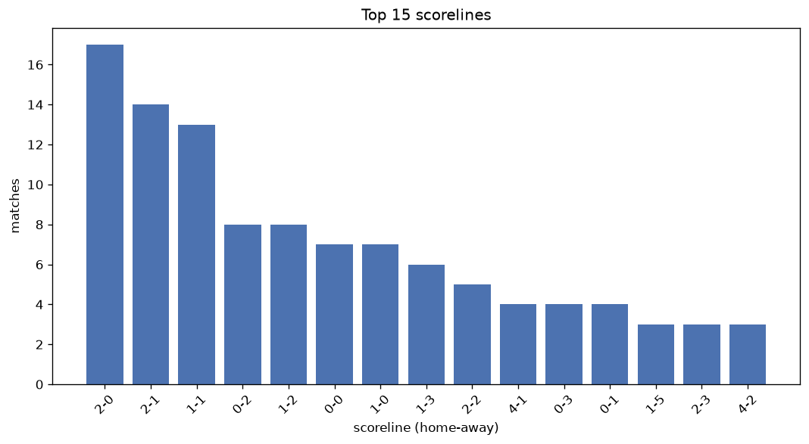
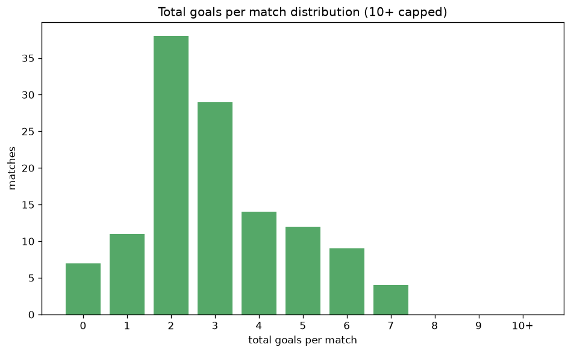

# Scoreline Analysis
- Report: `scoreline_analysis`
- Generated: 2026-10-27T02:34:47+00:00
- Script: `backend/scripts/analyze_scorelines.py` v1.0.0
- League: Super League Women (Belgium)
- Scope: league `wbelgium1`

## 1. Scoreline frequency
- Matches analysed: **600** across **7** seasons.
- Distinct scorelines seen: **50**.

| scoreline | count | pct |
|---|---|---|
| 2-0 | 50 | 8.3% |
| 0-2 | 40 | 6.7% |
| 1-1 | 40 | 6.7% |
| 0-1 | 37 | 6.2% |
| 2-1 | 35 | 5.8% |
| 1-0 | 33 | 5.5% |
| 1-2 | 30 | 5.0% |
| 3-0 | 28 | 4.7% |
| 0-3 | 27 | 4.5% |
| 0-0 | 25 | 4.2% |
| 0-4 | 24 | 4.0% |
| 1-3 | 23 | 3.8% |
| 4-0 | 21 | 3.5% |
| 4-1 | 20 | 3.3% |
| 3-1 | 18 | 3.0% |
| 2-2 | 18 | 3.0% |
| 1-4 | 13 | 2.2% |
| 2-3 | 11 | 1.8% |
| 3-2 | 9 | 1.5% |
| 5-0 | 9 | 1.5% |

## 2. Scoreline frequency per season

### 2020-2021
| scoreline | count | pct |
|---|---|---|
| 2-0 | 8 | 8.9% |
| 1-1 | 7 | 7.8% |
| 1-2 | 6 | 6.7% |
| 0-2 | 5 | 5.6% |
| 0-3 | 5 | 5.6% |

### 2021-2022
| scoreline | count | pct |
|---|---|---|
| 0-1 | 8 | 8.9% |
| 0-2 | 7 | 7.8% |
| 0-3 | 6 | 6.7% |
| 3-0 | 5 | 5.6% |
| 1-1 | 5 | 5.6% |

### 2022-2023
| scoreline | count | pct |
|---|---|---|
| 2-0 | 11 | 10.0% |
| 0-4 | 9 | 8.2% |
| 0-1 | 7 | 6.4% |
| 0-2 | 7 | 6.4% |
| 4-0 | 7 | 6.4% |

### 2023-2024
| scoreline | count | pct |
|---|---|---|
| 0-2 | 10 | 11.1% |
| 4-1 | 8 | 8.9% |
| 3-0 | 8 | 8.9% |
| 0-1 | 7 | 7.8% |
| 1-0 | 6 | 6.7% |

### 2024-2025
| scoreline | count | pct |
|---|---|---|
| 1-0 | 8 | 9.5% |
| 2-1 | 7 | 8.3% |
| 0-1 | 7 | 8.3% |
| 2-0 | 6 | 7.1% |
| 1-3 | 5 | 6.0% |

### 2025-2026
| scoreline | count | pct |
|---|---|---|
| 2-0 | 14 | 13.0% |
| 2-1 | 14 | 13.0% |
| 1-1 | 12 | 11.1% |
| 0-2 | 7 | 6.5% |
| 1-2 | 7 | 6.5% |

### 2026-2027
| scoreline | count | pct |
|---|---|---|
| 1-0 | 3 | 10.7% |
| 3-1 | 3 | 10.7% |
| 2-0 | 3 | 10.7% |
| 4-0 | 2 | 7.1% |
| 0-0 | 2 | 7.1% |

## 3. Total-goal histogram
_10+ groups all matches with 10 or more total goals._

| total goals | matches | pct |
|---|---|---|
| 0 | 25 | 4.2% |
| 1 | 70 | 11.7% |
| 2 | 130 | 21.7% |
| 3 | 120 | 20.0% |
| 4 | 104 | 17.3% |
| 5 | 71 | 11.8% |
| 6 | 32 | 5.3% |
| 7 | 24 | 4.0% |
| 8 | 13 | 2.2% |
| 9 | 6 | 1.0% |
| 10+ | 5 | 0.8% |

## 4. Extreme scorelines
- Matches with 7+ total goals: **48**

| season | date | scoreline | total goals |
|---|---|---|---|
| 2020-2021 | 2020-09-05 | 0-11 | 11 |
| 2021-2022 | 2022-01-28 | 9-2 | 11 |
| 2020-2021 | 2020-11-08 | 10-0 | 10 |
| 2020-2021 | 2021-03-05 | 1-9 | 10 |
| 2021-2022 | 2021-11-05 | 2-8 | 10 |
| 2020-2021 | 2020-10-13 | 9-0 | 9 |
| 2020-2021 | 2021-01-31 | 1-8 | 9 |
| 2021-2022 | 2021-11-09 | 7-2 | 9 |
| 2022-2023 | 2022-11-05 | 8-1 | 9 |
| 2023-2024 | 2023-10-21 | 8-1 | 9 |
| 2023-2024 | 2023-12-09 | 8-1 | 9 |
| 2020-2021 | 2020-09-05 | 6-2 | 8 |
| 2020-2021 | 2021-02-05 | 8-0 | 8 |
| 2021-2022 | 2021-09-10 | 7-1 | 8 |
| 2021-2022 | 2022-01-22 | 8-0 | 8 |
| 2021-2022 | 2022-02-12 | 7-1 | 8 |
| 2022-2023 | 2022-08-20 | 8-0 | 8 |
| 2022-2023 | 2022-10-21 | 5-3 | 8 |
| 2022-2023 | 2022-10-22 | 1-7 | 8 |
| 2022-2023 | 2022-11-25 | 5-3 | 8 |
| 2023-2024 | 2023-11-17 | 6-2 | 8 |
| 2023-2024 | 2023-11-18 | 5-3 | 8 |
| 2023-2024 | 2024-01-26 | 8-0 | 8 |
| 2024-2025 | 2025-03-29 | 7-1 | 8 |
| 2020-2021 | 2020-09-05 | 5-2 | 7 |
| 2020-2021 | 2020-10-02 | 0-7 | 7 |
| 2020-2021 | 2020-11-15 | 7-0 | 7 |
| 2020-2021 | 2020-12-12 | 6-1 | 7 |
| 2021-2022 | 2021-08-28 | 7-0 | 7 |
| 2021-2022 | 2021-08-29 | 7-0 | 7 |
| 2021-2022 | 2021-11-13 | 6-1 | 7 |
| 2021-2022 | 2021-12-17 | 7-0 | 7 |
| 2022-2023 | 2022-09-16 | 7-0 | 7 |
| 2022-2023 | 2022-10-01 | 0-7 | 7 |
| 2022-2023 | 2022-12-09 | 6-1 | 7 |
| 2022-2023 | 2023-01-28 | 6-1 | 7 |
| 2022-2023 | 2023-02-04 | 6-1 | 7 |
| 2022-2023 | 2023-02-26 | 7-0 | 7 |
| 2023-2024 | 2023-09-02 | 2-5 | 7 |
| 2023-2024 | 2024-01-12 | 3-4 | 7 |
| 2024-2025 | 2024-11-13 | 7-0 | 7 |
| 2024-2025 | 2024-11-16 | 4-3 | 7 |
| 2024-2025 | 2024-12-14 | 0-7 | 7 |
| 2024-2025 | 2025-01-18 | 3-4 | 7 |
| 2025-2026 | 2025-12-20 | 1-6 | 7 |
| 2025-2026 | 2026-01-31 | 3-4 | 7 |
| 2026-2027 | 2026-09-06 | 6-1 | 7 |
| 2026-2027 | 2026-09-26 | 3-4 | 7 |

## 5. Margin-of-victory distribution (decided matches)
- Decided matches: **515** (draws: **85**)
- Average winning margin: **2.6**

| margin | matches | pct |
|---|---|---|
| 1 | 160 | 31.1% |
| 2 | 145 | 28.2% |
| 3+ | 210 | 40.8% |

## 6. Margin by outcome

### Home wins
- Matches: **276** | avg margin: **2.75** | max margin: **10**
| margin | matches | pct |
|---|---|---|
| 1 | 78 | 28.3% |
| 2 | 78 | 28.3% |
| 3+ | 120 | 43.5% |
- *Full match-by-match list available in `scoreline_analysis.json`.*

### Away wins
- Matches: **239** | avg margin: **2.42** | max margin: **11**
| margin | matches | pct |
|---|---|---|
| 1 | 82 | 34.3% |
| 2 | 67 | 28.0% |
| 3+ | 90 | 37.7% |
- *Full match-by-match list available in `scoreline_analysis.json`.*

## 7. Most common exact score by outcome type
| outcome | matches | most common score | count | pct |
|---|---|---|---|---|
| home | 276 | 2-0 | 50 | 18.1% |
| draw | 85 | 1-1 | 40 | 47.1% |
| away | 239 | 0-2 | 40 | 16.7% |

---
*All statistics are computed from PostgreSQL tables (read-only). Run with `python backend/scripts/analyze_scorelines.py` to regenerate.*

## Charts

