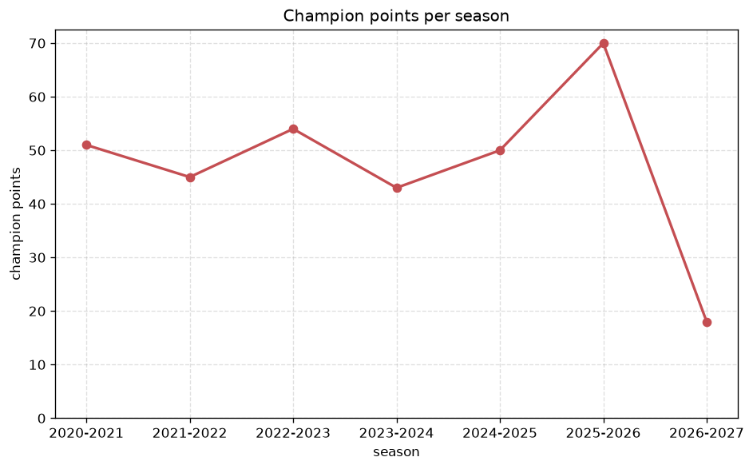
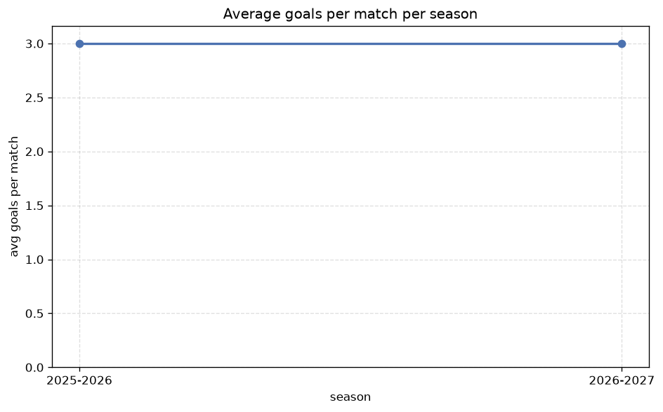

# Season Trends Analysis
- Report: `season_trends`
- Generated: 2026-10-27T02:34:45+00:00
- Script: `backend/scripts/analyze_seasons.py` v1.0.0
- League: Super League Women (Belgium)
- Scope: league `wbelgium1`

## 1. Champions per season
| season | champion | pts | runner-up | margin |
|---|---|---|---|---|
| 2020-2021 | RSC Anderlecht W | 51 | St. Liege W | 9 pts |
| 2021-2022 | RSC Anderlecht W | 45 | Leuven W | 1 pts |
| 2022-2023 | Leuven W | 54 | RSC Anderlecht W | 2 pts |
| 2023-2024 | Leuven W | 43 | St. Liege W | 0 pts |
| 2024-2025 | RSC Anderlecht W | 50 | Leuven W | 0 pts |
| 2025-2026 | Leuven W | 70 | RSC Anderlecht W | 15 pts |
| 2026-2027 | RSC Anderlecht W | 18 | Club Brugge W | 1 pts |

## 2. Title-race tightness
- Tight races (margin <= 3 pts): **5** of 7 seasons
- Tightest race: **2023-2024** - Leuven W beat St. Liege W by **0** pts

| season | margin | tight |
|---|---|---|
| 2020-2021 | 9 pts |  |
| 2021-2022 | 1 pts | yes |
| 2022-2023 | 2 pts | yes |
| 2023-2024 | 0 pts | yes |
| 2024-2025 | 0 pts | yes |
| 2025-2026 | 15 pts |  |
| 2026-2027 | 1 pts | yes |

## 3. Points thresholds
_Position-specific points per season. Key: 1 = champion, 2 = runner-up, 4 = CL line, 6 = Europa, 5 = last safe, 8 = bottom._

| season | pos 1 | pos 2 | pos 4 | pos 5 | pos 6 | pos 8 |
|---|---|---|---|---|---|---|
| 2020-2021 | 51 | 42 | 34 | 26 | 20 | 15 |
| 2021-2022 | 45 | 44 | 35 | 30 | 29 | 9 |
| 2022-2023 | 54 | 52 | 37 | 36 | 28 | 22 |
| 2023-2024 | 43 | 43 | 31 | 30 | 29 | 10 |
| 2024-2025 | 50 | 50 | 33 | 25 | 25 | 9 |
| 2025-2026 | 70 | 55 | 39 | 31 | 29 | 16 |
| 2026-2027 | 18 | 17 | 11 | 9 | 9 | 0 |

## 4. Relegation battle
| season | safe pos | safe pts | drop pos | drop pts | gap |
|---|---|---|---|---|---|
| 2020-2021 | 5 | 26 | 6 | 20 | 6 pts |
| 2021-2022 | 5 | 30 | 6 | 29 | 1 pts |
| 2022-2023 | 5 | 36 | 6 | 28 | 8 pts |
| 2023-2024 | 5 | 30 | 6 | 29 | 1 pts |
| 2024-2025 | 5 | 25 | 6 | 25 | 0 pts |
| 2025-2026 | 5 | 31 | 6 | 29 | 2 pts |
| 2026-2027 | 5 | 9 | 6 | 9 | 0 pts |

## 5. League-level trends
| season | matches | total goals | avg goals | home win | draw | away win | goalless | avg pts/team |
|---|---|---|---|---|---|---|---|---|
| 2020-2021 | 90 | 334 | 3.711 | 43.3% | 12.2% | 44.4% | 4.4% | 25.9 |
| 2021-2022 | 90 | 338 | 3.756 | 48.9% | 7.8% | 43.3% | 1.1% | 26.3 |
| 2022-2023 | 110 | 377 | 3.427 | 46.4% | 13.6% | 40.0% | 5.5% | 28.64 |
| 2023-2024 | 90 | 304 | 3.378 | 48.9% | 12.2% | 38.9% | 4.4% | 25.9 |
| 2024-2025 | 84 | 265 | 3.155 | 47.6% | 13.1% | 39.3% | 2.4% | 30.12 |
| 2025-2026 | 108 | 324 | 3.0 | 40.7% | 23.1% | 36.1% | 5.6% | 37.38 |
| 2026-2027 | 28 | 89 | 3.179 | 50.0% | 17.9% | 32.1% | 7.1% | 9.88 |

## 6. View divergence
- Largest divergence: **2021-2022** (goals view, avg abs position diff = 4.200)

_Avg absolute position difference between classic view and alternative view per season._

| season | classic vs luck | classic vs goals |
|---|---|---|
| 2020-2021 | 1.000 | 2.200 |
| 2021-2022 | 1.600 | 4.200 |
| 2022-2023 | 2.545 | 3.091 |
| 2023-2024 | 1.600 | 3.400 |
| 2024-2025 | 2.000 | 2.250 |
| 2025-2026 | 1.750 | 3.250 |
| 2026-2027 | 1.250 | 3.750 |

---
*All statistics are computed from PostgreSQL tables (read-only). Run with `python backend/scripts/analyze_seasons.py` to regenerate.*

## Charts

