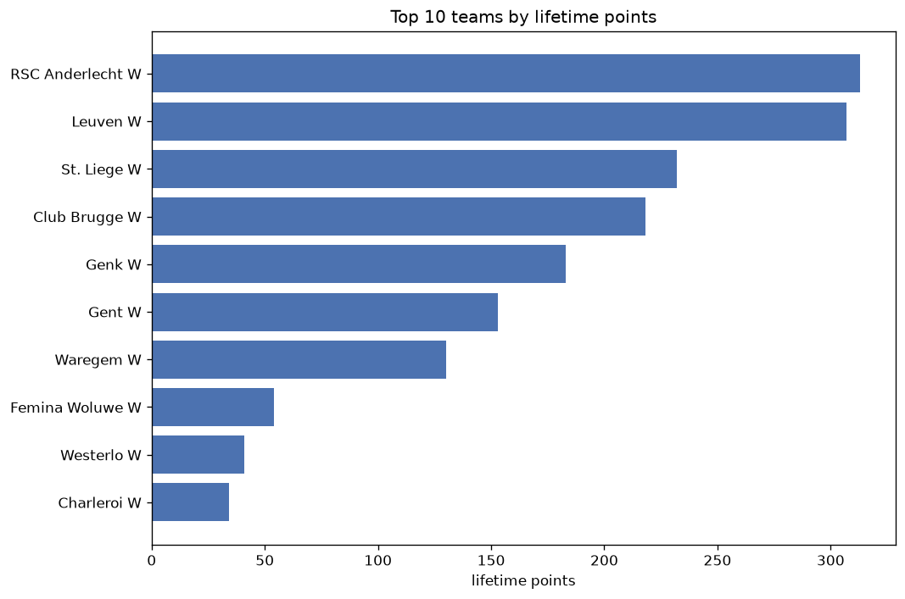
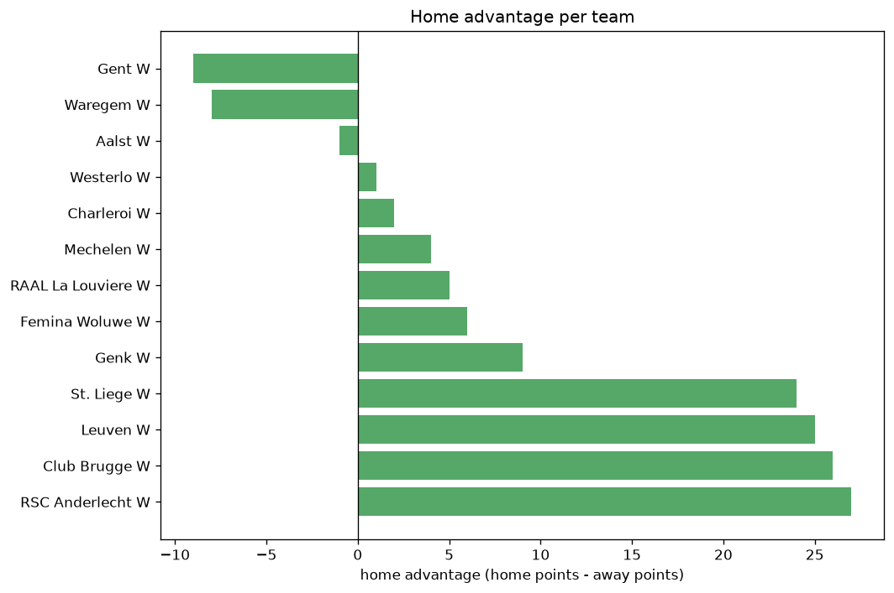

# Team Analysis
- Report: `teams_analysis`
- Generated: 2026-10-26T01:52:29+00:00
- Script: `backend/scripts/analyze_teams.py` v1.0.0
- League: Super League Women (Belgium)
- Scope: league `wbelgium1`

- Teams: **13** | Seasons: **7** | Matches: **600**

## 1. Team standings (lifetime)
| team | seasons | played | W | D | L | pts | GF | GA | GD | avg pts/season | best pos | worst pos | titles |
|---|---|---|---|---|---|---|---|---|---|---|---|---|---|
| RSC Anderlecht W | 7 | 129 | 99 | 16 | 14 | 313 | 405 | 103 | 302 | 44.71 | 1 | 3 | 4 |
| Leuven W | 7 | 129 | 97 | 16 | 16 | 307 | 346 | 107 | 239 | 43.86 | 1 | 4 | 3 |
| St. Liege W | 7 | 129 | 70 | 22 | 37 | 232 | 244 | 156 | 88 | 33.14 | 2 | 6 | 0 |
| Club Brugge W | 7 | 129 | 65 | 23 | 41 | 218 | 265 | 180 | 85 | 31.14 | 2 | 5 | 0 |
| Genk W | 7 | 129 | 53 | 24 | 52 | 183 | 216 | 203 | 13 | 26.14 | 4 | 6 | 0 |
| Gent W | 7 | 129 | 47 | 12 | 70 | 153 | 177 | 224 | -47 | 21.86 | 3 | 8 | 0 |
| Waregem W | 7 | 129 | 37 | 19 | 73 | 130 | 134 | 232 | -98 | 18.57 | 3 | 9 | 0 |
| Femina Woluwe W | 4 | 74 | 14 | 12 | 48 | 54 | 66 | 191 | -125 | 13.5 | 7 | 10 | 0 |
| Westerlo W | 2 | 48 | 12 | 5 | 31 | 41 | 49 | 104 | -55 | 20.5 | 6 | 8 | 0 |
| Charleroi W | 4 | 74 | 8 | 10 | 56 | 34 | 49 | 242 | -193 | 8.5 | 8 | 10 | 0 |
| Aalst W | 3 | 56 | 7 | 4 | 45 | 25 | 44 | 169 | -125 | 8.33 | 8 | 11 | 0 |
| Mechelen W | 2 | 38 | 4 | 4 | 30 | 16 | 29 | 112 | -83 | 8.0 | 9 | 9 | 0 |
| RAAL La Louviere W | 1 | 7 | 2 | 3 | 2 | 9 | 7 | 8 | -1 | 9.0 | 5 | 5 | 0 |

## 2. Home vs away split
| team | home P | H-W | H-D | H-L | H-pts | away P | A-W | A-D | A-L | A-pts | adv |
|---|---|---|---|---|---|---|---|---|---|---|---|
| RSC Anderlecht W | 66 | 55 | 5 | 6 | 170 | 63 | 44 | 11 | 8 | 143 | 27 |
| Club Brugge W | 66 | 37 | 11 | 18 | 122 | 63 | 28 | 12 | 23 | 96 | 26 |
| Leuven W | 66 | 53 | 7 | 6 | 166 | 63 | 44 | 9 | 10 | 141 | 25 |
| St. Liege W | 66 | 38 | 14 | 14 | 128 | 63 | 32 | 8 | 23 | 104 | 24 |
| Genk W | 63 | 28 | 12 | 23 | 96 | 66 | 25 | 12 | 29 | 87 | 9 |
| Femina Woluwe W | 37 | 8 | 6 | 23 | 30 | 37 | 6 | 6 | 25 | 24 | 6 |
| RAAL La Louviere W | 3 | 2 | 1 | 0 | 7 | 4 | 0 | 2 | 2 | 2 | 5 |
| Mechelen W | 19 | 3 | 1 | 15 | 10 | 19 | 1 | 3 | 15 | 6 | 4 |
| Charleroi W | 37 | 4 | 6 | 27 | 18 | 37 | 4 | 4 | 29 | 16 | 2 |
| Westerlo W | 23 | 6 | 3 | 14 | 21 | 25 | 6 | 2 | 17 | 20 | 1 |
| Aalst W | 28 | 3 | 3 | 22 | 12 | 28 | 4 | 1 | 23 | 13 | -1 |
| Waregem W | 63 | 17 | 10 | 36 | 61 | 66 | 20 | 9 | 37 | 69 | -8 |
| Gent W | 63 | 22 | 6 | 35 | 72 | 66 | 25 | 6 | 35 | 81 | -9 |

## 3. Top performers
### Best points per game (PPG)
| rank | team | PPG |
|---|---|---|
| 1 | RSC Anderlecht W | 2.43 |
| 2 | Leuven W | 2.38 |
| 3 | St. Liege W | 1.80 |
| 4 | Club Brugge W | 1.69 |
| 5 | Genk W | 1.42 |

### Most goals scored
| rank | team | goals |
|---|---|---|
| 1 | RSC Anderlecht W | 405 |
| 2 | Leuven W | 346 |
| 3 | Club Brugge W | 265 |
| 4 | St. Liege W | 244 |
| 5 | Genk W | 216 |

### Best goal difference
| rank | team | GD |
|---|---|---|
| 1 | RSC Anderlecht W | 302 |
| 2 | Leuven W | 239 |
| 3 | St. Liege W | 88 |
| 4 | Club Brugge W | 85 |
| 5 | Genk W | 13 |

### Best defence (goals against per match, standings)
| rank | team | GA/match |
|---|---|---|
| 1 | RSC Anderlecht W | 0.798 |
| 2 | Leuven W | 0.829 |
| 3 | RAAL La Louviere W | 1.143 |
| 4 | St. Liege W | 1.209 |
| 5 | Club Brugge W | 1.395 |

## 4. Team consistency
- Teams present in all **7** seasons: **7**

Club Brugge W, Genk W, Gent W, Leuven W, RSC Anderlecht W, St. Liege W, Waregem W

## 5. Head-to-head dominance
- Distinct fixtures: **69** (showing the 15 most frequent)

| fixture | meetings | home wins | draws | away wins | home pct | draw pct | away pct |
|---|---|---|---|---|---|---|---|
| Leuven W vs Club Brugge W | 17 | 10 | 2 | 5 | 58.8% | 11.8% | 29.4% |
| RSC Anderlecht W vs Club Brugge W | 17 | 8 | 4 | 5 | 47.1% | 23.5% | 29.4% |
| RSC Anderlecht W vs St. Liege W | 17 | 8 | 5 | 4 | 47.1% | 29.4% | 23.5% |
| St. Liege W vs Club Brugge W | 17 | 8 | 5 | 4 | 47.1% | 29.4% | 23.5% |
| St. Liege W vs Leuven W | 17 | 7 | 3 | 7 | 41.2% | 17.6% | 41.2% |
| Gent W vs Genk W | 17 | 6 | 4 | 7 | 35.3% | 23.5% | 41.2% |
| Gent W vs Waregem W | 17 | 6 | 2 | 9 | 35.3% | 11.8% | 52.9% |
| RSC Anderlecht W vs Leuven W | 17 | 6 | 3 | 8 | 35.3% | 17.6% | 47.1% |
| Genk W vs Waregem W | 17 | 5 | 4 | 8 | 29.4% | 23.5% | 47.1% |
| Leuven W vs Genk W | 15 | 9 | 4 | 2 | 60.0% | 26.7% | 13.3% |
| Leuven W vs Waregem W | 15 | 9 | 1 | 5 | 60.0% | 6.7% | 33.3% |
| RSC Anderlecht W vs Genk W | 15 | 9 | 1 | 5 | 60.0% | 6.7% | 33.3% |
| Club Brugge W vs Genk W | 15 | 8 | 4 | 3 | 53.3% | 26.7% | 20.0% |
| Gent W vs Club Brugge W | 15 | 8 | 0 | 7 | 53.3% | 0.0% | 46.7% |
| RSC Anderlecht W vs Gent W | 15 | 7 | 1 | 7 | 46.7% | 6.7% | 46.7% |

## 6. Position per season (classic view)
_Cells show final position; '-' when the team was absent from that season._

| team | 2020-2021 | 2021-2022 | 2022-2023 | 2023-2024 | 2024-2025 | 2025-2026 | 2026-2027 |
|---|---|---|---|---|---|---|---|
| RSC Anderlecht W | 1 | 1 | 2 | 3 | 1 | 2 | 1 |
| Leuven W | 4 | 2 | 1 | 1 | 2 | 1 | 3 |
| St. Liege W | 2 | 3 | 3 | 2 | 3 | 6 | 6 |
| Club Brugge W | 5 | 4 | 4 | 4 | 4 | 4 | 2 |
| Genk W | 6 | 5 | 5 | 5 | 5 | 5 | 4 |
| Gent W | 3 | 6 | 6 | 6 | 7 | 7 | 8 |
| Waregem W | 9 | 7 | 7 | 7 | 8 | 3 | 7 |
| Femina Woluwe W | 7 | 9 | 8 | 10 | - | - | - |
| Westerlo W | - | - | - | - | 6 | 8 | - |
| Charleroi W | 10 | 8 | 10 | 8 | - | - | - |
| Aalst W | 8 | 10 | 11 | - | - | - | - |
| Mechelen W | - | - | 9 | 9 | - | - | - |
| RAAL La Louviere W | - | - | - | - | - | - | 5 |

---
*All statistics are computed from PostgreSQL tables (read-only). Run with `python backend/scripts/analyze_teams.py` to regenerate.*

## Charts

