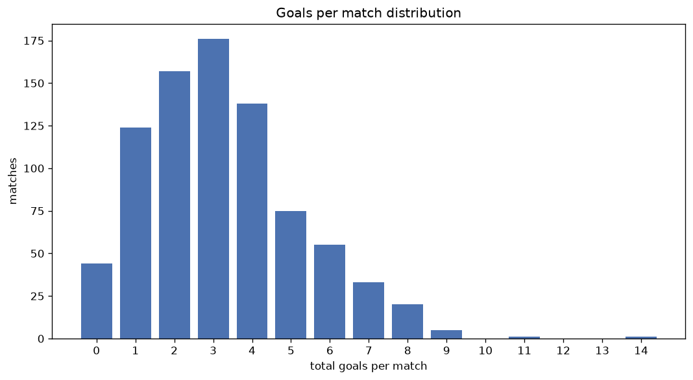
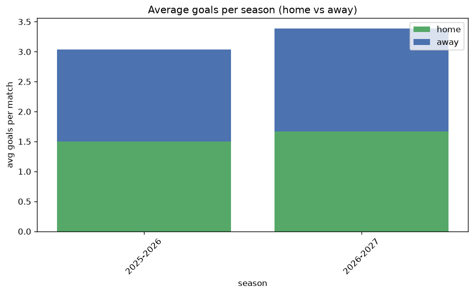

# Goal Analysis
- Report: `goals_analysis`
- Generated: 2026-10-29T02:19:33+00:00
- Script: `backend/scripts/analyze_goals.py` v1.0.0
- League: Premiere Ligue Women (France)
- Scope: league `wfrance1`

## 1. Goals per match distribution
| goals | matches | pct |
|---|---|---|
| 0 | 44 | 5.3% |
| 1 | 124 | 15.0% |
| 2 | 157 | 18.9% |
| 3 | 176 | 21.2% |
| 4 | 138 | 16.6% |
| 5 | 75 | 9.0% |
| 6 | 55 | 6.6% |
| 7 | 33 | 4.0% |
| 8 | 20 | 2.4% |
| 9 | 5 | 0.6% |
| 10 | 0 | 0.0% |
| 11 | 1 | 0.1% |
| 12 | 0 | 0.0% |
| 13 | 0 | 0.0% |
| 14 | 1 | 0.1% |

## 2. Goals per match per season
| season | matches | total goals | avg home | avg away | avg total |
|---|---|---|---|---|---|
| 2020-2021 | 132 | 422 | 1.735 | 1.462 | 3.197 |
| 2021-2022 | 132 | 427 | 1.788 | 1.447 | 3.235 |
| 2022-2023 | 132 | 404 | 1.538 | 1.523 | 3.061 |
| 2023-2024 | 132 | 468 | 1.864 | 1.682 | 3.545 |
| 2024-2025 | 132 | 437 | 1.924 | 1.386 | 3.311 |
| 2025-2026 | 135 | 410 | 1.504 | 1.533 | 3.037 |
| 2026-2027 | 34 | 116 | 1.735 | 1.676 | 3.412 |

## 3. Home vs away goal share
- Home goals: **1430** (53.3%)
- Away goals: **1254** (46.7%)
- Home/away ratio: **1.14**

| season | home goals | away goals | total | home pct | away pct |
|---|---|---|---|---|---|
| 2020-2021 | 229 | 193 | 422 | 54.3% | 45.7% |
| 2021-2022 | 236 | 191 | 427 | 55.3% | 44.7% |
| 2022-2023 | 203 | 201 | 404 | 50.2% | 49.8% |
| 2023-2024 | 246 | 222 | 468 | 52.6% | 47.4% |
| 2024-2025 | 254 | 183 | 437 | 58.1% | 41.9% |
| 2025-2026 | 203 | 207 | 410 | 49.5% | 50.5% |
| 2026-2027 | 59 | 57 | 116 | 50.9% | 49.1% |

## 4. BTTS (Both Teams To Score)
- Overall: **364** of `829` (43.9%)

| season | matches | BTTS | pct |
|---|---|---|---|
| 2020-2021 | 132 | 49 | 37.1% |
| 2021-2022 | 132 | 50 | 37.9% |
| 2022-2023 | 132 | 59 | 44.7% |
| 2023-2024 | 132 | 76 | 57.6% |
| 2024-2025 | 132 | 52 | 39.4% |
| 2025-2026 | 135 | 61 | 45.2% |
| 2026-2027 | 34 | 17 | 50.0% |

## 5. Clean sheets
- Home clean sheets: **266** (32.1%)
- Away clean sheets: **243** (29.3%)
- Total clean sheets recorded: **509**
- Matches with at least one clean sheet: **465** (56.1%)
- Both teams kept clean sheets (0-0): **44**

| season | matches | home CS | away CS | total CS | matches w/ CS |
|---|---|---|---|---|---|
| 2020-2021 | 132 | 44 | 49 | 93 | 83 (62.9%) |
| 2021-2022 | 132 | 46 | 41 | 87 | 82 (62.1%) |
| 2022-2023 | 132 | 42 | 36 | 78 | 73 (55.3%) |
| 2023-2024 | 132 | 37 | 22 | 59 | 56 (42.4%) |
| 2024-2025 | 132 | 49 | 43 | 92 | 80 (60.6%) |
| 2025-2026 | 135 | 37 | 44 | 81 | 74 (54.8%) |
| 2026-2027 | 34 | 11 | 8 | 19 | 17 (50.0%) |

## 6. Scoring intensity
- First-half goals: **1242** (46.5%)
- Second-half goals: **1427** (53.5%)
- Avg first-half goals per match: **1.507**
- Avg second-half goals per match: **1.732**
- Second-half-only scoring (HT 0-0, FT goals >= 1): **145** (17.5%)
- *5 match(es) excluded (no HT score recorded).*

| season | matches | 1st half | 2nd half | 1st half pct | 2nd half pct |
|---|---|---|---|---|---|
| 2020-2021 | 132 | 199 | 223 | 47.2% | 52.8% |
| 2021-2022 | 132 | 204 | 223 | 47.8% | 52.2% |
| 2022-2023 | 132 | 193 | 211 | 47.8% | 52.2% |
| 2023-2024 | 132 | 204 | 261 | 43.9% | 56.1% |
| 2024-2025 | 132 | 201 | 236 | 46.0% | 54.0% |
| 2025-2026 | 135 | 178 | 220 | 44.7% | 55.3% |
| 2026-2027 | 34 | 63 | 53 | 54.3% | 45.7% |

## 7. First-goal timing
- Matches with first-goal time recorded: `780` of `829` (94.1%)
- Goalless matches: `49`
- Min `1` | Max `97` | Mean `27.08` | Median (p50) `21.0`

| bucket | count | % of matches | % of scoring matches |
|---|---|---|---|
| 1-15 | 309 | 37.3% | 39.6% |
| 16-30 | 187 | 22.6% | 24.0% |
| 31-45 | 126 | 15.2% | 16.2% |
| 46-60 | 93 | 11.2% | 11.9% |
| 61-75 | 35 | 4.2% | 4.5% |
| 76-90 | 23 | 2.8% | 2.9% |
| 91-120 | 7 | 0.8% | 0.9% |

---
*All statistics are computed from PostgreSQL tables (read-only). Run with `python backend/scripts/analyze_goals.py` to regenerate.*

## Charts

