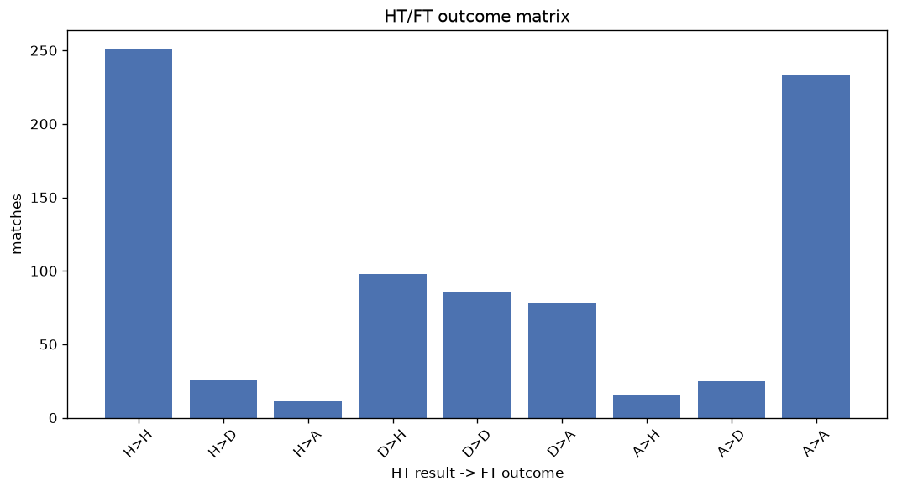
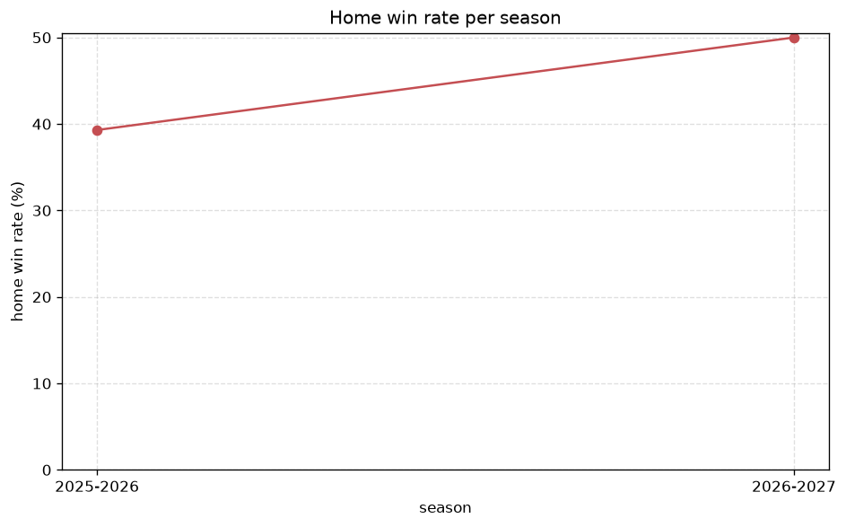

# Match Analysis
- Report: `matches_analysis`
- Generated: 2026-10-30T04:15:39+00:00
- Script: `backend/scripts/analyze_matches.py` v1.0.0
- League: Premiere Ligue Women (France)
- Scope: league `wfrance1`

## 1. Overall summary
| metric | value |
|---|---|
| Matches | 829 |
| Home wins | 366 (44.1%) |
| Draws | 137 (16.5%) |
| Away wins | 326 (39.3%) |
| Total goals | 2684 |
| Average goals per match | 3.238 |
| Goalless matches | 44 (5.3%) |

## 2. Per-season breakdown
| season | matches | home wins | draws | away wins | total goals | avg goals | goalless |
|---|---|---|---|---|---|---|---|
| 2020-2021 | 132 | 64 (48.5%) | 15 (11.4%) | 53 (40.2%) | 422 | 3.197 | 10 (7.6%) |
| 2021-2022 | 132 | 57 (43.2%) | 15 (11.4%) | 60 (45.5%) | 427 | 3.235 | 5 (3.8%) |
| 2022-2023 | 132 | 57 (43.2%) | 22 (16.7%) | 53 (40.2%) | 404 | 3.061 | 5 (3.8%) |
| 2023-2024 | 132 | 62 (47.0%) | 26 (19.7%) | 44 (33.3%) | 468 | 3.545 | 3 (2.3%) |
| 2024-2025 | 132 | 58 (43.9%) | 26 (19.7%) | 48 (36.4%) | 437 | 3.311 | 12 (9.1%) |
| 2025-2026 | 135 | 53 (39.3%) | 25 (18.5%) | 57 (42.2%) | 410 | 3.037 | 7 (5.2%) |
| 2026-2027 | 34 | 15 (44.1%) | 8 (23.5%) | 11 (32.4%) | 116 | 3.412 | 2 (5.9%) |

## 3. HT/FT outcome matrix
| HT result \ FT result | Home | Draw | Away | total |
|---|---|---|---|---|
| HT home lead | 251 (86.9%) | 26 (9.0%) | 12 (4.2%) | 289 |
| HT draw | 98 (37.4%) | 86 (32.8%) | 78 (29.8%) | 262 |
| HT away lead | 15 (5.5%) | 25 (9.2%) | 233 (85.3%) | 273 |
- *5 match(es) excluded (no HT score recorded).*

## 4. Comeback matches
- Home comebacks (trailing at HT, won at FT): **15** (1.8%)
- Away comebacks (trailing at HT, won at FT): **12** (1.4%)

### Home comebacks
| season | home | away | HT | FT |
|---|---|---|---|---|
| 2020-2021 | Bordeaux W | Soyaux W | 0-1 | 2-1 |
| 2020-2021 | Dijon W | Fleury 91 W | 0-1 | 3-1 |
| 2021-2022 | Soyaux W | St Etienne W | 0-1 | 2-1 |
| 2021-2022 | Fleury 91 W | St Etienne W | 0-2 | 4-2 |
| 2023-2024 | Lille W | Fleury 91 W | 0-1 | 2-1 |
| 2023-2024 | Fleury 91 W | Dijon W | 0-1 | 2-1 |
| 2023-2024 | Fleury 91 W | Bordeaux W | 0-1 | 2-1 |
| 2023-2024 | Dijon W | St Etienne W | 0-1 | 3-2 |
| 2023-2024 | Paris FC W | Le Havre W | 0-2 | 3-2 |
| 2024-2025 | Fleury 91 W | Guingamp W | 0-1 | 4-1 |
| 2024-2025 | Paris FC W | Strasbourg W | 0-1 | 3-1 |
| 2025-2026 | Dijon W | Montpellier W | 0-1 | 2-1 |
| 2025-2026 | Le Havre W | Montpellier W | 0-1 | 3-2 |
| 2025-2026 | Nantes W | Le Havre W | 0-1 | 2-1 |
| 2025-2026 | Dijon W | Le Havre W | 0-1 | 2-1 |

### Away comebacks
| season | home | away | HT | FT |
|---|---|---|---|---|
| 2021-2022 | Bordeaux W | Fleury 91 W | 1-0 | 1-2 |
| 2021-2022 | St Etienne W | Montpellier W | 1-0 | 1-2 |
| 2021-2022 | Montpellier W | Reims W | 1-0 | 1-2 |
| 2022-2023 | Dijon W | Rodez AF W | 1-0 | 1-2 |
| 2022-2023 | Soyaux W | Guingamp W | 1-0 | 1-2 |
| 2023-2024 | St Etienne W | Le Havre W | 1-0 | 1-2 |
| 2023-2024 | Lille W | St Etienne W | 1-0 | 1-2 |
| 2023-2024 | Bordeaux W | Paris FC W | 2-1 | 2-6 |
| 2023-2024 | Montpellier W | Lille W | 1-0 | 1-2 |
| 2025-2026 | Nantes W | Dijon W | 1-0 | 1-2 |
| 2025-2026 | Lens W | Paris FC W | 1-0 | 1-2 |
| 2026-2027 | Lens W | Strasbourg W | 1-0 | 1-3 |

## 5. HT lead conversion
| HT state | matches | converted to win | held as draw | collapsed to loss |
|---|---|---|---|---|
| Home lead | 289 | 251 (86.9%) | 26 (9.0%) | 12 (4.2%) |
| Away lead | 273 | 233 (85.3%) | 25 (9.2%) | 15 (5.5%) |

### Matches level at half-time
| FT result | count | pct |
|---|---|---|
| Home win | 98 | 37.4% |
| Draw | 86 | 32.8% |
| Away win | 78 | 29.8% |
- *5 match(es) excluded (no HT score recorded).*

## 6. First-goal timing
- Matches with a first-goal time recorded: `780` of `829` (94.1%)

Outcome distribution by first-goal timing bucket:
| bucket | matches | % of matches | home | draw | away |
|---|---|---|---|---|---|
| 1-15 | 309 | 37.3% | 147 (47.6%) | 30 (9.7%) | 132 (42.7%) |
| 16-30 | 187 | 22.6% | 75 (40.1%) | 23 (12.3%) | 89 (47.6%) |
| 31-45 | 126 | 15.2% | 68 (54.0%) | 15 (11.9%) | 43 (34.1%) |
| 46-60 | 93 | 11.2% | 45 (48.4%) | 15 (16.1%) | 33 (35.5%) |
| 61-75 | 35 | 4.2% | 15 (42.9%) | 8 (22.9%) | 12 (34.3%) |
| 76-90 | 23 | 2.8% | 8 (34.8%) | 2 (8.7%) | 13 (56.5%) |
| 91-120 | 7 | 0.8% | 6 (85.7%) | 0 (0.0%) | 1 (14.3%) |

## 7. Goalless matches
- Overall: **44** of `829` (5.3%)

| season | matches | goalless | pct |
|---|---|---|---|
| 2020-2021 | 132 | 10 | 7.6% |
| 2021-2022 | 132 | 5 | 3.8% |
| 2022-2023 | 132 | 5 | 3.8% |
| 2023-2024 | 132 | 3 | 2.3% |
| 2024-2025 | 132 | 12 | 9.1% |
| 2025-2026 | 135 | 7 | 5.2% |
| 2026-2027 | 34 | 2 | 5.9% |

---
*All statistics are computed from PostgreSQL tables (read-only). Run with `python backend/scripts/analyze_matches.py` to regenerate.*

## Charts

