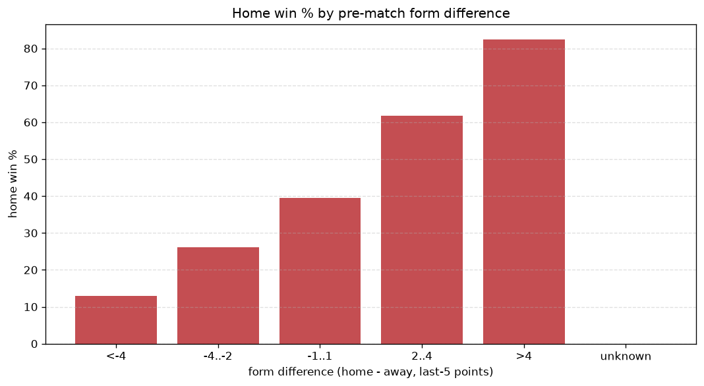
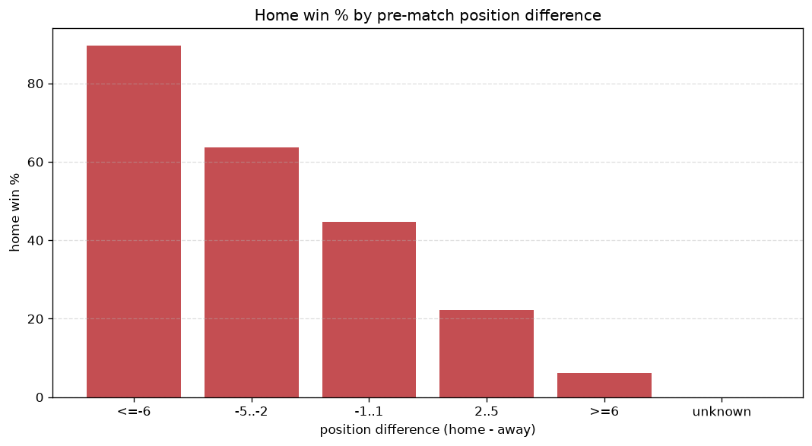

# Relationships Analysis
- Report: `relationships`
- Generated: 2026-10-26T01:52:58+00:00
- Script: `backend/scripts/analyze_relationships.py` v1.0.0
- League: Premiere Ligue Women (France)
- Scope: league `wfrance1`

- Matches analysed: **795** (23 leakage-safe pre-match features).

## 1. Correlation matrix
_Pearson correlation of each pre-match feature with observed goals; sorted by |corr(total goals)|._

| feature | corr(home) | corr(away) | corr(total) |
|---|---|---|---|
| home_team_home_goals_avg | 0.338 | -0.249 | 0.104 |
| home_team_home_win_rate | 0.319 | -0.234 | 0.099 |
| home_team_wins_last_5 | 0.324 | -0.264 | 0.081 |
| home_team_goals_scored_last_5 | 0.323 | -0.262 | 0.080 |
| home_team_points_last_5 | 0.319 | -0.261 | 0.078 |
| home_rest_days | -0.052 | -0.030 | -0.072 |
| home_team_home_conceded_avg | -0.281 | 0.235 | -0.064 |
| home_position_before_match | -0.371 | 0.340 | -0.061 |
| home_team_goals_conceded_last_5 | -0.284 | 0.248 | -0.056 |
| away_rest_days | -0.042 | -0.005 | -0.042 |
| rest_days_difference | -0.017 | -0.033 | -0.041 |
| points_difference | 0.467 | -0.472 | 0.041 |
| away_team_away_win_rate | -0.217 | 0.293 | 0.041 |
| away_team_away_goals_avg | -0.233 | 0.310 | 0.040 |
| away_team_away_conceded_avg | 0.168 | -0.236 | -0.039 |
| home_points_before_match | 0.260 | -0.244 | 0.038 |
| away_team_goals_scored_last_5 | -0.240 | 0.316 | 0.038 |
| position_difference | -0.493 | 0.511 | -0.034 |
| away_team_wins_last_5 | -0.245 | 0.301 | 0.022 |
| away_position_before_match | 0.310 | -0.365 | -0.015 |
| away_team_points_last_5 | -0.251 | 0.292 | 0.009 |
| away_points_before_match | -0.210 | 0.231 | -0.003 |
| away_team_goals_conceded_last_5 | 0.227 | -0.254 | 0.001 |

## 2. Form vs outcome
_Home win/draw/away % per bucket of `home_team_points_last_5 - away_team_points_last_5`._

| bucket | matches | home | draw | away | home % | draw % | away % |
|---|---|---|---|---|---|---|---|
| <-4 | 163 | 21 | 27 | 115 | 12.9% | 16.6% | 70.6% |
| -4..-2 | 142 | 37 | 27 | 78 | 26.1% | 19.0% | 54.9% |
| -1..1 | 200 | 79 | 37 | 84 | 39.5% | 18.5% | 42.0% |
| 2..4 | 120 | 74 | 20 | 26 | 61.7% | 16.7% | 21.7% |
| >4 | 170 | 140 | 18 | 12 | 82.4% | 10.6% | 7.1% |
| unknown | 0 | 0 | 0 | 0 | - | - | - |

## 3. Position vs outcome
_Home win/draw/away % per bucket of `position_difference` (home position - away position; negative favours the home team)._

| bucket | matches | home | draw | away | home % | draw % | away % |
|---|---|---|---|---|---|---|---|
| <=-6 | 106 | 95 | 9 | 2 | 89.6% | 8.5% | 1.9% |
| -5..-2 | 195 | 124 | 35 | 36 | 63.6% | 17.9% | 18.5% |
| -1..1 | 168 | 75 | 29 | 64 | 44.6% | 17.3% | 38.1% |
| 2..5 | 230 | 51 | 46 | 133 | 22.2% | 20.0% | 57.8% |
| >=6 | 96 | 6 | 10 | 80 | 6.2% | 10.4% | 83.3% |
| unknown | 0 | 0 | 0 | 0 | - | - | - |

## 4. Rest advantage
_Home win/draw/away % per bucket of `rest_days_difference` (home rest - away rest). Matches with unknown rest are bucketed separately._

| bucket | matches | home | draw | away | home % | draw % | away % |
|---|---|---|---|---|---|---|---|
| <-1 | 46 | 22 | 8 | 16 | 47.8% | 17.4% | 34.8% |
| -1..0 | 147 | 74 | 26 | 47 | 50.3% | 17.7% | 32.0% |
| 0 | 353 | 154 | 56 | 143 | 43.6% | 15.9% | 40.5% |
| 1..2 | 168 | 59 | 28 | 81 | 35.1% | 16.7% | 48.2% |
| >2 | 45 | 25 | 6 | 14 | 55.6% | 13.3% | 31.1% |
| unknown | 36 | 17 | 5 | 14 | 47.2% | 13.9% | 38.9% |
- *36 match(es) had unknown rest difference (missing rest data on at least one side).*

## 5. Home team quality
_Home win rate by `home_team_home_win_rate` tier (split at 0.5)._

- `< 0.5` tier: **32.8%** home win (150/457)
- `>= 0.5` tier: **59.5%** home win (201/338)
- Home-win gap (>= split minus < split): **+26.7 pp**

| tier | label | matches | home | draw | away | home % |
|---|---|---|---|---|---|---|
| low | < 0.5 | 457 | 150 | 78 | 229 | 32.8% |
| high | >= 0.5 | 338 | 201 | 51 | 86 | 59.5% |

## 6. Feature averages by result
_Mean feature value per outcome; `range` is home-minus-away spread of the group means._

| feature | home mean | draw mean | away mean | range |
|---|---|---|---|---|
| points_difference | 7.217 | -1.589 | -7.883 | 15.099 |
| away_points_before_match | 11.171 | 15.829 | 19.330 | 8.159 |
| home_points_before_match | 18.387 | 14.240 | 11.448 | 6.940 |
| position_difference | -2.821 | 0.481 | 3.076 | 5.897 |
| home_team_goals_scored_last_5 | 9.031 | 6.101 | 5.127 | 3.904 |
| away_team_goals_scored_last_5 | 5.083 | 7.202 | 8.949 | 3.867 |
| away_team_points_last_5 | 4.578 | 6.535 | 7.835 | 3.257 |
| away_team_goals_conceded_last_5 | 8.393 | 6.481 | 5.283 | 3.111 |
| away_position_before_match | 7.892 | 6.271 | 4.832 | 3.060 |
| home_team_goals_conceded_last_5 | 5.496 | 7.411 | 8.530 | 3.034 |
| home_team_points_last_5 | 7.627 | 5.651 | 4.644 | 2.982 |
| home_position_before_match | 5.071 | 6.752 | 7.908 | 2.837 |
| away_team_wins_last_5 | 1.274 | 1.953 | 2.397 | 1.123 |
| home_team_wins_last_5 | 2.328 | 1.612 | 1.292 | 1.036 |
| home_team_home_goals_avg | 2.032 | 1.328 | 1.200 | 0.832 |
| away_team_away_goals_avg | 1.024 | 1.406 | 1.793 | 0.769 |
| home_team_home_conceded_avg | 1.058 | 1.417 | 1.680 | 0.622 |
| away_team_away_conceded_avg | 1.875 | 1.491 | 1.296 | 0.579 |
| rest_days_difference | 0.425 | -0.129 | -0.073 | 0.554 |
| home_rest_days | 12.284 | 11.766 | 11.970 | 0.518 |
| away_team_away_win_rate | 0.249 | 0.363 | 0.475 | 0.226 |
| home_team_home_win_rate | 0.529 | 0.370 | 0.306 | 0.223 |
| away_rest_days | 11.859 | 11.895 | 12.043 | 0.184 |

---
*All features are leakage-safe pre-match values built by `ml.features.build_features.build_rows` from strictly prior matches. Run with `python backend/scripts/analyze_relationships.py` to regenerate.*

## Charts

