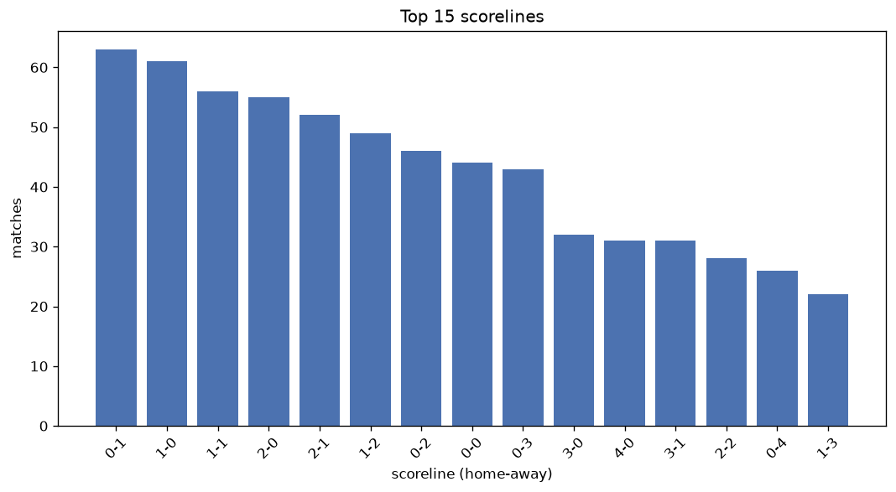
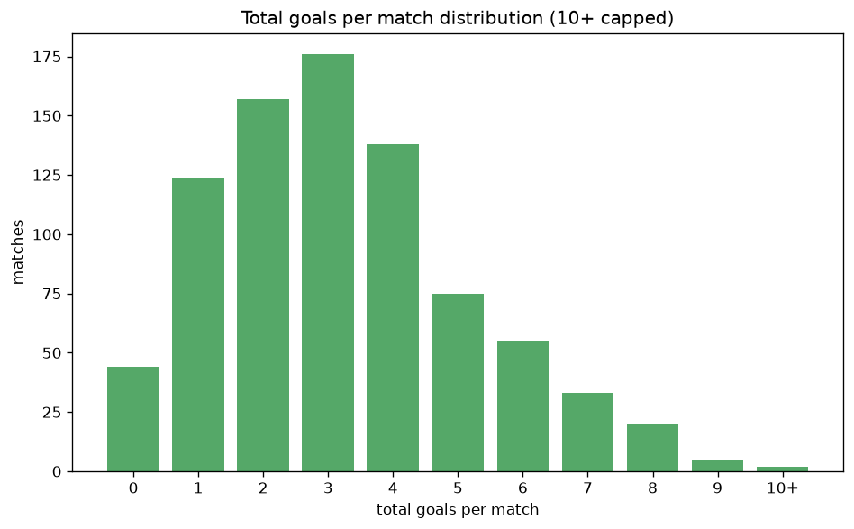

# Scoreline Analysis
- Report: `scoreline_analysis`
- Generated: 2026-10-26T01:52:56+00:00
- Script: `backend/scripts/analyze_scorelines.py` v1.0.0
- League: Premiere Ligue Women (France)
- Scope: league `wfrance1`

## 1. Scoreline frequency
- Matches analysed: **829** across **7** seasons.
- Distinct scorelines seen: **48**.

| scoreline | count | pct |
|---|---|---|
| 0-1 | 63 | 7.6% |
| 1-0 | 61 | 7.4% |
| 1-1 | 56 | 6.8% |
| 2-0 | 55 | 6.6% |
| 2-1 | 52 | 6.3% |
| 1-2 | 49 | 5.9% |
| 0-2 | 46 | 5.5% |
| 0-0 | 44 | 5.3% |
| 0-3 | 43 | 5.2% |
| 3-0 | 32 | 3.9% |
| 4-0 | 31 | 3.7% |
| 3-1 | 31 | 3.7% |
| 2-2 | 28 | 3.4% |
| 0-4 | 26 | 3.1% |
| 1-3 | 22 | 2.7% |
| 6-0 | 18 | 2.2% |
| 1-4 | 17 | 2.1% |
| 5-0 | 14 | 1.7% |
| 4-1 | 12 | 1.4% |
| 0-5 | 12 | 1.4% |

## 2. Scoreline frequency per season

### 2020-2021
| scoreline | count | pct |
|---|---|---|
| 0-1 | 13 | 9.8% |
| 2-1 | 11 | 8.3% |
| 0-0 | 10 | 7.6% |
| 1-0 | 9 | 6.8% |
| 0-3 | 8 | 6.1% |

### 2021-2022
| scoreline | count | pct |
|---|---|---|
| 0-1 | 15 | 11.4% |
| 1-2 | 10 | 7.6% |
| 1-0 | 9 | 6.8% |
| 3-0 | 8 | 6.1% |
| 2-0 | 8 | 6.1% |

### 2022-2023
| scoreline | count | pct |
|---|---|---|
| 2-0 | 14 | 10.6% |
| 1-0 | 12 | 9.1% |
| 1-1 | 10 | 7.6% |
| 0-1 | 10 | 7.6% |
| 2-1 | 8 | 6.1% |

### 2023-2024
| scoreline | count | pct |
|---|---|---|
| 1-1 | 14 | 10.6% |
| 2-1 | 13 | 9.8% |
| 1-0 | 10 | 7.6% |
| 2-0 | 7 | 5.3% |
| 1-2 | 7 | 5.3% |

### 2024-2025
| scoreline | count | pct |
|---|---|---|
| 0-0 | 12 | 9.1% |
| 0-1 | 9 | 6.8% |
| 1-0 | 9 | 6.8% |
| 4-0 | 9 | 6.8% |
| 0-2 | 9 | 6.8% |

### 2025-2026
| scoreline | count | pct |
|---|---|---|
| 1-2 | 11 | 8.1% |
| 2-1 | 11 | 8.1% |
| 0-3 | 11 | 8.1% |
| 0-1 | 11 | 8.1% |
| 1-1 | 10 | 7.4% |

### 2026-2027
| scoreline | count | pct |
|---|---|---|
| 0-2 | 4 | 11.8% |
| 1-0 | 4 | 11.8% |
| 2-0 | 3 | 8.8% |
| 1-1 | 3 | 8.8% |
| 3-2 | 2 | 5.9% |

## 3. Total-goal histogram
_10+ groups all matches with 10 or more total goals._

| total goals | matches | pct |
|---|---|---|
| 0 | 44 | 5.3% |
| 1 | 124 | 15.0% |
| 2 | 157 | 18.9% |
| 3 | 176 | 21.2% |
| 4 | 138 | 16.6% |
| 5 | 75 | 9.0% |
| 6 | 55 | 6.6% |
| 7 | 33 | 4.0% |
| 8 | 20 | 2.4% |
| 9 | 5 | 0.6% |
| 10+ | 2 | 0.2% |

## 4. Extreme scorelines
- Matches with 7+ total goals: **60**

| season | date | scoreline | total goals |
|---|---|---|---|
| 2020-2021 | 2020-11-14 | 0-14 | 14 |
| 2024-2025 | 2024-11-16 | 11-0 | 11 |
| 2020-2021 | 2020-12-12 | 9-0 | 9 |
| 2023-2024 | 2024-01-20 | 8-1 | 9 |
| 2024-2025 | 2025-03-14 | 8-1 | 9 |
| 2025-2026 | 2025-10-03 | 1-8 | 9 |
| 2026-2027 | 2026-09-18 | 1-8 | 9 |
| 2020-2021 | 2020-09-05 | 4-4 | 8 |
| 2020-2021 | 2020-10-03 | 7-1 | 8 |
| 2020-2021 | 2021-01-23 | 7-1 | 8 |
| 2020-2021 | 2021-06-04 | 8-0 | 8 |
| 2021-2022 | 2021-11-20 | 6-2 | 8 |
| 2021-2022 | 2022-02-05 | 2-6 | 8 |
| 2021-2022 | 2022-02-11 | 8-0 | 8 |
| 2022-2023 | 2022-12-03 | 8-0 | 8 |
| 2022-2023 | 2023-01-20 | 4-4 | 8 |
| 2022-2023 | 2023-05-27 | 7-1 | 8 |
| 2023-2024 | 2024-02-10 | 2-6 | 8 |
| 2024-2025 | 2024-09-20 | 2-6 | 8 |
| 2024-2025 | 2024-09-29 | 8-0 | 8 |
| 2024-2025 | 2024-11-08 | 0-8 | 8 |
| 2024-2025 | 2025-03-21 | 2-6 | 8 |
| 2025-2026 | 2026-02-21 | 2-6 | 8 |
| 2025-2026 | 2026-05-06 | 6-2 | 8 |
| 2025-2026 | 2026-05-16 | 8-0 | 8 |
| 2026-2027 | 2026-09-04 | 1-7 | 8 |
| 2026-2027 | 2026-09-12 | 7-1 | 8 |
| 2020-2021 | 2020-10-10 | 6-1 | 7 |
| 2020-2021 | 2020-11-21 | 1-6 | 7 |
| 2020-2021 | 2021-04-04 | 7-0 | 7 |
| 2021-2022 | 2021-10-16 | 5-2 | 7 |
| 2021-2022 | 2021-10-31 | 1-6 | 7 |
| 2021-2022 | 2021-11-14 | 6-1 | 7 |
| 2021-2022 | 2021-11-21 | 7-0 | 7 |
| 2021-2022 | 2022-02-05 | 4-3 | 7 |
| 2021-2022 | 2022-02-26 | 2-5 | 7 |
| 2021-2022 | 2022-04-16 | 6-1 | 7 |
| 2021-2022 | 2022-05-28 | 2-5 | 7 |
| 2022-2023 | 2023-01-21 | 6-1 | 7 |
| 2022-2023 | 2023-04-02 | 0-7 | 7 |
| 2022-2023 | 2023-05-21 | 5-2 | 7 |
| 2023-2024 | 2023-11-05 | 1-6 | 7 |
| 2023-2024 | 2023-11-11 | 1-6 | 7 |
| 2023-2024 | 2023-11-11 | 4-3 | 7 |
| 2023-2024 | 2023-11-12 | 2-5 | 7 |
| 2023-2024 | 2023-12-16 | 2-5 | 7 |
| 2023-2024 | 2024-02-17 | 4-3 | 7 |
| 2023-2024 | 2024-03-23 | 0-7 | 7 |
| 2023-2024 | 2024-03-30 | 3-4 | 7 |
| 2023-2024 | 2024-04-14 | 1-6 | 7 |
| 2023-2024 | 2024-05-08 | 3-4 | 7 |
| 2024-2025 | 2024-11-02 | 7-0 | 7 |
| 2024-2025 | 2024-11-23 | 6-1 | 7 |
| 2024-2025 | 2025-02-15 | 7-0 | 7 |
| 2025-2026 | 2025-09-20 | 5-2 | 7 |
| 2025-2026 | 2025-09-27 | 3-4 | 7 |
| 2025-2026 | 2025-09-27 | 6-1 | 7 |
| 2025-2026 | 2025-10-18 | 6-1 | 7 |
| 2025-2026 | 2025-10-18 | 6-1 | 7 |
| 2025-2026 | 2025-12-13 | 0-7 | 7 |

## 5. Margin-of-victory distribution (decided matches)
- Decided matches: **692** (draws: **137**)
- Average winning margin: **2.52**

| margin | matches | pct |
|---|---|---|
| 1 | 251 | 36.3% |
| 2 | 165 | 23.8% |
| 3+ | 276 | 39.9% |

## 6. Margin by outcome

### Home wins
- Matches: **366** | avg margin: **2.63** | max margin: **11**
| margin | matches | pct |
|---|---|---|
| 1 | 128 | 35.0% |
| 2 | 94 | 25.7% |
| 3+ | 144 | 39.3% |
- *Full match-by-match list available in `scoreline_analysis.json`.*

### Away wins
- Matches: **326** | avg margin: **2.41** | max margin: **14**
| margin | matches | pct |
|---|---|---|
| 1 | 123 | 37.7% |
| 2 | 71 | 21.8% |
| 3+ | 132 | 40.5% |
- *Full match-by-match list available in `scoreline_analysis.json`.*

## 7. Most common exact score by outcome type
| outcome | matches | most common score | count | pct |
|---|---|---|---|---|
| home | 366 | 1-0 | 61 | 16.7% |
| draw | 137 | 1-1 | 56 | 40.9% |
| away | 326 | 0-1 | 63 | 19.3% |

---
*All statistics are computed from PostgreSQL tables (read-only). Run with `python backend/scripts/analyze_scorelines.py` to regenerate.*

## Charts

