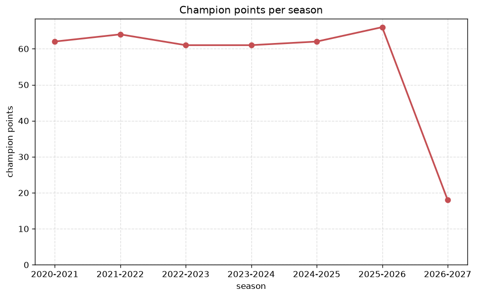
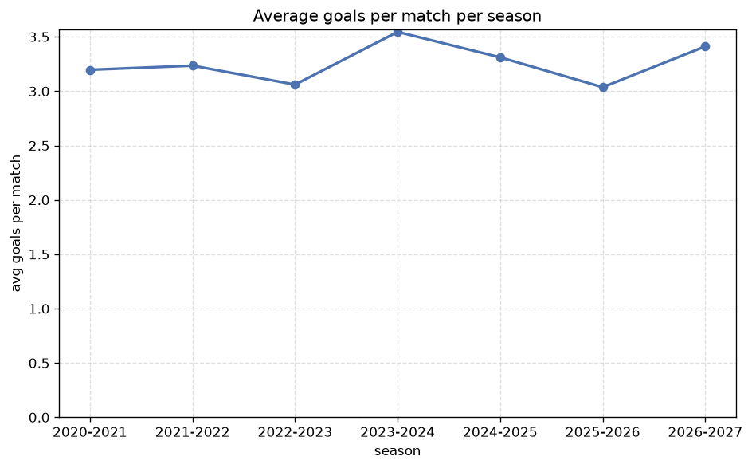

# Season Trends Analysis
- Report: `season_trends`
- Generated: 2026-10-30T04:15:42+00:00
- Script: `backend/scripts/analyze_seasons.py` v1.0.0
- League: Premiere Ligue Women (France)
- Scope: league `wfrance1`

## 1. Champions per season
| season | champion | pts | runner-up | margin |
|---|---|---|---|---|
| 2020-2021 | PSG W | 62 | Lyon W | 1 pts |
| 2021-2022 | Lyon W | 64 | PSG W | 11 pts |
| 2022-2023 | Lyon W | 61 | PSG W | 6 pts |
| 2023-2024 | Lyon W | 61 | PSG W | 11 pts |
| 2024-2025 | Lyon W | 62 | PSG W | 10 pts |
| 2025-2026 | Lyon W | 66 | Paris FC W | 15 pts |
| 2026-2027 | OL Lyonnes W | 18 | PSG W | 3 pts |

## 2. Title-race tightness
- Tight races (margin <= 3 pts): **2** of 7 seasons
- Tightest race: **2020-2021** - PSG W beat Lyon W by **1** pts

| season | margin | tight |
|---|---|---|
| 2020-2021 | 1 pts | yes |
| 2021-2022 | 11 pts |  |
| 2022-2023 | 6 pts |  |
| 2023-2024 | 11 pts |  |
| 2024-2025 | 10 pts |  |
| 2025-2026 | 15 pts |  |
| 2026-2027 | 3 pts | yes |

## 3. Points thresholds
_Position-specific points per season. Key: 1 = champion, 2 = runner-up, 4 = CL line, 6 = Europa, 9 = last safe, 12 = bottom._

| season | pos 1 | pos 2 | pos 4 | pos 6 | pos 9 | pos 12 |
|---|---|---|---|---|---|---|
| 2020-2021 | 62 | 61 | 37 | 30 | 25 | 8 |
| 2021-2022 | 64 | 53 | 43 | 35 | 16 | 7 |
| 2022-2023 | 61 | 55 | 39 | 32 | 24 | 6 |
| 2023-2024 | 61 | 50 | 35 | 32 | 23 | 13 |
| 2024-2025 | 62 | 52 | 43 | 33 | 17 | 9 |
| 2025-2026 | 66 | 51 | 41 | 33 | 19 | 13 |
| 2026-2027 | 18 | 15 | 9 | 8 | 5 | 1 |

## 4. Relegation battle
| season | safe pos | safe pts | drop pos | drop pts | gap |
|---|---|---|---|---|---|
| 2020-2021 | 9 | 25 | 10 | 17 | 8 pts |
| 2021-2022 | 9 | 16 | 10 | 15 | 1 pts |
| 2022-2023 | 9 | 24 | 10 | 15 | 9 pts |
| 2023-2024 | 9 | 23 | 10 | 16 | 7 pts |
| 2024-2025 | 9 | 17 | 10 | 17 | 0 pts |
| 2025-2026 | 9 | 19 | 10 | 15 | 4 pts |
| 2026-2027 | 9 | 5 | 10 | 3 | 2 pts |

## 5. League-level trends
| season | matches | total goals | avg goals | home win | draw | away win | goalless | avg pts/team |
|---|---|---|---|---|---|---|---|---|
| 2020-2021 | 132 | 422 | 3.197 | 48.5% | 11.4% | 40.2% | 7.6% | 31.75 |
| 2021-2022 | 132 | 427 | 3.235 | 43.2% | 11.4% | 45.5% | 3.8% | 31.75 |
| 2022-2023 | 132 | 404 | 3.061 | 43.2% | 16.7% | 40.2% | 3.8% | 31.17 |
| 2023-2024 | 132 | 468 | 3.545 | 47.0% | 19.7% | 33.3% | 2.3% | 30.83 |
| 2024-2025 | 132 | 437 | 3.311 | 43.9% | 19.7% | 36.4% | 9.1% | 30.83 |
| 2025-2026 | 135 | 410 | 3.037 | 39.3% | 18.5% | 42.2% | 5.2% | 31.67 |
| 2026-2027 | 34 | 116 | 3.412 | 44.1% | 23.5% | 32.4% | 5.9% | 7.83 |

## 6. View divergence
- Largest divergence: **2022-2023** (goals view, avg abs position diff = 4.167)

_Avg absolute position difference between classic view and alternative view per season._

| season | classic vs luck | classic vs goals |
|---|---|---|
| 2020-2021 | 1.500 | 2.833 |
| 2021-2022 | 2.500 | 3.667 |
| 2022-2023 | 2.500 | 4.167 |
| 2023-2024 | 2.667 | 3.000 |
| 2024-2025 | 1.333 | 4.000 |
| 2025-2026 | 2.167 | 3.333 |
| 2026-2027 | 2.333 | 3.667 |

---
*All statistics are computed from PostgreSQL tables (read-only). Run with `python backend/scripts/analyze_seasons.py` to regenerate.*

## Charts

