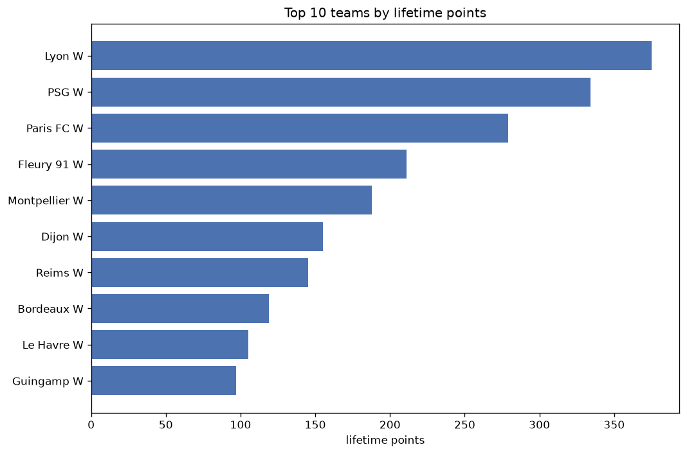
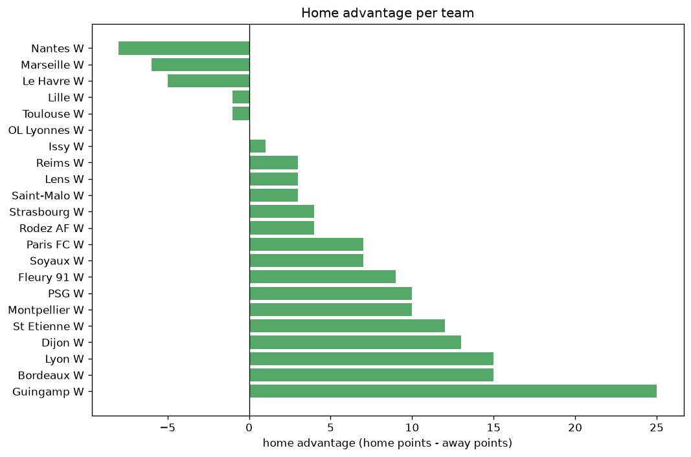

# Team Analysis
- Report: `teams_analysis`
- Generated: 2026-10-26T01:52:52+00:00
- Script: `backend/scripts/analyze_teams.py` v1.0.0
- League: Premiere Ligue Women (France)
- Scope: league `wfrance1`

- Teams: **22** | Seasons: **7** | Matches: **829**

## 1. Team standings (lifetime)
| team | seasons | played | W | D | L | pts | GF | GA | GD | avg pts/season | best pos | worst pos | titles |
|---|---|---|---|---|---|---|---|---|---|---|---|---|---|
| Lyon W | 6 | 134 | 122 | 9 | 3 | 375 | 489 | 54 | 435 | 62.5 | 1 | 2 | 5 |
| PSG W | 7 | 139 | 105 | 19 | 15 | 334 | 377 | 91 | 286 | 47.71 | 1 | 3 | 1 |
| Paris FC W | 7 | 139 | 85 | 24 | 30 | 279 | 306 | 143 | 163 | 39.86 | 2 | 4 | 0 |
| Fleury 91 W | 7 | 137 | 61 | 28 | 48 | 211 | 214 | 185 | 29 | 30.14 | 4 | 9 | 0 |
| Montpellier W | 7 | 138 | 55 | 23 | 60 | 188 | 204 | 209 | -5 | 26.86 | 5 | 10 | 0 |
| Dijon W | 6 | 132 | 43 | 26 | 63 | 155 | 136 | 234 | -98 | 25.83 | 4 | 10 | 0 |
| Reims W | 5 | 110 | 43 | 16 | 51 | 145 | 160 | 200 | -40 | 29.0 | 4 | 11 | 0 |
| Bordeaux W | 4 | 88 | 35 | 14 | 39 | 119 | 131 | 134 | -3 | 29.75 | 3 | 11 | 0 |
| Le Havre W | 6 | 116 | 26 | 27 | 63 | 105 | 131 | 241 | -110 | 17.5 | 6 | 12 | 0 |
| Guingamp W | 5 | 110 | 27 | 16 | 67 | 97 | 113 | 264 | -151 | 19.4 | 5 | 12 | 0 |
| Nantes W | 3 | 51 | 19 | 15 | 17 | 72 | 66 | 79 | -13 | 24.0 | 4 | 7 | 0 |
| St Etienne W | 4 | 88 | 18 | 12 | 58 | 66 | 75 | 206 | -131 | 16.5 | 7 | 12 | 0 |
| Strasbourg W | 3 | 50 | 12 | 14 | 24 | 50 | 59 | 90 | -31 | 16.67 | 7 | 9 | 0 |
| Soyaux W | 3 | 66 | 11 | 6 | 49 | 39 | 48 | 159 | -111 | 13.0 | 9 | 12 | 0 |
| Marseille W | 2 | 28 | 7 | 7 | 14 | 28 | 34 | 55 | -21 | 14.0 | 4 | 9 | 0 |
| Issy W | 2 | 44 | 7 | 2 | 35 | 23 | 30 | 134 | -104 | 11.5 | 11 | 11 | 0 |
| OL Lyonnes W | 1 | 6 | 6 | 0 | 0 | 18 | 36 | 3 | 33 | 18.0 | 1 | 1 | 1 |
| Lens W | 2 | 28 | 4 | 5 | 19 | 17 | 25 | 63 | -38 | 8.5 | 11 | 11 | 0 |
| Lille W | 1 | 22 | 2 | 7 | 13 | 13 | 27 | 65 | -38 | 13.0 | 12 | 12 | 0 |
| Rodez AF W | 1 | 22 | 3 | 3 | 16 | 12 | 16 | 48 | -32 | 12.0 | 11 | 11 | 0 |
| Saint-Malo W | 1 | 5 | 1 | 0 | 4 | 3 | 3 | 9 | -6 | 3.0 | 10 | 10 | 0 |
| Toulouse W | 1 | 5 | 0 | 1 | 4 | 1 | 4 | 18 | -14 | 1.0 | 12 | 12 | 0 |

## 2. Home vs away split
| team | home P | H-W | H-D | H-L | H-pts | away P | A-W | A-D | A-L | A-pts | adv |
|---|---|---|---|---|---|---|---|---|---|---|---|
| Guingamp W | 55 | 17 | 10 | 28 | 61 | 55 | 10 | 6 | 39 | 36 | 25 |
| Lyon W | 68 | 64 | 3 | 1 | 195 | 66 | 58 | 6 | 2 | 180 | 15 |
| Bordeaux W | 44 | 20 | 7 | 17 | 67 | 44 | 15 | 7 | 22 | 52 | 15 |
| Dijon W | 66 | 24 | 12 | 30 | 84 | 66 | 19 | 14 | 33 | 71 | 13 |
| St Etienne W | 44 | 10 | 9 | 25 | 39 | 44 | 8 | 3 | 33 | 27 | 12 |
| PSG W | 70 | 55 | 7 | 8 | 172 | 69 | 50 | 12 | 7 | 162 | 10 |
| Montpellier W | 69 | 29 | 12 | 28 | 99 | 69 | 26 | 11 | 32 | 89 | 10 |
| Fleury 91 W | 68 | 32 | 14 | 22 | 110 | 69 | 29 | 14 | 26 | 101 | 9 |
| Paris FC W | 69 | 44 | 11 | 14 | 143 | 70 | 41 | 13 | 16 | 136 | 7 |
| Soyaux W | 33 | 7 | 2 | 24 | 23 | 33 | 4 | 4 | 25 | 16 | 7 |
| Strasbourg W | 25 | 7 | 6 | 12 | 27 | 25 | 5 | 8 | 12 | 23 | 4 |
| Rodez AF W | 11 | 2 | 2 | 7 | 8 | 11 | 1 | 1 | 9 | 4 | 4 |
| Reims W | 55 | 22 | 8 | 25 | 74 | 55 | 21 | 8 | 26 | 71 | 3 |
| Lens W | 14 | 3 | 1 | 10 | 10 | 14 | 1 | 4 | 9 | 7 | 3 |
| Saint-Malo W | 3 | 1 | 0 | 2 | 3 | 2 | 0 | 0 | 2 | 0 | 3 |
| Issy W | 22 | 4 | 0 | 18 | 12 | 22 | 3 | 2 | 17 | 11 | 1 |
| OL Lyonnes W | 3 | 3 | 0 | 0 | 9 | 3 | 3 | 0 | 0 | 9 | 0 |
| Lille W | 11 | 1 | 3 | 7 | 6 | 11 | 1 | 4 | 6 | 7 | -1 |
| Toulouse W | 2 | 0 | 0 | 2 | 0 | 3 | 0 | 1 | 2 | 1 | -1 |
| Le Havre W | 58 | 11 | 17 | 30 | 50 | 58 | 15 | 10 | 33 | 55 | -5 |
| Marseille W | 14 | 3 | 2 | 9 | 11 | 14 | 4 | 5 | 5 | 17 | -6 |
| Nantes W | 25 | 7 | 11 | 7 | 32 | 26 | 12 | 4 | 10 | 40 | -8 |

## 3. Top performers
### Best points per game (PPG)
| rank | team | PPG |
|---|---|---|
| 1 | OL Lyonnes W | 3.00 |
| 2 | Lyon W | 2.80 |
| 3 | PSG W | 2.40 |
| 4 | Paris FC W | 2.01 |
| 5 | Fleury 91 W | 1.54 |

### Most goals scored
| rank | team | goals |
|---|---|---|
| 1 | Lyon W | 489 |
| 2 | PSG W | 377 |
| 3 | Paris FC W | 306 |
| 4 | Fleury 91 W | 214 |
| 5 | Montpellier W | 204 |

### Best goal difference
| rank | team | GD |
|---|---|---|
| 1 | Lyon W | 435 |
| 2 | PSG W | 286 |
| 3 | Paris FC W | 163 |
| 4 | OL Lyonnes W | 33 |
| 5 | Fleury 91 W | 29 |

### Best defence (goals against per match, standings)
| rank | team | GA/match |
|---|---|---|
| 1 | Lyon W | 0.403 |
| 2 | OL Lyonnes W | 0.500 |
| 3 | PSG W | 0.655 |
| 4 | Paris FC W | 1.029 |
| 5 | Fleury 91 W | 1.350 |

## 4. Team consistency
- Teams present in all **7** seasons: **4**

Fleury 91 W, Montpellier W, PSG W, Paris FC W

## 5. Head-to-head dominance
- Distinct fixtures: **157** (showing the 15 most frequent)

| fixture | meetings | home wins | draws | away wins | home pct | draw pct | away pct |
|---|---|---|---|---|---|---|---|
| Lyon W vs Paris FC W | 13 | 6 | 3 | 4 | 46.2% | 23.1% | 30.8% |
| PSG W vs Fleury 91 W | 13 | 5 | 3 | 5 | 38.5% | 23.1% | 38.5% |
| PSG W vs Montpellier W | 13 | 4 | 3 | 6 | 30.8% | 23.1% | 46.2% |
| PSG W vs Paris FC W | 13 | 3 | 6 | 4 | 23.1% | 46.2% | 30.8% |
| Montpellier W vs Dijon W | 12 | 8 | 3 | 1 | 66.7% | 25.0% | 8.3% |
| Paris FC W vs Montpellier W | 12 | 8 | 1 | 3 | 66.7% | 8.3% | 25.0% |
| Lyon W vs Dijon W | 12 | 6 | 0 | 6 | 50.0% | 0.0% | 50.0% |
| Lyon W vs Fleury 91 W | 12 | 6 | 0 | 6 | 50.0% | 0.0% | 50.0% |
| Lyon W vs Montpellier W | 12 | 6 | 0 | 6 | 50.0% | 0.0% | 50.0% |
| PSG W vs Dijon W | 12 | 6 | 0 | 6 | 50.0% | 0.0% | 50.0% |
| Paris FC W vs Dijon W | 12 | 6 | 0 | 6 | 50.0% | 0.0% | 50.0% |
| Paris FC W vs Fleury 91 W | 12 | 6 | 2 | 4 | 50.0% | 16.7% | 33.3% |
| Dijon W vs Fleury 91 W | 12 | 4 | 5 | 3 | 33.3% | 41.7% | 25.0% |
| PSG W vs Lyon W | 12 | 4 | 2 | 6 | 33.3% | 16.7% | 50.0% |
| Montpellier W vs Fleury 91 W | 12 | 2 | 4 | 6 | 16.7% | 33.3% | 50.0% |

## 6. Position per season (classic view)
_Cells show final position; '-' when the team was absent from that season._

| team | 2020-2021 | 2021-2022 | 2022-2023 | 2023-2024 | 2024-2025 | 2025-2026 | 2026-2027 |
|---|---|---|---|---|---|---|---|
| Lyon W | 2 | 1 | 1 | 1 | 1 | 1 | - |
| PSG W | 1 | 2 | 2 | 2 | 2 | 3 | 2 |
| Paris FC W | 4 | 3 | 3 | 3 | 3 | 2 | 3 |
| Fleury 91 W | 9 | 4 | 4 | 5 | 5 | 5 | 9 |
| Montpellier W | 7 | 5 | 5 | 6 | 6 | 10 | 8 |
| Dijon W | 8 | 10 | 10 | 9 | 4 | 6 | - |
| Reims W | 6 | 7 | 6 | 4 | 11 | - | - |
| Bordeaux W | 3 | 6 | 7 | 11 | - | - | - |
| Le Havre W | 12 | - | 8 | 8 | 8 | 8 | 6 |
| Guingamp W | 5 | 8 | 9 | 10 | 12 | - | - |
| Nantes W | - | - | - | - | 7 | 4 | 5 |
| St Etienne W | - | 12 | - | 7 | 10 | 12 | - |
| Strasbourg W | - | - | - | - | 9 | 7 | 7 |
| Soyaux W | 10 | 9 | 12 | - | - | - | - |
| Marseille W | - | - | - | - | - | 9 | 4 |
| Issy W | 11 | 11 | - | - | - | - | - |
| OL Lyonnes W | - | - | - | - | - | - | 1 |
| Lens W | - | - | - | - | - | 11 | 11 |
| Lille W | - | - | - | 12 | - | - | - |
| Rodez AF W | - | - | 11 | - | - | - | - |
| Saint-Malo W | - | - | - | - | - | - | 10 |
| Toulouse W | - | - | - | - | - | - | 12 |

---
*All statistics are computed from PostgreSQL tables (read-only). Run with `python backend/scripts/analyze_teams.py` to regenerate.*

## Charts

