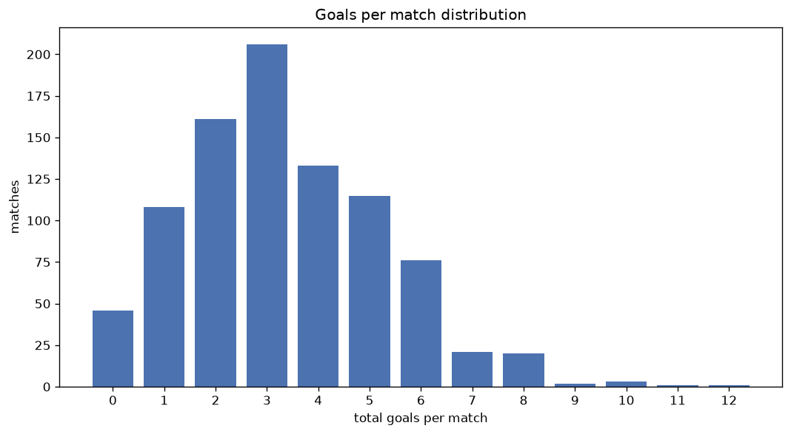
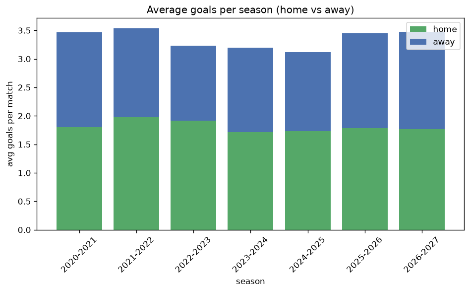

# Goal Analysis
- Report: `goals_analysis`
- Generated: 2026-10-26T01:53:11+00:00
- Script: `backend/scripts/analyze_goals.py` v1.0.0
- League: Bundesliga Women (Germany)
- Scope: league `wgermany1`

## 1. Goals per match distribution
| goals | matches | pct |
|---|---|---|
| 0 | 46 | 5.2% |
| 1 | 108 | 12.1% |
| 2 | 161 | 18.0% |
| 3 | 206 | 23.1% |
| 4 | 133 | 14.9% |
| 5 | 115 | 12.9% |
| 6 | 76 | 8.5% |
| 7 | 21 | 2.4% |
| 8 | 20 | 2.2% |
| 9 | 2 | 0.2% |
| 10 | 3 | 0.3% |
| 11 | 1 | 0.1% |
| 12 | 1 | 0.1% |

## 2. Goals per match per season
| season | matches | total goals | avg home | avg away | avg total |
|---|---|---|---|---|---|
| 2020-2021 | 132 | 458 | 1.803 | 1.667 | 3.47 |
| 2021-2022 | 132 | 467 | 1.977 | 1.561 | 3.538 |
| 2022-2023 | 132 | 427 | 1.917 | 1.318 | 3.235 |
| 2023-2024 | 132 | 422 | 1.712 | 1.485 | 3.197 |
| 2024-2025 | 132 | 411 | 1.735 | 1.379 | 3.114 |
| 2025-2026 | 182 | 627 | 1.786 | 1.659 | 3.445 |
| 2026-2027 | 51 | 177 | 1.765 | 1.706 | 3.471 |

## 3. Home vs away goal share
- Home goals: **1622** (54.3%)
- Away goals: **1367** (45.7%)
- Home/away ratio: **1.187**

| season | home goals | away goals | total | home pct | away pct |
|---|---|---|---|---|---|
| 2020-2021 | 238 | 220 | 458 | 52.0% | 48.0% |
| 2021-2022 | 261 | 206 | 467 | 55.9% | 44.1% |
| 2022-2023 | 253 | 174 | 427 | 59.3% | 40.7% |
| 2023-2024 | 226 | 196 | 422 | 53.6% | 46.4% |
| 2024-2025 | 229 | 182 | 411 | 55.7% | 44.3% |
| 2025-2026 | 325 | 302 | 627 | 51.8% | 48.2% |
| 2026-2027 | 90 | 87 | 177 | 50.8% | 49.2% |

## 4. BTTS (Both Teams To Score)
- Overall: **428** of `893` (47.9%)

| season | matches | BTTS | pct |
|---|---|---|---|
| 2020-2021 | 132 | 60 | 45.5% |
| 2021-2022 | 132 | 63 | 47.7% |
| 2022-2023 | 132 | 51 | 38.6% |
| 2023-2024 | 132 | 64 | 48.5% |
| 2024-2025 | 132 | 52 | 39.4% |
| 2025-2026 | 182 | 108 | 59.3% |
| 2026-2027 | 51 | 30 | 58.8% |

## 5. Clean sheets
- Home clean sheets: **268** (30.0%)
- Away clean sheets: **243** (27.2%)
- Total clean sheets recorded: **511**
- Matches with at least one clean sheet: **465** (52.1%)
- Both teams kept clean sheets (0-0): **46**

| season | matches | home CS | away CS | total CS | matches w/ CS |
|---|---|---|---|---|---|
| 2020-2021 | 132 | 41 | 40 | 81 | 72 (54.5%) |
| 2021-2022 | 132 | 41 | 35 | 76 | 69 (52.3%) |
| 2022-2023 | 132 | 48 | 43 | 91 | 81 (61.4%) |
| 2023-2024 | 132 | 42 | 34 | 76 | 68 (51.5%) |
| 2024-2025 | 132 | 43 | 42 | 85 | 80 (60.6%) |
| 2025-2026 | 182 | 42 | 39 | 81 | 74 (40.7%) |
| 2026-2027 | 51 | 11 | 10 | 21 | 21 (41.2%) |

## 6. Scoring intensity
- First-half goals: **1327** (44.4%)
- Second-half goals: **1662** (55.6%)
- Avg first-half goals per match: **1.486**
- Avg second-half goals per match: **1.861**
- Second-half-only scoring (HT 0-0, FT goals >= 1): **161** (18.0%)

| season | matches | 1st half | 2nd half | 1st half pct | 2nd half pct |
|---|---|---|---|---|---|
| 2020-2021 | 132 | 215 | 243 | 46.9% | 53.1% |
| 2021-2022 | 132 | 221 | 246 | 47.3% | 52.7% |
| 2022-2023 | 132 | 189 | 238 | 44.3% | 55.7% |
| 2023-2024 | 132 | 192 | 230 | 45.5% | 54.5% |
| 2024-2025 | 132 | 166 | 245 | 40.4% | 59.6% |
| 2025-2026 | 182 | 277 | 350 | 44.2% | 55.8% |
| 2026-2027 | 51 | 67 | 110 | 37.9% | 62.1% |

## 7. First-goal timing
- Matches with first-goal time recorded: `847` of `893` (94.8%)
- Goalless matches: `46`
- Min `1` | Max `93` | Mean `26.6` | Median (p50) `21`

| bucket | count | % of matches | % of scoring matches |
|---|---|---|---|
| 1-15 | 329 | 36.8% | 38.8% |
| 16-30 | 237 | 26.5% | 28.0% |
| 31-45 | 116 | 13.0% | 13.7% |
| 46-60 | 85 | 9.5% | 10.0% |
| 61-75 | 46 | 5.2% | 5.4% |
| 76-90 | 31 | 3.5% | 3.7% |
| 91-120 | 3 | 0.3% | 0.4% |

---
*All statistics are computed from PostgreSQL tables (read-only). Run with `python backend/scripts/analyze_goals.py` to regenerate.*

## Charts

