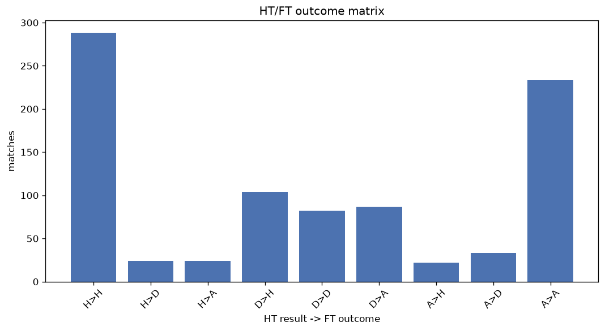
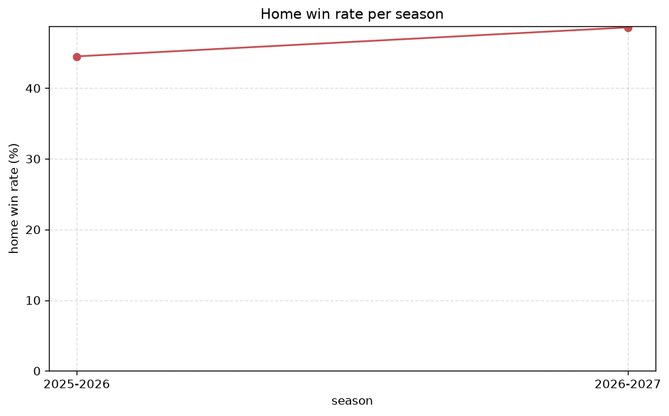

# Match Analysis
- Report: `matches_analysis`
- Generated: 2026-10-29T02:19:49+00:00
- Script: `backend/scripts/analyze_matches.py` v1.0.0
- League: Bundesliga Women (Germany)
- Scope: league `wgermany1`

## 1. Overall summary
| metric | value |
|---|---|
| Matches | 897 |
| Home wins | 414 (46.2%) |
| Draws | 139 (15.5%) |
| Away wins | 344 (38.4%) |
| Total goals | 3010 |
| Average goals per match | 3.356 |
| Goalless matches | 46 (5.1%) |

## 2. Per-season breakdown
| season | matches | home wins | draws | away wins | total goals | avg goals | goalless |
|---|---|---|---|---|---|---|---|
| 2020-2021 | 132 | 62 (47.0%) | 17 (12.9%) | 53 (40.2%) | 458 | 3.47 | 9 (6.8%) |
| 2021-2022 | 132 | 60 (45.5%) | 23 (17.4%) | 49 (37.1%) | 467 | 3.538 | 7 (5.3%) |
| 2022-2023 | 132 | 64 (48.5%) | 18 (13.6%) | 50 (37.9%) | 427 | 3.235 | 10 (7.6%) |
| 2023-2024 | 132 | 58 (43.9%) | 24 (18.2%) | 50 (37.9%) | 422 | 3.197 | 8 (6.1%) |
| 2024-2025 | 132 | 62 (47.0%) | 18 (13.6%) | 52 (39.4%) | 411 | 3.114 | 5 (3.8%) |
| 2025-2026 | 182 | 81 (44.5%) | 32 (17.6%) | 69 (37.9%) | 627 | 3.445 | 7 (3.8%) |
| 2026-2027 | 55 | 27 (49.1%) | 7 (12.7%) | 21 (38.2%) | 198 | 3.6 | 0 (0.0%) |

## 3. HT/FT outcome matrix
| HT result \ FT result | Home | Draw | Away | total |
|---|---|---|---|---|
| HT home lead | 288 (85.7%) | 24 (7.1%) | 24 (7.1%) | 336 |
| HT draw | 104 (38.1%) | 82 (30.0%) | 87 (31.9%) | 273 |
| HT away lead | 22 (7.6%) | 33 (11.5%) | 233 (80.9%) | 288 |

## 4. Comeback matches
- Home comebacks (trailing at HT, won at FT): **22** (2.5%)
- Away comebacks (trailing at HT, won at FT): **24** (2.7%)

### Home comebacks
| season | home | away | HT | FT |
|---|---|---|---|---|
| 2020-2021 | Hoffenheim W | Werder Bremen W | 0-1 | 3-1 |
| 2020-2021 | Bayer Leverkusen W | Eintracht Frankfurt W | 1-2 | 3-2 |
| 2020-2021 | SGS Essen W | Meppen W | 0-1 | 3-1 |
| 2021-2022 | Hoffenheim W | Freiburg W | 0-1 | 2-1 |
| 2021-2022 | Potsdam W | SGS Essen W | 0-1 | 3-2 |
| 2021-2022 | Wolfsburg W | Eintracht Frankfurt W | 1-2 | 3-2 |
| 2021-2022 | Potsdam W | Bayer Leverkusen W | 0-1 | 4-2 |
| 2021-2022 | Eintracht Frankfurt W | Hoffenheim W | 0-1 | 3-2 |
| 2021-2022 | Bayern Munich W | Eintracht Frankfurt W | 1-2 | 4-2 |
| 2022-2023 | Koln W | Potsdam W | 1-2 | 4-2 |
| 2022-2023 | Hoffenheim W | Freiburg W | 1-2 | 3-2 |
| 2022-2023 | Freiburg W | Duisburg W | 0-1 | 4-1 |
| 2023-2024 | Eintracht Frankfurt W | RB Leipzig W | 0-1 | 3-1 |
| 2023-2024 | Freiburg W | Werder Bremen W | 0-1 | 2-1 |
| 2023-2024 | Werder Bremen W | Bayer Leverkusen W | 0-1 | 2-1 |
| 2024-2025 | RB Leipzig W | Potsdam W | 0-1 | 4-1 |
| 2025-2026 | Freiburg W | Eintracht Frankfurt W | 0-1 | 3-2 |
| 2025-2026 | Wolfsburg W | Freiburg W | 0-1 | 3-1 |
| 2025-2026 | Bayern Munich W | Wolfsburg W | 0-1 | 4-1 |
| 2025-2026 | Wolfsburg W | RB Leipzig W | 0-1 | 3-2 |
| 2026-2027 | Wolfsburg W | Werder Bremen W | 0-1 | 3-2 |
| 2026-2027 | Bayer Leverkusen W | Werder Bremen W | 0-2 | 3-2 |

### Away comebacks
| season | home | away | HT | FT |
|---|---|---|---|---|
| 2020-2021 | Freiburg W | Bayer Leverkusen W | 1-0 | 1-2 |
| 2020-2021 | Duisburg W | Potsdam W | 2-1 | 2-3 |
| 2020-2021 | Bayern Munich W | Hoffenheim W | 2-0 | 2-3 |
| 2021-2022 | Bayer Leverkusen W | SGS Essen W | 1-0 | 1-2 |
| 2021-2022 | Koln W | Potsdam W | 1-0 | 1-3 |
| 2021-2022 | Bayer Leverkusen W | Freiburg W | 2-0 | 2-3 |
| 2021-2022 | Jena W | Koln W | 1-0 | 1-3 |
| 2021-2022 | Hoffenheim W | Potsdam W | 1-0 | 1-2 |
| 2022-2023 | Hoffenheim W | Wolfsburg W | 1-0 | 1-2 |
| 2022-2023 | Koln W | Meppen W | 1-0 | 1-2 |
| 2022-2023 | Meppen W | Wolfsburg W | 1-0 | 2-3 |
| 2023-2024 | Duisburg W | Bayern Munich W | 1-0 | 1-5 |
| 2024-2025 | SGS Essen W | Eintracht Frankfurt W | 1-0 | 1-3 |
| 2024-2025 | Bayer Leverkusen W | Bayern Munich W | 1-0 | 2-3 |
| 2025-2026 | Union Berlin W | Wolfsburg W | 1-0 | 1-4 |
| 2025-2026 | Hamburger SV W | 1.FC Nurnberg W | 1-0 | 1-2 |
| 2025-2026 | Union Berlin W | Bayer Leverkusen W | 1-0 | 1-2 |
| 2025-2026 | SGS Essen W | Union Berlin W | 2-1 | 2-4 |
| 2025-2026 | Koln W | Eintracht Frankfurt W | 1-0 | 1-2 |
| 2026-2027 | 1.FC Nurnberg W | Wolfsburg W | 2-0 | 2-8 |
| 2026-2027 | Bayer Leverkusen W | Bayern Munich W | 1-0 | 2-3 |
| 2026-2027 | Mainz W | Eintracht Frankfurt W | 2-0 | 2-3 |
| 2026-2027 | Freiburg W | Bayer Leverkusen W | 1-0 | 1-2 |
| 2026-2027 | 1.FC Nurnberg W | Hoffenheim W | 1-0 | 1-2 |

## 5. HT lead conversion
| HT state | matches | converted to win | held as draw | collapsed to loss |
|---|---|---|---|---|
| Home lead | 336 | 288 (85.7%) | 24 (7.1%) | 24 (7.1%) |
| Away lead | 288 | 233 (80.9%) | 33 (11.5%) | 22 (7.6%) |

### Matches level at half-time
| FT result | count | pct |
|---|---|---|
| Home win | 104 | 38.1% |
| Draw | 82 | 30.0% |
| Away win | 87 | 31.9% |

## 6. First-goal timing
- Matches with a first-goal time recorded: `851` of `897` (94.9%)

Outcome distribution by first-goal timing bucket:
| bucket | matches | % of matches | home | draw | away |
|---|---|---|---|---|---|
| 1-15 | 332 | 37.0% | 171 (51.5%) | 27 (8.1%) | 134 (40.4%) |
| 16-30 | 237 | 26.4% | 110 (46.4%) | 26 (11.0%) | 101 (42.6%) |
| 31-45 | 116 | 12.9% | 51 (44.0%) | 20 (17.2%) | 45 (38.8%) |
| 46-60 | 85 | 9.5% | 47 (55.3%) | 7 (8.2%) | 31 (36.5%) |
| 61-75 | 47 | 5.2% | 19 (40.4%) | 9 (19.1%) | 19 (40.4%) |
| 76-90 | 31 | 3.5% | 15 (48.4%) | 4 (12.9%) | 12 (38.7%) |
| 91-120 | 3 | 0.3% | 1 (33.3%) | 0 (0.0%) | 2 (66.7%) |

## 7. Goalless matches
- Overall: **46** of `897` (5.1%)

| season | matches | goalless | pct |
|---|---|---|---|
| 2020-2021 | 132 | 9 | 6.8% |
| 2021-2022 | 132 | 7 | 5.3% |
| 2022-2023 | 132 | 10 | 7.6% |
| 2023-2024 | 132 | 8 | 6.1% |
| 2024-2025 | 132 | 5 | 3.8% |
| 2025-2026 | 182 | 7 | 3.8% |
| 2026-2027 | 55 | 0 | 0.0% |

---
*All statistics are computed from PostgreSQL tables (read-only). Run with `python backend/scripts/analyze_matches.py` to regenerate.*

## Charts

