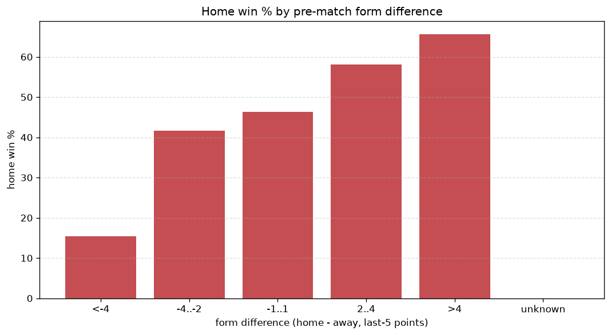
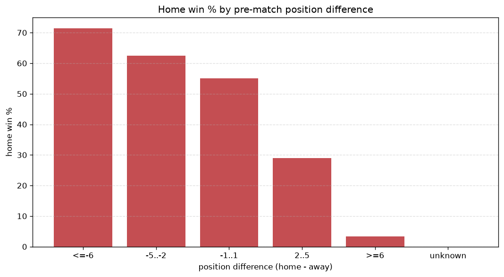

# Relationships Analysis
- Report: `relationships`
- Generated: 2026-10-27T02:35:26+00:00
- Script: `backend/scripts/analyze_relationships.py` v1.0.0
- League: Bundesliga Women (Germany)
- Scope: league `wgermany1`

- Matches analysed: **842** (23 leakage-safe pre-match features).

## 1. Correlation matrix
_Pearson correlation of each pre-match feature with observed goals; sorted by |corr(total goals)|._

| feature | corr(home) | corr(away) | corr(total) |
|---|---|---|---|
| home_points_before_match | 0.321 | -0.204 | 0.137 |
| home_position_before_match | -0.431 | 0.338 | -0.135 |
| home_team_home_goals_avg | 0.319 | -0.215 | 0.127 |
| home_team_goals_scored_last_5 | 0.328 | -0.226 | 0.127 |
| home_team_home_win_rate | 0.349 | -0.252 | 0.125 |
| home_team_points_last_5 | 0.331 | -0.237 | 0.120 |
| home_team_wins_last_5 | 0.340 | -0.251 | 0.119 |
| points_difference | 0.511 | -0.473 | 0.103 |
| home_team_goals_conceded_last_5 | -0.284 | 0.237 | -0.078 |
| home_team_home_conceded_avg | -0.280 | 0.243 | -0.069 |
| position_difference | -0.503 | 0.511 | -0.066 |
| away_team_wins_last_5 | -0.218 | 0.339 | 0.064 |
| away_team_away_conceded_avg | 0.133 | -0.235 | -0.061 |
| away_team_goals_scored_last_5 | -0.239 | 0.359 | 0.060 |
| away_team_away_win_rate | -0.199 | 0.307 | 0.056 |
| away_team_away_goals_avg | -0.210 | 0.319 | 0.055 |
| away_team_points_last_5 | -0.222 | 0.332 | 0.054 |
| away_position_before_match | 0.261 | -0.363 | -0.043 |
| rest_days_difference | -0.058 | 0.018 | -0.039 |
| away_points_before_match | -0.198 | 0.274 | 0.032 |
| away_rest_days | 0.011 | 0.012 | 0.019 |
| away_team_goals_conceded_last_5 | 0.182 | -0.237 | -0.017 |
| home_rest_days | -0.033 | 0.025 | -0.011 |

## 2. Form vs outcome
_Home win/draw/away % per bucket of `home_team_points_last_5 - away_team_points_last_5`._

| bucket | matches | home | draw | away | home % | draw % | away % |
|---|---|---|---|---|---|---|---|
| <-4 | 183 | 21 | 25 | 137 | 11.5% | 13.7% | 74.9% |
| -4..-2 | 124 | 42 | 19 | 63 | 33.9% | 15.3% | 50.8% |
| -1..1 | 221 | 102 | 44 | 75 | 46.2% | 19.9% | 33.9% |
| 2..4 | 148 | 92 | 27 | 29 | 62.2% | 18.2% | 19.6% |
| >4 | 166 | 130 | 17 | 19 | 78.3% | 10.2% | 11.4% |
| unknown | 0 | 0 | 0 | 0 | - | - | - |

## 3. Position vs outcome
_Home win/draw/away % per bucket of `position_difference` (home position - away position; negative favours the home team)._

| bucket | matches | home | draw | away | home % | draw % | away % |
|---|---|---|---|---|---|---|---|
| <=-6 | 109 | 91 | 11 | 7 | 83.5% | 10.1% | 6.4% |
| -5..-2 | 203 | 142 | 27 | 34 | 70.0% | 13.3% | 16.7% |
| -1..1 | 196 | 94 | 42 | 60 | 48.0% | 21.4% | 30.6% |
| 2..5 | 212 | 56 | 43 | 113 | 26.4% | 20.3% | 53.3% |
| >=6 | 122 | 4 | 9 | 109 | 3.3% | 7.4% | 89.3% |
| unknown | 0 | 0 | 0 | 0 | - | - | - |

## 4. Rest advantage
_Home win/draw/away % per bucket of `rest_days_difference` (home rest - away rest). Matches with unknown rest are bucketed separately._

| bucket | matches | home | draw | away | home % | draw % | away % |
|---|---|---|---|---|---|---|---|
| <-1 | 142 | 66 | 18 | 58 | 46.5% | 12.7% | 40.8% |
| -1..0 | 142 | 71 | 16 | 55 | 50.0% | 11.3% | 38.7% |
| 0 | 225 | 94 | 45 | 86 | 41.8% | 20.0% | 38.2% |
| 1..2 | 236 | 113 | 35 | 88 | 47.9% | 14.8% | 37.3% |
| >2 | 59 | 25 | 8 | 26 | 42.4% | 13.6% | 44.1% |
| unknown | 38 | 18 | 10 | 10 | 47.4% | 26.3% | 26.3% |
- *38 match(es) had unknown rest difference (missing rest data on at least one side).*

## 5. Home team quality
_Home win rate by `home_team_home_win_rate` tier (split at 0.5)._

- `< 0.5` tier: **32.3%** home win (148/458)
- `>= 0.5` tier: **62.2%** home win (239/384)
- Home-win gap (>= split minus < split): **+29.9 pp**

| tier | label | matches | home | draw | away | home % |
|---|---|---|---|---|---|---|
| low | < 0.5 | 458 | 148 | 81 | 229 | 32.3% |
| high | >= 0.5 | 384 | 239 | 51 | 94 | 62.2% |

## 6. Feature averages by result
_Mean feature value per outcome; `range` is home-minus-away spread of the group means._

| feature | home mean | draw mean | away mean | range |
|---|---|---|---|---|
| points_difference | 6.731 | 0.000 | -9.121 | 15.852 |
| home_points_before_match | 19.287 | 13.955 | 11.170 | 8.117 |
| away_points_before_match | 12.556 | 13.955 | 20.291 | 7.735 |
| position_difference | -2.537 | 0.129 | 3.464 | 6.002 |
| away_team_goals_scored_last_5 | 5.713 | 6.652 | 9.310 | 3.596 |
| home_team_goals_scored_last_5 | 8.941 | 5.826 | 5.406 | 3.535 |
| home_position_before_match | 5.217 | 7.348 | 8.625 | 3.408 |
| home_team_points_last_5 | 7.736 | 5.220 | 4.557 | 3.179 |
| home_team_goals_conceded_last_5 | 5.786 | 7.682 | 8.693 | 2.908 |
| away_team_points_last_5 | 5.044 | 5.674 | 7.864 | 2.820 |
| away_position_before_match | 7.755 | 7.220 | 5.161 | 2.594 |
| away_team_goals_conceded_last_5 | 8.196 | 7.462 | 5.690 | 2.506 |
| home_team_wins_last_5 | 2.370 | 1.561 | 1.245 | 1.125 |
| home_rest_days | 11.680 | 11.369 | 12.468 | 1.099 |
| away_team_wins_last_5 | 1.437 | 1.644 | 2.418 | 0.981 |
| home_team_home_goals_avg | 2.078 | 1.469 | 1.185 | 0.893 |
| away_rest_days | 11.314 | 11.163 | 12.010 | 0.847 |
| away_team_away_goals_avg | 1.142 | 1.226 | 1.743 | 0.601 |
| home_team_home_conceded_avg | 1.125 | 1.388 | 1.697 | 0.572 |
| away_team_away_conceded_avg | 1.858 | 1.821 | 1.332 | 0.525 |
| home_team_home_win_rate | 0.551 | 0.365 | 0.274 | 0.277 |
| rest_days_difference | 0.366 | 0.238 | 0.450 | 0.213 |
| away_team_away_win_rate | 0.281 | 0.308 | 0.443 | 0.162 |

---
*All features are leakage-safe pre-match values built by `ml.features.build_features.build_rows` from strictly prior matches. Run with `python backend/scripts/analyze_relationships.py` to regenerate.*

## Charts

