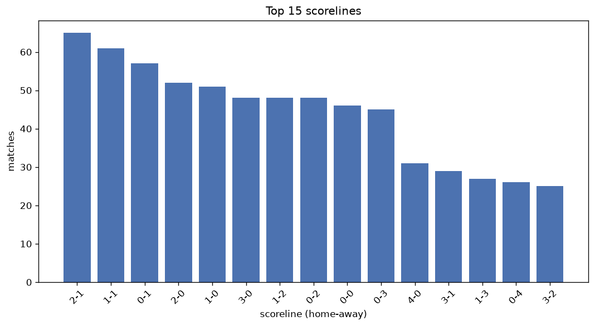
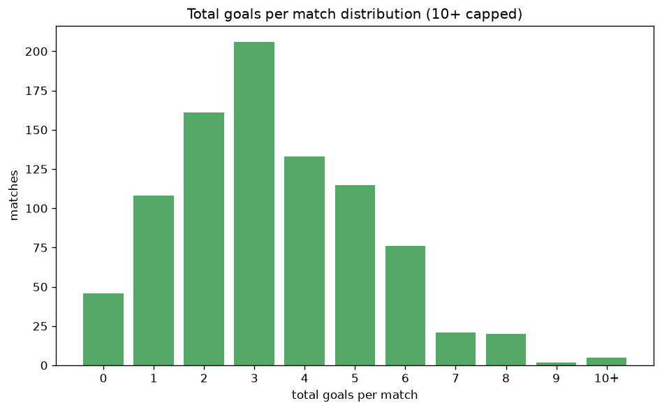

# Scoreline Analysis
- Report: `scoreline_analysis`
- Generated: 2026-10-26T01:53:17+00:00
- Script: `backend/scripts/analyze_scorelines.py` v1.0.0
- League: Bundesliga Women (Germany)
- Scope: league `wgermany1`

## 1. Scoreline frequency
- Matches analysed: **893** across **7** seasons.
- Distinct scorelines seen: **48**.

| scoreline | count | pct |
|---|---|---|
| 2-1 | 65 | 7.3% |
| 1-1 | 61 | 6.8% |
| 0-1 | 57 | 6.4% |
| 2-0 | 52 | 5.8% |
| 1-0 | 51 | 5.7% |
| 3-0 | 48 | 5.4% |
| 1-2 | 48 | 5.4% |
| 0-2 | 48 | 5.4% |
| 0-0 | 46 | 5.2% |
| 0-3 | 45 | 5.0% |
| 4-0 | 31 | 3.5% |
| 3-1 | 29 | 3.2% |
| 1-3 | 27 | 3.0% |
| 0-4 | 26 | 2.9% |
| 3-2 | 25 | 2.8% |
| 1-4 | 21 | 2.4% |
| 2-3 | 21 | 2.4% |
| 4-1 | 21 | 2.4% |
| 2-2 | 20 | 2.2% |
| 5-0 | 16 | 1.8% |

## 2. Scoreline frequency per season

### 2020-2021
| scoreline | count | pct |
|---|---|---|
| 2-1 | 10 | 7.6% |
| 0-0 | 9 | 6.8% |
| 1-0 | 9 | 6.8% |
| 3-0 | 8 | 6.1% |
| 0-3 | 8 | 6.1% |

### 2021-2022
| scoreline | count | pct |
|---|---|---|
| 1-1 | 11 | 8.3% |
| 2-1 | 9 | 6.8% |
| 1-2 | 8 | 6.1% |
| 0-3 | 7 | 5.3% |
| 0-2 | 7 | 5.3% |

### 2022-2023
| scoreline | count | pct |
|---|---|---|
| 0-0 | 10 | 7.6% |
| 4-0 | 10 | 7.6% |
| 0-1 | 10 | 7.6% |
| 0-2 | 9 | 6.8% |
| 2-0 | 9 | 6.8% |

### 2023-2024
| scoreline | count | pct |
|---|---|---|
| 2-1 | 13 | 9.8% |
| 2-0 | 10 | 7.6% |
| 1-1 | 9 | 6.8% |
| 3-0 | 8 | 6.1% |
| 0-2 | 8 | 6.1% |

### 2024-2025
| scoreline | count | pct |
|---|---|---|
| 1-0 | 12 | 9.1% |
| 0-1 | 11 | 8.3% |
| 0-3 | 11 | 8.3% |
| 0-2 | 10 | 7.6% |
| 2-0 | 9 | 6.8% |

### 2025-2026
| scoreline | count | pct |
|---|---|---|
| 1-1 | 18 | 9.9% |
| 2-1 | 17 | 9.3% |
| 0-1 | 12 | 6.6% |
| 2-0 | 10 | 5.5% |
| 3-0 | 10 | 5.5% |

### 2026-2027
| scoreline | count | pct |
|---|---|---|
| 1-2 | 6 | 11.8% |
| 1-1 | 5 | 9.8% |
| 2-1 | 5 | 9.8% |
| 2-0 | 3 | 5.9% |
| 1-0 | 3 | 5.9% |

## 3. Total-goal histogram
_10+ groups all matches with 10 or more total goals._

| total goals | matches | pct |
|---|---|---|
| 0 | 46 | 5.2% |
| 1 | 108 | 12.1% |
| 2 | 161 | 18.0% |
| 3 | 206 | 23.1% |
| 4 | 133 | 14.9% |
| 5 | 115 | 12.9% |
| 6 | 76 | 8.5% |
| 7 | 21 | 2.4% |
| 8 | 20 | 2.2% |
| 9 | 2 | 0.2% |
| 10+ | 5 | 0.6% |

## 4. Extreme scorelines
- Matches with 7+ total goals: **48**

| season | date | scoreline | total goals |
|---|---|---|---|
| 2022-2023 | 2023-05-28 | 11-1 | 12 |
| 2021-2022 | 2022-05-08 | 1-10 | 11 |
| 2022-2023 | 2023-04-22 | 8-2 | 10 |
| 2023-2024 | 2024-02-17 | 1-9 | 10 |
| 2026-2027 | 2026-08-22 | 2-8 | 10 |
| 2023-2024 | 2023-09-16 | 9-0 | 9 |
| 2024-2025 | 2025-02-09 | 9-0 | 9 |
| 2020-2021 | 2020-11-14 | 5-3 | 8 |
| 2020-2021 | 2020-12-20 | 0-8 | 8 |
| 2020-2021 | 2021-02-07 | 7-1 | 8 |
| 2020-2021 | 2021-06-06 | 8-0 | 8 |
| 2021-2022 | 2021-08-29 | 8-0 | 8 |
| 2021-2022 | 2021-11-14 | 7-1 | 8 |
| 2021-2022 | 2021-12-04 | 7-1 | 8 |
| 2021-2022 | 2021-12-05 | 7-1 | 8 |
| 2021-2022 | 2022-03-13 | 7-1 | 8 |
| 2021-2022 | 2022-04-24 | 7-1 | 8 |
| 2021-2022 | 2022-05-15 | 7-1 | 8 |
| 2022-2023 | 2023-04-02 | 8-0 | 8 |
| 2022-2023 | 2023-05-07 | 7-1 | 8 |
| 2023-2024 | 2024-02-09 | 4-4 | 8 |
| 2024-2025 | 2024-09-13 | 6-2 | 8 |
| 2024-2025 | 2024-11-09 | 8-0 | 8 |
| 2025-2026 | 2025-09-19 | 6-2 | 8 |
| 2025-2026 | 2025-10-04 | 0-8 | 8 |
| 2025-2026 | 2025-12-10 | 5-3 | 8 |
| 2025-2026 | 2026-04-27 | 6-2 | 8 |
| 2020-2021 | 2020-10-18 | 5-2 | 7 |
| 2020-2021 | 2020-11-08 | 2-5 | 7 |
| 2020-2021 | 2020-11-21 | 1-6 | 7 |
| 2020-2021 | 2020-12-13 | 7-0 | 7 |
| 2020-2021 | 2021-02-14 | 7-0 | 7 |
| 2020-2021 | 2021-03-14 | 5-2 | 7 |
| 2020-2021 | 2021-04-25 | 6-1 | 7 |
| 2021-2022 | 2021-11-07 | 3-4 | 7 |
| 2022-2023 | 2022-09-30 | 6-1 | 7 |
| 2022-2023 | 2022-10-02 | 5-2 | 7 |
| 2022-2023 | 2023-02-05 | 7-0 | 7 |
| 2022-2023 | 2023-05-07 | 6-1 | 7 |
| 2023-2024 | 2024-03-23 | 3-4 | 7 |
| 2024-2025 | 2025-02-16 | 6-1 | 7 |
| 2024-2025 | 2025-03-29 | 0-7 | 7 |
| 2024-2025 | 2025-04-13 | 5-2 | 7 |
| 2025-2026 | 2025-09-22 | 4-3 | 7 |
| 2025-2026 | 2025-12-13 | 1-6 | 7 |
| 2025-2026 | 2026-04-25 | 4-3 | 7 |
| 2025-2026 | 2026-05-10 | 7-0 | 7 |
| 2026-2027 | 2026-09-19 | 5-2 | 7 |

## 5. Margin-of-victory distribution (decided matches)
- Decided matches: **755** (draws: **138**)
- Average winning margin: **2.48**

| margin | matches | pct |
|---|---|---|
| 1 | 271 | 35.9% |
| 2 | 177 | 23.4% |
| 3+ | 307 | 40.7% |

## 6. Margin by outcome

### Home wins
- Matches: **411** | avg margin: **2.59** | max margin: **10**
| margin | matches | pct |
|---|---|---|
| 1 | 143 | 34.8% |
| 2 | 94 | 22.9% |
| 3+ | 174 | 42.3% |
- *Full match-by-match list available in `scoreline_analysis.json`.*

### Away wins
- Matches: **344** | avg margin: **2.35** | max margin: **9**
| margin | matches | pct |
|---|---|---|
| 1 | 128 | 37.2% |
| 2 | 83 | 24.1% |
| 3+ | 133 | 38.7% |
- *Full match-by-match list available in `scoreline_analysis.json`.*

## 7. Most common exact score by outcome type
| outcome | matches | most common score | count | pct |
|---|---|---|---|---|
| home | 411 | 2-1 | 65 | 15.8% |
| draw | 138 | 1-1 | 61 | 44.2% |
| away | 344 | 0-1 | 57 | 16.6% |

---
*All statistics are computed from PostgreSQL tables (read-only). Run with `python backend/scripts/analyze_scorelines.py` to regenerate.*

## Charts

