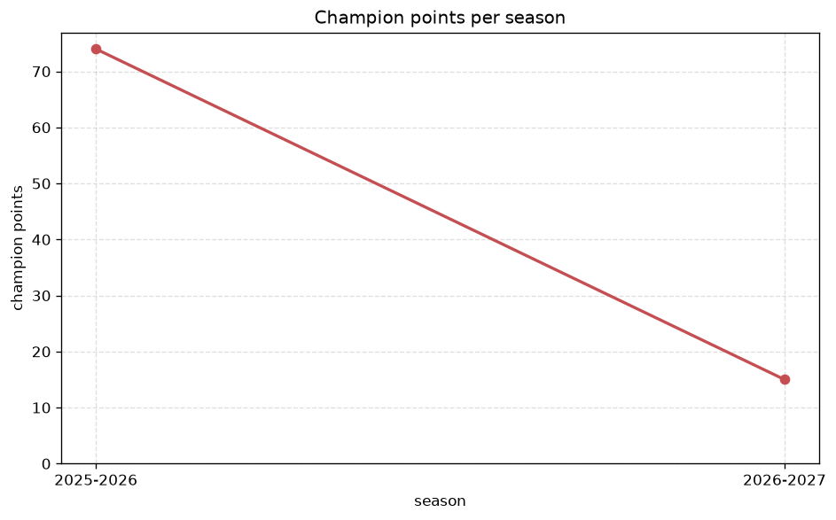
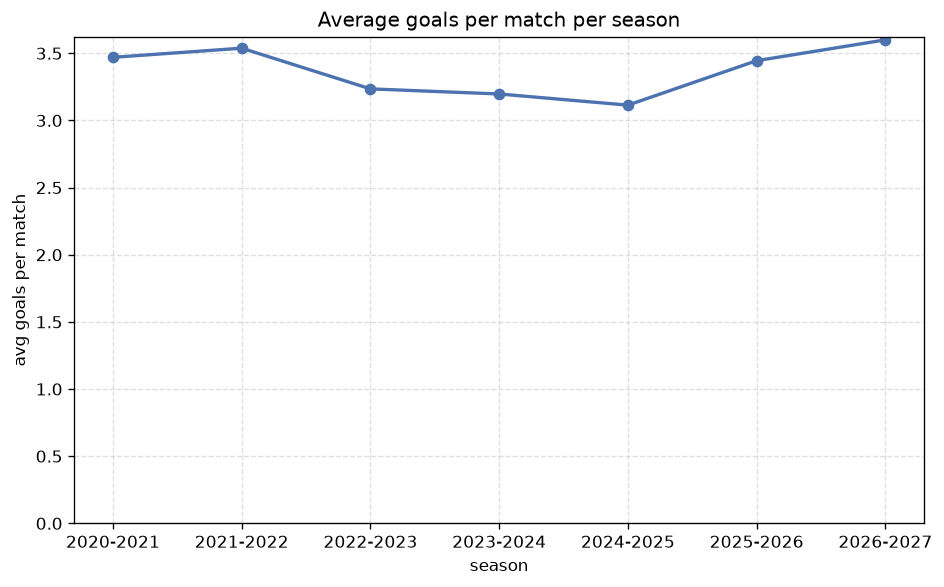

# Season Trends Analysis
- Report: `season_trends`
- Generated: 2026-10-30T04:15:55+00:00
- Script: `backend/scripts/analyze_seasons.py` v1.0.0
- League: Bundesliga Women (Germany)
- Scope: league `wgermany1`

## 1. Champions per season
| season | champion | pts | runner-up | margin |
|---|---|---|---|---|
| 2020-2021 | Bayern Munich W | 61 | Wolfsburg W | 2 pts |
| 2021-2022 | Wolfsburg W | 59 | Bayern Munich W | 4 pts |
| 2022-2023 | Bayern Munich W | 59 | Wolfsburg W | 2 pts |
| 2023-2024 | Bayern Munich W | 60 | Wolfsburg W | 7 pts |
| 2024-2025 | Bayern Munich W | 59 | Wolfsburg W | 8 pts |
| 2025-2026 | Bayern Munich W | 74 | Wolfsburg W | 16 pts |
| 2026-2027 | Bayern Munich W | 24 | Wolfsburg W | 3 pts |

## 2. Title-race tightness
- Tight races (margin <= 3 pts): **3** of 7 seasons
- Tightest race: **2020-2021** - Bayern Munich W beat Wolfsburg W by **2** pts

| season | margin | tight |
|---|---|---|
| 2020-2021 | 2 pts | yes |
| 2021-2022 | 4 pts |  |
| 2022-2023 | 2 pts | yes |
| 2023-2024 | 7 pts |  |
| 2024-2025 | 8 pts |  |
| 2025-2026 | 16 pts |  |
| 2026-2027 | 3 pts | yes |

## 3. Points thresholds
_Position-specific points per season. Key: 1 = champion, 2 = runner-up, 4 = CL line, 6 = Europa, 11 = last safe, 14 = bottom._

| season | pos 1 | pos 2 | pos 4 | pos 6 | pos 11 | pos 14 |
|---|---|---|---|---|---|---|
| 2020-2021 | 61 | 59 | 39 | 30 | 14 | - |
| 2021-2022 | 59 | 55 | 43 | 32 | 13 | - |
| 2022-2023 | 59 | 57 | 48 | 24 | 17 | - |
| 2023-2024 | 60 | 53 | 35 | 31 | 15 | - |
| 2024-2025 | 59 | 51 | 43 | 36 | 10 | - |
| 2025-2026 | 74 | 58 | 46 | 43 | 22 | 11 |
| 2026-2027 | 24 | 21 | 13 | 12 | 8 | 0 |

## 4. Relegation battle
| season | safe pos | safe pts | drop pos | drop pts | gap |
|---|---|---|---|---|---|
| 2020-2021 | 11 | 14 | 12 | 7 | 7 pts |
| 2021-2022 | 11 | 13 | 12 | 5 | 8 pts |
| 2022-2023 | 11 | 17 | 12 | 8 | 9 pts |
| 2023-2024 | 11 | 15 | 12 | 4 | 11 pts |
| 2024-2025 | 11 | 10 | 12 | 1 | 9 pts |
| 2025-2026 | 11 | 22 | 12 | 18 | 4 pts |
| 2026-2027 | 11 | 8 | 12 | 6 | 2 pts |

## 5. League-level trends
| season | matches | total goals | avg goals | home win | draw | away win | goalless | avg pts/team |
|---|---|---|---|---|---|---|---|---|
| 2020-2021 | 132 | 458 | 3.47 | 47.0% | 12.9% | 40.2% | 6.8% | 31.58 |
| 2021-2022 | 132 | 467 | 3.538 | 45.5% | 17.4% | 37.1% | 5.3% | 31.08 |
| 2022-2023 | 132 | 427 | 3.235 | 48.5% | 13.6% | 37.9% | 7.6% | 31.5 |
| 2023-2024 | 132 | 422 | 3.197 | 43.9% | 18.2% | 37.9% | 6.1% | 31.0 |
| 2024-2025 | 132 | 411 | 3.114 | 47.0% | 13.6% | 39.4% | 3.8% | 31.5 |
| 2025-2026 | 182 | 627 | 3.445 | 44.5% | 17.6% | 37.9% | 3.8% | 36.71 |
| 2026-2027 | 55 | 198 | 3.6 | 49.1% | 12.7% | 38.2% | 0.0% | 11.29 |

## 6. View divergence
- Largest divergence: **2026-2027** (goals view, avg abs position diff = 4.571)

_Avg absolute position difference between classic view and alternative view per season._

| season | classic vs luck | classic vs goals |
|---|---|---|
| 2020-2021 | 1.667 | 2.833 |
| 2021-2022 | 1.833 | 2.000 |
| 2022-2023 | 2.167 | 2.667 |
| 2023-2024 | 2.333 | 4.500 |
| 2024-2025 | 2.167 | 3.500 |
| 2025-2026 | 2.429 | 4.286 |
| 2026-2027 | 1.286 | 4.571 |

---
*All statistics are computed from PostgreSQL tables (read-only). Run with `python backend/scripts/analyze_seasons.py` to regenerate.*

## Charts

