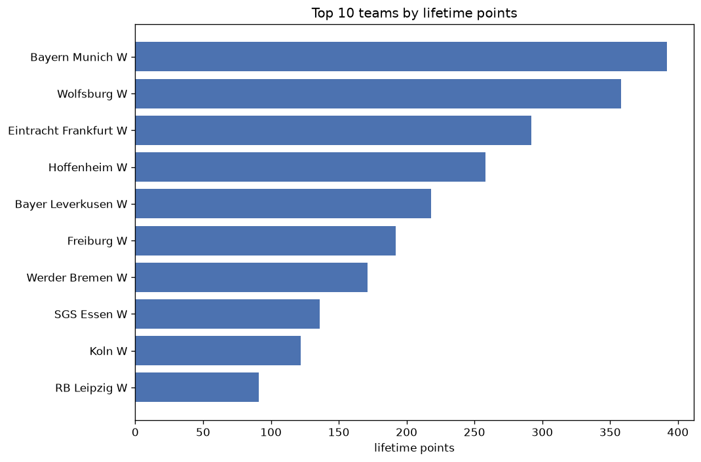
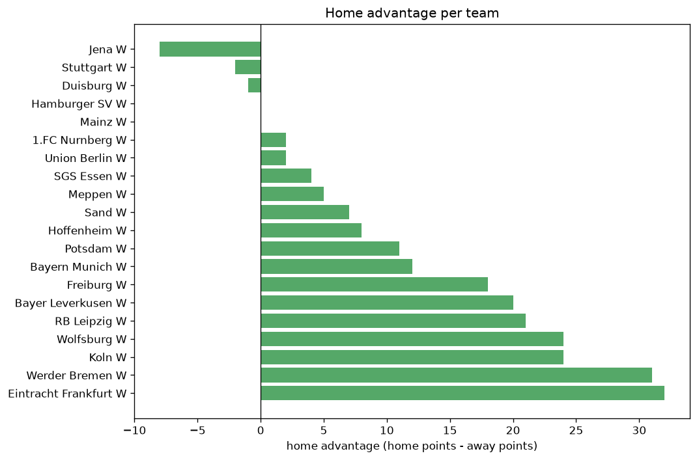

# Team Analysis
- Report: `teams_analysis`
- Generated: 2026-10-27T02:35:20+00:00
- Script: `backend/scripts/analyze_teams.py` v1.0.0
- League: Bundesliga Women (Germany)
- Scope: league `wgermany1`

- Teams: **20** | Seasons: **7** | Matches: **897**

## 1. Team standings (lifetime)
| team | seasons | played | W | D | L | pts | GF | GA | GD | avg pts/season | best pos | worst pos | titles |
|---|---|---|---|---|---|---|---|---|---|---|---|---|---|
| Bayern Munich W | 7 | 144 | 127 | 11 | 6 | 392 | 462 | 72 | 390 | 56.0 | 1 | 2 | 6 |
| Wolfsburg W | 7 | 144 | 115 | 13 | 16 | 358 | 450 | 133 | 317 | 51.14 | 1 | 2 | 1 |
| Eintracht Frankfurt W | 7 | 144 | 92 | 16 | 36 | 292 | 339 | 174 | 165 | 41.71 | 3 | 6 | 0 |
| Hoffenheim W | 7 | 143 | 80 | 18 | 45 | 258 | 316 | 187 | 129 | 36.86 | 3 | 10 | 0 |
| Bayer Leverkusen W | 7 | 144 | 65 | 23 | 56 | 218 | 225 | 211 | 14 | 31.14 | 4 | 7 | 0 |
| Freiburg W | 7 | 144 | 55 | 27 | 62 | 192 | 221 | 248 | -27 | 27.43 | 5 | 9 | 0 |
| Werder Bremen W | 7 | 143 | 48 | 27 | 68 | 171 | 166 | 269 | -103 | 24.43 | 4 | 9 | 0 |
| SGS Essen W | 6 | 136 | 35 | 31 | 70 | 136 | 155 | 239 | -84 | 22.67 | 4 | 13 | 0 |
| Koln W | 6 | 122 | 33 | 23 | 66 | 122 | 134 | 232 | -98 | 20.33 | 6 | 10 | 0 |
| RB Leipzig W | 4 | 78 | 25 | 16 | 37 | 91 | 109 | 143 | -34 | 22.75 | 7 | 10 | 0 |
| Potsdam W | 4 | 88 | 27 | 10 | 51 | 91 | 111 | 206 | -95 | 22.75 | 4 | 12 | 0 |
| 1.FC Nurnberg W | 3 | 56 | 11 | 9 | 36 | 42 | 61 | 145 | -84 | 14.0 | 11 | 13 | 0 |
| Union Berlin W | 2 | 34 | 11 | 7 | 16 | 40 | 56 | 67 | -11 | 20.0 | 8 | 9 | 0 |
| Meppen W | 2 | 44 | 8 | 7 | 29 | 31 | 32 | 92 | -60 | 15.5 | 11 | 11 | 0 |
| Sand W | 2 | 44 | 8 | 7 | 29 | 31 | 37 | 98 | -61 | 15.5 | 10 | 11 | 0 |
| Duisburg W | 3 | 66 | 6 | 11 | 49 | 29 | 46 | 172 | -126 | 9.67 | 10 | 12 | 0 |
| Jena W | 3 | 70 | 5 | 11 | 54 | 26 | 38 | 203 | -165 | 8.67 | 11 | 14 | 0 |
| Hamburger SV W | 2 | 34 | 5 | 9 | 20 | 24 | 40 | 72 | -32 | 12.0 | 12 | 12 | 0 |
| Stuttgart W | 1 | 8 | 2 | 2 | 4 | 8 | 8 | 20 | -12 | 8.0 | 11 | 11 | 0 |
| Mainz W | 1 | 8 | 0 | 0 | 8 | 0 | 4 | 27 | -23 | 0.0 | 14 | 14 | 0 |

## 2. Home vs away split
| team | home P | H-W | H-D | H-L | H-pts | away P | A-W | A-D | A-L | A-pts | adv |
|---|---|---|---|---|---|---|---|---|---|---|---|
| Eintracht Frankfurt W | 72 | 51 | 9 | 12 | 162 | 72 | 41 | 7 | 24 | 130 | 32 |
| Werder Bremen W | 72 | 29 | 14 | 29 | 101 | 71 | 19 | 13 | 39 | 70 | 31 |
| Wolfsburg W | 71 | 62 | 5 | 4 | 191 | 73 | 53 | 8 | 12 | 167 | 24 |
| Koln W | 61 | 21 | 10 | 30 | 73 | 61 | 12 | 13 | 36 | 49 | 24 |
| RB Leipzig W | 39 | 17 | 5 | 17 | 56 | 39 | 8 | 11 | 20 | 35 | 21 |
| Bayer Leverkusen W | 72 | 36 | 11 | 25 | 119 | 72 | 29 | 12 | 31 | 99 | 20 |
| Freiburg W | 72 | 30 | 15 | 27 | 105 | 72 | 25 | 12 | 35 | 87 | 18 |
| Bayern Munich W | 72 | 66 | 4 | 2 | 202 | 72 | 61 | 7 | 4 | 190 | 12 |
| Potsdam W | 44 | 15 | 6 | 23 | 51 | 44 | 12 | 4 | 28 | 40 | 11 |
| Hoffenheim W | 72 | 41 | 10 | 21 | 133 | 71 | 39 | 8 | 24 | 125 | 8 |
| Sand W | 22 | 5 | 4 | 13 | 19 | 22 | 3 | 3 | 16 | 12 | 7 |
| Meppen W | 22 | 5 | 3 | 14 | 18 | 22 | 3 | 4 | 15 | 13 | 5 |
| SGS Essen W | 68 | 17 | 19 | 32 | 70 | 68 | 18 | 12 | 38 | 66 | 4 |
| 1.FC Nurnberg W | 28 | 6 | 4 | 18 | 22 | 28 | 5 | 5 | 18 | 20 | 2 |
| Union Berlin W | 17 | 6 | 3 | 8 | 21 | 17 | 5 | 4 | 8 | 19 | 2 |
| Hamburger SV W | 17 | 2 | 6 | 9 | 12 | 17 | 3 | 3 | 11 | 12 | 0 |
| Mainz W | 4 | 0 | 0 | 4 | 0 | 4 | 0 | 0 | 4 | 0 | 0 |
| Duisburg W | 33 | 3 | 5 | 25 | 14 | 33 | 3 | 6 | 24 | 15 | -1 |
| Stuttgart W | 4 | 1 | 0 | 3 | 3 | 4 | 1 | 2 | 1 | 5 | -2 |
| Jena W | 35 | 1 | 6 | 28 | 9 | 35 | 4 | 5 | 26 | 17 | -8 |

## 3. Top performers
### Best points per game (PPG)
| rank | team | PPG |
|---|---|---|
| 1 | Bayern Munich W | 2.72 |
| 2 | Wolfsburg W | 2.49 |
| 3 | Eintracht Frankfurt W | 2.03 |
| 4 | Hoffenheim W | 1.80 |
| 5 | Bayer Leverkusen W | 1.51 |

### Most goals scored
| rank | team | goals |
|---|---|---|
| 1 | Bayern Munich W | 462 |
| 2 | Wolfsburg W | 450 |
| 3 | Eintracht Frankfurt W | 339 |
| 4 | Hoffenheim W | 316 |
| 5 | Bayer Leverkusen W | 225 |

### Best goal difference
| rank | team | GD |
|---|---|---|
| 1 | Bayern Munich W | 390 |
| 2 | Wolfsburg W | 317 |
| 3 | Eintracht Frankfurt W | 165 |
| 4 | Hoffenheim W | 129 |
| 5 | Bayer Leverkusen W | 14 |

### Best defence (goals against per match, standings)
| rank | team | GA/match |
|---|---|---|
| 1 | Bayern Munich W | 0.500 |
| 2 | Wolfsburg W | 0.924 |
| 3 | Eintracht Frankfurt W | 1.208 |
| 4 | Hoffenheim W | 1.308 |
| 5 | Bayer Leverkusen W | 1.465 |

## 4. Team consistency
- Teams present in all **7** seasons: **7**

Bayer Leverkusen W, Bayern Munich W, Eintracht Frankfurt W, Freiburg W, Hoffenheim W, Werder Bremen W, Wolfsburg W

## 5. Head-to-head dominance
- Distinct fixtures: **154** (showing the 15 most frequent)

| fixture | meetings | home wins | draws | away wins | home pct | draw pct | away pct |
|---|---|---|---|---|---|---|---|
| Hoffenheim W vs Eintracht Frankfurt W | 13 | 8 | 3 | 2 | 61.5% | 23.1% | 15.4% |
| Bayer Leverkusen W vs Eintracht Frankfurt W | 13 | 7 | 4 | 2 | 53.8% | 30.8% | 15.4% |
| Bayer Leverkusen W vs Freiburg W | 13 | 7 | 1 | 5 | 53.8% | 7.7% | 38.5% |
| Bayern Munich W vs Freiburg W | 13 | 7 | 2 | 4 | 53.8% | 15.4% | 30.8% |
| Freiburg W vs Werder Bremen W | 13 | 7 | 3 | 3 | 53.8% | 23.1% | 23.1% |
| Wolfsburg W vs Bayer Leverkusen W | 13 | 7 | 2 | 4 | 53.8% | 15.4% | 30.8% |
| Wolfsburg W vs Hoffenheim W | 13 | 7 | 1 | 5 | 53.8% | 7.7% | 38.5% |
| Bayer Leverkusen W vs Werder Bremen W | 13 | 6 | 2 | 5 | 46.2% | 15.4% | 38.5% |
| Bayern Munich W vs Bayer Leverkusen W | 13 | 6 | 1 | 6 | 46.2% | 7.7% | 46.2% |
| Wolfsburg W vs Werder Bremen W | 13 | 6 | 2 | 5 | 46.2% | 15.4% | 38.5% |
| Bayern Munich W vs Eintracht Frankfurt W | 13 | 5 | 3 | 5 | 38.5% | 23.1% | 38.5% |
| Hoffenheim W vs Bayer Leverkusen W | 13 | 5 | 1 | 7 | 38.5% | 7.7% | 53.8% |
| Bayern Munich W vs Wolfsburg W | 12 | 8 | 1 | 3 | 66.7% | 8.3% | 25.0% |
| Wolfsburg W vs Eintracht Frankfurt W | 12 | 8 | 0 | 4 | 66.7% | 0.0% | 33.3% |
| Eintracht Frankfurt W vs SGS Essen W | 12 | 7 | 0 | 5 | 58.3% | 0.0% | 41.7% |

## 6. Position per season (classic view)
_Cells show final position; '-' when the team was absent from that season._

| team | 2020-2021 | 2021-2022 | 2022-2023 | 2023-2024 | 2024-2025 | 2025-2026 | 2026-2027 |
|---|---|---|---|---|---|---|---|
| Bayern Munich W | 1 | 2 | 1 | 1 | 1 | 1 | 1 |
| Wolfsburg W | 2 | 1 | 2 | 2 | 2 | 2 | 2 |
| Eintracht Frankfurt W | 6 | 3 | 3 | 3 | 3 | 3 | 3 |
| Hoffenheim W | 3 | 5 | 4 | 5 | 6 | 4 | 10 |
| Bayer Leverkusen W | 5 | 7 | 5 | 6 | 4 | 5 | 5 |
| Freiburg W | 7 | 6 | 6 | 9 | 5 | 8 | 9 |
| Werder Bremen W | 9 | 9 | 8 | 7 | 7 | 6 | 4 |
| SGS Essen W | 8 | 10 | 7 | 4 | 9 | 13 | - |
| Koln W | - | 8 | 9 | 10 | 10 | 7 | 6 |
| RB Leipzig W | - | - | - | 8 | 8 | 10 | 7 |
| Potsdam W | 4 | 4 | 12 | - | 12 | - | - |
| 1.FC Nurnberg W | - | - | - | 11 | - | 11 | 13 |
| Union Berlin W | - | - | - | - | - | 9 | 8 |
| Meppen W | 11 | - | 11 | - | - | - | - |
| Sand W | 10 | 11 | - | - | - | - | - |
| Duisburg W | 12 | - | 10 | 12 | - | - | - |
| Jena W | - | 12 | - | - | 11 | 14 | - |
| Hamburger SV W | - | - | - | - | - | 12 | 12 |
| Stuttgart W | - | - | - | - | - | - | 11 |
| Mainz W | - | - | - | - | - | - | 14 |

---
*All statistics are computed from PostgreSQL tables (read-only). Run with `python backend/scripts/analyze_teams.py` to regenerate.*

## Charts

