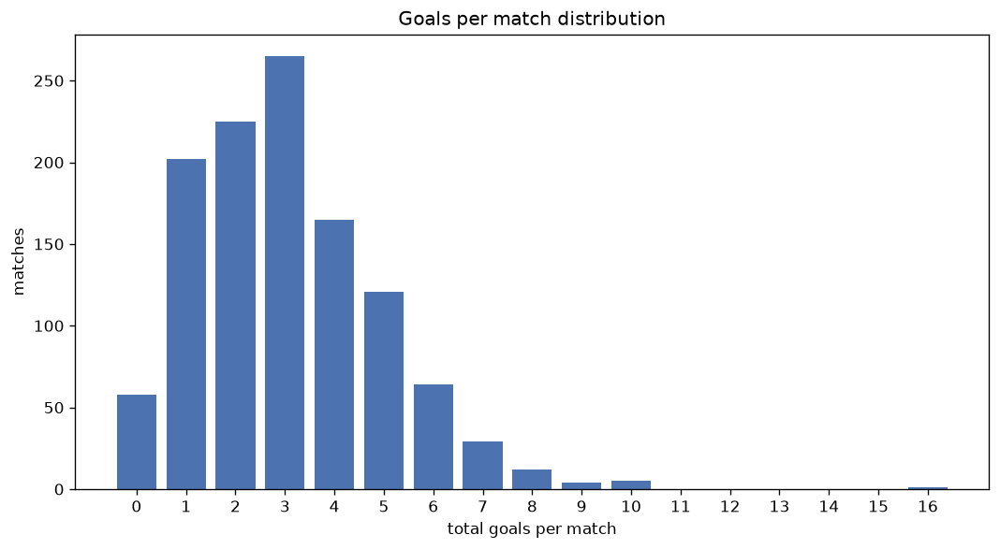
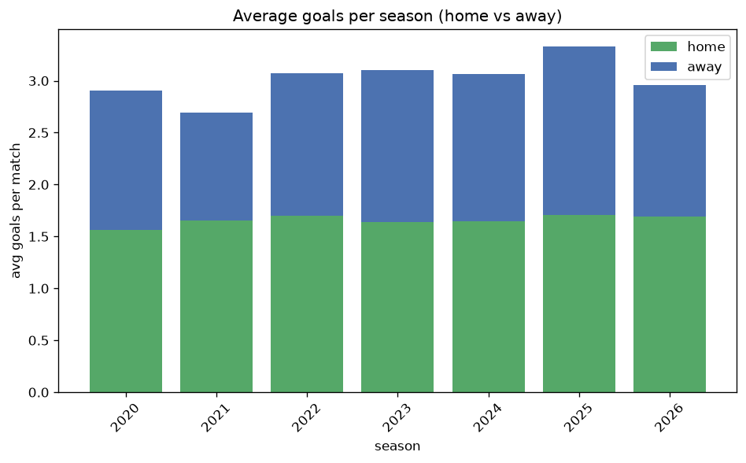

# Goal Analysis
- Report: `goals_analysis`
- Generated: 2026-10-26T01:53:31+00:00
- Script: `backend/scripts/analyze_goals.py` v1.0.0
- League: Allsvenskan Women (Sweden)
- Scope: league `wsweden`

## 1. Goals per match distribution
| goals | matches | pct |
|---|---|---|
| 0 | 58 | 5.0% |
| 1 | 202 | 17.5% |
| 2 | 225 | 19.5% |
| 3 | 265 | 23.0% |
| 4 | 165 | 14.3% |
| 5 | 121 | 10.5% |
| 6 | 64 | 5.6% |
| 7 | 29 | 2.5% |
| 8 | 12 | 1.0% |
| 9 | 4 | 0.3% |
| 10 | 5 | 0.4% |
| 11 | 0 | 0.0% |
| 12 | 0 | 0.0% |
| 13 | 0 | 0.0% |
| 14 | 0 | 0.0% |
| 15 | 0 | 0.0% |
| 16 | 1 | 0.1% |

## 2. Goals per match per season
| season | matches | total goals | avg home | avg away | avg total |
|---|---|---|---|---|---|
| 2020 | 132 | 383 | 1.561 | 1.341 | 2.902 |
| 2021 | 132 | 355 | 1.652 | 1.038 | 2.689 |
| 2022 | 182 | 559 | 1.698 | 1.374 | 3.071 |
| 2023 | 182 | 565 | 1.637 | 1.467 | 3.104 |
| 2024 | 182 | 558 | 1.648 | 1.418 | 3.066 |
| 2025 | 182 | 606 | 1.709 | 1.621 | 3.33 |
| 2026 | 159 | 471 | 1.692 | 1.27 | 2.962 |

## 3. Home vs away goal share
- Home goals: **1911** (54.6%)
- Away goals: **1586** (45.4%)
- Home/away ratio: **1.205**

| season | home goals | away goals | total | home pct | away pct |
|---|---|---|---|---|---|
| 2020 | 206 | 177 | 383 | 53.8% | 46.2% |
| 2021 | 218 | 137 | 355 | 61.4% | 38.6% |
| 2022 | 309 | 250 | 559 | 55.3% | 44.7% |
| 2023 | 298 | 267 | 565 | 52.7% | 47.3% |
| 2024 | 300 | 258 | 558 | 53.8% | 46.2% |
| 2025 | 311 | 295 | 606 | 51.3% | 48.7% |
| 2026 | 269 | 202 | 471 | 57.1% | 42.9% |

## 4. BTTS (Both Teams To Score)
- Overall: **541** of `1151` (47.0%)

| season | matches | BTTS | pct |
|---|---|---|---|
| 2020 | 132 | 61 | 46.2% |
| 2021 | 132 | 56 | 42.4% |
| 2022 | 182 | 87 | 47.8% |
| 2023 | 182 | 88 | 48.4% |
| 2024 | 182 | 78 | 42.9% |
| 2025 | 182 | 100 | 54.9% |
| 2026 | 159 | 71 | 44.7% |

## 5. Clean sheets
- Home clean sheets: **373** (32.4%)
- Away clean sheets: **295** (25.6%)
- Total clean sheets recorded: **668**
- Matches with at least one clean sheet: **610** (53.0%)
- Both teams kept clean sheets (0-0): **58**

| season | matches | home CS | away CS | total CS | matches w/ CS |
|---|---|---|---|---|---|
| 2020 | 132 | 41 | 35 | 76 | 71 (53.8%) |
| 2021 | 132 | 51 | 36 | 87 | 76 (57.6%) |
| 2022 | 182 | 60 | 42 | 102 | 95 (52.2%) |
| 2023 | 182 | 55 | 50 | 105 | 94 (51.6%) |
| 2024 | 182 | 66 | 54 | 120 | 104 (57.1%) |
| 2025 | 182 | 47 | 39 | 86 | 82 (45.1%) |
| 2026 | 159 | 53 | 39 | 92 | 88 (55.3%) |

## 6. Scoring intensity
- First-half goals: **1625** (46.5%)
- Second-half goals: **1872** (53.5%)
- Avg first-half goals per match: **1.412**
- Avg second-half goals per match: **1.626**
- Second-half-only scoring (HT 0-0, FT goals >= 1): **233** (20.2%)

| season | matches | 1st half | 2nd half | 1st half pct | 2nd half pct |
|---|---|---|---|---|---|
| 2020 | 132 | 171 | 212 | 44.6% | 55.4% |
| 2021 | 132 | 162 | 193 | 45.6% | 54.4% |
| 2022 | 182 | 269 | 290 | 48.1% | 51.9% |
| 2023 | 182 | 272 | 293 | 48.1% | 51.9% |
| 2024 | 182 | 251 | 307 | 45.0% | 55.0% |
| 2025 | 182 | 266 | 340 | 43.9% | 56.1% |
| 2026 | 159 | 234 | 237 | 49.7% | 50.3% |

## 7. First-goal timing
- Matches with first-goal time recorded: `1093` of `1151` (95.0%)
- Goalless matches: `58`
- Min `1` | Max `96` | Mean `28.36` | Median (p50) `22`

| bucket | count | % of matches | % of scoring matches |
|---|---|---|---|
| 1-15 | 413 | 35.9% | 37.8% |
| 16-30 | 272 | 23.6% | 24.9% |
| 31-45 | 163 | 14.2% | 14.9% |
| 46-60 | 127 | 11.0% | 11.6% |
| 61-75 | 73 | 6.3% | 6.7% |
| 76-90 | 35 | 3.0% | 3.2% |
| 91-120 | 10 | 0.9% | 0.9% |

---
*All statistics are computed from PostgreSQL tables (read-only). Run with `python backend/scripts/analyze_goals.py` to regenerate.*

## Charts

