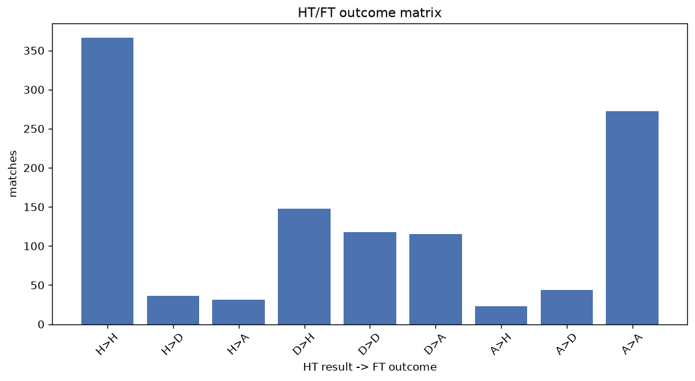
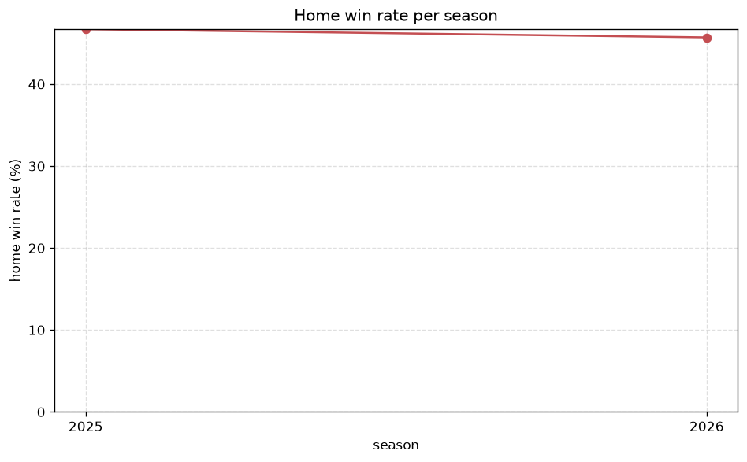

# Match Analysis
- Report: `matches_analysis`
- Generated: 2026-10-27T02:35:35+00:00
- Script: `backend/scripts/analyze_matches.py` v1.0.0
- League: Allsvenskan Women (Sweden)
- Scope: league `wsweden`

## 1. Overall summary
| metric | value |
|---|---|
| Matches | 1153 |
| Home wins | 537 (46.6%) |
| Draws | 198 (17.2%) |
| Away wins | 418 (36.3%) |
| Total goals | 3501 |
| Average goals per match | 3.036 |
| Goalless matches | 58 (5.0%) |

## 2. Per-season breakdown
| season | matches | home wins | draws | away wins | total goals | avg goals | goalless |
|---|---|---|---|---|---|---|---|
| 2020 | 132 | 60 (45.5%) | 22 (16.7%) | 50 (37.9%) | 383 | 2.902 | 5 (3.8%) |
| 2021 | 132 | 65 (49.2%) | 30 (22.7%) | 37 (28.0%) | 355 | 2.689 | 11 (8.3%) |
| 2022 | 182 | 87 (47.8%) | 24 (13.2%) | 71 (39.0%) | 559 | 3.071 | 7 (3.8%) |
| 2023 | 182 | 81 (44.5%) | 38 (20.9%) | 63 (34.6%) | 565 | 3.104 | 11 (6.0%) |
| 2024 | 182 | 81 (44.5%) | 31 (17.0%) | 70 (38.5%) | 558 | 3.066 | 16 (8.8%) |
| 2025 | 182 | 85 (46.7%) | 25 (13.7%) | 72 (39.6%) | 606 | 3.33 | 4 (2.2%) |
| 2026 | 161 | 78 (48.4%) | 28 (17.4%) | 55 (34.2%) | 475 | 2.95 | 4 (2.5%) |

## 3. HT/FT outcome matrix
| HT result \ FT result | Home | Draw | Away | total |
|---|---|---|---|---|
| HT home lead | 366 (84.5%) | 36 (8.3%) | 31 (7.2%) | 433 |
| HT draw | 148 (38.8%) | 118 (31.0%) | 115 (30.2%) | 381 |
| HT away lead | 23 (6.8%) | 44 (13.0%) | 272 (80.2%) | 339 |

## 4. Comeback matches
- Home comebacks (trailing at HT, won at FT): **23** (2.0%)
- Away comebacks (trailing at HT, won at FT): **31** (2.7%)

### Home comebacks
| season | home | away | HT | FT |
|---|---|---|---|---|
| 2020 | Uppsala W | Djurgarden W | 1-2 | 3-2 |
| 2020 | Umea W | Linkoping W | 0-1 | 3-2 |
| 2021 | Kristianstad W | Djurgarden W | 0-1 | 2-1 |
| 2021 | Eskilstuna Utd W | Vaxjo DFF W | 0-1 | 2-1 |
| 2022 | Vittsjo W | Pitea W | 0-1 | 2-1 |
| 2022 | Linkoping W | Eskilstuna Utd W | 1-2 | 5-2 |
| 2022 | Rosengard W | Vittsjo W | 1-2 | 3-2 |
| 2023 | Linkoping W | Kalmar W | 0-1 | 2-1 |
| 2023 | Pitea W | Kalmar W | 0-1 | 2-1 |
| 2023 | Hacken W | KIF Orebro W | 0-1 | 2-1 |
| 2023 | Rosengard W | IF Brommapojkarna W | 0-1 | 3-1 |
| 2024 | Pitea W | Vaxjo DFF W | 1-2 | 3-2 |
| 2024 | IF Brommapojkarna W | Vaxjo DFF W | 0-2 | 3-2 |
| 2024 | Djurgarden W | Vittsjo W | 0-1 | 2-1 |
| 2024 | AIK W | Vaxjo DFF W | 0-1 | 2-1 |
| 2025 | Djurgarden W | Kristianstad W | 0-1 | 2-1 |
| 2025 | Pitea W | Alingsas W | 0-1 | 2-1 |
| 2025 | Hammarby W | Vittsjo W | 0-1 | 3-2 |
| 2025 | Kristianstad W | Linkoping W | 0-1 | 3-1 |
| 2025 | Alingsas W | IF Brommapojkarna W | 1-2 | 3-2 |
| 2025 | Djurgarden W | Alingsas W | 0-1 | 5-1 |
| 2026 | Vaxjo DFF W | IF Brommapojkarna W | 0-1 | 2-1 |
| 2026 | Djurgarden W | AIK W | 0-1 | 2-1 |

### Away comebacks
| season | home | away | HT | FT |
|---|---|---|---|---|
| 2020 | Vittsjo W | Linkoping W | 1-0 | 1-2 |
| 2020 | KIF Orebro W | Vittsjo W | 1-0 | 1-2 |
| 2020 | Kristianstad W | Linkoping W | 1-0 | 1-2 |
| 2021 | Djurgarden W | AIK W | 1-0 | 1-2 |
| 2021 | Djurgarden W | Hacken W | 1-0 | 1-4 |
| 2022 | Kalmar W | Hammarby W | 1-0 | 1-5 |
| 2022 | Vittsjo W | Linkoping W | 1-0 | 1-2 |
| 2022 | Djurgarden W | Hacken W | 1-0 | 1-3 |
| 2023 | Vaxjo DFF W | Norrkoping W | 2-1 | 2-3 |
| 2023 | Kalmar W | Kristianstad W | 2-1 | 2-3 |
| 2023 | Uppsala W | Vaxjo DFF W | 1-0 | 1-2 |
| 2024 | Pitea W | Kristianstad W | 1-0 | 1-2 |
| 2024 | IF Brommapojkarna W | Kristianstad W | 1-0 | 1-3 |
| 2024 | Djurgarden W | IF Brommapojkarna W | 2-0 | 2-3 |
| 2024 | AIK W | Vittsjo W | 2-1 | 2-3 |
| 2024 | Trelleborg W | KIF Orebro W | 2-1 | 2-3 |
| 2024 | Rosengard W | Hammarby W | 2-1 | 2-3 |
| 2024 | Norrkoping W | AIK W | 1-0 | 2-3 |
| 2024 | KIF Orebro W | Vaxjo DFF W | 1-0 | 1-2 |
| 2025 | Vaxjo DFF W | Kristianstad W | 2-1 | 2-3 |
| 2025 | Hacken W | Norrkoping W | 1-0 | 1-3 |
| 2025 | IF Brommapojkarna W | Djurgarden W | 1-0 | 1-2 |
| 2025 | Rosengard W | AIK W | 1-0 | 1-2 |
| 2025 | Pitea W | IF Brommapojkarna W | 1-0 | 1-2 |
| 2025 | Vittsjo W | Kristianstad W | 1-0 | 1-2 |
| 2025 | AIK W | Vittsjo W | 1-0 | 1-2 |
| 2025 | AIK W | Norrkoping W | 1-0 | 1-2 |
| 2026 | Rosengard W | AIK W | 1-0 | 1-2 |
| 2026 | Pitea W | IF Brommapojkarna W | 1-0 | 1-2 |
| 2026 | IF Brommapojkarna W | Vittsjo W | 1-0 | 1-2 |
| 2026 | AIK W | Vittsjo W | 1-0 | 1-2 |

## 5. HT lead conversion
| HT state | matches | converted to win | held as draw | collapsed to loss |
|---|---|---|---|---|
| Home lead | 433 | 366 (84.5%) | 36 (8.3%) | 31 (7.2%) |
| Away lead | 339 | 272 (80.2%) | 44 (13.0%) | 23 (6.8%) |

### Matches level at half-time
| FT result | count | pct |
|---|---|---|
| Home win | 148 | 38.8% |
| Draw | 118 | 31.0% |
| Away win | 115 | 30.2% |

## 6. First-goal timing
- Matches with a first-goal time recorded: `1095` of `1153` (95.0%)

Outcome distribution by first-goal timing bucket:
| bucket | matches | % of matches | home | draw | away |
|---|---|---|---|---|---|
| 1-15 | 414 | 35.9% | 213 (51.4%) | 50 (12.1%) | 151 (36.5%) |
| 16-30 | 273 | 23.7% | 137 (50.2%) | 37 (13.6%) | 99 (36.3%) |
| 31-45 | 163 | 14.1% | 70 (42.9%) | 27 (16.6%) | 66 (40.5%) |
| 46-60 | 127 | 11.0% | 62 (48.8%) | 14 (11.0%) | 51 (40.2%) |
| 61-75 | 73 | 6.3% | 32 (43.8%) | 9 (12.3%) | 32 (43.8%) |
| 76-90 | 35 | 3.0% | 19 (54.3%) | 3 (8.6%) | 13 (37.1%) |
| 91-120 | 10 | 0.9% | 4 (40.0%) | 0 (0.0%) | 6 (60.0%) |

## 7. Goalless matches
- Overall: **58** of `1153` (5.0%)

| season | matches | goalless | pct |
|---|---|---|---|
| 2020 | 132 | 5 | 3.8% |
| 2021 | 132 | 11 | 8.3% |
| 2022 | 182 | 7 | 3.8% |
| 2023 | 182 | 11 | 6.0% |
| 2024 | 182 | 16 | 8.8% |
| 2025 | 182 | 4 | 2.2% |
| 2026 | 161 | 4 | 2.5% |

---
*All statistics are computed from PostgreSQL tables (read-only). Run with `python backend/scripts/analyze_matches.py` to regenerate.*

## Charts

