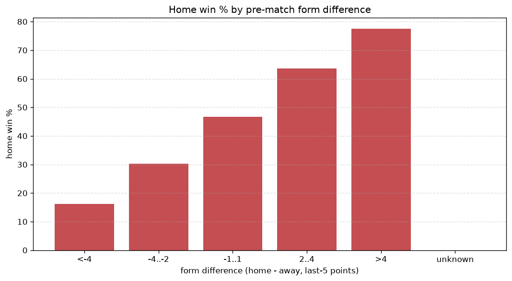
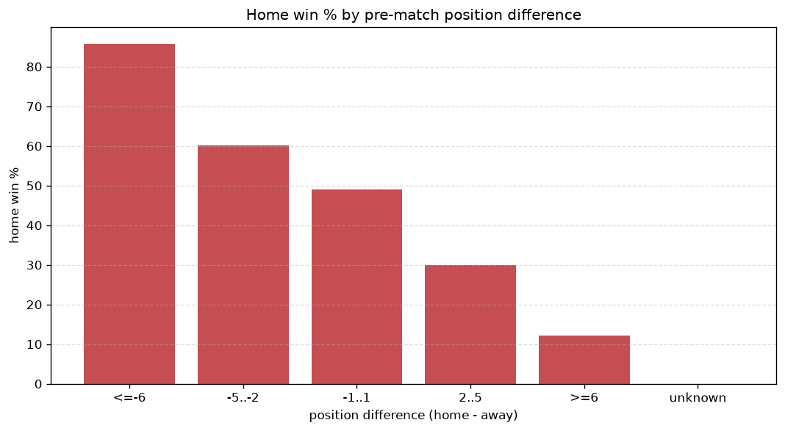

# Relationships Analysis
- Report: `relationships`
- Generated: 2026-10-26T01:53:39+00:00
- Script: `backend/scripts/analyze_relationships.py` v1.0.0
- League: Allsvenskan Women (Sweden)
- Scope: league `wsweden`

- Matches analysed: **992** (23 leakage-safe pre-match features).

## 1. Correlation matrix
_Pearson correlation of each pre-match feature with observed goals; sorted by |corr(total goals)|._

| feature | corr(home) | corr(away) | corr(total) |
|---|---|---|---|
| home_team_goals_scored_last_5 | 0.261 | -0.162 | 0.090 |
| home_points_before_match | 0.233 | -0.136 | 0.087 |
| position_difference | -0.487 | 0.408 | -0.086 |
| away_team_away_conceded_avg | 0.264 | -0.176 | 0.082 |
| home_team_home_goals_avg | 0.249 | -0.163 | 0.080 |
| away_team_goals_conceded_last_5 | 0.278 | -0.195 | 0.078 |
| points_difference | 0.487 | -0.418 | 0.078 |
| away_position_before_match | 0.351 | -0.289 | 0.066 |
| rest_days_difference | 0.031 | 0.040 | 0.057 |
| home_position_before_match | -0.320 | 0.274 | -0.052 |
| away_team_points_last_5 | -0.304 | 0.269 | -0.043 |
| away_team_wins_last_5 | -0.307 | 0.274 | -0.042 |
| home_team_home_win_rate | 0.209 | -0.175 | 0.037 |
| away_rest_days | -0.029 | -0.011 | -0.032 |
| away_team_away_win_rate | -0.289 | 0.270 | -0.030 |
| home_team_goals_conceded_last_5 | -0.217 | 0.266 | 0.027 |
| home_team_points_last_5 | 0.228 | -0.213 | 0.024 |
| home_team_wins_last_5 | 0.222 | -0.206 | 0.024 |
| away_team_goals_scored_last_5 | -0.279 | 0.281 | -0.012 |
| away_points_before_match | -0.236 | 0.266 | 0.012 |
| home_team_home_conceded_avg | -0.185 | 0.208 | 0.009 |
| away_team_away_goals_avg | -0.253 | 0.281 | 0.009 |
| home_rest_days | -0.007 | 0.018 | 0.008 |

## 2. Form vs outcome
_Home win/draw/away % per bucket of `home_team_points_last_5 - away_team_points_last_5`._

| bucket | matches | home | draw | away | home % | draw % | away % |
|---|---|---|---|---|---|---|---|
| <-4 | 198 | 32 | 35 | 131 | 16.2% | 17.7% | 66.2% |
| -4..-2 | 188 | 57 | 42 | 89 | 30.3% | 22.3% | 47.3% |
| -1..1 | 246 | 115 | 47 | 84 | 46.7% | 19.1% | 34.1% |
| 2..4 | 173 | 110 | 28 | 35 | 63.6% | 16.2% | 20.2% |
| >4 | 187 | 145 | 18 | 24 | 77.5% | 9.6% | 12.8% |
| unknown | 0 | 0 | 0 | 0 | - | - | - |

## 3. Position vs outcome
_Home win/draw/away % per bucket of `position_difference` (home position - away position; negative favours the home team)._

| bucket | matches | home | draw | away | home % | draw % | away % |
|---|---|---|---|---|---|---|---|
| <=-6 | 147 | 126 | 11 | 10 | 85.7% | 7.5% | 6.8% |
| -5..-2 | 236 | 142 | 42 | 52 | 60.2% | 17.8% | 22.0% |
| -1..1 | 198 | 97 | 35 | 66 | 49.0% | 17.7% | 33.3% |
| 2..5 | 247 | 74 | 54 | 119 | 30.0% | 21.9% | 48.2% |
| >=6 | 164 | 20 | 28 | 116 | 12.2% | 17.1% | 70.7% |
| unknown | 0 | 0 | 0 | 0 | - | - | - |

## 4. Rest advantage
_Home win/draw/away % per bucket of `rest_days_difference` (home rest - away rest). Matches with unknown rest are bucketed separately._

| bucket | matches | home | draw | away | home % | draw % | away % |
|---|---|---|---|---|---|---|---|
| <-1 | 98 | 42 | 21 | 35 | 42.9% | 21.4% | 35.7% |
| -1..0 | 196 | 97 | 33 | 66 | 49.5% | 16.8% | 33.7% |
| 0 | 382 | 178 | 58 | 146 | 46.6% | 15.2% | 38.2% |
| 1..2 | 237 | 101 | 44 | 92 | 42.6% | 18.6% | 38.8% |
| >2 | 39 | 20 | 5 | 14 | 51.3% | 12.8% | 35.9% |
| unknown | 40 | 21 | 9 | 10 | 52.5% | 22.5% | 25.0% |
- *40 match(es) had unknown rest difference (missing rest data on at least one side).*

## 5. Home team quality
_Home win rate by `home_team_home_win_rate` tier (split at 0.5)._

- `< 0.5` tier: **36.8%** home win (180/489)
- `>= 0.5` tier: **55.5%** home win (279/503)
- Home-win gap (>= split minus < split): **+18.7 pp**

| tier | label | matches | home | draw | away | home % |
|---|---|---|---|---|---|---|
| low | < 0.5 | 489 | 180 | 92 | 217 | 36.8% |
| high | >= 0.5 | 503 | 279 | 78 | 146 | 55.5% |

## 6. Feature averages by result
_Mean feature value per outcome; `range` is home-minus-away spread of the group means._

| feature | home mean | draw mean | away mean | range |
|---|---|---|---|---|
| points_difference | 6.423 | -1.941 | -7.686 | 14.109 |
| away_points_before_match | 12.954 | 17.071 | 22.055 | 9.101 |
| position_difference | -2.505 | 1.059 | 3.165 | 5.671 |
| home_points_before_match | 19.377 | 15.129 | 14.369 | 5.008 |
| away_team_goals_scored_last_5 | 5.316 | 6.753 | 8.259 | 2.943 |
| away_team_points_last_5 | 4.941 | 6.676 | 7.832 | 2.891 |
| home_position_before_match | 6.105 | 7.612 | 8.959 | 2.854 |
| away_position_before_match | 8.610 | 6.553 | 5.793 | 2.817 |
| home_team_goals_conceded_last_5 | 5.368 | 6.776 | 8.110 | 2.742 |
| home_team_points_last_5 | 7.227 | 5.688 | 4.882 | 2.345 |
| home_team_goals_scored_last_5 | 7.673 | 5.782 | 5.350 | 2.323 |
| away_team_goals_conceded_last_5 | 7.582 | 6.188 | 5.347 | 2.235 |
| away_team_wins_last_5 | 1.379 | 1.959 | 2.358 | 0.979 |
| home_team_wins_last_5 | 2.139 | 1.653 | 1.369 | 0.770 |
| home_rest_days | 8.441 | 8.919 | 9.059 | 0.619 |
| away_team_away_goals_avg | 0.952 | 1.219 | 1.537 | 0.585 |
| away_rest_days | 8.539 | 9.037 | 9.088 | 0.549 |
| home_team_home_goals_avg | 1.733 | 1.343 | 1.277 | 0.456 |
| away_team_away_conceded_avg | 1.728 | 1.360 | 1.298 | 0.431 |
| home_team_home_conceded_avg | 1.024 | 1.239 | 1.426 | 0.402 |
| away_team_away_win_rate | 0.215 | 0.327 | 0.413 | 0.197 |
| home_team_home_win_rate | 0.514 | 0.402 | 0.378 | 0.137 |
| rest_days_difference | -0.098 | -0.118 | -0.028 | 0.090 |

---
*All features are leakage-safe pre-match values built by `ml.features.build_features.build_rows` from strictly prior matches. Run with `python backend/scripts/analyze_relationships.py` to regenerate.*

## Charts

