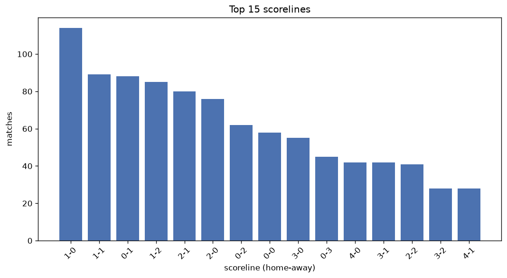
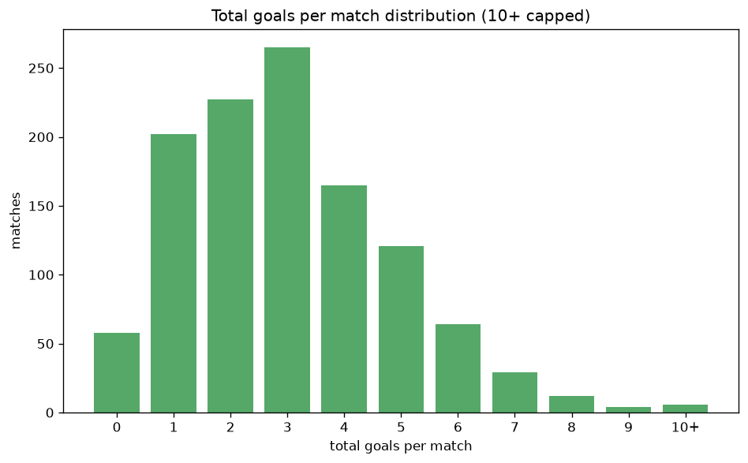

# Scoreline Analysis
- Report: `scoreline_analysis`
- Generated: 2026-10-27T02:35:43+00:00
- Script: `backend/scripts/analyze_scorelines.py` v1.0.0
- League: Allsvenskan Women (Sweden)
- Scope: league `wsweden`

## 1. Scoreline frequency
- Matches analysed: **1153** across **7** seasons.
- Distinct scorelines seen: **49**.

| scoreline | count | pct |
|---|---|---|
| 1-0 | 114 | 9.9% |
| 1-1 | 89 | 7.7% |
| 0-1 | 88 | 7.6% |
| 1-2 | 85 | 7.4% |
| 2-1 | 80 | 6.9% |
| 2-0 | 76 | 6.6% |
| 0-2 | 62 | 5.4% |
| 0-0 | 58 | 5.0% |
| 3-0 | 55 | 4.8% |
| 0-3 | 45 | 3.9% |
| 4-0 | 42 | 3.6% |
| 3-1 | 42 | 3.6% |
| 2-2 | 41 | 3.6% |
| 3-2 | 28 | 2.4% |
| 4-1 | 28 | 2.4% |
| 2-3 | 24 | 2.1% |
| 1-3 | 23 | 2.0% |
| 1-4 | 20 | 1.7% |
| 0-4 | 17 | 1.5% |
| 5-1 | 11 | 1.0% |

## 2. Scoreline frequency per season

### 2020
| scoreline | count | pct |
|---|---|---|
| 0-1 | 14 | 10.6% |
| 1-0 | 13 | 9.8% |
| 1-1 | 11 | 8.3% |
| 1-2 | 11 | 8.3% |
| 3-0 | 10 | 7.6% |

### 2021
| scoreline | count | pct |
|---|---|---|
| 1-0 | 18 | 13.6% |
| 1-1 | 14 | 10.6% |
| 0-1 | 11 | 8.3% |
| 0-0 | 11 | 8.3% |
| 0-2 | 9 | 6.8% |

### 2022
| scoreline | count | pct |
|---|---|---|
| 1-0 | 19 | 10.4% |
| 1-2 | 18 | 9.9% |
| 2-0 | 15 | 8.2% |
| 0-1 | 14 | 7.7% |
| 1-1 | 12 | 6.6% |

### 2023
| scoreline | count | pct |
|---|---|---|
| 1-0 | 19 | 10.4% |
| 1-1 | 18 | 9.9% |
| 2-1 | 15 | 8.2% |
| 0-2 | 13 | 7.1% |
| 0-1 | 11 | 6.0% |

### 2024
| scoreline | count | pct |
|---|---|---|
| 0-0 | 16 | 8.8% |
| 1-0 | 15 | 8.2% |
| 2-0 | 13 | 7.1% |
| 0-1 | 13 | 7.1% |
| 0-2 | 13 | 7.1% |

### 2025
| scoreline | count | pct |
|---|---|---|
| 2-1 | 19 | 10.4% |
| 1-2 | 17 | 9.3% |
| 1-0 | 16 | 8.8% |
| 2-0 | 13 | 7.1% |
| 1-1 | 10 | 5.5% |

### 2026
| scoreline | count | pct |
|---|---|---|
| 1-1 | 16 | 9.9% |
| 0-1 | 15 | 9.3% |
| 1-0 | 14 | 8.7% |
| 3-0 | 14 | 8.7% |
| 2-1 | 13 | 8.1% |

## 3. Total-goal histogram
_10+ groups all matches with 10 or more total goals._

| total goals | matches | pct |
|---|---|---|
| 0 | 58 | 5.0% |
| 1 | 202 | 17.5% |
| 2 | 227 | 19.7% |
| 3 | 265 | 23.0% |
| 4 | 165 | 14.3% |
| 5 | 121 | 10.5% |
| 6 | 64 | 5.6% |
| 7 | 29 | 2.5% |
| 8 | 12 | 1.0% |
| 9 | 4 | 0.3% |
| 10+ | 6 | 0.5% |

## 4. Extreme scorelines
- Matches with 7+ total goals: **51**

| season | date | scoreline | total goals |
|---|---|---|---|
| 2023 | 2023-11-05 | 1-15 | 16 |
| 2020 | 2020-08-07 | 1-9 | 10 |
| 2021 | 2021-06-20 | 10-0 | 10 |
| 2021 | 2021-11-06 | 8-2 | 10 |
| 2023 | 2023-11-11 | 10-0 | 10 |
| 2024 | 2024-06-26 | 1-9 | 10 |
| 2024 | 2024-06-30 | 8-1 | 9 |
| 2024 | 2024-10-12 | 8-1 | 9 |
| 2025 | 2025-10-11 | 6-3 | 9 |
| 2026 | 2026-10-04 | 9-0 | 9 |
| 2020 | 2020-08-12 | 7-1 | 8 |
| 2021 | 2021-07-02 | 6-2 | 8 |
| 2022 | 2022-09-10 | 2-6 | 8 |
| 2022 | 2022-09-16 | 6-2 | 8 |
| 2022 | 2022-10-31 | 7-1 | 8 |
| 2023 | 2023-05-04 | 8-0 | 8 |
| 2023 | 2023-06-04 | 7-1 | 8 |
| 2023 | 2023-10-15 | 6-2 | 8 |
| 2024 | 2024-06-27 | 5-3 | 8 |
| 2024 | 2024-08-26 | 0-8 | 8 |
| 2025 | 2025-11-16 | 7-1 | 8 |
| 2026 | 2026-08-08 | 8-0 | 8 |
| 2020 | 2020-11-07 | 0-7 | 7 |
| 2021 | 2021-05-13 | 4-3 | 7 |
| 2021 | 2021-05-29 | 0-7 | 7 |
| 2021 | 2021-06-27 | 6-1 | 7 |
| 2022 | 2022-04-15 | 2-5 | 7 |
| 2022 | 2022-06-03 | 3-4 | 7 |
| 2022 | 2022-06-12 | 5-2 | 7 |
| 2022 | 2022-06-19 | 7-0 | 7 |
| 2022 | 2022-09-11 | 5-2 | 7 |
| 2023 | 2023-04-15 | 6-1 | 7 |
| 2023 | 2023-06-19 | 5-2 | 7 |
| 2023 | 2023-06-30 | 1-6 | 7 |
| 2023 | 2023-08-26 | 2-5 | 7 |
| 2023 | 2023-09-17 | 5-2 | 7 |
| 2023 | 2023-10-22 | 7-0 | 7 |
| 2024 | 2024-04-13 | 4-3 | 7 |
| 2024 | 2024-05-05 | 1-6 | 7 |
| 2024 | 2024-06-12 | 0-7 | 7 |
| 2024 | 2024-06-16 | 0-7 | 7 |
| 2024 | 2024-07-05 | 7-0 | 7 |
| 2024 | 2024-09-17 | 5-2 | 7 |
| 2024 | 2024-10-19 | 7-0 | 7 |
| 2025 | 2025-05-11 | 6-1 | 7 |
| 2025 | 2025-05-16 | 6-1 | 7 |
| 2025 | 2025-08-08 | 7-0 | 7 |
| 2025 | 2025-08-23 | 2-5 | 7 |
| 2025 | 2025-09-27 | 2-5 | 7 |
| 2025 | 2025-09-28 | 2-5 | 7 |
| 2025 | 2025-09-28 | 0-7 | 7 |

## 5. Margin-of-victory distribution (decided matches)
- Decided matches: **955** (draws: **198**)
- Average winning margin: **2.21**

| margin | matches | pct |
|---|---|---|
| 1 | 422 | 44.2% |
| 2 | 220 | 23.0% |
| 3+ | 313 | 32.8% |

## 6. Margin by outcome

### Home wins
- Matches: **537** | avg margin: **2.27** | max margin: **10**
| margin | matches | pct |
|---|---|---|
| 1 | 224 | 41.7% |
| 2 | 128 | 23.8% |
| 3+ | 185 | 34.5% |
- *Full match-by-match list available in `scoreline_analysis.json`.*

### Away wins
- Matches: **418** | avg margin: **2.14** | max margin: **14**
| margin | matches | pct |
|---|---|---|
| 1 | 198 | 47.4% |
| 2 | 92 | 22.0% |
| 3+ | 128 | 30.6% |
- *Full match-by-match list available in `scoreline_analysis.json`.*

## 7. Most common exact score by outcome type
| outcome | matches | most common score | count | pct |
|---|---|---|---|---|
| home | 537 | 1-0 | 114 | 21.2% |
| draw | 198 | 1-1 | 89 | 44.9% |
| away | 418 | 0-1 | 88 | 21.1% |

---
*All statistics are computed from PostgreSQL tables (read-only). Run with `python backend/scripts/analyze_scorelines.py` to regenerate.*

## Charts

