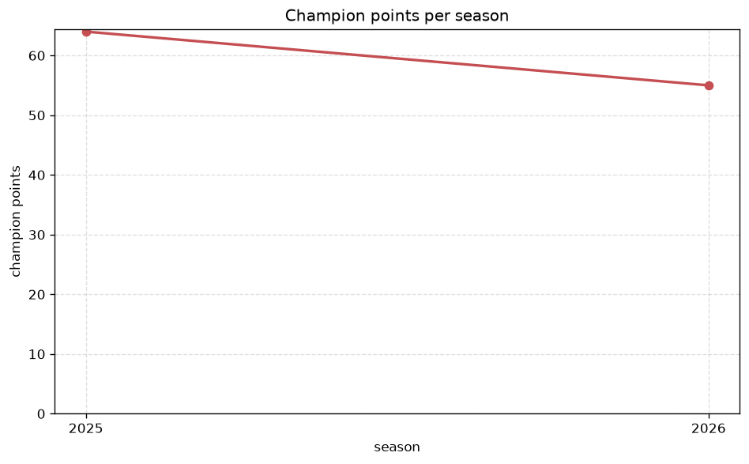
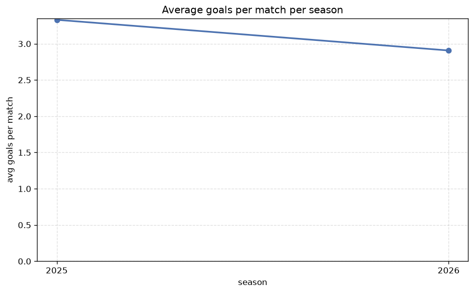

# Season Trends Analysis
- Report: `season_trends`
- Generated: 2026-10-29T02:20:13+00:00
- Script: `backend/scripts/analyze_seasons.py` v1.0.0
- League: Allsvenskan Women (Sweden)
- Scope: league `wsweden`

## 1. Champions per season
| season | champion | pts | runner-up | margin |
|---|---|---|---|---|
| 2020 | Goteborg W | 54 | Rosengard W | 7 pts |
| 2021 | Rosengard W | 57 | Hacken W | 10 pts |
| 2022 | Rosengard W | 66 | Hacken W | 7 pts |
| 2023 | Hammarby W | 59 | Hacken W | 0 pts |
| 2024 | Rosengard W | 75 | Hacken W | 11 pts |
| 2025 | Hacken W | 64 | Hammarby W | 4 pts |
| 2026 | Hacken W | 64 | Hammarby W | 8 pts |

## 2. Title-race tightness
- Tight races (margin <= 3 pts): **1** of 7 seasons
- Tightest race: **2023** - Hammarby W beat Hacken W by **0** pts

| season | margin | tight |
|---|---|---|
| 2020 | 7 pts |  |
| 2021 | 10 pts |  |
| 2022 | 7 pts |  |
| 2023 | 0 pts | yes |
| 2024 | 11 pts |  |
| 2025 | 4 pts |  |
| 2026 | 8 pts |  |

## 3. Points thresholds
_Position-specific points per season. Key: 1 = champion, 2 = runner-up, 4 = CL line, 6 = Europa, 11 = last safe, 14 = bottom._

| season | pos 1 | pos 2 | pos 4 | pos 6 | pos 11 | pos 14 |
|---|---|---|---|---|---|---|
| 2020 | 54 | 47 | 39 | 27 | 23 | - |
| 2021 | 57 | 47 | 35 | 31 | 16 | - |
| 2022 | 66 | 59 | 52 | 45 | 19 | 8 |
| 2023 | 59 | 59 | 52 | 48 | 24 | 3 |
| 2024 | 75 | 64 | 52 | 33 | 27 | 3 |
| 2025 | 64 | 60 | 50 | 41 | 25 | 9 |
| 2026 | 64 | 56 | 37 | 32 | 23 | 6 |

## 4. Relegation battle
| season | safe pos | safe pts | drop pos | drop pts | gap |
|---|---|---|---|---|---|
| 2020 | 11 | 23 | 12 | 10 | 13 pts |
| 2021 | 11 | 16 | 12 | 11 | 5 pts |
| 2022 | 11 | 19 | 12 | 12 | 7 pts |
| 2023 | 11 | 24 | 12 | 20 | 4 pts |
| 2024 | 11 | 27 | 12 | 26 | 1 pts |
| 2025 | 11 | 25 | 12 | 23 | 2 pts |
| 2026 | 11 | 23 | 12 | 23 | 0 pts |

## 5. League-level trends
| season | matches | total goals | avg goals | home win | draw | away win | goalless | avg pts/team |
|---|---|---|---|---|---|---|---|---|
| 2020 | 132 | 383 | 2.902 | 45.5% | 16.7% | 37.9% | 3.8% | 31.17 |
| 2021 | 132 | 355 | 2.689 | 49.2% | 22.7% | 28.0% | 8.3% | 30.5 |
| 2022 | 182 | 559 | 3.071 | 47.8% | 13.2% | 39.0% | 3.8% | 37.29 |
| 2023 | 182 | 565 | 3.104 | 44.5% | 20.9% | 34.6% | 6.0% | 36.29 |
| 2024 | 182 | 558 | 3.066 | 44.5% | 17.0% | 38.5% | 8.8% | 36.79 |
| 2025 | 182 | 606 | 3.33 | 46.7% | 13.7% | 39.6% | 2.2% | 37.21 |
| 2026 | 161 | 475 | 2.95 | 48.4% | 17.4% | 34.2% | 2.5% | 32.5 |

## 6. View divergence
- Largest divergence: **2023** (goals view, avg abs position diff = 5.429)

_Avg absolute position difference between classic view and alternative view per season._

| season | classic vs luck | classic vs goals |
|---|---|---|
| 2020 | 2.333 | 3.167 |
| 2021 | 3.000 | 3.333 |
| 2022 | 2.000 | 4.571 |
| 2023 | 2.571 | 5.429 |
| 2024 | 2.143 | 4.286 |
| 2025 | 2.714 | 5.000 |
| 2026 | 2.429 | 4.571 |

---
*All statistics are computed from PostgreSQL tables (read-only). Run with `python backend/scripts/analyze_seasons.py` to regenerate.*

## Charts

